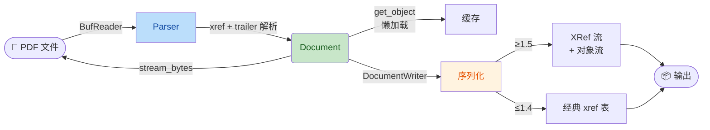

# pdf_engine — Rust PDF 解析/生成库

一个纯 Rust 实现的 PDF 1.x 文件解析与生成库。版本中立的类型系统、宽进严出的读写策略，支持 XRef 流 / 对象流 / FlateDecode / LZWDecode / CCITTFaxDecode / PNG Up Predictor。

## 模块架构



| 模块 | 职责 |
|------|------|
| `types` | 纯数据类型：`PdfVersion` / `PdfFeature` 能力模型、`Document` / `Object` / `Dict` / `Value` / `Xref` / `Trailer` |
| `reader` | 文件解析：`Parser::parse_document` 窗口式懒加载、xref 策略链（经典表 → XRef 流 → 全文扫描）、对象流解包 |
| `writer` | 序列化：`DocumentWriter::build` 按目标版本选择策略（XRef 流 / 经典表）、结构性特性自动降级 |
| `builder` | 逻辑构建层：`PdfBuilder` 把 Page / Text / Image 翻译为底层对象 |
| `filters` | 流解码：`StreamFilter` 可扩展接口；`FlateDecode`（zlib）、`LZWDecode`（`/EarlyChange`）、`CCITTFaxDecode`（Group 3/4）、`ASCIIHex` / `ASCII85` / `RunLength`、PNG Up / TIFF Predictor |

> 核心模块均已按职责拆分目录：`types/{mod,version,features,value,document,tests}.rs`、
> `reader/{mod,lexer,object,parser,document,xref,tests}.rs`、
> `writer/{mod,value,version,serialize,context,document_writer,tests}.rs`、
> `filters/{mod,ascii,flate,lzw,predictor,tests}.rs`、`ccitt/{mod,decoder,tables,tests}.rs`、
> `content/{mod,types,serialize,stream,tests}.rs`；根文件只保留公共接口与编排。

## 快速上手

### 依赖

```toml
[dependencies]
pdf_engine = { path = "." }
```

仅启用 `flate2` 的 `rust_backend`（纯 Rust miniz_oxide，无 C 依赖）。

### CLI

```bash
cargo run -- parse input.pdf              # 解析并打印概要
cargo run -- gen output.pdf --version 1.3 # 生成最小 PDF（可选版本）
```

### 代码示例 1：解析 + 取对象

```rust
use pdf_engine::core::reader::Parser;

let file = std::fs::File::open("input.pdf")?;
let mut parser = Parser::new(file)?;
let doc = parser.parse_document()?;

println!("declared version: {}", doc.source_version());
// 懒加载：打开只解文件级结构；对象按需触发解析
if let Some((root_num, _)) = doc.trailer().root() {
    let catalog = doc.get_object(root_num)?.expect("root present");
    println!("root: {}", catalog.value.type_name());
}
```

### 代码示例 2：生成 PDF

```rust
use pdf_engine::core::builder::{Font, PageSize, PdfBuilder};
use pdf_engine::core::types::PdfVersion;

let mut builder = PdfBuilder::with_version(PdfVersion::V1_4);
let page = builder.page(PageSize::A4);
builder.text(page, &Font::helvetica(24.0), 72.0, 720.0, "Hello, PDF!");

let mut out = Vec::new();
builder.build(&mut out)?;
std::fs::write("output.pdf", out)?;
```

### 代码示例 3：版本转换（结构性特性自动降级）

读一个 PDF 1.5 文件（XRef 流 + 对象流），以 1.3 写出——结构性特性自动降级为经典 xref 表 + 顶层对象。

```rust
use pdf_engine::core::reader::Parser;
use pdf_engine::core::types::PdfVersion;
use pdf_engine::core::writer::DocumentWriter;

let file = std::fs::File::open("input-1.5.pdf")?;
let doc = Parser::new(file)?.parse_document()?;

let mut out = Vec::new();
DocumentWriter::new()
    .with_version(PdfVersion::V1_3)
    .build(&doc, &mut out)?;

// 回读：1.3 头、经典 xref 表、所有对象顶层可见
std::fs::write("converted.pdf", &out)?;
let file2 = std::fs::File::open("converted.pdf")?;
let doc2 = Parser::new(file2)?.parse_document()?;
assert_eq!(doc2.source_version(), PdfVersion::V1_3);
```

## 核心设计

### 版本中立类型系统

`Document::source_version` 记录源文件声明版本（只读元数据），与 writer 目标版本完全解耦。写端默认 1.7，由 `DocumentWriter::with_version` 显式指定，不受源文件影响。

### 过滤器接口与第三方隔离

`core::filters::StreamFilter` 是 PDF 过滤器的统一解码接口：`decode_stream` 按 `/Filter` 规范名调度 `builtin_filters()`，`decode_stream_with` 可注入自定义实现（放在内建实现之前即可覆盖）。依赖第三方库的过滤器**只在自身实现内部**经后端适配器调用——当前 `FlateDecode` 通过 `InflateBackend` 隔离 `flate2`，过滤器接口与调度层不暴露任何第三方类型；`CCITTFaxDecode`（Group 3/4）为 `src/core/ccitt/` 中的纯 Rust 实现，不引入第三方传真库。后续新增 DCT/JPX 等过滤器只需实现 trait 并注册，无需改动调度逻辑。

### 宽进严出

- **宽进（读）**：按实际内容解析，忽略声明版本硬门控。文件头声明 1.3 但实际含 XRef 流 → 按 XRef 流解析，仅记说明性 warning。
- **严出（写）**：目标版本不在 1.0–1.7 内，或内容用到的特性高于目标版本（如目标 1.4 但含 JPXDecode），返回 `WriteError::UnsupportedVersion`。

### 特性能力模型（唯一事实源）

```rust
fn supports(self, feature: PdfFeature) -> bool {
    self >= feature.min_version()
}
```

reader / writer / builder **全部** 经 `PdfVersion::supports(PdfFeature)` 判定版本→特性映射，无散落的 `if v >= V1_5` 魔法数字。

### 结构性特性自动降级

`ObjStm` / XRef 流 / Predictor 等**结构性**特性——当目标版本 < 最低版本时，writer 自动改写：
- 读端解包对象流 → 写端以顶层对象写出
- XRef 流 → 经典 xref 表

### 内容特性显式拒绝

`JPXDecode` / `JBIG2Decode` / 透明度 / 可选内容等**内容语义**特性——目标版本不支持时，writer **拒绝**并返回明确错误（"JPXDecode (最低版本 1.5)"），不会静默降级导致语义丢失。

## CLI 用法

```
demo parse <file.pdf>         解析并打印概要
demo gen <out.pdf> [--version X]   生成最小 PDF（X ∈ 1.0..=2.0；writer 输出 1.0–1.7）
```

`parse` 输出：声明版本、xref 数量、缓存对象数、解析 warning。`gen` 默认 1.7。

## API 入口导航

| 入口 | 类型 | 说明 |
|------|------|------|
| `core::types::Document` | struct | 顶层文档对象，懒加载 |
| `core::types::PdfVersion` | struct | 版本号 + `supports(feature)` 判定 |
| `core::types::PdfFeature` | enum | 版本特性（ObjStm / XRef / JPXDecode / …） |
| `core::reader::Parser` | struct | 文件解析入口（`Parser::new` → `parse_document`） |
| `core::writer::DocumentWriter` | struct | 序列化入口（`new` → `with_version` → `build`） |
| `core::writer::write_document` | fn | 便捷包装（writer 默认 1.7） |
| `core::builder::PdfBuilder` | struct | 逻辑构建层（`with_version` → `page` / `text` → `build`） |
| `core::filters::decode_stream` | fn | 流过滤器解码（`Flate` / `LZW` / `ASCIIHex` / `RunLength` / …） |
| `core::filters::decode_stream_with` | fn | 用自定义/扩展过滤器集合解码 |
| `core::filters::StreamFilter` | trait | 过滤器解码接口（新增或替换实现） |
| `core::filters::builtin_filters` | fn | 内建标准过滤器集合（可追加自定义实现） |

## 版本特性速查表

`min_version` 取自 `PdfFeature::min_version`（唯一事实源）。reader 支持按实际内容解析（宽进），writer 输出上限为 1.7。

| 特性 | PDF 最低版本 | reader | writer ≥min | writer <min 时行为 |
|------|:---:|:---:|:---:|------|
| 经典 xref 表 | 1.0 | ✅ | ✅ | — |
| FlateDecode | 1.2 | ✅ | ✅ | — |
| LZWDecode | 1.0 | ✅ | ✅ | — |
| CCITTFaxDecode | 1.0 | ✅ | ✅ | — |
| EncryptionRC4 | 1.1 | ✅ | ✅ | **显式拒绝**（内容特性） |
| JBIG2Decode | 1.4 | ✅ | ✅ | **显式拒绝**（内容特性） |
| 透明度 `/SMask` / `/ca` | 1.4 | ✅ | ✅ | **显式拒绝**（内容特性） |
| XRef 流 | 1.5 | ✅ | ✅ | **自动降级**为经典 xref 表 |
| 对象流 ObjStm | 1.5 | ✅ | ✅ | **自动降级**为顶层对象 |
| JPXDecode | 1.5 | ✅ | ✅ | **显式拒绝**（内容特性） |
| 可选内容 OC | 1.5 | ✅ | ✅ | **显式拒绝**（内容特性） |
| Predictor PNG Up / TIFF | * | ✅ | ✅ | 跟随 XRef 流/对象流降级 |

> 标注 `*` 的 Predictor 是 XRef 流/对象流的内建属性，不单独占用最低版本阈值。

### Writer 输出区间

writer **输出** 1.0–1.7 全部版本；**解析**可读 1.0–2.0（含 PDF 2.0 头的文件，只要内容仍使用本库支持的特性）。

## 标准符合性与开发规划

- [PDF 标准特性矩阵](docs/FEATURE_MATRIX.md)：以 ISO 32000-1 第 7–14 章为骨架的全特性 TODO 清单（状态/版本/优先级/证据）。
- [开发路线图](docs/ROADMAP.md)：基于矩阵的分阶段开发规划与进度跟踪约定。
