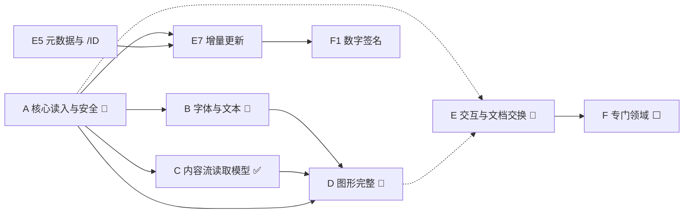

# PDF 库开发路线图（ROADMAP）

> 目的：把 `docs/FEATURE_MATRIX.md` 中的 ⬜/🟡 条目组织为**可独立验收的增量**，定义执行顺序、依赖与完成口径（「未分配条目（待决策）」除外，它们尚未进入交付计划）。
> 与矩阵的关系：矩阵是**事实层**（只记录代码实测状态与测试证据）；本文件是**规划层**（范围、增量拆分、依赖、验收）。规划条目不复制测试名，完成证据一律回写矩阵对应行。
>
> **2026-10-26 规划修订**：以 `docs/PDF32000_2008/` 重新核对 ISO 32000-1 章节号；修正阶段 A 的完成口径（不再宣称「真实世界 PDF 全部可读」）；把原阶段 C 中的「读端通用内容流模型」拆为独立阶段 C，原 C/D/E 顺延为 D/E/F；条目计数改为按「可独立验收增量」统计。旧阶段与新阶段的对应关系见文末「阶段映射」。
>
> **2026-10-26 评审修复**：按文档评审结论修正规划层——阶段 A 回退为 🚧 并新增 A6 fixture 回归（既有 fixture 全部未接入测试，不满足原则 5）；B5 改为 Table 112 的字体级 `/Resources`（删除不存在的「每字形资源字典」）；D3 增加解码后端选型 spike，D4 明确压缩后端失败的单一契约；E1 拥有 `/Names` 字典语义、E5 拥有 `/ID` 生成/校验（E6/E7 复用）；F 的验收标准直接写入本文档；新增「未分配条目（待决策）」；模块债清单与增量依赖按源码实测重写。

## 规划原则

1. **读写闭环**：每个新特性先明确读端模型、写端生成与往返验证；只有一端的能力在矩阵 Reader/Writer 列分开标注，不得以写端完成代替整体完成。
2. **读端模型先行**：内容流、资源、颜色空间、图像、Shading/Pattern 等读端能力统一建立在阶段 C 的通用内容流模型上，避免各功能重复实现分词与资源解析。
3. **语法层边界**：本库目标是 PDF 语法/对象层读写与数据提取，不实现光栅化、hinting、扫描转换、半调、颜色管理或页面合成。第 10 章整体为非目标；字体条目中的「渲染/hinting」缺口不再作为字体阶段未完成理由。
4. **增量粒度**：一个增量 = 一个可独立评审的 PR，必须包含代码、单元测试、必要时的集成往返测试、矩阵回写；单个增量不同时跨两个阶段的核心目标。
5. **真实样本驱动**：每个阶段结束前至少用一个真实 PDF 做回归；fixtures 必须有来源与许可说明，读端不得 panic。合成样本用于边界与负向用例。
6. **失败语义统一**：解析/解码/安全边界返回类型化错误；任何宽容行为显式实现、测试并记录于矩阵备注（沿用工程约定 #4）。
7. **第三方隔离**：新增解码器/编码器/密码学能力必须先定义 PDF 语义 trait，再由适配器接入（沿用工程约定 #1/#2/#3）。
8. **版本门控**：所有新增读写能力必须接入 `PdfFeature`/`PdfVersion` 机制，写端目标版本不足时返回 `WriteError::UnsupportedVersion` 且不写字节。

## 进度跟踪约定

### 状态机

- 单条目状态：`⬜ → 🚧（进行中）→ ✅`；评审决定不做的转 `❌` 并注明理由。
- 矩阵条目的四态（✅/🟡/⬜/❌）与总状态合并规则以 `FEATURE_MATRIX.md` 图例为准；矩阵条目由 `✅` 降为 `🟡` 必须在备注中写明缺口，并在矩阵「总览」修订记录中登记。
- 禁止 `✅ → ⬜` 回退；除非实现被移除，且须在矩阵备注中注明原因。增量条目与阶段状态的 `✅ → 🚧` 回退仅允许在验收口径修订时发生，并须在矩阵备注与本节「阶段映射」同时记录原因。
- 阶段状态：⬜ 未开始 / 🚧 进行中 / ✅ 完成 / ❌ 放弃。阶段完成后发现验收缺口时回退为 🚧，并记录缺口与补做增量（参见阶段 A 的 A6）。
- 状态只在代码实测后修改，禁止凭印象改动。

### 「完成」定义（三齐）

一个增量标记 ✅ 必须同时满足：

1. **代码实现合入**：功能代码进入主分支；
2. **有对应测试**：单元测试 + 必要的集成往返测试，测试名写入矩阵对应行；
3. **文档同步**：矩阵状态/证据/总览统计同步更新，必要时更新 README 版本特性速查表与本文件阶段状态。

三者缺一，不得标 ✅（至多标 🚧）。

### 更新流程

每次增量完成时按顺序执行：

1. 回写矩阵对应行的状态、Reader/Writer 分列与测试证据；
2. 重算矩阵「总览」统计，使四态计数与表内一致；
3. 勾选本文件对应增量的复选框，更新阶段总览的「已完成/增量数」；
4. 当阶段全部增量 ✅ 时更新阶段状态；若阶段完成口径发生变化，先在本文档「阶段映射/口径变更」中记录。

## 工程约定（依赖、扩展点与失败语义）

以下约定面向全库；条目中的现有模块只是当前实例，同类新增实现同样适用。

1. **第三方库必须隔离在 PDF 语义 trait/适配器之后**：
   - 代码实现方案优先级：Rust 标准库 > 成熟第三方库/本地实现；
   - 需要在实现内部使用第三方能力时，禁止直接调用第三方库，必须先定义稳定的 trait，再由适配器实现（现有示例：`filters::InflateBackend` 封装 `flate2`；`CffOutlineParser` 封装 `ttf-parser`；`JpegBackend` 封装 `zune-jpeg`；`CryptoBackend` 封装 RustCrypto 原语）。
2. **扩展优先于修改核心调度**：新增能力应通过既有扩展点（trait、注册表、可注入后端）接入；核心调度逻辑保持稳定，不得为单个实现修改调度分支。现有实例：过滤器经 `filters::StreamFilter` + `builtin_filters` 注册，`decode_stream` 不改动，`decode_stream_with` 支持注入/覆盖。
3. **抽象须可替换、可验证**：每个扩展点都要有替代实现的测试，证明核心只依赖抽象而非具体实现；新增扩展点时同步交付该测试。
4. **边界失败语义统一**：所有解析、解码与安全边界对损坏、截断或非法输入返回类型化错误（`DecodeError`、`FontError`、`ParseError` 等），不得 panic；任何宽容恢复或降级行为必须显式实现、有测试覆盖并记录在矩阵备注中。
5. **模块拆分约定**：单个 `.rs` 文件超过约 600 行或 25 KiB，或同时承担多个职责时，必须解构为目录模块（`foo/mod.rs` + 子模块）；编解码器实现、码表、测试应分文件；既有超限模块列入「工程债」逐项拆分，新增功能不得继续扩大超限文件。
6. **PDF 标准特性实现约束**：当前库实现的所有 PDF 标准特性都必须接受 PDF 版本机制管理。
7. **读写对称**：新增写端特性时，矩阵必须同时评估读端状态；只写不读的能力在阶段验收中不得被称为「完整」。
8. **fixtures 纪律**：真实 PDF 放入 `tests/fixtures/` 并在本文档登记用途与来源；测试必须能在无网络环境运行，fixture 体积保持可控。

## 工程债：模块目录化

已完成拆分（历史记录）：

- [x] `filters`：`filters/{mod,ascii,flate,lzw,predictor,tests}.rs`
- [x] `ccitt`：`ccitt/{mod,decoder,tables,tests}.rs`
- [x] `reader`：`reader/{mod,lexer,object,parser,document,xref,tests}.rs`
- [x] `writer`：`writer/{mod,value,version,serialize,context,document_writer,tests}.rs`
- [x] `types`：`types/{mod,version,features,value,document,tests}.rs`
- [x] `content`：`content/{mod,types,serialize,stream,tests}.rs`
- [x] `builder`：`builder/{mod,types,assemble,tests}.rs`
- [x] `type1_program/charstring`：实现与测试分文件
- [x] `reader/font`：`font/{mod,descriptor,encoding,simple,tests}.rs`
- [x] `reader/text`：`text/{mod,tokenizer,tests}.rs`
- [x] `reader/font/cid_cmap`：`cid_cmap/{mod,cid,token,to_unicode,tests}.rs`（2026-10-27，B6）

**2026-10-26 实测仍超限、后续增量触及前必须先拆分或同步拆分的模块**（按行数降序；阈值见工程约定 #5：>600 行或 >25 KiB）：

- [ ] `reader/font/truetype/cmap.rs`（1537 行 / 69.2 KiB；任何 cmap 增量前拆分）
- [ ] `builder/tests/mod.rs`（1602 行 / 52.2 KiB；新增 builder 测试前按主题拆分；导航测试已独立为 `builder/tests/navigation.rs`）
- [ ] `builder/tests/cid.rs`（1217 行 / 39.4 KiB；新增 CID 写端测试前拆分）
- [ ] `reader/font/truetype/sfnt.rs`（1164 行 / 50.0 KiB；SFNT 增量前拆分）
- [ ] `reader/font/cid.rs`（1140 行 / 40.4 KiB；CID 读端增量前拆分）
- [ ] `builder/tests/shading.rs`（1087 行 / 36.5 KiB；新增着色写端测试前拆分；D5 为读端增量未触及）
- [ ] `reader/font/type1_program/mod.rs`（1010 行 / 36.0 KiB；Type 1 增量前拆分）
- [ ] `reader/security/standard.rs`（998 行 / 35.2 KiB；安全增量前拆分）
- [ ] `builder/types/shading.rs`（982 行 / 32.0 KiB；D6/D7 前拆分；D5 为读端增量未触及）
- [x] `builder/mod.rs`（已拆分，2026-10-27：912→497 行 / 21.2 KiB；`patterns.rs` 178 行、`text_codes.rs` 105→359 行、`navigation/{mod,validate}.rs` 461+156 行）
- [ ] `reader/text/tests.rs`（1358 行 / 44.2 KiB；C1 前拆分；B7 继续追加未拆分）
- [ ] `builder/assemble/mod.rs`（853 行 / 36.6 KiB；组装逻辑变更前拆分）
- [ ] `reader/font/truetype/glyph.rs`（816 行 / 29.6 KiB；字形增量前拆分）
- [ ] `reader/text/mod.rs`（1350 行 / 48.8 KiB；C1 复用/重构时拆分；B7 新增位置模型与 OCMD 求值后仍超限，后续文本增量前须拆出片段/可选内容子模块）
- [ ] `builder/tests/font_program.rs`（722 行 / 25.1 KiB；新增字体程序测试前拆分）
- [ ] `reader/tests.rs`（689 行 / 26.1 KiB；新增读端测试前拆分）
- [ ] `builder/types/image.rs`（675 行 / 25.0 KiB；D2/D7 前拆分）
- [ ] `builder/assemble/shading.rs`（651 行 / 20.9 KiB；组装变更前拆分；D5 为读端增量未触及）
- [ ] `reader/optional_content.rs`（813 行 / 28.1 KiB；B7 已触及仍未拆分，后续可选内容增量前拆分配置解析与 OCMD 求值）
- [ ] `builder/tests/graphics_state.rs`（606 行 / 20.5 KiB；新增图形状态测试前拆分）
- [ ] `tests/main.rs`（8819 行 / 314.8 KiB；集成测试按主题拆分，新增集成测试前先迁出对应主题）

## 阶段总览

| 阶段 | 目标 | 增量数 | 已完成 | 主要依赖 | 状态 |
|---|---|---|---|---|---|
| A 核心读入与安全 | 语法/文件结构/核心过滤器/加密/函数可读 | 6 | 6 | — | ✅ |
| B 字体与文本 | 字体字典、程序、编码、文本提取（语法层） | 7 | 5 | A | 🚧 |
| C 内容流读取模型 | 通用 Op/资源/状态/标记内容读取，解除第 8/9/11/14 章读端缺口 | 5 | 5 | A | ✅ |
| D 图形完整 | 颜色/图像/Shading/透明度的读端模型与写端收尾 | 7 | 3（D1、D4、D5 完成；写端基线见 D0） | A、B、C（D3 只需 A） | 🚧 |
| E 交互与文档交换 | 导航/注解/表单/元数据/嵌入文件/增量更新 | 7 | 0（E1 读写切片完成，其余子项待补） | D（E1/E3/E5 只需 A） | 🚧 |
| F 专门领域 | 签名/Tagged PDF/预印/多媒体/其他交换能力 | 5 | 0 | E | ⬜ |

> 计数口径：只统计仍需推进的「增量」；阶段内已完成的历史工作以「基线」列出并指向矩阵，不重复计入增量数。阶段状态以「阶段目标是否全部达成」为准，不以历史基线多少为准。

## 阶段 A：核心读入与安全 🚧

**目标**：常见 PDF 1.0–1.7 的语法、文件结构、核心过滤器、加密与函数可读；读端对损坏输入返回类型化错误而非 panic。

**已完成基线**（证据与测试名见 `FEATURE_MATRIX.md` 第 7 章对应行）：

- [x] A1 词法与对象模型：7.2、7.3.2–7.3.10；嵌套上限、流长度与间接引用解析。
- [x] A2 文件结构与交叉引用：7.5.2–7.5.8（经典表/ XRef 流/ ObjStm/ `/Prev` 链/混合引用）、7.7.2 Catalog 版本覆盖。
- [x] A3 核心过滤器：7.4.1–7.4.6、7.4.8、7.4.4.4（Flate/LZW/CCITT/DCT/ASCIIHex/ASCII85/RunLength/Predictor），第三方后端经 trait 隔离。
- [x] A4 安全：7.6.2/7.6.3/7.4.10 的 Standard Security Handler R2–R4 解密（RC4-40/128、AESV2、`/EncryptMetadata false`、`/Crypt`），公钥与 R5/R6 明确不支持。
- [x] A5 Functions 与线性化容忍：7.10 Type 0/2/3/4 读端求值；附录 F 线性化文件按普通路径完整可读（不利用 hint 流）。

**待推进增量**：

- [x] **A6 真实样本回归与 fixture 纪律**（原则 5、工程约定 #8）：把 `tests/fixtures/minimal-document.pdf` 与 `tests/fixtures/pdflatex-4-pages.pdf` 接入自动化测试（文档解析、页面树遍历、文本提取冒烟），在 fixtures 表补齐来源/许可/体积；用至少一个真实 PDF 验证损坏输入不 panic。`tests/main.rs` 已超限，接入前按「工程债」要求先把对应主题迁出为独立测试模块。
  - 退出标准：两个 fixture 在 `cargo test` 中自动运行（新增用例位于拆分后的主题模块）；二者的来源/许可/体积已登记；无法追溯许可的既有 fixture 由 A6 决定替换为自生成样本并记录决策；截断副本返回类型化错误而非 panic。
  - **完成记录（2026-10-26）**：新增 `tests/fixtures.rs` 集成测试（5 项：`minimal_document_parses_without_error`、`pdflatex_4_pages_parses_without_error`、`truncated_minimal_document_returns_typed_error`、`truncated_pdflatex_4_pages_returns_typed_error`、`corrupted_pdf_returns_typed_error_not_panic`）；fixtures 表已登记体积，来源/许可标「待追溯」；既有 fixture 许可未确认，待后续决策是否替换为自生成样本。

**完成口径**：仅指上述 A1–A6。本阶段验收**只看 Reader 列**：A 范围内条目 Reader ✅ 即达成基线，Writer 侧缺口不参与本阶段判定（例如过滤器 Writer 列为 🟡 是「透传/剥离，不主动编码」的已知策略）。以下**不属于**阶段 A，避免「A 完成 = 所有真实 PDF 可读」的误读：

- JBIG2/JPX 解码 → D3；
- 图像字典/内联图像/图像蒙版读端 → D2；
- 通用内容流 Op 模型 → C；
- 增量更新写出 → E7；
- Name Dictionary（7.7.4 `/Names`）→ E1；Filespec/`/EmbeddedFiles` → E6；Extensions 字典 → F5；
- 非 ISO 32000-1 的 `<~ ~>` ASCII85 字符串扩展（矩阵 7.3.4 扩展行）不进入阶段 A；
- 权限位解释（矩阵 7.6.3 权限行）→「未分配条目」；
- 加密写出、公钥安全处理器、PDF 2.0 R5/R6 → 非目标（见文末）。

**验收标准**：

- 含上述过滤器的合成样本与真实样本可解析，解码字节正确；损坏/截断样本返回类型化错误；
- 线性化样本按普通路径读取无错误；
- 真实样本 fixture 已接入自动化测试，来源/许可/体积已登记；
- `cargo test` 全绿；除上文已排除的条目（7.3.4 扩展、7.4.7/7.4.9、7.7.4、7.11、7.12、7.6.3 权限行）外，A1–A5 所列章节的矩阵条目 Reader 均为 ✅；上述排除条目的归属见「不属于阶段 A」与「未分配条目」；A6 的 fixture 要求全部满足。

## 阶段 B：字体与文本 🚧

**目标**：能读写 ISO 32000-1 定义的简单字体、Type 0/CID 字体、Type 3 字体与嵌入程序，并提取 Unicode 文本；不做 hinting/渲染。

**已完成基线**（证据见 `FEATURE_MATRIX.md` 第 9 章）：

- [x] B1 简单字体与编码：9.6.2/9.6.6（Standard 14、`/Widths`、`/FontDescriptor`、五种预定义编码 + `/Differences` + AGL；写端宽度/编码/描述符）。
- [x] B2 TrueType 程序：9.6.3（SFNT、cmap format 0/2/4/6/8/10/12/13、水平/垂直度量、复合字形、内建编码、OpenType `OTTO` 读端）。
- [x] B3 CID/Type 0 核心：9.7.4/9.7.5/9.7.6（CIDFontType0/2、`CIDToGIDMap`、W/DW、DW2/W2、Identity-H/V 与嵌入 CMap、CFF 轮廓经 trait 适配）。
- [x] B4 嵌入程序与子集：9.9/9.6.4（Type 1/TrueType/CFF/OpenType 嵌入、`Length1–3`、TrueType/Type 1/CID-CFF/name-keyed CFF 子集、六字母标签、`/CIDSet` 裁剪）。

**待推进增量**：

- [x] **B5 Type 3 完善**（9.6.5，🟡）：按 Table 112 补齐**字体级** `/Resources` 的读写（多级间接引用、资源名解析）与 Table 112 要求的 `/Name`、`/FontDescriptor` 条目，以及可选 `/ToUnicode`；无 `/BaseEncoding` 时的精确码位归属（当前以 StandardEncoding 近似）；`d0`/`d1` 指标与文本提取已有。注意：Table 112 只有一个字体级 `/Resources`，CharProcs 内不存在每字形资源字典。
  - 退出标准：Type 3 字体字典的 Table 112 条目可写→解析→提取往返；字体级 `/Resources` 经多级间接引用可读回；`/Name`/`/FontDescriptor`/`/ToUnicode` 读写往返；负向用例覆盖缺失/非法资源与缺失必需条目。
  - 完成说明（2026-10-27，证据见矩阵 9.6.5）：读端 `Type3Font` 新增 `name`/`descriptor`/`has_to_unicode` 字段，`/FontDescriptor` 复用 `parse_descriptor`（含 `/FontFamily`、`/Ascent` 等 Table 122 条目），`/ToUnicode` 校验为流并由文本提取经 `simple_font_to_unicode` 解析；字体级 `/Resources` 支持任意层间接引用（上限 16 层，超出或成环返回类型化错误），`resources()` 返回最终字典，`resource(document, category, name)` 支持类别字典再解引用与资源名 `#xx` 解码后的匹配（与页面资源查找语义一致）。写端 `Type3Font::with_name`/`with_to_unicode` 与 `Font::with_descriptor` 生效：`/Name` 经 `is_valid_pdf_name` 校验后写出，描述符按 `fill_required_defaults` 补齐必填项且不写 `FontFile*`，`/ToUnicode` 复用 CMap 生成器（bfchar/bfrange 分节），`/Resources` 由调用方以 `with_resources` 提供后原样挂到字体字典。测试：`type3_font_parses_name_descriptor_and_to_unicode`、`type3_font_rejects_invalid_name_descriptor_and_to_unicode`、`type3_font_omits_optional_entries_when_absent`、`type3_font_requires_char_procs`、`type3_font_resources_missing_returns_none`、`type3_font_resources_rejects_non_dict_and_unresolved`、`type3_resources_follow_multi_level_indirect_chain`、`type3_resources_reject_reference_cycle_and_depth_overflow`、`type3_resource_resolves_category_chain_and_escaped_names`、`type3_font_writes_name_descriptor_and_to_unicode`、`type3_font_rejects_invalid_name`、`builder_type3_metadata_and_resources_roundtrip_through_parser`。
  - 剩余缺口：仍不对 CharProcs 求值（只读 `d0`/`d1` 声明指标，不执行绘制操作符）；无 `/BaseEncoding` 时字符码→字形名仍以 StandardEncoding 近似（未实现 Table 112 注的精确归属）；写端不自动生成 `/Resources` 或字形所引用的资源对象，仅透传调用方字典；`/Name` 按 PDF 1.1+ 语义视为可选（PDF 1.0 要求存在，未做版本门控）。
- [ ] **B6 CMap/ToUnicode 完整性**（9.7.5、9.10.3，🟡）：补全 Adobe-GB1/CNS1/Japan1/Korea1 ordering 数据（当前为紧凑近似）；读端 ToUnicode `usecmap` 基座名册（已内置 `Adobe-Identity-UCS`，其余预定义基座待补）；写端 ToUnicode 支持 `usecmap` 继承（已支持 Identity 基座）。
  - 启动前置：先确定 ordering 数据来源、许可证与体积上限并登记到 fixtures 表，不得引入许可不明的 Adobe 数据文件；`reader/font/cid_cmap.rs` 已超限，触及前先拆分。
  - 退出标准：预定义 CMap 与完整 ordering 样本的字符码→CID 映射正确；数据来源/许可/体积已登记；`usecmap` 基座覆盖/裁剪有测试；`text_code_bytes*` 不再静默跳过非法长度。
  - 进度（2026-10-27）：拆分前置已完成——`cid_cmap.rs` 拆为 `cid_cmap/{mod,cid,token,to_unicode,tests}.rs`（39/433/193/320/228 行），行为与既有测试不变。读端 ToUnicode `usecmap` 机制落地：`ToUnicodeMap::parse_lenient_with(data, resolve)` 合并基座映射（本地映射覆盖基座、本地声明 codespace 时裁剪越界继承映射、基座不可解析时保留本地映射），`parse_lenient` 通过该路径仅使用本地映射；`usecmap` 基座覆盖/裁剪已有单元测试。写端 `text_code_bytes`/`text_code_bytes_unicode` 不再静默跳过非法码长：记录首个非法长度（`PageBuild.invalid_code_length`），`build` 返回 `WriteError::InvalidObject` 且零字节输出；两方法拆至 `builder/text_codes.rs`。测试：`tounicode_usecmap_inherits_base_and_prefers_local_mappings`、`tounicode_usecmap_clips_inherited_mappings_to_local_codespace`、`tounicode_usecmap_inherits_all_mappings_without_local_codespace`、`tounicode_usecmap_rejects_duplicate_and_malformed_bases`、`text_code_bytes_rejects_illegal_lengths_at_build`、`text_code_bytes_unicode_rejects_illegal_length_at_build`。
  - 进度（2026-10-27 切片 2）：读端 `ToUnicodeMap` 内置 `Adobe-Identity-UCS` 恒等基座——惰性解析不物化 65536 条映射，仅对 2 字节码按大端 u16 取 Unicode 标量（`char::from_u32` 拒绝孤立代理、本地声明 codespace 时裁剪），`unicode_for` 保持仅本地映射，新增 `resolve_unicode` 供 `Type0Font::decode_codes` 回退；未知基座仍保留本地映射。写端 `CidFont::with_to_unicode_usecmap` 仅接受该基座，`to_unicode_cmap` 在 `/CMapType 2 def` 后写 `/<基座> usecmap`（带基座时 `/CMapName` 改 `/Custom-UCS`），仅声明基座而无显式映射时也生成 CMap，未知基座构建期 `WriteError::InvalidObject` 零字节。测试：`tounicode_identity_base_resolves_unmapped_two_byte_codes`、`tounicode_identity_base_respects_local_codespace`、`tounicode_identity_base_skips_surrogates_and_other_lengths`、`cid_font_to_unicode_usecmap_writes_identity_base`、`cid_font_to_unicode_usecmap_alone_writes_identity_base`、`cid_font_to_unicode_usecmap_rejects_unknown_base`、`builder_to_unicode_identity_base_roundtrips_through_extractor`。
  - 剩余缺口：完整 ordering 数据与来源/许可/体积登记未完成（fixtures 表登记前不引入 Adobe 数据文件）；预定义 ToUnicode 基座名册仅内置 `Adobe-Identity-UCS`，其余基座名仍按未知处理（保留本地映射）；写端 `usecmap` 只声明继承、不展开写出基座映射，代理对与多码元目标一律写 `bfchar`。
- [x] **B7 文本提取语义完善**（9.10，🟡）：跳过 `/Artifact` 标记内容、提供可选的带位置/间距的文本片段 API（不做版面分析）；`/ActualText` 替换与隐藏 OCG 过滤已随 C4 落地，B7 只需补回归样本与 OCMD 可见性。
  - 退出标准：`ActualText`、Artifact、隐藏 OCG 三类样本的提取结果正确；现有文本提取测试无回归；`try_extract_page_text` 错误语义保持。
  - 完成说明（2026-10-27，证据见矩阵 9.2/9.10/14.6）：提取端标记栈把 `/Artifact`（含嵌套继承、内联属性、分隔符抑制）整体排除；新增 `TextFragment` 位置模型（`Tm/Td/TD/T*/TL/Ts`、`cm`、`q/Q`、Form `/Matrix`、`BT` 重置；不含字形推进）与 `Document::extract_text_fragments`/`try_extract_page_text_fragments`/`extract_page_text_fragments`，页面文本与片段共用 `extract_page_state`，错误语义不变；新增 OCMD 求值：`OptionalContentProperties::membership_visible` + `membership_visibility`（`/P` 四种策略、`/VE` 的 `And/Or/Not` 递归与短路、未知组状态返回 `None`），文本提取与 `resolve_marked_visibility` 均支持内联/间接 OCMD。测试：`artifact_marked_content_is_skipped`、`nested_sections_inherit_artifact_state`、`artifact_with_inline_properties_is_skipped`、`artifact_breaks_do_not_insert_separators`、`artifact_text_is_absent_from_fragments`、`fragments_report_show_positions_and_merge_same_position_runs`、`fragments_apply_cm_and_q_q_at_the_ctm_level`、`fragments_track_leading_and_text_rise`、`actual_text_replacement_becomes_a_fragment`、`fragments_apply_form_matrix_and_restore_ctm`、`extract_page_text_fragments_reports_page_errors`、`hidden_ocg_text_is_absent_from_fragments`、`membership_policy_matrix`、`membership_visibility_expression_overrides_policy`、`visibility_evaluates_inline_membership_dictionary`、`indirect_ocmd_hides_section_by_policy`、`ocmd_resolved_through_properties_name`、`inline_ocmd_visibility_expression_overrides_policy`、`builder_text_fragments_report_positions`。
  - 剩余缺口：片段位置不含字形宽度推进（同一行多次 `Tj` 共用起点）；不感知 `/Rotate` 与 MediaBox（坐标为默认用户空间）；内联 OCG 字典（无对象号）可见性仍未求值；`page_marked_content` 的间接 OCMD 引用仍不可判定（回调签名限制）；写端无 `/Artifact` 写出 API；`reader/text/mod.rs` 与 `reader/optional_content.rs` 已超限未拆分。

**非目标（本阶段明确不做）**：hinting、字形光栅化、版面分析、CFF2 子集化、TTC 子集化、OpenType 子集化（保留程序透传 + 子集标签）。

**依赖**：A（过滤器/流解码）。B5 只依赖 A；B7 依赖 C4（标记内容读取模型，已完成），可后置；B6 只触及字体模块。

**验收标准**：

- 写出含嵌入 TrueType、CIDFontType2、Type 1/CFF 子集的文档，重新解析后字体程序/宽度/文本一致；
- 含 CJK 文本的样本可提取为 Unicode；ToUnicode 往返可还原；
- Type 3 字典（含字体级 `/Resources`、`/Name`、`/FontDescriptor`）与 CharProcs 指标往返；
- `cargo test` 全绿。

## 阶段 C：内容流读取模型（跨章节前置）✅ (5/5)

**目标**：提供通用的内容流解析、资源解析与图形状态模型，作为第 8/9/11/14 章读端能力的共同底座；本阶段只做**模型与数据**，不做渲染。

**为什么单列**：当前库只有写端 `content::ContentStream`，读端仅有 `reader/text` 为文本提取做的词法扫描。这导致矩阵第 8/9/11/14 章大量 Reader 列为 ⬜，也让颜色空间、Shading/Pattern、图像、标记内容等读端能力无法复用。该模型是所有后续读端增量的硬前置。

**增量**：

- [x] **C1 内容流词法与 Op AST**：复用并重构 `reader/text/tokenizer.rs`，解析操作符、操作数、内联图像 `BI/ID/EI` 边界、注释/空白/名称转义；未建模操作符保留原始 token 序列以便重新序列化。新增 `reader::content` 目录模块（触及 `reader/text/mod.rs` 前先拆分）。
  - 退出标准：合成内容流覆盖全部 ISO 32000-1 Table A.1 操作符；内联图像二进制数据不被误分词；未知操作符可往返；现有文本提取测试全部通过。
  - 测试：`parse_graphics_state_operators`、`parse_path_construction_operators`、`parse_path_painting_operators`、`parse_text_object_operators`、`parse_color_operators`、`parse_unmodeled_operator`、`parse_empty_stream`、`parse_comments_and_whitespace`、`parse_tj_array_operand`、`parse_dash_pattern_array_operand`、`parse_empty_dash_pattern_array_operand`、`tj_array_with_hex_string_elements`、`tj_rejects_non_array_operand`、`tj_rejects_unterminated_array`、`tj_rejects_name_element_in_array`、`d_rejects_non_numeric_array_element`、`d_rejects_missing_phase_operand`
- [x] **C2 资源解析与页面内容 API**：`Document::page_content_ops`（或等价 API）遍历页面树、合并 `/Contents` 数组、解析 `/Resources` 继承、解析 `/XObject`/`/Font`/`/ColorSpace`/`/Shading`/`/Pattern`/`/Properties` 名称。Form XObject 不在 API 内自动递归：调用方按 `Op::PaintXObject` + `page_resource("XObject", name)` 自行展开（递归深度与防环由调用方控制；C3 状态机只对 `q/Q` 栈限深，不约束 XObject 展开）。
  - 退出标准：`tests/fixtures/pdflatex-4-pages.pdf` 四页均可解析；资源名经 `#xx` 转义可解析；`/Parent` 资源继承有测试。
  - 测试：`page_content_ops_parses_simple_page`、`page_content_ops_returns_error_for_invalid_page_index`、`page_resource_resolves_font_name`、`page_resource_inherits_from_parent`、`page_resource_returns_none_for_missing_resource`、`page_resource_decodes_name_escapes`、`page_content_ops_handles_contents_array`、`decode_name_escapes_handles_various_cases`、`pdflatex_4_pages_all_content_ops_parse`
- [x] **C3 图形状态机**：`q/Q` 栈、CTM、线宽/线帽/线接/斜接/虚线、文本状态、`gs` 应用 ExtGState、颜色/图案当前值；状态复制与恢复语义按 8.4/9.3/11.x。
  - 退出标准：嵌套 `q/Q`、`cm`、`gs`、`Tf/Td/Tm` 的状态快照测试；越界/非法参数返回类型化错误。
  - 实现范围：`reader/content/state.rs` 新增 `ContentStateRunner`/`ContentState`（Table 57 初始值、Table 56 `Q` 空栈为 no-op、`MAX_SAVE_DEPTH`=512 限深）、`run_content_state` 逐操作符快照、`Document::page_content_state_trace`/`page_content_state`（经 `/Resources/ExtGState` 应用 `gs` 的 LW/LC/LJ/ML/SA/D/RI/Font/CA/ca/BM/OP）；文本状态按 9.3/9.4（BT 仅重置 Tm/Tlm、Td 平移 Tlm、TD 设置 leading=-ty、T*/'/" 依 leading 换行）；颜色/图案当前值跟踪 rg/RG/g/G/CMYK/scn/SCN/CS/cs 与分量范围校验。
  - 测试：`q_q_stack_restores_ctm_and_line_width`、`q_stack_underflow_has_no_effect`、`cm_concatenates_matrices_in_prepend_order`、`save_stack_depth_limit_returns_error`、`gs_applies_ext_g_state_parameters`、`unknown_gs_name_returns_typed_error`、`gs_font_name_entry_sets_text_font`、`invalid_state_parameters_return_typed_errors`、`non_finite_matrix_returns_typed_error`、`bt_resets_text_matrices_keeps_text_state`、`td_td_and_t_star_update_matrices`、`tick_and_quote_show_text_move_to_next_line`、`color_operators_track_current_values`、`named_pattern_color_operators_are_modeled`、`out_of_range_device_color_components_return_typed_errors`、`pdflatex_4_pages_state_machine_runs`
  - 剩余缺口：路径/裁剪/图像/Form XObject 的绘制语义不进入状态模型（仅几何与参数状态）；`gs` 的 `/Font` 名称形式只记录名称不解析字号引用；颜色分量个数与 `/ColorSpace` 基色空间的匹配依赖 D1 读端模型。
- [x] **C4 标记内容与可选内容读取语义**：`BMC/BDC/EMC/MP/DP` 嵌套与属性表解析、`/ActualText`/`/E` 提取、OCG 可见性过滤；与 14.6/8.11 的读端模型统一。
  - 退出标准：嵌套标记内容配对错误可诊断；`ActualText` 替换与隐藏 OCG 过滤有测试；属性表支持名称与内联字典。
  - 实现范围：分词器补 `CsToken::Dictionary`（`take_dictionary`，嵌套/字符串感知，`(a>b)` 不提前闭合）并修复名称分词吞分隔符（`]`）的缺口；`parser.rs` 新增 `parse_dictionary_inner` 宽松字典构建（嵌套字典/数组/`num num R` 引用（顶层与数组内）/布尔/字符串/十六进制串）。新增 `reader/content/marked.rs`：`collect_marked_sections`（`BMC/BDC/EMC/MP/DP` 栈配对，`MAX_MARKED_DEPTH`=64 限深，类型化 `MarkedContentError`：`UnmatchedEnd`/`UnclosedSection`/`DepthExceeded`）、`MarkedSection`（span、`point`、`/ActualText`/`/E`/`/Alt`/`/Lang`，字面与 UTF-16BE 十六进制串解码）、属性表支持内联字典与 `/Properties` 名称解析（含兼容写端「名称直指 OCG 字典」形态）、`resolve_marked_visibility` 经目录 `/OCProperties` 判定 OCG 可见性（`/D` BaseState/ON/OFF）、`Document::page_marked_content`。文本提取端（`reader/text`）统一语义：`MarkedFrame` 栈实现隐藏范围不提取、`/ActualText` 整段替换（emit-once）、嵌套继承隐藏态、`EMC` 宽容失衡、Form XObject 内未闭合范围不外泄；`OptionalContentProperties::is_visible` 复用。
  - 测试：`pairs_begin_and_end_with_spans`、`nests_sections_and_closes_inner_first`、`point_operators_are_zero_length_sections`、`bdc_resolves_inline_dictionary_properties`、`bdc_resolves_property_name_through_resources`、`bdc_name_pointing_at_ocg_dictionary_marks_group`、`unmatched_emc_reports_operator_index`、`unclosed_section_reports_outermost_tag`、`depth_limit_is_enforced`、`text_entries_decode_literal_and_hex_strings`、`visibility_resolves_oc_name_and_reference`、`page_marked_content_resolves_properties_and_visibility`、`bdc_keeps_inline_dictionary_property_list`、`bdc_property_dictionary_supports_nested_dict_array_and_reference`、`dp_accepts_property_name_or_dictionary`、`hex_string_operand_in_dictionary_keeps_hex_characters`、`dictionary_with_string_containing_angle_brackets_roundtrips_entries`、`actual_text_replaces_all_shows_in_section`、`actual_text_decodes_hex_string_property`、`bdc_property_name_resolves_through_properties_resource`、`hidden_ocg_section_is_not_extracted`、`visible_ocg_section_is_extracted`、`hidden_ocg_property_resolved_by_direct_reference`、`bdc_name_pointing_at_ocg_dictionary_filters_hidden_group`、`nested_section_inherits_hidden_state_from_parent`、`unbalanced_emc_does_not_break_extraction`、`unclosed_marked_section_in_form_does_not_leak_to_caller`、`pdflatex_4_pages_marked_content_pairs_with_spans`（写→读往返 `builder_optional_content_roundtrips_through_parser` 同步升级为隐藏层不提取断言）
  - 剩余缺口：内联 OCG 字典形态的可见性未求值（OCMD 已随 B7 求值）；间接属性表操作数（`5 0 R /Tag BDC`）不支持；`page_marked_content` 不递归 Form XObject，且其回调签名无法区分间接 OCMD 引用；`/E` 已暴露但未参与提取替换；`/Artifact` 范围识别与位置感知 API 已随 B7 落地；`reader/optional_content.rs` 模块拆分未做。
- [x] **C5 读写模型统一与 roundtrip**：读端 Op AST 与写端 `content::Op` 的映射表；parse→model→serialize→parse 的往返测试；未建模操作符透传策略记录在矩阵。
  - 退出标准：覆盖路径/文本/颜色/XObject/Shading/Pattern/标记内容的往返样本；序列化字节可被现有 parser 重新解析；无 panic。
  - 实现范围：新增 `reader/content/mapping.rs` 三件套——`to_content_op`（读端 `Op` → 写端 `content::Op`，写端不可表达时返回类型化 `OpMappingError`：`NotRepresentableByWriter`（TD 双操作数/d0/d1/BX/EX/内嵌图像/Unmodeled/非 Name/Dict 属性表/非 UTF-8 的 `'`/`"`/`TJ` 串）与 `OperandOutOfRange`（`J`/`j` 非 0–2、`Tr` 非 0–255）；`Tj` 串按字节合法性自动选字面量或十六进制形式）；`from_content_op`（写端 → 读端全函数，唯一有损点为单操作数 `MoveNextLineSetLeading` 映射为 `TD` 且 `tx=0`）；`serialize_ops`（可映射操作符复用写端 `ContentStream` 序列化器，其余走原始回退输出合法语法，保证 `parse → serialize → parse` 模型级无损）。parser 修复：水平缩放关键字从错误的 `Th` 改为规范的 `Tz`；未建模操作数经 `tokens_to_values` 无损捕获（`[ ... ]` 数组含嵌套、`num gen R` 引用、`true/false/null` 类型化、字面量串按字节逐 char、十六进制串大写）。`ContentStream::ops()` 只读访问器与 `LineCap/LineJoin::value()` 公开（纯增量，不改公共签名）。
  - 测试：`horizontal_scaling_parses_tz_keyword`、`graphics_state_and_path_operators_roundtrip`、`text_operators_roundtrip_including_hex_binary_and_escapes`、`td_d0_d1_bx_ex_roundtrip_through_raw_fallback`、`out_of_range_linecap_linejoin_and_render_mode_roundtrip`、`to_content_op_errors_for_variants_without_writer_model`、`show_text_selects_literal_for_utf8_and_hex_for_binary`、`marked_content_operators_roundtrip_name_and_inline_dict`、`color_pattern_xobject_shading_and_extgstate_roundtrip`、`unmodeled_operators_preserve_array_name_and_string_operands`、`from_content_op_maps_writer_stream_ops_and_remaps_losslessly`、`writer_model_ops_map_to_reader_model_shapes`、`inline_image_variant_serializes_and_reparses`、`pdflatex_4_pages_content_model_serialization_roundtrips`（真实四页样本逐页模型无损）、`content_model_roundtrip_preserves_text_extraction`（builder 写出 → 读端模型 → `serialize_ops` → 重解析相等 → 经 `to_content_op` 重建 Form 写出后文本仍可提取）
  - 剩余缺口：内联图像 `Op::InlineImage` 自 D2 起可读写往返（`BI … ID <data> EI`，D2 已修复分词器入口）；写端模型仍缺 TD 双操作数、d0/d1、BX/EX、内嵌图像与 Unmodeled 透传变体（桥接层以原始回退补齐，未扩展 `content::Op` 公共 API）；Latin-1 边界：未建模操作数/属性字典内 `Value::String` 含 ≥0x80 字节时经 `write_value` 按 UTF-8 编码写出、重解析按字节逐 char，模型级不严格相等（ASCII 串往返无损）；`BDC/DP` 的数组/布尔/间接引用形态操作数仍是 `expect_properties` 的既有限制（映射为 Unmodeled 后按写值原样输出，重解析形态不变）；写端 `MoveNextLineSetLeading` 单操作数 `TD` 不合规范的问题仅记录未修（改动公共枚举超出本增量边界）。

**依赖**：A。B 为软依赖（文本提取可在 C1/C2 完成后迁移到统一模型，但不得为迁移而扩大本阶段范围）。

**验收标准**：

- 真实多页 PDF 的内容流可完整解析，操作符计数与资源引用可核对；
- 内联图像、Form XObject、`q/Q`、`gs`、标记内容均有测试；
- 文本提取在切换到统一模型后结果不回归；
- `cargo test` 全绿；矩阵第 8/9/11/14 章中「无通用内容流读端」的备注可被逐项消除。

## 阶段 D：图形完整（读端模型 + 写端收尾）🚧

**目标**：把已完成的图形写端能力补齐读端模型，并补齐写端剩余条目；颜色/图像/Shading/Pattern/透明度达到语法层完整。

**D0 写端基线（已完成，证据见矩阵第 8/11 章）**：

- [x] 8.4.4/8.4.5 ExtGState 读写（`/TR` `/BG` `/BG2` `/UCR` `/UCR2` 已接入；`/TR2` 透传、`/HT` 半色调对象模型见 D6，2026-10-26）；
- [x] 8.6.4–8.6.8 设备/CIE-Based/Indexed/Separation/DeviceN 颜色空间、灰度/CMYK/颜色操作符；
- [x] 8.7 Shading Type 1–7、着色图案与彩色/无色平铺图案；
- [x] 8.9/8.9.6 图像字典常用条目、图像蒙版、软蒙版图像；
- [x] 8.10.1–8.10.3 Form/Group XObject；11.3.5/11.6.4/11.4/11.6.5/11.6.6 透明度写端；
- [x] 14.6 标记内容操作符；8.11 可选内容（OCG/OCProperties/Properties/BDC）。
- 说明：8.8.2 PostScript XObject、8.10.4 Reference XObject 不在基线内。

**待推进增量**：

- [x] **D1 颜色空间读端模型**（8.6.4–8.6.8）：解析 `/ColorSpace` 资源（设备、CalGray/CalRGB/Lab/ICCBased、Indexed、Separation/DeviceN、Pattern），支持 `/DefaultGray`/`/DefaultRGB`/`/DefaultCMYK`；Indexed 还原到基色空间；Separation/DeviceN 经 tint 函数求值到备用空间；输出分量数组与空间描述。
  - 退出标准：设备/CIE/Indexed/Separation/DeviceN 样本的样本值解码正确；ICCBased 返回配置文件字节与 `/N`；非法空间返回类型化错误。
  - 完成说明（2026-10-26，证据见矩阵 8.6.4–8.6.8）：新增 `core/reader/color_space/`——`Document::color_space` 解析名字/数组空间（间接引用、流、`/Default*` 经页资源），`ColorSpaceModel` 覆盖设备/CIE/ICCBased/Indexed/Separation/DeviceN/Pattern，`decode_samples` 按 1/2/4/8/16 位 MSB-first 行补位解码并把 Indexed 展到基空间、Separation/DeviceN 送 `Function` tint 求值；非法结构返回类型化 `ColorSpaceError`（Malformed/Unsupported/Function）。剩余缺口：NChannel 与 `/Attributes`/`/Optimize`、Lab 的 `/Attn` 不建模；解码不应用图像 `/Decode` 矩阵（归 D2 样本 API）；颜色操作符分量匹配校验尚未接入 C3 状态机。
- [x] **D2 图像字典、图像蒙版与内联图像读端**（8.9.5/8.9.6/8.9.7）：建模 `/Width`/`/Height`/`/ColorSpace`/`/BitsPerComponent`/`/Decode`/`/Interpolate`/`/Intent`/`/ImageMask`/`/Mask`/`/SMask`/`/SMaskInData`/`/Alternates`；解码内联图像 `BI/ID/EI` 字典与数据；提供样本读取 API（不做合成/渲染）。
  - 退出标准：内联图像与图像 XObject 的字典/样本可读；Stencil/Explicit/Colour Key 蒙版结构可解析；`/Alternates` 列表可遍历；损坏/截断图像数据返回错误。
  - 完成说明（2026-10-27，证据见矩阵 8.9.5/8.9.5.4/8.9.6/8.9.7）：新增 `reader/image`——`Document::image`/`page_image`/`inline_image`/`page_inline_image` 返回 `ImageModel`（字典全字段 + 过滤器链 + 未建模条目 `other`），`samples()` 复用 D1 `ColorSpaceModel` 解码（Indexed 展开调色板、Separation/DeviceN tint 求值、Lab 默认 `/Range`）、再应用 `/Decode` 线性映射（Indexed/Separation/DeviceN 的显式 `/Decode` 返回 `Unsupported`）；`ImageMaskModel::{Explicit, ColorKey}` 覆盖 Stencil/显式蒙版/颜色键蒙版，SMask 要求 DeviceGray 同尺寸且禁止嵌套；`/Alternates` 递归解析并沿用深度上限 8；数据长度、蒙版范围、循环引用均返回类型化 `ImageError`。内联图像修复分词器不可达路径（`CsToken::InlineImage` 按空白/分隔符识别 `EI`），`ContentParser` 产出 `Op::InlineImage`，读端补齐 Table 94 键缩写与 Table 95 颜色空间名缩写。测试：`reader/image/tests.rs` 16 项 + 集成 `builder_images_roundtrip_through_image_model` + 内容层 `inline_image_*` 4 项。剩余缺口：JBIG2/JPX 样本解码归 D3、不做图像合成/渲染、内联 `/L` 不用于修正数据长度、内联 `/OC` 与其他冷门条目仅保留在 `other`。
- [ ] **D3 JBIG2/JPX 解码**（7.4.7/7.4.9）：启动前先做后端选型 spike（纯 Rust 实现 vs 第三方适配器，比较许可证、体积、维护状态与可测试性）并把结论写入增量启动说明；再定义 `Jbig2Backend`/`JpxBackend` trait 与可替换适配器；接入 `StreamFilter` 注册；补 1.4/1.5 版本门控与损坏输入测试。
  - 退出标准：选型结论已记录；规范/公开样本可解码为位图/分量数据；trait 有替代实现测试；损坏流不 panic；写端仍按透传/剥离策略处理。
- [x] **D4 写端图像压缩**（7.4.4/7.4.8 Writer 列）：定义 `DeflateBackend` 编码 trait，提供 FlateDecode 编码路径（可选 Predictor）；图像/内容流写入时按调用方选择压缩；DCT 保持透传。更新矩阵过滤器 Writer 列与 README 体积说明。
  - 失败语义（单一契约）：默认纯 Rust Flate 后端始终可用；调用方注入的后端失败时必须返回类型化 `WriteError` 且不写出任何字节，**不得静默回退明文**；未请求压缩时保持明文透传。
  - 退出标准：写入→读端解码的字节一致；压缩流体积小于原始流；后端失败路径有测试且不写字节；特性与版本门控正确。
  - 完成说明（2026-10-26，证据见矩阵 7.4.4/7.4.4.4）：压缩位于 `write_object_maybe_compressed` 序列化咽喉点，内存明文不变；Predictor 采用 15（逐行标记 2 = PNG Up），限 8-bit DeviceGray/RGB/CMYK 命名色空间；Flate ≥1.2、预测器 ≥1.3 门控。剩余缺口：仅文档级 opt-in（无逐流粒度）、不编码 TIFF/其他 PNG 过滤函数。
- [x] **D5 Shading/Pattern 读端模型**（8.7）：解析 Shading 字典 Type 1–7、网格流（BitsPerCoordinate/Component/Flag、Decode）、PatternType 1/2、图案流与 `/Resources`；校验域/坐标/函数维数；输出几何与颜色函数描述。
  - 退出标准：Type 1–7 合成样本可读；网格流位打包与 `/Decode` 还原正确；着色/平铺图案资源可解析；非法条目返回错误。
  - 完成说明（2026-10-26，证据见矩阵 8.7）：新增 `reader/shading`，`ShadingModel` 覆盖 Type 1–7（网格按 MSB-first 位流还原顶点记录，`/Function` 存在时每顶点存单参数）、`PatternModel` 覆盖平铺（PaintType/TilingType/BBox/XStep/YStep/Matrix/Resources/图块字节）与着色图案（内联/引用/按 `/Shading` 资源名解析），`page_shading`/`page_pattern` 提供页资源入口；函数维数、位深、Decode 长度与分组完整性返回类型化错误。剩余缺口：Type 4 顶点不做三角形复用展开、平铺图块内容流不做解释、C3 状态机尚未按 `PatternModel` 接线、真实样本 fixture 待补。
- [x] **D6 ExtGState/透明度读端应用与写端剩余**（8.4.4/8.4.5、11.x）：`gs` 接入 C3 状态机已完成（LW/LC/LJ/ML/SA/D/RI/Font/CA/ca/BM/OP）；剩余写端 `/TR2`、`/HT`（半色调对象模型）、SMask `/TR`、`/SMaskInData`；读端 `/Group`、软蒙版图像、`/Matte`（Table 146）结构解析。
  - 退出标准：`gs` 应用后状态快照正确；`/TR2`/`/HT` 写出可被读端解析；`/Matte` 与 `/SMaskInData` 读写样本通过；透明度版本门控保持。
  - 完成说明（2026-10-26，证据见矩阵 8.4.4/8.4.5、11.4/11.6.6、11.5/11.6.5）：写端 `/TR2` 以字典原样透传、`/HT` 建模半色调包装字典（`/DefaultHalftoneType` + 按色料覆盖）与类型 1/2 半色调字典（`/SpotFunction` `/TransferFunction` 复用函数句柄池，同一句柄只写一次）、软蒙版 `/TR`（`/SMaskInData` 限 0–2、`/Matte` 非空有限数组），`/Matte` 由 `PdfFeature::SoftMaskMatte` 门控 ≥1.6；读端新增 `reader/graphics_state/halftone`（`HalftoneModel`：类型 1/2 类型化、类型 3–5/色料数组/命名半色调不建模但保留写出值、包装字典色料与其余条目）与 `reader/group`（`Document::group`/`page_group`：`/S`、`/CS` 经颜色空间模型解析、`/I` 默认 false、`/K` 宽松建模、未知条目入 `other`），`SoftMask` 补 `/TR`、`/SMaskInData`、`/Matte` 与未建模条目透传。剩余缺口：`/HT` 类型 3–5、屏幕字典、命名半色调与 `/HTPO` 不写不建模；`/TR2` 只透传不解释语义；软蒙版 `/G` 仅接受透明组 Form；组内合成/渲染语义不做；图像级 `/Matte` 与图像流尺寸校验放宽归 D7/8.9。
- [x] **D7 写端图像/表单补全**（8.9.5、8.10、11.5）：`/Intent`、`/Alternates` 图像、`/Matte`、Form XObject 自有 `/Resources`/`/OC`/`/Ref`（按价值取舍）、Reference XObject 评估；补齐相应版本门控与往返测试。
  - 退出标准：新增字典条目可写→解析→读回；非法参数不写字节；第三方阅读器语法检查无错误（人工验收）。
  - 进度（2026-10-27，图像字典部分完成）：`ImageData` 新增 `intent`/`alternates`/`matte` 与 `with_*`，写端 `/Intent`（`PdfFeature::ImageIntent` ≥1.4）、`/Alternates`（Table 90 `<< /Image n 0 R >>` 字典数组，`PdfFeature::AlternateImages` ≥1.3）、`/Matte`（写到 SMask 图像字典，`PdfFeature::SoftMaskMatte` ≥1.6）及校验（图像蒙版禁用、替代图像禁嵌套/蒙版/超高分辨率、Matte 分量数按基图）；读端补 `ImageModel::matte` 与 Table 90 替代图像字典。证据见矩阵 8.9.5/8.9.5.4/11.5，测试 `image_writes_intent_alternates_and_matte`、`image_intent_requires_pdf_1_4`、`image_alternates_require_pdf_1_3`、`image_matte_requires_pdf_1_6`、`invalid_matte_parameters_fail_the_build`、`invalid_alternate_images_fail_the_build`、`image_mask_rejects_intent_and_alternates`、`image_matte_is_parsed_on_soft_mask`、`smask_matte_length_must_match_base_components`、`image_matte_rejects_non_finite_and_image_masks`、`image_alternates_accept_table_90_dictionaries`、集成往返 `builder_image_intent_alternates_and_matte_roundtrip`。
  - 完成说明（2026-10-27，Form 部分收尾）：`builder/types/form.rs` 新增 `FormResources`（`fonts`/`images`/`optional_content`，`with_font`/`with_image`/`with_optional_content` 链式构造）与 `FormXObject::with_resources`，`assemble` 为每个在用表单写 `/Resources`（`/Font` `/F<n>`、`/XObject` `/Im<n>`、`/Properties` `/OC<n>`，提供空资源时写空字典以按规范替换而非继承）；表单字体/图片并入文档级 `font_pool`/`image_pool`，与页面相同资源共享对象号，未绘制的表单不分配对象；`FormXObject::with_optional_content` 写表单级 `/OC`（PDF 1.5，`PdfFeature::OptionalContent` 门控），表单 `/OC` 与 `/Properties` 引用的 OCG 并入同一 OCG 池并出现在目录 `/OCProperties`，越界句柄报 `WriteError::InvalidObject` 且零字节。测试 `form_own_resources_write_font_and_image_dictionaries`、`form_resources_share_objects_with_page_resources`、`unused_form_resources_are_not_written`、`empty_form_resources_replace_inherited_resources`、`form_optional_content_writes_oc_and_properties_references`、`form_optional_content_requires_pdf_1_5`、`unknown_form_optional_content_handles_fail_the_build`、集成往返 `builder_form_own_resources_roundtrip_through_parser`。`/Ref`（Reference XObject）按价值取舍不实现：PDF 2.0 已弃用、依赖外部文件规格语义，读写端均不生成/不解析（见矩阵 8.10.4）。剩余缺口：表单资源仅覆盖 Font/XObject/Properties（无 ExtGState/Pattern/Shading/ColorSpace），不写 `/Metadata`/`/PieceInfo`/`/OPI`，不按内容去重；读端文本提取不按表单 `/OC` 求值可见性，替代图像 `/DefaultForPrinting`/`/OC` 仍未建模。

**依赖**：D0 写端基线已具备；逐增量依赖如下——D3/D4 **只依赖 A**，不依赖 C，可与 C 并行；D1 依赖 C2/C3；D2 依赖 C2（资源与内容 API）；D5 依赖 C2/C3；D6 依赖 C3；D7 依赖 D0，其中 Form 自有 `/Resources` 部分与 C2 的资源模型对齐。B 仅在 Pattern 内字体与文本场景为软依赖。

**验收标准**：

- 含 ICCBased/Separation/Pattern/图像/Shading/透明组的样本可读入为模型对象；
- 写端剩余条目补齐后，矩阵第 8/11 章 Writer 列无未解释的 🟡；
- 真实样本（含 JBIG2/JPX 图像）可解析，损坏样本不 panic；
- `cargo test` 全绿。

## 阶段 E：交互与文档交换 🚧

**目标**：导航、注解、表单、元数据、嵌入文件与增量更新基础可用。

**增量**：

- [ ] **E1 导航与页面标签**（12.3、12.4.2、12.7.6）：显式/命名 Destinations、Outline、Page Labels、Named Pages（`/Pages` 名称树）。本增量拥有 7.7.4 `/Names` 名称字典的语义封装（解析、查找、写回），作为 E6 的前置，不得由 E6 另建一套。
  - 进度（2026-10-27 读端切片，证据见矩阵 7.7.4/12.3/12.4/12.7.6）：新增 `reader/navigation/`（`mod`/`page_tree`/`name_tree`/`destination`/`outline`/`page_labels`/`tests`）。公开 API：`Document::page_count`、`name_tree(category)`、`named_destination(name)`、`named_page(name)`、`outline()`、`page_labels()`/`page_label(page_index)`；类型 `Destination`（8 种显式目标）、`Outline`/`OutlineItem`/`OutlineDestination`、`PageLabelStyle`/`PageLabelRange`/`PageLabels`、`NavigationError`。名称树与数值树走独立加固遍历（深度 64、节点 4096、间接引用环检测），大纲另有 10000 项上限与深度 64；命名目标兼容 `/Names /Dests` 名称树与旧式目录 `/Dests` 字典（键 `#xx` 解码）；命名页面要求间接页面引用并经页面树索引映射为 0 基页号。测试：`name_tree_reads_flat_and_kid_nodes`、`name_tree_rejects_cycles_and_depth_overflow`、`name_tree_rejects_malformed_nodes`、`explicit_destinations_parse_all_types`、`malformed_destinations_are_typed_errors`、`malformed_named_destination_is_a_typed_error`、`named_destinations_resolve_from_name_tree_and_legacy_dict`、`named_pages_resolve_page_references`、`outline_reads_titles_destinations_and_children`、`outline_rejects_cycles_and_missing_titles`、`outline_is_absent_without_catalog_entry`、`page_labels_format_styles_prefixes_and_starts`、`invalid_page_label_entries_are_typed_errors`、`page_tree_index_maps_indirect_pages_and_detects_cycles`。
  - 进度（2026-10-27 写端切片，证据见矩阵 7.7.4/12.3/12.4/12.7.6）：新增 `builder/navigation/mod.rs`（461 行）与 `builder/navigation/validate.rs`（156 行）。公开 API：`PdfBuilder::page_labels(&[PageLabelRange])`、`named_destination(name, Destination)`、`named_page(name, page)`、`outline(&[OutlineEntry])`，在 `build` 完成对象组装后统一改写目录（catalog 覆写、导航对象从现有最大对象号之后分配，未改动 `builder/assemble`）：`/PageLabels` 数值树单叶子、`/Names /Dests` 与 `/Names /Pages` 名称树叶子（键按 `PdfTextString` 编码排序、文本串键十六进制写出）、`/Outlines` 根与兄弟链（`/Parent`/`/Prev`/`/Next`/`/First`/`/Last`/`/Count`，展开记可见后代、折叠记负总后代）。构建期校验名称唯一/页码范围与递增/目标操作数有限/缩放 >0/颜色 0–1/大纲深度 64 与条目 10000；版本门控大纲 ≥1.1、命名目标 ≥1.2、页面标签与命名页面 ≥1.3，非法输入与版本不足均零字节。测试：`page_labels_write_number_tree`、`navigation_absent_leaves_catalog_untouched`、`named_destinations_and_pages_write_name_trees`、`outline_writes_linked_items_and_counts`、`navigation_rejects_invalid_input_without_output`、`navigation_version_gates_require_minimum_versions`、`builder_navigation_roundtrips_through_parser`。
  - 剩余缺口：缩略图（12.3.3）、Collections（12.3.5）、Articles/Presentations（12.4）与 `/Templates` 名称树未建模；大纲 `/A` 动作仅原样保留（语义归 E3，写端仅 `/Dest`）；旧式目录 `/Dests` 不写出；名称树/数值树不写 `/Kids`/`/Limits` 中间节点，读端 `/Limits` 仅透传不校验；其他 `/Names` 类别（EmbeddedFiles/JavaScript 等）归 E6 及后续增量。
- [ ] **E2 注解通用结构与常用类型**（12.5.1–12.5.6）：Annotation 字典/标志/边框/AP 外观流；先做 Text、Link、FreeText、Highlight、Underline、Squiggly、StrikeOut、Stamp、Ink、Popup、FileAttachment、Widget（Widget 与 E4 联动）。
  - 进度（2026-10-27 读端切片，证据见矩阵 12.5.1–12.5.5）：新增 `reader/annotation.rs` + `annotation/tests.rs`。公开 API：`Document::page_annotations(page_index)` 遍历页面 `/Annots`（直接字典与间接引用、页面树深度 64/环检测/单页 4096 上限），`Annotation` 类型化通用条目——`/Rect`、`/Subtype`（Table 169 全 21 种 + `Unknown`、`is_markup`）、`AnnotationFlags`（Table 165 十位 + `visible()`）、`/Contents`/`/RC`/`/T`/`/NM`/`/M`/`/CreationDate`、`/C`/`/IC`/`/CA`、边框 `/BS` 优先旧式 `/Border`（含 `/BM`，`[0 0 0]` 宽容）、外观流 `/AP` N/D/R + `/AS`、标记类 `/QuadPoints`（8 倍数校验）、`/Popup`；`/A`/`/Dest` 原样保留（语义经 E3 `Document::action`），未建模条目（`/InkList`、FileSpec、Widget 链等）入 `Annotation::dict`；类型化 `AnnotationError`。测试 13 单元 + `annotated.pdf` fixture 2 项（`annotated_fixture_reads_text_highlight_and_ink_annotations` 等）。
  - 进度（2026-10-27 写端切片，证据见矩阵 12.5.1–12.5.5）：新增 `builder/types/annotation.rs` + `builder/assemble/annotation.rs`。公开 API：`PdfAnnotation` 链式构造通用条目（`/Rect`、`/F`、文本五种、`/C`/`/IC`/`/CA`/`/BM`、`/BS` 边框样式、`/QuadPoints`、`/A`、`/Dest`、`/Popup`），`AnnotationKind` 17 常用子类型（含 `min_version`/`is_markup`）、`AnnotationBorderStyle` 五种、`AnnotationDestination` 显式/命名；`PdfBuilder::add_annotation(page, annot) -> usize` 页绑定注册，assemble 按句柄分配间接对象并登记页面 `/Annots`；`Link` 的 `/A` `GoTo` 目标与 `/Dest` 显式目标的页号解析为 Page 对象引用（复用导航层 `destination_value`）；版本门控：Squiggly/Ink ≥1.4 内联 `UnsupportedVersion`、标记类 ≥1.3 经新增 `PdfFeature::MarkupAnnotations`、`/CA`/`/BM` 登记 Transparency。测试 12 单元（`text_annotation_is_written_as_indirect_object`、`link_goto_action_resolves_destination_page_reference`、`popup_handle_resolves_to_annotation_reference`、`squiggly_requires_pdf_1_4` 等）+ 集成 `builder_annotations_roundtrip_through_parser`（写→`Document::page_annotations`/`Document::action` 往返）。
  - 进度（2026-10-28 外观流写端切片，证据见矩阵 12.5.1–12.5.5）：`PdfAnnotation` 新增 `with_appearance`/`with_appearance_down`/`with_appearance_rollover`（`/AP` 字典 `/N`/`/D`/`/R`，句柄指向 D0 Form XObject 池）；`assemble` 把外观句柄并入 `used_forms` 统一分配对象号（越界 `InvalidObject`），`/AP` 版本门控 ≥1.2（`UnsupportedVersion`，与子类型门控独立），`annotation_dict` 经 `form_nums` 把句柄写成流引用，仅非空时输出 `/AP` 字典。测试 3 单元（`appearance_streams_written_as_normal_down_rollover_references`、`appearance_requires_pdf_1_2`、`appearance_handle_out_of_range_is_rejected`）+ 集成 `builder_annotation_appearance_roundtrips_through_parser`（`/AP /N` 回读为 Form 流，`/Subtype /Form`/`/BBox`/内容算子完整）。
  - 剩余缺口：`/AP` 状态子字典（Widget 多状态外观）与 `/AS` 联动不写、外观流内容生成不建模；子类型专属条目未类型化/未写出（Text `/Name` 图标、Line 端点/L ME、Ink `/InkList` 路径、FileAttachment FileSpec 语义、Widget 字段联动归 E4）；旧式 `/Border` 数组只读不写；`/Dest` 读端未解析为 12.3 目标模型；`/Parent` 注解继承（12.5.2）未求值；外观流内容解析归渲染。
- [ ] **E3 动作**（12.6）：GoTo/URI/Named 优先；GoToR/Launch/JavaScript 等按需增补；动作字典读写与注解/大纲联动。
  - 进度（2026-10-27 读端切片，证据见矩阵 12.6）：新增 `reader/action/{mod,tests}.rs`。公开 API：`Document::action(&Value)` 解析动作字典（支持间接引用），返回 `Action` 枚举（GoTo/GoToR/Named/URI/Launch/JavaScript/Unknown）；`FileSpec` 优先取 `/UF` 再依次 `/F`/`/DOS`/`/Unix`/`/Mac`；`RemoteDestination`（Named/Page）；`NamedAction`（NextPage/PrevPage/FirstPage/LastPage/Other）；类型化 `ActionError::{Malformed,PageNotFound}`。GoTo 的 `/D` 显式目标经页面树映射为 0 基页号（复用 E1 的 `page_tree_index`）；未知 `/S` 保留名称入 `Action::Unknown`。测试：`parses_goto_uri_and_named_actions`、`parses_remote_launch_and_javascript_actions`、`unknown_action_subtype_is_preserved`、`action_values_resolve_indirect_references`、`malformed_actions_are_typed_errors`。
  - 进度（2026-10-27 写端切片，证据见矩阵 12.6）：新增 `builder/types/action.rs`。公开 API：`Action` 枚举（GoTo/GoToR/Named/URI/Launch/JavaScript/Unknown）与 `PdfBuilder::action(Action) -> usize` 注册方法；`OutlineEntry` 扩展 `action: Option<usize>` 字段，`write_outline_items` 写出 `/A` 间接引用；版本门控 PDF 1.2+（`outline actions (/A)`）。测试：`outline_with_action_writes_a_reference`、`outline_action_requires_pdf_1_2`。
  - 剩余缺口：GoToE/Thread/Sound/Movie/Hide/Set-OCG-State/Rendition/Transition/GoTo-3D-View 未建模；触发事件（/K,/D,/U 等）归 E2/E4 联动；`/D` 远程目标数组的页面号解析未做（远程文档无页面树）。
- [ ] **E4 AcroForm**（12.7.2–12.7.5）：AcroForm 字典、字段字典、文本/按钮/选择字段、Widget 注解、字段动作；外观流可由 D0 的 Form XObject 写端生成。
  - 进度（2026-10-28 读端切片，证据见矩阵 12.7.2–12.7.4/12.5.6）：新增 `reader/form.rs` + `form/tests.rs`。公开 API：`Document::acro_form() -> Result<Option<AcroForm>>`——目录 `/AcroForm`（Table 218 `/NeedAppearances`/`/DA`/`/DR`/`/XFA` 原样保留）与 `Field` 树（Table 221 `/T`/`/FT`/`/Ff`/`/V`/`/DV`/`/Kids`），继承按 Table 222 逐节点下传 `FT`/`Ff`/`V`/`DV`/`DA`/`Q`/`MaxLen`/`Opt`；`FieldType`（Btn/Tx/Ch/Sig/Unknown）、`FieldFlags`（Table 221 位访问器 read_only/required/no_export/multiline/password/radio/pushbutton/combo/multi_select）、`/MaxLen`/`/Q` 整型与 `/Opt` 数组类型校验；完全限定名由 `/T` 链以 `.` 拼接（空 `/T` 不延长名）；Widget 节点识别 `/Subtype /Widget`，要求 `/Rect` 四有限数，`/AP`/`/AS`/`/P` 类型化保留。加固：字段深度 64、节点上限 4096（`MAX_FORM_NODES`）、间接引用环检测、全部结构错误为 `FormError`。测试 8 项：`acro_form_reads_field_tree_with_inheritance`、`widget_node_keeps_appearance_state_and_page_reference`、`choice_button_and_signature_types`、`empty_partial_name_does_not_extend_qualified_name`、`missing_acro_form_and_defaults`、`malformed_form_entries_are_typed_errors`、`field_tree_cycles_and_depth_are_typed_errors`、`form_node_limit_is_enforced`。
  - 进度（2026-10-28 写端切片，证据见矩阵 12.7.2–12.7.4/12.5.6）：新增 `builder/types/form_field.rs` + `builder/assemble/form_field.rs`。公开 API：`PdfBuilder::set_acro_form(AcroForm)`、`FormField`（`text`/`checkbox`/`radio`/`push_button`/`choice`/`signature`/`group`/`widget` 构造 + `with_value`/`with_default_value`/`with_default_appearance`/`with_quadding`/`with_max_len`/`with_option`/`with_tooltip`/`with_annotation_flags`/`with_appearance`/`with_appearance_down`/`with_appearance_rollover`/`with_appearance_state`/`with_page`/`with_child`）、`FormFieldType`、`FieldValue`（Text/Name/Multiple）、`FormOption`（export+display）与 `FormField` 的 `/Ff` 位常量。写出：目录 `/AcroForm`（`/Fields` 根引用、可选 `/NeedAppearances`、可选 `/DA`），字段树前序分配独立对象（`/T`/`/FT`/`/Ff`/`/V`/`/DV`/`/DA`/`/Q`/`/MaxLen`/`/Opt`/`/TU`、`/Kids` 与 `/Parent`，全限定名经 `/T` 链）；带 `/Rect` 的终端节点合并字段+Widget 字典（`/Type /Annot`、`/Subtype /Widget`、`/Rect`、`/F`、`/P`），并按页自动注册进 `/Annots`；`/AP` N/D/R 复用 D0 Form XObject 池（与页面/注解共享对象号）、`/AS` 状态名直写。校验：矩形 4 项有限、Widget 不得带 `/Kids`、终端需有效 `/FT`、`/Q` ≤2、`/MaxLen` 仅文本、`/Opt` 仅选择、页绑定与外观句柄越界、版本 ≥1.2；全部错误零字节。测试 8 单元：`text_field_is_written_as_widget_in_acro_form_and_page_annots`、`field_tree_writes_parent_kids_and_fully_qualified_names`、`choice_and_button_fields_write_options_and_flags`、`widget_appearance_references_pool_form_streams`、`widget_page_override_binds_and_registers_on_that_page`、`acro_form_requires_pdf_1_2`、`invalid_form_trees_are_rejected_without_output`、`widget_appearance_handle_out_of_range_is_rejected` + 集成 `builder_acro_form_roundtrips_through_parser`。
  - 剩余缺口：`/DR` 默认资源字典不写；`/Ff` 与 `/FT` 的完备性校验（同名字段合并、单选组 `/Opt` 语义）未做；12.7.5 字段动作 `/AA`（K/F/V/C 触发事件）与 `/CO` 计算顺序未实现；单选/复选框组多 Widget 的 `/AP` 状态子字典（`/N << /On ... >>`）未建模；XFA 仅透传不实现；无真实 AcroForm fixture。
- [ ] **E5 元数据与文件标识**（14.3.2、14.3.3、14.4）：`/Info` 语义封装、XMP `/Metadata` 读写（先透传/基本包，后做属性访问）、`/ID` 生成/更新/校验（经典 xref 路径补 `/ID`）。本增量拥有 `/ID` 生成与校验的唯一实现，E7 复用。
  - 进度（2026-10-27 读写切片，证据见矩阵 14.3.2/14.3.3/14.4）：读端新增 `reader/metadata.rs`（`Document::document_info`、`Document::file_identifier`、`Document::xmp_metadata`）；写端新增 `builder/metadata.rs`（`DocumentInfo` 链式构造、`FileIdentifier::{new, generate}` FNV-1a 128 位确定性生成、`permanent_matches` 校验 API）与 `PdfBuilder::set_document_info`/`set_file_identifier`/`set_xmp_metadata`；`assemble` 写出 `/Info` 独立对象、trailer `/ID`、目录 `/Metadata` XMP 流（≥1.4 门控）；经典 xref 表 trailer 路径透传 `/Info` `/ID`。测试：`parses_document_info_dictionary`、`parses_file_identifier`、`document_info_is_written_as_indirect_object`、`file_identifier_is_written_to_trailer`、`xmp_metadata_stream_written_to_catalog`、`xmp_metadata_requires_pdf_1_4`、`builder_metadata_roundtrips_through_xref_stream_parser`、`builder_metadata_roundtrips_through_classic_table_parser`、`builder_xmp_metadata_roundtrips_through_parser` 等 18 项。
  - 剩余缺口：XMP 仅透传级读写（包解析/属性访问未做）；`/Info` 的 `D:` 日期串无类型化解析。
- [ ] **E6 嵌入文件**（7.11）：Filespec、`/EmbeddedFiles` 名称树、嵌入文件流；名称树复用 E1 的 `/Names` 语义封装；与 FileAttachment 注解联动。
  - 进度（2026-10-28 读端切片，证据见矩阵 7.11/12.5.6）：新增 `reader/embedded.rs` + `embedded/tests.rs`。公开 API：`Document::embedded_files()`（目录 `/Names /EmbeddedFiles` 名称树 → `BTreeMap<String, Filespec>`，键经 `PdfTextString::decode`）、`embedded_file(name)`、`filespec(&Value)`（直接字典/间接引用）、`annotation_filespec(&Annotation)`（`/FS` 目标解析）；`Filespec` 类型化 `/F`/`/UF`/`/Desc`/`/EF` 三形态载体（直引流/嵌套文件规格/数组）且 `/RF` 等未建模条目原样保留；`FileParameters` `/Size`/`/CheckSum`/`/CreationDate`/`/ModDate` 与 `size_matches()`/`checksum_matches()`（7.11.4.3：剔除 ASCII 空白后 MD5）；类型化 `EmbeddedFileError::{CatalogMissing,Malformed,LimitExceeded}`；深度 8、流 64、环检测。测试 9 项：`embedded_files_decodes_unicode_key_and_filespec_entries`、`file_parameters_expose_size_and_declared_checksum`、`checksum_ignores_ascii_whitespace_in_stream_data`、`ef_accepts_direct_nested_and_array_carriers`、`annotation_filespec_resolves_file_attachment_target`、`absent_or_unknown_embedded_files_are_empty`、`malformed_embedded_entries_are_typed_errors`、`filespec_cycles_and_depth_are_typed_errors`、`relative_and_unmodelled_entries_are_preserved`。
  - 进度（2026-10-28 写端切片，证据见矩阵 7.11/12.5.6）：新增 `builder/types/embedded_file.rs` + `builder/assemble/embedded_file.rs`。公开 API：`PdfBuilder::embed_file(EmbeddedFile) -> usize` 句柄注册；`EmbeddedFile` 链式构造（`with_short_name`/`with_description`/`with_subtype`/`with_creation_date`/`with_modification_date`，`/F` 缺省取 ASCII 名）；`PdfAnnotation::with_filespec(handle)` 写 FileAttachment `/FS`（该子类型缺句柄构建期拒绝）。写出：assemble 在 AcroForm 字段对象之后为每个附件分配「文件规格→流」成对独立对象（`/Type /Filespec`、`/F`、`/UF`（仅 ≥1.4）、`/Desc`、`/EF` 直引 `Ref(stream)`；`/Type /EmbeddedFile`、`/Subtype` MIME 名、`/Params`（`/Size`、`/CheckSum` 大写十六进制 MD5、`/CreationDate`/`/ModDate`））；目录 `/Names /EmbeddedFiles` 复用导航层 `name_tree`，`navigation::apply` 改为并入既有 `/Names` 字典（`/Dests` 与 `/EmbeddedFiles` 共存）。校验：空名/含分隔符名/非 ASCII 无短名/空 `Subtype`/空日期/重名 `InvalidObject`，版本门控 ≥1.3、`/Desc` 与非 ASCII 名 ≥1.4（`UnsupportedVersion`），句柄越界拒绝，全部校验先于对象分配（零字节契约）。测试 7 单元：`embedded_file_writes_filespec_stream_pair_and_name_tree`、`embedded_checksum_is_md5_of_whitespace_stripped_data`、`file_attachment_annotation_links_filespec_handle`、`file_attachment_requires_known_filespec_handle`、`embedded_files_are_version_gated`、`invalid_embedded_names_are_rejected`、`embedded_names_tree_merges_with_navigation_entries` + 集成 `builder_embedded_files_roundtrip_through_parser`（ASCII+中文双附件写→解析：名称树键解码、`/UF`/`/Desc`/`/Subtype` 回读、`size_matches()`/`checksum_matches()`、流字节精确相等、`/F` 短名兜底、`/FS` 注解→同一文件规格）。
  - 剩余缺口：`/RF` 相对解析不实现（仅原样保留）；`/DOS`/`/Mac`/`/Unix`/`/ID` 平台条目不写；Sound/Screen/Movie 注解与 Launch/GoToR 的 Filespec 参数未联动；写端 `/EF` 仅直引单流（嵌套/数组载体不写）；无真实附件 fixture。
- [ ] **E7 增量更新写出**（7.5.6 Writer）：`/Prev` 链、新/自由 xref 条目、trailer 合并、`/ID` 更新；复用 E5 的 `/ID` API，不另造生成/校验逻辑；为 F1 数字签名提供基础。
  - 进度（2026-10-28 写端切片，证据见矩阵 7.5.6）：新增 `writer/incremental.rs` + `incremental/tests.rs`，公开 `DocumentWriter::build_incremental(&Document, &mut dyn Write)`。契约：宿主必须是从文件解析的 `Document`（保留源字节，经 `Document::read_at` 分块复制）；目标版本必须等于源文件头版本（文件头不可改写，否则 `UnsupportedVersion`）；加密文档拒绝；缓冲后一次性写出（失败零字节）。增量段：变更对象以新对象号/代数 +1 顶层写出（`revision_generation`），删除对象经新增 `Document::delete_object`/`deleted_objects()` API 写自由条目遮蔽旧版本；交叉引用按源版本能力选择经典全量表（合并历史条目 + 占位自由行）或 XRef 流局部 `/Index` 段（含自身行 `(1, xref_offset, 0)`）；trailer 合并非结构键（跳过 `Type/Size/W/Index/Length/Prev/Root/ID` 后重建，`/Prev` 仅在 >0 时写）；`/ID` 更新链复用 E5 `FileIdentifier::generate`（永久串保留、更新串 = FNV-1a(永久串‖旧更新串‖新文件长度)，`permanent_matches` 可校验）。读端配套修复：`load_all_objects` 跳过已缓存对象，历史段对象流条目不再覆盖最新版本缓存；全量重写不再把源 trailer `/Prev` 带入自包含输出；引用解析改为按对象号取最新修订（容忍代数）——见下条 F1 切片三说明。测试 8 单元：`incremental_stream_section_chains_prev_and_keeps_history`、`incremental_overrides_object_with_bumped_generation`、`incremental_free_entry_hides_deleted_object`、`incremental_classic_table_merges_history_entries`、`incremental_updates_file_identifier_permanent_kept`、`incremental_requires_file_backed_document`、`incremental_rejects_header_version_change`、`incremental_rejects_modify_and_delete_conflict` + 集成 `builder_incremental_update_appends_second_page`（builder 单页→对象手术追加第二页→增量写出：原字节为前缀、`/Prev` 指向原 `startxref`、两页文本均可提取）、`builder_incremental_update_deletes_annotation_and_supports_full_rewrite`（删注解→自由条目遮蔽→回读仅剩保留项→再全量重写自包含且无告警）。
  - 剩余缺口：增量段全部顶层写出，不做对象流重打包/历史垃圾回收（垃圾字节随版本累积）；文件头版本不可改（升级需目录 `/Version`，未实现）；无源字节（内存构造的 `Document`）无法增量；`/ID` 缺失时保持缺失；`/XRefStm` 混合引用文件写出未做（见「未分配条目」）；Linearize 属后续（签名 ByteRange 已随 F1 切片三落地）。

**依赖**：E1/E3/E5 只依赖 A；E2 依赖 D0 的 Form XObject 写端；E4 依赖 E1/E3 与 D0；E6 依赖 E1（`/Names`）；E7 依赖 E5（`/ID`）与 A（xref 读写），可与 E2/E4 并行。F1 依赖 E7。

**验收标准**：

- `tests/fixtures/annotated.pdf` 可读，注解/动作结构可遍历；生成含 Link 注解的文档可点击跳转（人工验收）；
- AcroForm 文本字段 + Widget 写出后可被第三方阅读器识别；
- XMP 与 `/Info` 读写一致，`/ID` 生成符合规范算法；
- 增量更新文件可被读端与第三方阅读器按 `/Prev` 链读取；
- `cargo test` 全绿。

## 阶段 F：专门领域 ⬜

**目标**：按需求逐步立项，不预设排期。

**增量**：

- [ ] **F1 数字签名**（12.8）：ByteRange、签名字典、DocMDP/UR/FieldMDP、PKCS#1/PKCS#7；密码学经 `SignatureBackend` trait 隔离；依赖 E7。
  - 进度（2026-10-28 读端切片，证据见矩阵 12.8）：新增 `reader/signature.rs` + `signature/tests.rs`；依赖新增 `sha1`/`sha2`（RustCrypto digest 0.10 家族，与既有 `md-5` 一致，仅经 trait 隔离使用）。公开 API：`Document::signature_flags()`（目录 `/SigFlags`）、`Document::document_signatures()`（经 E4 `/AcroForm` 字段树递归发现 `FT /Sig` 字段 `/V`，`FormError` 映射为类型化错误）、`Document::signature(&Value)`（签名字典模型 `DocumentSignature`：`/Filter`、`/SubFilter`→`SignatureSubFilter`（pkcs7 sha1/detached、x509、CAdES、RFC3161，未知保留原名）与 `default_digest()`、`/ByteRange` 四非负整数、`/Contents` 原样、`/Name`/`/Location`/`/Reason`/`/ContactInfo`/`/M` 文本串解码、`/References` 原样、完整 `dict` 透传）、`validate_signature_byte_range()`（`o1==0`、段长>0、`o2>o1+l1`、`o2+l2≤` 文件长度；`SignatureError::{CatalogMissing,Malformed,NoSource}`）、`signature_digest(sig, DigestAlgorithm, &dyn SignatureBackend)`（覆盖段按 64 KiB 分块经 `Document::read_at` 流式读源，`Document::source_len()` 配套新增）。密码学后端 `SignatureBackend`/`DigestSink` trait 隔离，内置 `RustCryptoSignatureBackend`（MD5/SHA-1/SHA-256）。测试 13 单元：`signature_flags_exposed_on_catalog`、`document_signatures_finds_sig_field_value`、`byte_range_segments_exclude_contents_placeholder`、`signature_digest_matches_covered_bytes`、`tampering_covered_bytes_changes_signature_digest`、`filling_contents_preserves_digest_of_other_bytes`、`subfilter_mapping_and_default_digest`、`malformed_byte_ranges_are_typed_errors`、`non_monotonic_or_overlong_byte_range_is_malformed`、`signature_requires_dict_type_sig`、`signature_digest_requires_file_backed_document`（签名测试 PDF 以定点迭代重算 ByteRange 直至布局收敛构造，验证「先占位后填充」摘要稳定性）。
  - 进度（2026-10-28 变换引用切片，证据见矩阵 12.8）：`Document::signature_references(&DocumentSignature)` 解析 `/Reference` 数组的签名字典引用（Table 256–257）——`TransformMethod`（DocMDP/FieldMDP/UR，未知报错；无 `/TransformMethod` 视为时间戳引用跳过）、`/TransformParams` 按方法校验为 `TransformParams`：DocMDP `/P` 1–3 → `DocmdpPermission`（Table 253）、FieldMDP `/P` All/Include/Exclude + `/Annots` 位串（字面/十六进制/ASCII85 解码为字节，Table 254）、UR `/V`（int/1.2f//1.2///1.9）+`/Scope`（DocAttachment/Annotation/Form）+`/NeedAppearances`+`/Reason`+`/P`+`/V2`（Table 255），未建模键留 `dict`；`/Data` 引用（`data_reference()`）、`/DigestValue`、`/DigestLength`（`matches_digest_length()`）；便捷入口 `Document::doc_modification_permission`/`field_modification_params`。测试 +6：`docmdp_reference_exposes_permission_through_discovery`、`fieldmdp_reference_decodes_scope_and_annotation_bits`、`ur_reference_models_scope_version_and_reason`、`timestamp_reference_without_method_is_skipped`、`malformed_transform_params_are_typed_errors`（5 类损坏参数）、`reference_digest_matches_embedded_pdf_stream`（`/Data` 嵌入 PDF 流字节摘要 == `/DigestValue`，等长篡改后不匹配）。signature 模块合计 19 单元，全量 1235 通过。
  - 进度（2026-10-28 写端签名增量切片，证据见矩阵 12.8）：新增 `writer/signature.rs` + `signature/tests.rs`，公开 `DocumentWriter::sign_incremental(&Document, &SigningSpec, &dyn SignatureBackend) -> Result<SignedIncremental>`。契约：宿主须为文件解析的 `Document`（`InvalidObject`）、源文件头版本 ≥1.3（`types/version.rs` 新增 `PdfFeature::DigitalSignatures`，`UnsupportedVersion`）、加密文档拒绝（`EncryptedDocument`）；`SigningSpec` 链式构造（`new`/`with_signer`/`with_field_name`/`with_name`/`with_location`/`with_reason`/`with_date`/`with_filter`/`with_sub_filter`/`with_sig_flags`/`with_docmdp`），`signer` 默认恒等、输出长度须等于摘要字节数否则 `InvalidObject`，字段名非空且不含 `.`。写出流程：`load_all_objects` 快照→固定点迭代（≤8 轮，`MAX_PASSES`）：装配签名字典（Table 257：`/Type /Sig`、`/Filter /Adobe.PPKLite`、`/SubFilter`、`/ByteRange`、`/Contents` 占位大写十六进制串及可选 `/Name`/`/Location`/`/Reason`/`/M`/`/Reference`）与 `FT /Sig` Widget 字段并登记目录 `/SigFlags` 与 `/AcroForm /Fields`（复用既有间接数组并追加新字段，保留既有条目）→`build_incremental` 到缓冲→定位占位符唯一字节串得新 `[0 l1 o2 l2]`→range 与上轮相等即收敛→`fill_contents_placeholder` 按覆盖段分块 64 KiB 计算摘要并经 `spec.signer` 生成签名字节，以等长大写十六进制原位回填（偏移不再移动）。DocMDP：`/Reference` 指向 `SigReference` 字典（`/Data` 直引签名字典对象（Table 256 必备）、`/TransformMethod /DocMDP`、`/TransformParams /P`）。对象号经「现有最大 +1」空闲分配器新增，不改源对象号。读端配套修复（关键决策）：引用解析由「代号严格过滤」改为「按对象号取最新修订」——增量更新会将变更对象代数 +1，而入边仍写旧代 `N 0 R`，严格过滤会切断全部入边；修复点覆盖 navigation/text/page_content/trees/shading/optional_content/font/type3/image/group/graphics_state/color_space/document 共 13 处 resolve 路径，仅 trailer `/Encrypt`（密钥派生安全）与 builder 写端自省查找保持严格；回归测试 `bumped_generation_still_resolves_old_generation_references`。测试 7 单元（`signed_incremental_field_roundtrips_and_digest_matches_contents`、`signing_with_docmdp_writes_transform_reference`、`signing_extends_existing_acroform_fields_array`、`signing_rejects_memory_document_and_pre_1_3_source`、`signing_rejects_encrypted_trailer`、`signing_rejects_bad_signer_output_and_field_names`、`signed_output_survives_full_rewrite`）+ 集成 `builder_signature_incremental_protects_and_detects_tampering`（builder 文本页→签名增量→原字节为前缀、文本仍可提取、`/ByteRange` 校验通过、`/Contents` 解码 == SHA-256 覆盖段摘要、篡改覆盖字节后摘要改变）。全量 1244 通过（1098 lib + 3 cli + 13 fixtures + 130 集成）。
  - 进度（2026-10-28 目录 /Perms 读端切片，证据见矩阵 12.8）：`reader/signature.rs` 新增 12.8.5 Table 268 建模——`PermsEntryName`（`from_key`/`as_str`：DocMDP/UR/Form/SigFlags 四类 + `Unknown` 原名保留）、`PermsEntry{name, raw, signature, permission}`（条目值经一层间接解析；解析为字典且 `/Type /Sig` 时经 `Document::signature` 建模；仅 `/DocMDP` 条目校验字典整数 `/P` ∈ 1–3 填 `permission`，越界报类型化 `Malformed`）；API：`Document::perms_entry(PermsEntryName)`（无目录 `/Perms` 或无该键返回 `None`，`/Perms` 非字典报错）、`Document::perms_document_modification_permission()`（DocMDP 级别便捷入口）、`Document::perms_signatures()`（`/Perms /Sig` 数组逐项解析，无键返回空表）。测试 +6 单元：`perms_absent_returns_none_and_empty_signatures`、`perms_docmdp_resolves_indirect_signature_and_permission`、`perms_docmdp_reads_permission_from_signature_dictionary`、`perms_sig_array_returns_all_signatures`、`perms_sig_flags_entry_keeps_raw_value_without_signature`、`perms_malformed_shapes_are_typed_errors`；signature 读端合计 25 单元，全量 1250 通过（1104 lib + 3 cli + 13 fixtures + 130 集成）。
  - 剩余缺口：`/Perms` 条目的证书链与时间戳验证、PKCS#7/CMS 语法解析未实现（`signer` 回调可插拔但未内置 PKCS#7 构造器；adbe.pkcs7.* SubFilter 下 `/Contents` 为摘要十六进制而非 CMS 对象，签名产物以外部工具验证为人工验收项）；无真实签名 fixture。
- [ ] **F2 逻辑结构/Tagged PDF/无障碍**（14.7–14.9）：结构树、结构类型/属性、`/ActualText`/`/Alt`/`/Lang`、角色映射、无障碍检查。
- [ ] **F3 预印**（14.11、11.7.4）：页面边界、打印机标记、分色字典、输出意图、陷印、OPI；叠印控制已在 8.6.7 完成。
- [ ] **F4 多媒体**（13.2–13.6）：Renditions、Sound、Movie、Alternate Presentations、3D；均为 P3，按使用场景立项。
- [ ] **F5 其他交换能力**（14.10、7.12、附录 F）：Web Capture、Extensions 字典、线性化输出与 hint 流、PDF 2.0 差异评估。

**依赖**：F1 依赖 E7；F2 依赖 C4（标记内容读取模型）；F3 依赖 A 与 D0（页面级图形对象写端）；F4 依赖 E2/E3（注解/动作）；F5 依赖 A，线性化输出可选复用 E7。各项彼此独立，可任意顺序立项。

**验收标准**（逐项直接写入本文档，不引用外部 spec）：

- **F1**：ByteRange 覆盖签名字典之外的全部字节且边界正确；生成的签名可被外部工具验证（人工验收）；DocMDP/FieldMDP 变换限制可读；增量更新文件能定位签名字典。
- **F2**：结构树/结构元素读写往返；`/ActualText`/`/Alt`/`/Lang` 可提取；角色映射与结构类型可解析；非法结构条目返回类型化错误。
- **F3**：页面边界、打印机标记、分色字典、输出意图、陷印、OPI 字典可写→解析往返；第三方阅读器语法检查无错误（人工验收）。
- **F4**：Renditions/Sound/Movie/3D 字典与注释可读写往返（只做语法层，不播放、不渲染）。
- **F5**：Web Capture 与 Extensions 字典读写往返；线性化输出可被本库读端按普通路径读取，hint 流结构经语法校验。
- 每项完成必须同步矩阵状态与证据，不得以「部分可用」标 ✅。

## 非目标与明确不支持

以下条目不进入开发计划，矩阵状态标 ❌ 或保留 ⬜ 并注明「非目标」：

- **第 10 章渲染**：CIE→Device 转换、Device 空间互转、Transfer Function 渲染语义、半调、扫描转换/flatness/smoothness。本库为语法层；如未来需要渲染，另立渲染器项目，不在本路线图内。
- **12.7.8 XFA**：PDF 2.0 已弃用，评审决定不投入（矩阵标 ❌）。
- **8.8.2 PostScript XObjects**：不执行 PostScript；仅作为对象透传。
- **14.2 Procedure Sets**：标准侧已弃用，无实现价值。
- **PDF 2.0 输出**：写端仅 1.0–1.7；读端容忍 2.0 头部。R5/R6 解密、公钥安全处理器、加密写出均不计划。
- **CFF2/TTC 子集化、OpenType 子集化**：不计划；OpenType 程序保留透传 + 子集标签。
- **字体 hinting/光栅化**：不计划；仅提供轮廓、度量与文本提取数据。

## 未分配条目（待决策）

以下矩阵条目不归属任何阶段增量，也**不阻塞**任何阶段验收；决定立项时先在本文件补增量、依赖与验收口径。

| 条目 | 矩阵行 | 优先级 | 待决策点 |
|---|---|---|---|
| ASCII85 字符串扩展 `<~ ~>`（非 ISO 32000-1） | 7.3.4（扩展） | P3 | 读端无解析路径、写端类型为死代码；补读端、保留或删除需决策 |
| 混合引用文件写出（trailer `/XRefStm`） | 7.5.8.4 | P3 | 读端已支持；是否需要写出「经典表 + xref 流」的混合引用文件未定（E7 仅覆盖增量更新） |
| 权限模型（`/P` 位解释） | 7.6.3（权限行） | P2 | 认证已读取 `/P` 派生密钥；加密写出为非目标，是否公开只读权限位 API 需产品决策 |
| Multiple Master 字体（MMType1） | 9.6.2.3 | P3 | 现有编码路径接受 MMType1（9.6.6），但字体程序/实例语义未建模，是否值得投入 |
| FDF（Forms Data Format） | 12.7.7 | P3 | 与 AcroForm（E4）的数据交换场景是否在范围内 |
| Measurement Properties | 12.9 | P3 | 与预印/工程文档场景绑定，等 F3 需求明确 |
| Document Requirements | 12.10 | P3 | 标准定义的需求处理器生态已边缘化，是否投入 |
| Page-Piece 字典 | 14.5 | P3 | 应用私有数据，通用字典透传已够用，是否需要类型化封装 |

## 下一批建议增量（按依赖与收益排序）

1. **D3 JBIG2 解码**：真实扫描件（MRC）常见，独立于 C；先完成后端选型 spike。
2. **D2 图像字典/内联图像读端**：依赖 C3（已完成）与 D1（已完成，提供样本解码基础），含解析 `BI…EI` 不可达路径的整改（C5 已把该缺口记入映射层剩余项）；单独评审。已完成（2026-10-27，`reader/image`）。
3. **B6 ToUnicode/CMap 完整性**：CJK 文本正确性的关键，可与 D 并行；`cid_cmap.rs` 已拆分、读端 ToUnicode `usecmap` 继承与非 2 字节码长校验已落地（2026-10-27 切片），读端已内置 `Adobe-Identity-UCS` 基座且写端可声明该基座（2026-10-27 切片 2），尚余完整 ordering 数据（须先确定许可并登记 fixtures）与其余预定义 ToUnicode 基座名册。
4. **D7 写端图像/表单补全**（8.9.5、8.10、11.5）：已完成（2026-10-27）——图像 `/Intent`/`/Alternates`/`/Matte`，Form 自有 `/Resources`/`/OC`，`/Ref` 与 Reference XObject 经评估不实现（PDF 2.0 弃用、依赖外部文件规格）。
5. **B7 文本提取语义完善**（9.10）：已完成（2026-10-27）——`/Artifact` 跳过、位置片段 API、OCMD 可见性（含 `/VE`）。
6. **E1 导航与页面标签**（12.3、12.4.2、12.7.6、7.7.4）：读端与写端切片均已完成（2026-10-27）——名称树、8 种显式目标、命名目标（名称树+旧式字典）、大纲、页面标签、命名页面；写端 `builder/navigation/{mod,validate}.rs` 经目录后处理写出 `/PageLabels`/`/Names`/`/Outlines` 并含版本门控与构建期校验；剩余 12.3/12.4 子项（缩略图/Collections/Articles/Presentations、`/Templates`、`/A`）待后续切片。

并行边界：阶段 C 已全部完成；E1 读写切片均已完成（导航/页面标签 `reader/navigation` 与 `builder/navigation`，2026-10-27；写端采用目录后处理，未拆分 `builder/assemble/mod.rs`），剩余 12.3/12.4 子项待后续切片；D2 已完成（图像字典/图像蒙版/内联图像读端 `reader/image`，2026-10-27）；D7 已完成（图像字典条目与 Form 自有 `/Resources`/`/OC`，2026-10-27）；B7 已完成（文本提取语义与 OCMD，2026-10-27）；D3 只依赖 A；D4 已完成（写端 Flate 压缩，2026-10-26）；D1 已完成（颜色空间读端模型 `reader/color_space`，2026-10-26）；D5 已完成（Shading/Pattern 读端模型 `reader/shading`，2026-10-26）；D6 已完成（ExtGState/透明度写端剩余与读端模型 `reader/graphics_state/halftone`、`reader/group`，2026-10-26）；B6 已推进 2026-10-27 两个切片（模块拆分、ToUnicode `usecmap` 继承、非法码长构建期报错；内置 Identity 基座与写端 `usecmap`）但整体仍为 🟡（完整 ordering 数据未引入），只触及字体模块，可与 D 并行。

## 真实样本与 fixtures backlog

| fixture | 用途 | 来源/许可 | 体积 | 当前状态 |
|---|---|---|---|---|
| `tests/fixtures/minimal-document.pdf` | 基础解析回归 | 待追溯 | 17 KiB | ✅ A6 接入（`tests/fixtures.rs`） |
| `tests/fixtures/pdflatex-4-pages.pdf` | 页面树/内容流/文本提取 | 待追溯 | 25 KiB | ✅ A6 接入解析；C2 接入内容流；C3 接入状态机；C4 接入标记内容；C5 接入模型往返无损校验 |
| `tests/fixtures/annotated.pdf` | 注解/动作 | 待追溯 | 1.8 KiB | ✅ E2 接入（`annotated_fixture_reads_text_highlight_and_ink_annotations`）；动作联动待 E2 写端/E4 |
| `tests/fixtures/xmp-metadata.pdf` | XMP/Info | 待追溯 | 2.1 KiB | ✅ E5 接入（`tests/fixtures.rs`：解析 + `/Metadata`/`/Info`/`/ID` 提取） |
| 待补：JBIG2 扫描件 | D3 | 需许可安全的公开样本或自行生成 | — | 未获取 |
| 待补：JPX 图像 | D3 | 可使用公开测试图或生成工具（须登记许可） | — | 未获取 |
| 待补：Shading/Pattern/透明组 | D5/D6 | 优先用 builder 生成合成样本，再补真实样本 | — | D5/D6 合成样本已由 builder 往返集成测试覆盖；真实样本未获取 |
| 待补：AcroForm | E4 | 自行生成最小表单样本 | — | 未获取 |
| 待补：CJK CID/Type 0 | B6 | 使用开源字体生成最小样本；ordering 数据许可须单独登记 | — | 未获取；2026-10-27 两个切片均未引入 ordering 数据文件，来源/许可/体积仍未登记；内置的 `Adobe-Identity-UCS` 基座为算法恒等解析（无第三方数据文件） |
| 待补：增量更新/签名 | E7/F1 | 自行构造 v1 + update 样本 | — | 未获取 |

> 纪律：真实 PDF 必须有可追溯来源与许可；无法确认许可的样本不得入库。合成样本由 builder 或脚本生成，生成脚本随 fixture 一并入库。既有 4 个 fixture 来源待追溯，A6 已接入测试，后续决策是否替换为自生成样本。

## 阶段依赖图

实线表示阶段完成顺序，虚线表示 E 阶段的 E1/E3/E5 等增量只依赖 A、可在 D 完成前启动（逐增量依赖以各阶段正文为准）。依赖构成无环 DAG：A → B/C → D → E → F；B 与 C 可并行；E7 是 F1 的额外前置。

## 阶段映射（旧 → 新）

| 旧规划 | 新规划 | 说明 |
|---|---|---|
| 阶段 A 读得全 ✅ | 阶段 A 核心读入与安全 🚧 | 收窄完成口径；JBIG2/JPX/图像字典/内容流读端移出；评审后回退为 🚧 并补 A6 fixture 回归 |
| 阶段 B 文本可用 🚧 | 阶段 B 字体与文本 🚧 | 条目合并为 7 个增量；B1–B5、B7 已完成，B6 已推进 2026-10-27 两个切片（拆分/ToUnicode `usecmap` 继承/非法码长校验；内置 Identity 基座与写端 `usecmap`），完整 ordering 数据待补 |
| 阶段 C 图形完整 🚧 | 阶段 C 内容流读取模型 ⬜ + 阶段 D 图形完整 🚧 | 拆出跨章节前置的读端内容流模型 |
| 阶段 D 交互与交换 ⬜ | 阶段 E 交互与文档交换 ⬜ | 顺延；新增 E7 增量更新 |
| 阶段 E 专门领域 ⬜ | 阶段 F 专门领域 ⬜ | 顺延；签名/线性化等重新分组 |

## 维护说明

- 本文件只写「计划、依赖、验收」，不复制测试名；测试证据以矩阵为准。
- 每次增量完成后更新阶段总览的「已完成」计数；若增量拆分/合并，先更新本文件再动代码。
- 新增条目必须给出 ISO 32000-1 章节号与矩阵行；章节号以 `docs/PDF32000_2008/` 为准。
- 规划调整需在「阶段映射」或本文件顶部记录日期与原因，避免历史记忆与文档冲突。
