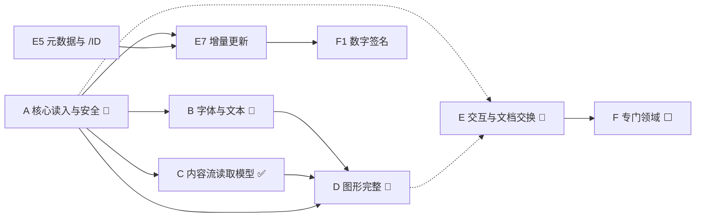

# PDF 库开发路线图（ROADMAP）

> 目的：把 `docs/FEATURE_MATRIX.md` 中的 ⬜/🟡 条目组织为**可独立验收的增量**，定义执行顺序、依赖与完成口径（「未分配条目（待决策）」除外，它们尚未进入交付计划）。
> 与矩阵的关系：矩阵是**事实层**（只记录代码实测状态与测试证据）；本文件是**规划层**（范围、增量拆分、依赖、验收）。规划条目不复制测试名，完成证据一律回写矩阵对应行。
>
> **2026-10-26 规划修订**：以 `docs/PDF32000_2008/` 重新核对 ISO 32000-1 章节号；修正阶段 A 的完成口径（不再宣称「真实世界 PDF 全部可读」）；把原阶段 C 中的「读端通用内容流模型」拆为独立阶段 C，原 C/D/E 顺延为 D/E/F；条目计数改为按「可独立验收增量」统计。旧阶段与新阶段的对应关系见文末「阶段映射」。
>
> **2026-10-26 评审修复**：按文档评审结论修正规划层——阶段 A 回退为 🚧 并新增 A6 fixture 回归（既有 fixture 全部未接入测试，不满足原则 5）；B5 改为 Table 112 的字体级 `/Resources`（删除不存在的「每字形资源字典」）；D3 增加解码后端选型 spike，D4 明确压缩后端失败的单一契约；E1 拥有 `/Names` 字典语义、E5 拥有 `/ID` 生成/校验（E6/E7 复用）；F 的验收标准直接写入本文档；新增「未分配条目（待决策）」；模块债清单与增量依赖按源码实测重写。

## 规划原则

1. **读写闭环**：每个新特性先明确读端模型、写端生成与往返验证；只有一端的能力在矩阵 Reader/Writer 列分开标注，不得以写端完成代替整体完成。
2. **读端模型先行**：内容流、资源、颜色空间、图像、Shading/Pattern 等读端能力统一建立在阶段 C 的通用内容流模型上，避免各功能重复实现分词与资源解析。
3. **语法层边界**：本库目标是 PDF 语法/对象层读写与数据提取，不实现光栅化、hinting、扫描转换、半调、颜色管理或页面合成。第 10 章整体为非目标；字体条目中的「渲染/hinting」缺口不再作为字体阶段未完成理由。
4. **增量粒度**：一个增量 = 一个可独立评审的 PR，必须包含代码、单元测试、必要时的集成往返测试、矩阵回写；单个增量不同时跨两个阶段的核心目标。
5. **真实样本驱动**：每个阶段结束前至少用一个真实 PDF 做回归；fixtures 必须有来源与许可说明，读端不得 panic。合成样本用于边界与负向用例。
6. **失败语义统一**：解析/解码/安全边界返回类型化错误；任何宽容行为显式实现、测试并记录于矩阵备注（沿用工程约定 #4）。
7. **第三方隔离**：新增解码器/编码器/密码学能力必须先定义 PDF 语义 trait，再由适配器接入（沿用工程约定 #1/#2/#3）。
8. **版本门控**：所有新增读写能力必须接入 `PdfFeature`/`PdfVersion` 机制，写端目标版本不足时返回 `WriteError::UnsupportedVersion` 且不写字节。

## 进度跟踪约定

### 状态机

- 单条目状态：`⬜ → 🚧（进行中）→ ✅`；评审决定不做的转 `❌` 并注明理由。
- 矩阵条目的四态（✅/🟡/⬜/❌）与总状态合并规则以 `FEATURE_MATRIX.md` 图例为准；矩阵条目由 `✅` 降为 `🟡` 必须在备注中写明缺口，并在矩阵「总览」修订记录中登记。
- 禁止 `✅ → ⬜` 回退；除非实现被移除，且须在矩阵备注中注明原因。增量条目与阶段状态的 `✅ → 🚧` 回退仅允许在验收口径修订时发生，并须在矩阵备注与本节「阶段映射」同时记录原因。
- 阶段状态：⬜ 未开始 / 🚧 进行中 / ✅ 完成 / ❌ 放弃。阶段完成后发现验收缺口时回退为 🚧，并记录缺口与补做增量（参见阶段 A 的 A6）。
- 状态只在代码实测后修改，禁止凭印象改动。

### 「完成」定义（三齐）

一个增量标记 ✅ 必须同时满足：

1. **代码实现合入**：功能代码进入主分支；
2. **有对应测试**：单元测试 + 必要的集成往返测试，测试名写入矩阵对应行；
3. **文档同步**：矩阵状态/证据/总览统计同步更新，必要时更新 README 版本特性速查表与本文件阶段状态。

三者缺一，不得标 ✅（至多标 🚧）。

### 更新流程

每次增量完成时按顺序执行：

1. 回写矩阵对应行的状态、Reader/Writer 分列与测试证据；
2. 重算矩阵「总览」统计，使四态计数与表内一致；
3. 勾选本文件对应增量的复选框，更新阶段总览的「已完成/增量数」；
4. 当阶段全部增量 ✅ 时更新阶段状态；若阶段完成口径发生变化，先在本文档「阶段映射/口径变更」中记录。

## 工程约定（依赖、扩展点与失败语义）

以下约定面向全库；条目中的现有模块只是当前实例，同类新增实现同样适用。

1. **第三方库必须隔离在 PDF 语义 trait/适配器之后**：
   - 代码实现方案优先级：Rust 标准库 > 成熟第三方库/本地实现；
   - 需要在实现内部使用第三方能力时，禁止直接调用第三方库，必须先定义稳定的 trait，再由适配器实现（现有示例：`filters::InflateBackend` 封装 `flate2`；`CffOutlineParser` 封装 `ttf-parser`；`JpegBackend` 封装 `zune-jpeg`；`CryptoBackend` 封装 RustCrypto 原语）。
2. **扩展优先于修改核心调度**：新增能力应通过既有扩展点（trait、注册表、可注入后端）接入；核心调度逻辑保持稳定，不得为单个实现修改调度分支。现有实例：过滤器经 `filters::StreamFilter` + `builtin_filters` 注册，`decode_stream` 不改动，`decode_stream_with` 支持注入/覆盖。
3. **抽象须可替换、可验证**：每个扩展点都要有替代实现的测试，证明核心只依赖抽象而非具体实现；新增扩展点时同步交付该测试。
4. **边界失败语义统一**：所有解析、解码与安全边界对损坏、截断或非法输入返回类型化错误（`DecodeError`、`FontError`、`ParseError` 等），不得 panic；任何宽容恢复或降级行为必须显式实现、有测试覆盖并记录在矩阵备注中。
5. **模块拆分约定**：单个 `.rs` 文件超过约 600 行或 25 KiB，或同时承担多个职责时，必须解构为目录模块（`foo/mod.rs` + 子模块）；编解码器实现、码表、测试应分文件；既有超限模块列入「工程债」逐项拆分，新增功能不得继续扩大超限文件。
6. **PDF 标准特性实现约束**：当前库实现的所有 PDF 标准特性都必须接受 PDF 版本机制管理。
7. **读写对称**：新增写端特性时，矩阵必须同时评估读端状态；只写不读的能力在阶段验收中不得被称为「完整」。
8. **fixtures 纪律**：真实 PDF 放入 `tests/fixtures/` 并在本文档登记用途与来源；测试必须能在无网络环境运行，fixture 体积保持可控。

## 工程债：模块目录化

已完成拆分（历史记录）：

- [x] `filters`：`filters/{mod,ascii,flate,lzw,predictor,tests}.rs`
- [x] `ccitt`：`ccitt/{mod,decoder,tables,tests}.rs`
- [x] `reader`：`reader/{mod,lexer,object,parser,document,xref,tests}.rs`
- [x] `writer`：`writer/{mod,value,version,serialize,context,document_writer,tests}.rs`
- [x] `types`：`types/{mod,version,features,value,document,tests}.rs`
- [x] `content`：`content/{mod,types,serialize,stream,tests}.rs`
- [x] `builder`：`builder/{mod,types,assemble,tests}.rs`
- [x] `type1_program/charstring`：实现与测试分文件
- [x] `reader/font`：`font/{mod,descriptor,encoding,simple,tests}.rs`
- [x] `reader/text`：`text/{mod,tokenizer,tests}.rs`
- [x] `reader/font/cid_cmap`：`cid_cmap/{mod,cid,token,to_unicode,tests}.rs`（2026-10-27，B6）
- [x] `reader/annotation`：`annotation/{mod,entries,subtype,link,measure,redact,mk,flags,watermark}.rs`（540+222+572+73+291+50+273+73+70 行，2026-10-28，E2 Line 切片前置；原 `annotation.rs` 782 行；测试同步目录化 `annotation/tests/{mod,support,entries,subtype,geometry,link,measure,redact,mk,dates,watermark}.rs`，公开 API 与既有测试名零改动；2026-10-29 几何切片把 Square/Circle/Polygon/PolyLine 解析并入 `subtype.rs`，2026-10-29 Link 切片把 Table 173 条目抽入 `link.rs`，2026-10-29 Measure 切片新增 `measure.rs`；2026-10-29 Redact 切片新增 `redact.rs`（Table 192 条目解析）；2026-10-29 外观特性切片新增 `mk.rs`（Table 189/247 的 `/MK` 与 `/IF`），`mod.rs` 只增 `appearance_characteristics` 字段与一行调用，升至 598 行、逼近约定 #5 的 600 行阈值；2026-10-29 Watermark 切片先把 `AnnotationFlags`（Table 165 十位 + 访问器）原样拆入 `flags.rs`（73 行），再新增 `watermark.rs`（Table 190/191 的 `/FixedPrint`），`mod.rs` 598→540 行）
- [x] `builder/types/annotation`：`annotation/{mod,kind,guard,subtype,free_text,geometry,link,measure,border,redact,mk,watermark}.rs`（585+121+40+486+361+148+97+367+79+149+344+101 行，2026-10-28，E2 Line 切片前置；原 `types/annotation.rs` 651 行；Line 专有条目成组入 `subtype.rs::LineEntries` 以保持 `mod.rs` 在阈值内；2026-10-29 FreeText 切片把 FreeText 专有条目成组入 `free_text.rs::FreeTextEntries`；2026-10-29 几何切片把 Square/Circle/Polygon/PolyLine 条目成组入 `geometry.rs::GeometryEntries`；2026-10-29 Link 切片把 `/H` `/PA` 成组入 `link.rs::LinkEntries`；2026-10-29 Popup 切片把 `AnnotationKind` 拆入 `kind.rs` 使 `mod.rs` 回到 600 行阈值内；2026-10-29 Measure 切片新增 `measure.rs`；2026-10-29 `/AP` 状态子字典与 `/AS` 切片扩写 `mod.rs`；2026-10-29 `/Border` 切片把旧式边框数组拆入 `border.rs::BorderArray` 使 `mod.rs` 回到 586 行；2026-10-29 Redact 切片把 Table 192 条目成组入 `redact.rs::RedactEntries`，`mod.rs` 因新增 `redact` 字段升至 597 行；2026-10-29 外观特性切片把 Table 189/247 成组入 `mk.rs`，同时把 `require_kind`/`require_kind_in` 拆入 `guard.rs`（40 行），`mod.rs` 597→580 行；2026-10-29 Watermark 切片把 Table 190/191 的 `FixedPrint` 成组入 `watermark.rs`（`with_fixed_print`/`validate_fixed_print` 同处），`mod.rs` 仅加字段与模块声明，580→585 行）
- [x] `reader/annotation/kind`：Table 169 子类型表从 `annotation/mod.rs` 抽出为 `kind.rs`（185 行，2026-10-28，E2 子类型表校准切片；`mod.rs` 590→484 行；`TABLE_169` 为名称/引入版本/标记类的唯一权威表，写端 `AnnotationKind::subtype()` 复用同一张表，builder 侧不再自带第二份版本表）
- [x] `tests/interactive`：目录模块 `tests/interactive/{mod,navigation,metadata,annotation,annotation_appearance,annotation_geometry,annotation_link,annotation_measure,annotation_mk,annotation_popup,annotation_redact,annotation_subtype_table,annotation_watermark,form,embedded,incremental,signature}.rs`（`mod.rs` 35 行 + 主题文件 54–454 行，2026-10-28，E2 子类型表校准切片前置；原 `tests/interactive.rs` 1189 行 / 43.5 KiB 超约定 #5 阈值；`mod.rs` 以 `#[path = "../support/mod.rs"] mod support;` 复用共享夹具，因目录模块不被 cargo 自动发现，`Cargo.toml` 补显式 `[[test]] name = "interactive" path = "tests/interactive/mod.rs"`；16 项既有测试名与断言零改动；2026-10-29 `/AP` 状态子字典与 `/AS` 切片新增 `annotation_appearance.rs`、Popup 关联切片新增 `annotation_popup.rs` 与 `annotation_subtype_table.rs`、Redact 切片新增 `annotation_redact.rs`、外观特性 `/MK` 切片新增 `annotation_mk.rs`、Watermark 切片新增 `annotation_watermark.rs`（54 行），`mod.rs` 子模块声明同步）
- [x] `builder/types/form_field` + `builder/assemble/form_field`：分别目录化为 `types/form_field/{mod,field,acro_form}.rs`（23+506+116 行）与 `assemble/form_field/{mod,validate,allocate,write}.rs`（36+440+98+169 行），2026-10-29 E4 选择字段 `/TI`/`/I` 切片前置拆分（原 603/632 行超限）
- [x] `tests/interactive/form`：目录化为 `form/{mod,appearance,names}.rs`（340+177+162 行，2026-10-29 E4 同名字段多重表示切片；原 `form.rs` 664 行超约定 #5 阈值；`mod.rs` 保留字段树/`/DR` 字体资源/`/AA`+`/CO`/数据动作四项往返测试，`appearance.rs` 收 `/AP` 状态子字典、`/DR` 非字体资源与 `/Ff` 标志，`names.rs` 收按钮 `/Opt`、选择字段 `/TI`/`/I` 与多重表示；12 项测试名零改动， cargo 路径改为 `form::appearance::*`、`form::names::*`）
- [x] `tests/interactive/annotation.rs` 主题拆分（2026-10-29 E2 Popup 自动成对切片）：636→454 行，拆出 `annotation_popup.rs`（93 行，Popup 关联双向往返）与 `annotation_subtype_table.rs`（113 行，Table 169 子类型集往返），注解级 `/AP` 外观流往返并入既有 `annotation_appearance.rs`（61→118 行）；3 项测试名零改动，cargo 路径改为 `annotation_popup::*`、`annotation_subtype_table::*`、`annotation_appearance::*`；新增 `builder/assemble/annotation_popup.rs`（111 行）与 `builder/tests/annotation_popup.rs`（173 行）而非继续扩写超限的 `builder/assemble/mod.rs`
- [x] `builder/tests` 注解夹具：`tests/support.rs`（42 行，`annot_object`/`annot_object_with_num`/`assert_text_entry` 由 `annotation.rs` 抽出供 `annotation.rs` 与新增 `annotation_line.rs` 共用）
- [x] `builder/navigation` 与 `builder/types/structure` 未再超限：整数 MCID 简写切片（2026-11-01）扩写 `navigation/structure.rs`（约 1030 行，超约定 #5 阈值）与 `types/structure/mod.rs`，见下方 14.7 进度条目；后续结构增量触及前须先按「校验/展开/写出」拆分 `navigation/structure.rs`
- [x] `builder/navigation/structure.rs` 目录化（2026-11-01，工程债车道，提交 `f859935`）：1689 行按主题拆为 `navigation/structure/{mod,limits,plan,element,attributes,objr,stream_mcr,flatten,write}.rs`（76/52/235/231/163/306/185/367/165 行），`mod.rs` 仅编排与 re-export，原 142 行 `//!` 规范引文逐行搬运零缺失；`navigation/mod.rs` 与全仓 9 处 `navigation::structure::` 引用零改动，全量测试逐项相等（lib 2128 + cli 3 + fixtures 14 + interactive 117 + main 86 + syntax 38 = 2389，doctest 3 通过/1 ignored），改动目录 clippy 零告警。下一个超阈值候选：`builder/navigation/mod.rs`（848 行），不在本车道写集内。

**2026-10-26 实测仍超限、后续增量触及前必须先拆分或同步拆分的模块**（按行数降序；阈值见工程约定 #5：>600 行或 >25 KiB）：

> **2026-11-02 全量实测快照（脚本重扫 `src/**/*.rs`，行 >600 或 >25 KiB 共 52 个文件）**：下面的逐条清单只覆盖部分违例、且数字随增量漂移，**以本快照为准**。本清单**尚未登记**的超限文件（按行数降序，行数/KiB）：`reader/accessibility/artifact_attribution_tests.rs` 1182 / 37.7（**2026-11-02 已目录化，见下方债务清单**）、`reader/shading/mod.rs` 1059 / 38.2（**2026-11-02 已目录化**）、`builder/tests/structure.rs` 1015 / 35.6（**2026-11-02 已目录化，见下方债务清单**）、`reader/accessibility/tests.rs` 956 / 30.8（**2026-11-02 已目录化**）、`reader/structure/standard/layout.rs` 889 / 32.0、`builder/tests/acro_form.rs` 888 / 30.5、`builder/types/structure/layout.rs` 881 / 27.3、`reader/action/tests.rs` 812 / 23.5、`reader/shading/tests.rs` 810 / 29.0（**2026-11-02 已目录化**）、`reader/optional_content.rs` 807 / 27.9、`reader/structure/tests.rs` 806 / 26.7、`reader/color_space/mod.rs` 776 / 28.8、`builder/tests/structure_mcr_stream.rs` 739 / 28.7、`reader/annotation/tests/subtype.rs` 736 / 25.5、`reader/annotation/subtype.rs` 710 / 27.5、`builder/assemble/annotation.rs` 717 / 28.4、`reader/content/state.rs` 709 / 25.8、`builder/types/graphics_state.rs` 702 / 25.2、`reader/content/parser.rs` 700 / 24.3；**仅按 KiB 违例而行数低于 600** 的：`types/features.rs` 586 / 26.0、`types/version.rs` 579 / 29.7、`reader/accessibility/artifact_attribution.rs` 551 / 25.6。**执行规则不变**：任何增量只要触及上表未登记但实测超限的文件，须在同一轮把该文件按主题目录化（或与本车道一起拆），不得「先加行再欠债」。
> **本条快照生成时正在飞的三笔拆分**：`builder/tests/structure_objr.rs` 1272 / 46.8（车道 #174）、`reader/image/{tests,mod}.rs` 1191 / 40.5 与 1095 / 43.8（车道 #175，含同目录 `image/jbig2.rs` 720 / 28.0 一并核阈值）、`reader/font/truetype/sfnt.rs` 1165 / 50.0（车道 #173）。**2026-11-02 落地更新**：#174（主树 `75960b1`）、#173（`b8cd014`）、#175（`5b3476f`，含同目录 `jbig2.rs` 719 行一并清偿）三笔已全部落地，见下方对应 `[x]` 条目；同批次 `builder/tests/cid.rs`（#176，主树 `a143c27`）亦已清偿。

- [x] `tests/main.rs`（原 7984 行 / 280 KiB，全仓最大违例）已于 2026-11-01 在隔离 worktree 按主题目录化为 `tests/main/{mod,crypto,font_type1,font_type1_builtin,font_truetype,xref_streams,content_text,builder_type3,builder_*}.rs` 共 23 个文件（`mod.rs` 282 行 / 11.5 KiB 保留头部文档与原 `use` 块 + `#[path = "../support/mod.rs"] mod support;` 复用夹具 + 22 个 `mod` 声明 + 5 个跨文件共享 helper；最大子文件 `builder_shading.rs` 542 行 / 18.5 KiB，其余 80–489 行）；`Cargo.toml` 须显式登记 `[[test]] name = "main" path = "tests/main/mod.rs"`（cargo 不自动发现目录形式的 `tests/main/mod.rs`），沿用 `tests/interactive` 先例；测试集零改动证据：`git show HEAD:tests/main.rs` 与拆分后全部文件的顶层 `fn` 名（95 个 = 81 测试 + 14 helper）排序后 `diff` 为空，去空白行多重集比对「删除行为零」，新增行只有 mod.rs 脚手架；测试 ID 获得主题前缀（如 `xref_streams::circular_prev_chain_terminates_with_warning`），全仓无引用旧扁平路径。提交 `cb95525`，主树全量 2172 与拆前一致（lib 1934 + cli 3 + fixtures 14 + interactive 103 + `tests/main/mod.rs` 81 + syntax 37；doctest 3 通过/1 ignored，不计入）；`rustfmt --edition 2024 --check` 23 个文件全通过，`cargo clippy --lib --tests` 仅 `builder_font_text.rs` 3 处 `collapsible_if` 为 HEAD 原样搬来的历史告警。

- [x] `reader/font/truetype/cmap.rs`（原 1537 行 / 69.2 KiB）已于 2026-11-01 在隔离 worktree 拆为 `cmap/{mod,raw,validate,lookup,reverse}.rs`（198/37/296/260/211 行）+ `cmap/tests/{mod,support}.rs`（408/186 行，测试块 27.6 KiB 故夹具另置）；缝线：`mod.rs` 持 `Cmap`/`CmapFormat`/`parse`/子表选择与 `cmap_priority`，`raw.rs` 持字节读取与 `invalid_cmap`，`validate.rs`/`lookup.rs`/`reverse.rs` 按职责分派；放宽可见性仅 `read_u8/u16/u32`、`checked_add`、`invalid_cmap`、`Cmap::validate`、`Cmap::format2_subheader_glyph`、`Cmap::format8_is_32` → `pub(super)`（+ 10 个测试夹具），`Cmap` 字段与公开 API 不变；19 个测试名与全路径 `core::reader::font::truetype::cmap::tests::*` 零改动，四个引用方（`truetype/mod.rs`、`sfnt.rs`、`subset/cmap.rs`、`subset/source.rs`）未修改仍解析；提交 `834cf51`，全量 2172 与拆前一致（lib 1934 + cli 3 + fixtures 14 + interactive 103 + main 81 + syntax 37；doctest 3 通过/1 ignored，不计入）
- [x] `reader/structure/stream_mcr_tests.rs`（743 行 / 25.3 KiB）与 `reader/structure/stream_mcr.rs`（660 行 / 28.0 KiB，超约定 #5 的两个阈值）已于 2026-11-01 在隔离 worktree 拆为 `stream_mcr/{mod,container,parent,conflicts}.rs`（138/217/249/120 行）+ `stream_mcr/tests/{mod,support,parent_resolution,table_326,edge_cases}.rs`（7/194/303/220/38 行）；`mod.rs` 持模块文档、re-export 与共享缝线（`Spot`/`note`），`container.rs` 持 `MarkedContentContainer`/`StreamMcrDiagnostic`/`StreamMcrRule`/`MarkedContentParent` 类型定义与容器辅助，`parent.rs` 持 `marked_content_parent` 入口与父树定位，`conflicts.rs` 持 `SweepEntry` 与 `diagnostics` 全树扫描；放宽可见性仅 `Spot`/`note`/`OwnerCheck`/`check_stream_owner`/`read_object`/`object_dict`/`page_index` → `pub(super)`（9 处跨文件共享），公开 API 零改动；21 个测试名零改动，全量 2456 与拆前一致（lib 2190 + cli 3 + fixtures 14 + interactive 122 + main 86 + syntax 38 + doctest 3）；提交 `c39d172`。
- [x] `builder/navigation/mod.rs`（848 行 / 33.0 KiB；此前本债清单**漏登记**，只在 `navigation/structure.rs` 条目尾部以「下一个超阈值候选」提及）已于 2026-11-02 在隔离 worktree 目录化为 `navigation/{mod,outline,pages,names,articles,collection,extensions,templates,alternate_presentation}.rs`（414/222/105/92/177/339/101/99/273 行）：`mod.rs` 只保留模块文档、`mod`/`pub use` 重导出、`NavigationState` 定义与访问器、`apply()` 编排与 `set_structure_tree`/`set_mark_info`（`navigation/structure/` 属另一车道写集，故留在入口）；新建 `outline.rs`（`OutlineEntry` + `write_outline`/`write_outline_items` + `OutlineContext` + `/Count` 与 `outline_has_actions`）、`pages.rs`（`page_labels` + `page_labels_dict`/`style_name` + `catalog_dict`/`page_refs`）、`names.rs`（`named_destination`/`named_page` + `name_tree` + `destination_value`/`optional_number`）；简报示例的 `ocg.rs`/`links.rs` 主题在本文件不存在（分属 types/assemble 既有代码），未建空文件；可见性放宽仅到 `pub(super)` 与等效范围的 `pub(in crate::core::builder)`（`name_tree`、`destination_value` 供 `assemble/annotation.rs`、`assemble/embedded_file.rs` 消费），公开 API 与全部测试名零改动，`builder::navigation::` 的 8 处外部引用经重导出全部解析；提交 `2a62eab`，全量 2456 与拆前逐项相等（lib 2190 + cli 3 + fixtures 14 + interactive 122 + main 86 + syntax 38 + doctest 3），9 个文件 `rustfmt --edition 2024 --check` 通过、`navigation/` 路径 clippy 零告警。
- [x] `builder/tests/mod.rs`（拆分前实测 **1758 行 / 61.9 KiB**，本行原登记「1644 行 / 53.1 KiB」已过时；导航测试已独立为 `builder/tests/navigation.rs`，注解夹具已抽出 `tests/support.rs`，Line 注解测试独立为 `tests/annotation_line.rs`，FreeText 注解测试独立为 `tests/annotation_free_text.rs`，几何注解测试独立为 `tests/annotation_geometry.rs`，Link 注解测试独立为 `tests/annotation_link.rs`，子类型表一致性测试独立为 `tests/annotation_subtype_table.rs`，旧式边框测试独立为 `tests/annotation_border.rs`，Popup 关联测试独立为 `tests/annotation_popup.rs`、Redact 注解测试独立为 `tests/annotation_redact.rs`、外观特性 `/MK` 测试独立为 `tests/annotation_mk.rs`、Watermark `/FixedPrint` 测试独立为 `tests/annotation_watermark.rs`（2026-10-29））已于 2026-11-02 在隔离 worktree 拆为 `builder/tests/{mod,common,object_layout,render,version,image_xobject,image_error,image_color_space}.rs`（185/272/26/38/136/274/326/553 行）：`common.rs` 新建，承载跨主题共享夹具（`render`、TrueType/SFNT/Type 1 程序夹具、`find_font_object`、`embedded_program(_stream)`、`font_descriptor`、`numbers`、`scalar`、`assert_image_rejected`），由 `mod.rs` 以 `use common::{…}` 重绑回 `tests` 作用域，故既有 27+ 主题文件的 `use super::*` 解析路径与可见性和拆前完全等价、零改动；`image_*` 四个主题按「写出/零字节拒绝/内联颜色空间」分派；`#[test]` 目录总数前后均 795，入口的 33 项测试总数不变，仅路径获得主题前缀 `builder::tests::<topic>::*`；`mod.rs` 停在 185 行（87 行逐主题头部文档 + 95 条 `mod` 声明本身即下限）；提交 `db2bc2f`，全量 2456 与拆前逐项相等，8 个文件 `rustfmt --edition 2024 --check` 通过、改动文件零 clippy 告警。**顺带新登记**：该目录内 9 个既有主题文件在基线即超阈值（`structure_objr` 1271、`cid` 1217、`shading` 1087、`structure` 1014、`graphics_state` 940、`acro_form` 887、`structure_mcr_stream` 738、`font_program` 722、`structure_standard` 605），须另立车道逐个拆分，不要与后续 builder 测试车道同期。
- [x] `reader/image/mod.rs`（拆分前实测 **1095 行 / 43.8 KiB**）与 `reader/image/tests.rs`（**1191 行 / 40.5 KiB**）已于 2026-11-02 在隔离 worktree 一并目录化为 `image/{mod,parse,entries,model,error}.rs`（58/477/238/77/294 行）+ `image/tests/{mod,support,basic,inline,mask,samples,jpx,jbig2}.rs`（11/72/204/93/276/140/187/251 行），**同车道顺带清偿同目录另一笔超限**：`image/jbig2.rs`（拆前 719 行 / 28.0 KiB，任务简报只列了两笔、实测三笔，已如实扩范围）→ `jbig2/{mod,kinds,model,parse}.rs`（44/146/260/292 行）+ 保留 `jbig2/tests.rs`（352 行）；`jpx.rs`（504 行 / 17.8 KiB）合规未动。缝线：`mod.rs` 持 38 行模块文档头（逐行保留）+ 子模块声明与 re-export，`parse.rs`/`entries.rs` 是**同一个 `impl Document` 跨文件拆分**（顶层编排与条目助手分家）；可见性放宽仅到 `pub(super)` 共 15 项（image 侧 `Result` 别名、`invalid`/`unsupported`、`image_depth`、`jbig2_image_info`、`parse_image_mask`、`image_dimension`、`image_integer`、`image_real_array`、`image_filters`、`resolve_image_value` + `tests/support.rs` 5 个夹具），`jbig2::is_jbig2_filter` 维持原 `pub(crate)`，无一处扩权为 `pub`；核对证据（基线用 `git ls-tree d175bd8` 现取整目录，避免只比单文件的假差异）：`#[test]` 前后均 **52**、非测试顶层条目 149 → 150（新增仅 4 条 `mod` 声明，差集为空）、`fn` 名集合差集恰为那 15 个 `pub(super)` 放宽项（原正则不认带括号可见性，已核对逐项对应）；外部引用零改动：`reader::image`/`ImageModel`/`ImageError`/`ImageMaskModel` 的五个消费点（`reader/opi/tests.rs`、`reader/thumbnail.rs`、`tests/interactive/image_jbig2.rs`、`tests/main/builder_image_model.rs`、`tests/main/builder_separation_intent.rs`）一字未改仍解析；车道提交 `05c1fb5` → 主树 `5b3476f`，全量 **2470** 与拆前逐项相等，20 个文件 `rustfmt --edition 2024 --check` 通过、`cargo clippy --lib --tests` 告警集与存量债完全持平（`reader/image` 相关零告警）。
- [x] `builder/tests/cid.rs`（拆分前实测 **1218 行 / 39.4 KiB**）已于 2026-11-02 在隔离 worktree 按主题拆为 `builder/tests/cid/{cff_subset,program_embedding,descriptor,vertical_metrics,encoding,truetype_subset,mod}.rs`（398/229/192/114/147/159/20 行，最大子文件 13.3 KiB）：`mod.rs` 仅持 6 条 `mod` 声明，四个共享 helper 均为单主题使用故随主题下沉、**零可见性放宽**（新文件无一处 `pub`）；顶层条目多重集前后各 33 且差集为空、`#[test]` 前后均 29、`fn` 名排序 diff 为空；`builder/tests/mod.rs:112` 的 `mod cid;` 一字未改（Rust 自动解析到 `cid/mod.rs`），`assemble/mod.rs:45` 与 `types/mod.rs:39` 是实现侧同名模块不受影响，`grep "cid::"` 在 `builder/tests/` 下零命中；车道提交 `edd6760` → 主树 `a143c27`，全量 **2470** 与拆前逐项相等（lib 2201 + cli 3 + fixtures 14 + interactive 122 + main 89 + syntax 38 + doctest 3，1 ignored 不计），改动文件 `rustfmt --edition 2024 --check` 通过、`cargo clippy --lib --tests` 零新增告警。
- [x] `builder/tests/structure_objr.rs`（拆分前实测 **1272 行 / 46.8 KiB**；本文件此前只在下方 2026-11-02 全量实测快照的「在飞三笔拆分」注里出现，**债清单没有独立条目**，故本条为新增登记）已于 2026-11-02 在隔离 worktree 按目标类型与失败路径拆为 `builder/tests/structure_objr/{mod,support,annotation_target,annotation_rejects,form_target,image_target,table326_contract}.rs`（37/224/227/96/261/269/230 行，最大子文件 10.7 KiB）：原 15 行 `//!` 规范引文（14.7.4.3 Table 325 / 14.7.4.4 / Table 326）逐字保留在 `mod.rs`，三段 `// —— … ——` 分节横幅改写为对应子模块 `//!` 头且其中规范引文原样保留；**`mod.rs` 不做 re-export**——全仓 `grep structure_objr` 只命中 `tests/mod.rs` 的 `mod structure_objr;`，无任何外部文件引用本主题夹具，而把 16 个 `pub(super)` 夹具再导出会触发 16 个 E0364（不能把仅 `pub(super)` 可见的项导出到更外层），故子模块统一 `use super::support::*; use super::super::*;`（与既有 `builder/tests/rendition/` 目录先例同形）；核对证据：`#[test]` 前后均 30、顶层 `fn`（含 15 个夹具）45→45 排序 diff 为空、五个测试文件与原行区间逐字节一致（唯一非逐字点是 `element_of` 签名加 `pub(super)` 后超 100 列被 rustfmt 折成 4 行）；测试全路径获得子模块前缀 `…::structure_objr::<topic>::<name>`、叶名与数量不变，docs 记录的是叶名故无漂移；`tests/mod.rs` 未改；车道提交 `2c50167` → 主树 `75960b1`，全量 2470 逐项相等，改动文件 fmt 通过、`structure_objr` 在 clippy 输出中零出现。
- [x] `reader/font/truetype/sfnt.rs`（拆分前实测 **1165 行 / 50.0 KiB**，本行原登记「1164 行」）已于 2026-11-02 在隔离 worktree 目录化为 `sfnt/{mod,directory,metrics,encoding,outline}.rs`（50/141/78/98/25 行）+ `sfnt/tests/{mod,support,directory,opentype,encoding,vertical}.rs`（9/237/131/127/241/96 行），合计 11 个文件、最大子文件 10.9 KiB：`mod.rs` 持 `SfntFlavor`/`TrueTypeFont`/`invalid_sfnt` 与子模块声明，`directory.rs` 持 SFNT 头与表目录校验，`metrics.rs`/`encoding.rs`/`outline.rs` 按量度/cmap/轮廓分派；**主代码零可见性放宽**（子模块是 `TrueTypeFont` 定义处的后代，私有字段与 `invalid_sfnt` 直接可见），仅 9 个测试夹具 `fn` → `pub(super)`（与 `cmap/tests/support.rs` 同款手法）；核对证据：非测试顶层条目前后各 4 项差集为空、`impl TrueTypeFont` 方法签名多重集 15↔15、`#[test]` 前后均 20、`assert` 出现次数 106↔106，测试路径由 `…::sfnt::tests::<name>` 变为 `…::sfnt::tests::<topic>::<name>`（与 `reader/text/tests/`、`subset/tests/` 形态一致）；外部引用零改动证据：`truetype/mod.rs` 的 `mod sfnt;` 与 `pub use sfnt::{SfntFlavor, TrueTypeFont};` 一字未改且全量编译通过；`directory.rs:67` 的 `is_multiple_of` 告警即原 `sfnt.rs:93` 同一行代码的存量告警（位置随文件移动，非新增）；车道提交 `3840906` → 主树 `b8cd014`，全量 2470 逐项相等，11 个文件 `rustfmt --edition 2024 --check` 通过。
- [x] `reader/font/cid.rs`（拆分前实测 **1141 行 / 40.4 KiB**，登记值 40.4 KiB 为 1000 进制折算）已于 2026-11-02 在隔离 worktree 目录化为 7 个文件（mod.rs 277/10.2, tables.rs 160/6.4, basic.rs 255/9.0, mod.rs 40/1.2, system_info.rs 103/3.1, vertical_metrics.rs 249/7.1, types.rs 108/3.6），最大 `types.rs` 108 行 / 3.6 KiB，全部同时满足约定 #5 的两个阈值：`mod.rs` 持 `CidToGidMap`/`CidFontType2`/`Document::cid_font_type2`/`CidMetrics` 入口与再导出，`tables.rs` 持 `/W`、`/W2` 宽度表解析，`types.rs` 持 `/CIDSystemInfo` 与竖排度量类型，测试另置 `tests/{basic,vertical_metrics,system_info}.rs`；非测试顶层条目前后各 4 项且差集为空、`#[test]` 前后均 15、`fn` 名集合差集只含被放宽为 `pub(super)` 的 7 项（`parse_cid_system_info`、`parse_widths`、`parse_vertical_metrics`、`metric_number` 与 3 个测试夹具），外部引用点 `font/mod.rs`（`pub use cid::{…}`）与 `cid_type0.rs`（`cid::parse_cid_metrics`）零修改仍解析；车道提交 `4d0846b` → 主树 `fe77cda`，全量 **2502** 与拆前逐项相等（lib 2227 + cli 3 + fixtures 14 + interactive 124 + main 93 + syntax 38 + doctest 3），新目录 7 个文件 `rustfmt --edition 2024 --check` 通过、clippy `^warning:` 持平 28。
- [x] `builder/tests/shading.rs`（拆分前实测 **1088 行 / 36.5 KiB**，登记值 36.5 KiB 略低）已于 2026-11-02 在隔离 worktree 按主题拆为 8 个文件（common_options.rs 73/2.8, direct_write.rs 107/4.3, function_sample.rs 372/13.6, mesh_write.rs 156/5.5, mod.rs 23/1.2, rejects.rs 293/10.2, support.rs 114/3.0, version_gate.rs 21/0.7），最大 `version_gate.rs` 21 行 / 0.7 KiB：`mod.rs` 只留头部文档与 `mod` 声明，`support.rs` 承载 10 个跨主题夹具（由子文件 `use super::super::*;` + `use super::support::{…}` 引入，照 `tests/rendition/`、`tests/structure_objr/` 先例，不用 `pub(super) use` 重导出以免 E0364），其余按「直写/网格写/函数样本与位宽/参数拒绝/公共条目/版本门禁」分派；`#[test]` 前后均 28、顶层 `fn` 名集合差集为空（测试叶名零改动，仅路径获得 `shading::<topic>::` 前缀）、可见性放宽仅 10 个夹具到 `pub(super)`；`builder/tests/mod.rs` 与 `docs/` 零改动，`grep "tests::shading"` 外部引用零命中；车道提交 `c716726` → 主树 `28c8d6c`，全量 **2502** 与拆前逐项相等，8 个文件 `rustfmt --edition 2024 --check` 通过、clippy 持平 28。
- [x] `reader/accessibility/artifact_attribution_tests.rs`（拆前实测 **1181 行 / 37.7 KiB**，两阈值均超限）于 2026-11-02 由车道目录化为 7 个文件：`mod.rs` 340 行 / 10.0 KiB（头部 `//!` 规范引文 + 6 条 `mod` 声明 + 全部跨主题夹具：对象号常量、结构树/页面/MCR/OBJR/注解构造器、发现期望辅助）、`shall_rules.rs` 117 行 / 3 tests、`mcr_page_coverage.rs` 125 行 / 4 tests、`tag_suspects.rs` 194 行 / 7 tests、`annotation_rules.rs` 249 行 / 10 tests、`exemptions_and_boundaries.rs` 111 行 / 5 tests、`output_order.rs` 84 行 / 1 tests，最大 249 行 / 9.4 KiB。子文件只需 `use super::*;`——夹具全部留在 `mod.rs`，私有项对子模块天然可见，**可见性放宽零项**，也未用 `pub(super) use` 重导出；`accessibility/mod.rs` 里 `#[cfg(test)] mod artifact_attribution_tests;` 一行未动（Rust 自动解析到同名目录）。核验：`#[test]` 前后 **30↔30**、顶层条目名集合差集为空（64 项 = 11 const + 23 fn + 30 test），测试叶名零改动、仅获得 `artifact_attribution_tests::<topic>::` 路径前缀。车道提交 `72c59ec` → 主树提交 `4778515`，主树全量 **2502** 与拆前逐项相等（lib 2227 + cli 3 + fixtures 14 + interactive 124 + main 93 + syntax 38 + doctest 3，1 ignored），新目录 7 个现存文件 `rustfmt --edition 2024 --check` 通过，clippy `^warning:` 持平 **28**。
- [x] `builder/tests/structure.rs`（拆前实测 **1014 行 / 36.6 KiB**）于 2026-11-02 由车道目录化为 7 个文件：`mod.rs` 28 行（头部文档 + `mod` 声明）、`support.rs` 75 行（跨主题共享夹具）、`tree_write.rs` 237 行 / 3 tests、`attributes.rs` 272 行 / 5 tests、`user_properties.rs` 201 行 / 5 tests、`rejects.rs` 199 行 / 8 tests、`version_gate.rs` 67 行 / 3 tests，最大 272 行 / 9.7 KiB。主题划分按树写出/属性对象与 ClassMap/MarkInfo 与用户属性/拒绝路径/版本门禁；`mark_info_*` 门禁测试随其本体归入 `user_properties.rs`。可见性放宽 **7 项**且全部只到 `pub(super)`，均在 `support.rs`（`build_and_parse`、`assert_invalid`、`assert_version_error`、`one_page`、`name`、`layout_dict`、`attribute_tree`），单主题夹具 `object_dict`/`simple_tree`/`user_property_attribute` 保持私有；子文件按先例用 `use super::super::*;` + `use super::support::{…}`，`pub(super) use` 零处。核验：`#[test]` 前后 **24↔24**、顶层条目名集合差集为空、全目录非空正文行多重集与拆前一致（逐行搬运，含注释与规范引文）、`grep -rn "tests::structure"` 外部引用零命中、`builder/tests/mod.rs` 未动。车道提交 `29c7c36` → 主树提交 `8bb624f`，主树全量 **2502** 逐项相等，新目录 7 文件 rustfmt 通过，clippy `^warning:` 持平 **28**。
- [x] `reader/shading/mod.rs` + `reader/shading/tests.rs`（拆前实测 **1058 行 / 38.2 KiB** 与 **809 行 / 29.0 KiB**（与登记值 1059/38.2、810/29.0 一致，行数差 1 属换行统计口径））于 2026-11-02 由同一车道一起目录化：模块侧 6 个主题文件 （`error.rs` 49、`model.rs` 220、`parse.rs` 250、`pattern.rs` 163、`fields.rs` 305、`bitstream.rs` 110，`mod.rs` 缩到 39 行只留 `//!` 文档 + `mod` 声明 + 原 17 个 `pub use` 重导出），测试侧 `shading/tests/{mod,support,simple,mesh_decode,pattern,page_resources,errors}.rs`（最大 `tests/mesh_decode.rs` 313 行 / 12.1 KiB）。可见性放宽**只到 `pub(super)`**，集中在 `fields.rs`（12 项）、`error.rs`（6 项）、`bitstream.rs`（3 项）、`parse.rs`（1 项）与 `tests/support.rs`（8 项夹具），公开 API 路径经 `mod.rs` 重导出保持不变；`pub(super) use` 零处。核验（主控自己跑，正则取 group(2) 名字集合）：模块侧条目名 **35↔35 对称差为空**、测试侧 **28↔28 对称差为空**、`#[test]` **19↔19**。车道提交 `3715cf8` → 主树提交 `6c1489a`，全量 **2502** 逐项相等，新目录全部文件 rustfmt 通过，clippy `^warning:` 持平 **28**。
- [x] `reader/accessibility/tests.rs`（拆前实测 **955 行 / 30.8 KiB**（与登记值 956 / 30.8 一致，行数差 1 属换行统计口径））于 2026-11-02 由车道目录化为 `tests/{mod,support,language_identifier,multi_language_text,document_language,span_properties,section_language,artifact_properties}.rs`（最大 `multi_language_text.rs` 196 行 / 6.9 KiB、`document_language.rs` 215 行 / 6.9 KiB；`mod.rs` 24 行只放 `mod` 声明与主题索引，父模块 `#[cfg(test)] mod tests;` 一行未动）。跨主题夹具入 `tests/support.rs` 并放宽 **12 项**到 `pub(super)`（`CATALOG`、`ROOT`、`name`、`arr`、`text`、`insert`、`language`、`marked_section`、`multi_language`、`element`、`struct_root`、`assert_malformed`），单主题夹具随主题留在子文件。核验：条目名 **36↔36 对称差为空**、`#[test]` **18↔18**、测试叶名零改动（仅多 `tests::<topic>::` 前缀）。车道提交 `3d2c758` → 主树提交 `84181c5` + `5e1a2de`（后者补记被路径参数漏掉的旧单文件删除：`git commit -- <目录>` 只覆盖目录内文件，同名 `tests.rs` 的删除不在该 pathspec 下，**这条坑要记住**），全量 **2502** 逐项相等，rustfmt 通过，clippy 持平 **28**。
- [ ] `reader/font/type1_program/mod.rs`（1010 行 / 36.0 KiB；Type 1 增量前拆分）
- [x] `reader/security/standard.rs`（拆分前实测 **1289 行 / 49.2 KiB**（50375 字节），本行原登记「998 行 / 35.2 KiB」已过时）已于 2026-11-02 在隔离 worktree 目录化为 `security/standard/{mod,auth,key,filters,decrypt,strings,tests}.rs`（137/202/114/142/155/45/550 行，最大文件同时满足约定 #5 的两个阈值；`mod.rs` 持模块文档、`SecurityHandler` 编排与 re-export，`auth.rs` 持口令认证与 `/O`/`/U` 校验，`key.rs` 持文件密钥派生，`filters.rs` 持 `/Filter`/`/StmF`/`/StrF`/`/CryptFilter` 名称解析，`decrypt.rs` 持 RC4/AES 流解密与 `decrypt_value`，`strings.rs` 持十六进制与口令填充）；可见性放宽仅 14 个私有条目 → `pub(super)`（`from_dict`、`decrypt_value`、`decrypt_bytes`、`explicit_crypt_filter`、`crypt_filter`、`pad_password`、`derive_owner_key`、`recover_user_password`、`derive_file_key`、`validate_user_password`、`PASSWORD_PADDING`、`FileKeyParams` 及其 7 字段、`pdf_string`、`decode_hex`、`encode_hex`），`security/mod.rs` 未动、公开与 `pub(crate)` API 路径零改动；核对证据：非测试顶层条目前后各 26 项且差集为空、`#[test]` 前后均 20、函数名集合逐项相同；提交 `4ed0742`，主树落地后全量 2456 与拆前逐项相等（lib 2190 + cli 3 + fixtures 14 + interactive 122 + main 86 + syntax 38 + doctest 3）；改动文件 `rustfmt --edition 2024 --check` 通过，clippy 无新增告警（仅 1 条继承自原 `standard.rs:425` 的历史 `is_multiple_of` 告警）。
- [ ] `builder/types/shading.rs`（982 行 / 32.0 KiB；D6/D7 前拆分；D5 为读端增量未触及）
- [x] `builder/mod.rs`（已拆分，2026-10-27：912→497 行 / 21.2 KiB；`patterns.rs` 178 行、`text_codes.rs` 105→359 行、`navigation/{mod,validate}.rs` 461+156 行）
- [x] `reader/text/tests.rs`（拆分前实测 **1380 行 / 45.1 KiB**，本行原登记「1358 行 / 44.2 KiB」）与 `reader/text/mod.rs`（拆分前实测 **1371 行 / 50.2 KiB**，本行原登记「1350 行 / 48.8 KiB」）已于 2026-11-02 在隔离 worktree 一并目录化：`text/{mod,tokenizer,matrix,state,error,context,oc_visibility,operator,fonts,resolve,document}.rs`（95/429/61/382/34/282/173/121/59/38/202 行，`tokenizer.rs` 原本合规未动）+ `text/tests/{mod,support,simple_fonts,composite_fonts,content_operators,page_tree_limits,form_xobjects,marked_content,artifacts_fragments}.rs`（10/190/198/153/123/167/126/223/254 行）；`mod.rs` 95 行仅持模块文档、限额常量、子模块声明/再导出与 `extract_text` 分派；可见性放宽仅 `pub(super)`（lib 侧 51 处：`state` 32、`context` 7、`matrix` 6、`operator` 2、`resolve` 2、`oc_visibility` 1、`fonts` 1，另 `tests/support.rs` 15 处夹具），公开 API 零改动——外部引用点仅 `content/parser.rs`（`text::tokenizer`）与 `tests/main/content_text.rs`（`text::TextFragment`，经 `pub use` 解析），两处均零修改仍解析；核对证据：归一化可见性后原 `mod.rs`+`tokenizer.rs` 顶层条目 54/54 全命中（新增仅 9 条 `mod` 声明与被拆开的 1 个 `impl ExtractionContext` 头），测试 `fn` 名集合 86=86 逐项相同、`#[test]` 66=66；提交 `ea8c7e4`，主树落地后全量与拆前逐项相等；`rustfmt --edition 2024 --check` 改动文件通过，clippy 前后告警集完全一致（28 条历史债，零新增）。剩余缺口不变：OCMD 求值与 `/Artifact` 写出 API 仍缺（原「已超限未拆分」一项现已清偿）。
- [x] `builder/assemble/mod.rs` 目录化（2026-11-01，工程债车道，master 合并提交见 `git log`）：2201 行的单一编排文件按职责拆为 `assemble/{mod,preflight,page_tree,alloc_forms,alloc_annotations,alloc_pools,alloc_groups,images,resource_objects,feature_profile,catalog_tree,form_stream,plan,indirect_objects,colorspace,graphics_state,utils}.rs`（`mod.rs` 2201→152 行，仅保留 doc 头、模块声明与 `assemble_document` 编排；子模块 75–355 行，最大 `preflight.rs` 355、`page_tree.rs` 237、`alloc_forms.rs` 227），逻辑逐行镜像、公开 API 零改动；拆分在隔离 worktree 完成后与 master 合并（唯一冲突 `mod.rs` 的 `/TU` 特性画像 5 行，已原样移植进 `feature_profile.rs`），全量测试与合并前基线逐项一致（lib 1904 + cli 3 + fixtures 14 + interactive 101 + main 81 + syntax 37）；本文件此前的历史记载（Popup/Redact/`/MK`/Watermark 切片的分支位置）保持不变。
- [ ] `reader/font/truetype/glyph.rs`（816 行 / 29.6 KiB；字形增量前拆分）
- [x] `reader/text/mod.rs`（1371 行 / 50.2 KiB）——已于 2026-11-02 与 `reader/text/tests.rs` 同车道目录化清偿，详见上一条 `reader/text/tests.rs` 记录（提交 `ea8c7e4`）；后续文本增量前无需再拆分，但新增片段/可选内容逻辑应继续落在 `text/{state,context,oc_visibility,operator}.rs` 对应主题文件。
- [ ] `builder/tests/font_program.rs`（722 行 / 25.1 KiB；新增字体程序测试前拆分）
- [ ] `reader/tests.rs`（689 行 / 26.1 KiB；新增读端测试前拆分）
- [ ] `builder/types/image.rs`（675 行 / 25.0 KiB；D2/D7 前拆分）
- [x] `builder/assemble/shading.rs`（原 651 行 / 20.9 KiB）已于 2026-11-01 在隔离 worktree 拆为目录模块 `shading/{mod,mesh,encode,tests}.rs`（176/263/206/32 行）：`mod.rs` 持着色字典组装入口与共享缝线，`mesh.rs` 持三角形/顶点网格（Table 118/119  bits 打包与补丁流），`encode.rs` 持函数样本编码与位宽计算，`tests.rs` 保留既有测试名；放宽可见性只到 `pub(super)`（17 处：跨文件共享的编码/网格/字典组装函数与 `BitWriter`），无一处放大为公开 API，调用方 `assemble/mod.rs` 与 `types/mod.rs` 未触及；提交 `d4a62c2`，全量 2172 与拆前一致（同上计数）、改动文件 `rustfmt --edition 2024 --check` 通过、`cargo clippy --lib --tests` 无新增告警
- [ ] `reader/optional_content.rs`（813 行 / 28.1 KiB；B7 已触及仍未拆分，后续可选内容增量前拆分配置解析与 OCMD 求值）
- [ ] `builder/tests/graphics_state.rs`（606 行 / 20.5 KiB；新增图形状态测试前拆分）
- [x] `tests/main.rs`（原 7957 行 / 279.8 KiB）已按主题拆分完成，见上一节债务清单同文件条目（2026-11-01 提交 `cb95525`）；新增集成测试一律落到对应主题文件，不再写回单文件。
  - 已完成（2026-10-28）：阶段 E/F 交互主题 13 项集成测试迁出为独立目标 `tests/interactive.rs`（1130 行 / 42.1 KiB：E1 导航、E2 注解与外观流、E4 AcroForm 与 `/DR`、E5 元数据/XMP、E6 嵌入文件、E7 增量更新、F1 签名增量）；共享辅助（`parse_buf`/`parse_buf_with_password`/`parse_buf_result`/`sample_doc`）迁入 `tests/support/mod.rs`（`#![allow(dead_code)]`，由各主题文件 `mod support;` 引入）。迁移前后集成测试均为 131 项、全量 1258 通过（1 ignored），测试名与断言未改。**今后新增交互特性（注解/表单/动作/嵌入文件/增量/签名）的集成往返测试写入 `tests/interactive/` 对应主题文件**（2026-10-28 第三 tranche：该单文件已按主题目录化，见下）。
  - 已完成（2026-10-28，第二 tranche）：「语法与文件结构（第 7 章）」主题 37 项集成测试迁出为独立目标 `tests/syntax.rs`（1601 行 / 59.2 KiB：词法与对象头、经典交叉引用表与 XRef 流、对象流、历史 `/Prev` 链、流过滤器解码、写出布局与 Name 转义、版本与特性门控往返）；跨主题辅助 `zlib`/`try_write` 追加进 `tests/support/mod.rs`（118 行）。测试名与断言零改动，迁移前后集成测试均为 149 项、全量 1270 通过（另有 1 doctest ignored）。**今后新增第 7 章语法/交叉引用/写出布局的集成测试写入 `tests/syntax.rs`。**
  - 已完成（2026-10-28，第三 tranche）：`tests/interactive.rs`（1189 行 / 43.5 KiB，超约定 #5 阈值）按特性拆为目录模块 `tests/interactive/{mod,navigation,metadata,annotation,form,embedded,incremental,signature}.rs`；crate 根集成文件的子模块解析在 `tests/` 下而非 `tests/interactive/`，故 `mod.rs` 需 `#[path = "../support/mod.rs"] mod support;`，且目录形态不被 cargo 自动发现、需在 `Cargo.toml` 显式声明 `[[test]]` 路径。拆分前后 interactive 目标均为 16 项测试、测试名与断言零改动（本切片新增 `builder_annotation_subtype_table_roundtrips_through_parser` 后为 17 项）。
  - 待迁出主题：字体与文本（第 9 章）、内容与图形（第 8/10/11 章）、过滤器与加密（7.4/7.6、7.6.x）。

**接近约定 #5 阈值（>580 行），下一次注解增量触及前须先继续按子类型外拆**：`src/core/builder/types/annotation/mod.rs`（585 行 / 19.4 KiB，Watermark 切片加 `fixed_print` 字段与模块声明后 580→585；下一次触及前可再外拆）；读端 `src/core/reader/annotation/mod.rs` 在 Watermark 切片先把 `AnnotationFlags` 原样拆入 `flags.rs`（73 行）后退回 540 行 / 23.4 KiB，脱离阈值；`src/core/builder/assemble/annotation.rs` Watermark 切片 562→576 行（`/FixedPrint` 为直接字典、无新对象分配），仍在阈值内；子类型专有条目已各自成模块（`mk.rs`/`watermark.rs`/`redact.rs`/`link.rs`/`measure.rs`/`border.rs` 等），后续新增子类型条目须继续新建子模块，只在 `mod.rs` 保留字段与一行调用。

## 阶段总览

| 阶段 | 目标 | 增量数 | 已完成 | 主要依赖 | 状态 |
|---|---|---|---|---|---|
| A 核心读入与安全 | 语法/文件结构/核心过滤器/加密/函数可读 | 6 | 6 | — | ✅ |
| B 字体与文本 | 字体字典、程序、编码、文本提取（语法层） | 7 | 5 | A | 🚧 |
| C 内容流读取模型 | 通用 Op/资源/状态/标记内容读取，解除第 8/9/11/14 章读端缺口 | 5 | 5 | A | ✅ |
| D 图形完整 | 颜色/图像/Shading/透明度的读端模型与写端收尾 | 7 | 3（D1、D4、D5 完成；写端基线见 D0） | A、B、C（D3 只需 A） | 🚧 |
| E 交互与文档交换 | 导航/注解/表单/元数据/嵌入文件/增量更新 | 7 | 0（E1 读写切片完成，其余子项待补） | D（E1/E3/E5 只需 A） | 🚧 |
| F 专门领域 | 签名/Tagged PDF/预印/多媒体/其他交换能力 | 5 | 0 | E | ⬜ |

> 计数口径：只统计仍需推进的「增量」；阶段内已完成的历史工作以「基线」列出并指向矩阵，不重复计入增量数。阶段状态以「阶段目标是否全部达成」为准，不以历史基线多少为准。

## 阶段 A：核心读入与安全 🚧

**目标**：常见 PDF 1.0–1.7 的语法、文件结构、核心过滤器、加密与函数可读；读端对损坏输入返回类型化错误而非 panic。

**已完成基线**（证据与测试名见 `FEATURE_MATRIX.md` 第 7 章对应行）：

- [x] A1 词法与对象模型：7.2、7.3.2–7.3.10；嵌套上限、流长度与间接引用解析。
- [x] A2 文件结构与交叉引用：7.5.2–7.5.8（经典表/ XRef 流/ ObjStm/ `/Prev` 链/混合引用）、7.7.2 Catalog 版本覆盖。
- [x] A3 核心过滤器：7.4.1–7.4.6、7.4.8、7.4.4.4（Flate/LZW/CCITT/DCT/ASCIIHex/ASCII85/RunLength/Predictor），第三方后端经 trait 隔离。
- [x] A4 安全：7.6.2/7.6.3/7.4.10 的 Standard Security Handler R2–R4 解密（RC4-40/128、AESV2、`/EncryptMetadata false`、`/Crypt`），公钥与 R5/R6 明确不支持。
- [x] A5 Functions 与线性化容忍：7.10 Type 0/2/3/4 读端求值；附录 F 线性化文件按普通路径完整可读（不利用 hint 流）。

**待推进增量**：

- [x] **A6 真实样本回归与 fixture 纪律**（原则 5、工程约定 #8）：把 `tests/fixtures/minimal-document.pdf` 与 `tests/fixtures/pdflatex-4-pages.pdf` 接入自动化测试（文档解析、页面树遍历、文本提取冒烟），在 fixtures 表补齐来源/许可/体积；用至少一个真实 PDF 验证损坏输入不 panic。`tests/main.rs` 已超限，接入前按「工程债」要求先把对应主题迁出为独立测试模块。
  - 退出标准：两个 fixture 在 `cargo test` 中自动运行（新增用例位于拆分后的主题模块）；二者的来源/许可/体积已登记；无法追溯许可的既有 fixture 由 A6 决定替换为自生成样本并记录决策；截断副本返回类型化错误而非 panic。
  - **完成记录（2026-10-26）**：新增 `tests/fixtures.rs` 集成测试（5 项：`minimal_document_parses_without_error`、`pdflatex_4_pages_parses_without_error`、`truncated_minimal_document_returns_typed_error`、`truncated_pdflatex_4_pages_returns_typed_error`、`corrupted_pdf_returns_typed_error_not_panic`）；fixtures 表已登记体积，来源/许可标「待追溯」；既有 fixture 许可未确认，待后续决策是否替换为自生成样本。

**完成口径**：仅指上述 A1–A6。本阶段验收**只看 Reader 列**：A 范围内条目 Reader ✅ 即达成基线，Writer 侧缺口不参与本阶段判定（例如过滤器 Writer 列为 🟡 是「透传/剥离，不主动编码」的已知策略）。以下**不属于**阶段 A，避免「A 完成 = 所有真实 PDF 可读」的误读：

- JBIG2/JPX 解码 → D3；
- 图像字典/内联图像/图像蒙版读端 → D2；
- 通用内容流 Op 模型 → C；
- 增量更新写出 → E7；
- Name Dictionary（7.7.4 `/Names`）→ E1；Filespec/`/EmbeddedFiles` → E6；Extensions 字典 → F5；
- 非 ISO 32000-1 的 `<~ ~>` ASCII85 字符串扩展（矩阵 7.3.4 扩展行）不进入阶段 A；
- 权限位解释（矩阵 7.6.3 权限行）已于 2026-11-01 作为 E1 切片落地（`Document::permissions()`），不再待决策；
- 加密写出、公钥安全处理器、PDF 2.0 R5/R6 → 非目标（见文末）。

**验收标准**：

- 含上述过滤器的合成样本与真实样本可解析，解码字节正确；损坏/截断样本返回类型化错误；
- 线性化样本按普通路径读取无错误；
- 真实样本 fixture 已接入自动化测试，来源/许可/体积已登记；
- `cargo test` 全绿；除上文已排除的条目（7.3.4 扩展、7.4.7/7.4.9、7.7.4、7.11；7.12 与 7.6.3 权限行已于 2026-11-01 落地）外，A1–A5 所列章节的矩阵条目 Reader 均为 ✅；上述排除条目的归属见「不属于阶段 A」与「未分配条目」；A6 的 fixture 要求全部满足。

## 阶段 B：字体与文本 🚧

**目标**：能读写 ISO 32000-1 定义的简单字体、Type 0/CID 字体、Type 3 字体与嵌入程序，并提取 Unicode 文本；不做 hinting/渲染。

**已完成基线**（证据见 `FEATURE_MATRIX.md` 第 9 章）：

- [x] B1 简单字体与编码：9.6.2/9.6.6（Standard 14、`/Widths`、`/FontDescriptor`、五种预定义编码 + `/Differences` + AGL；写端宽度/编码/描述符）。
- [x] B2 TrueType 程序：9.6.3（SFNT、cmap format 0/2/4/6/8/10/12/13、水平/垂直度量、复合字形、内建编码、OpenType `OTTO` 读端）。
- [x] B3 CID/Type 0 核心：9.7.4/9.7.5/9.7.6（CIDFontType0/2、`CIDToGIDMap`、W/DW、DW2/W2、Identity-H/V 与嵌入 CMap、CFF 轮廓经 trait 适配）。
- [x] B4 嵌入程序与子集：9.9/9.6.4（Type 1/TrueType/CFF/OpenType 嵌入、`Length1–3`、TrueType/Type 1/CID-CFF/name-keyed CFF 子集、六字母标签、`/CIDSet` 裁剪）。

**待推进增量**：

- [x] **B5 Type 3 完善**（9.6.5，🟡）：按 Table 112 补齐**字体级** `/Resources` 的读写（多级间接引用、资源名解析）与 Table 112 要求的 `/Name`、`/FontDescriptor` 条目，以及可选 `/ToUnicode`；无 `/BaseEncoding` 时的精确码位归属（当前以 StandardEncoding 近似）；`d0`/`d1` 指标与文本提取已有。注意：Table 112 只有一个字体级 `/Resources`，CharProcs 内不存在每字形资源字典。
  - 退出标准：Type 3 字体字典的 Table 112 条目可写→解析→提取往返；字体级 `/Resources` 经多级间接引用可读回；`/Name`/`/FontDescriptor`/`/ToUnicode` 读写往返；负向用例覆盖缺失/非法资源与缺失必需条目。
  - 完成说明（2026-10-27，证据见矩阵 9.6.5）：读端 `Type3Font` 新增 `name`/`descriptor`/`has_to_unicode` 字段，`/FontDescriptor` 复用 `parse_descriptor`（含 `/FontFamily`、`/Ascent` 等 Table 122 条目），`/ToUnicode` 校验为流并由文本提取经 `simple_font_to_unicode` 解析；字体级 `/Resources` 支持任意层间接引用（上限 16 层，超出或成环返回类型化错误），`resources()` 返回最终字典，`resource(document, category, name)` 支持类别字典再解引用与资源名 `#xx` 解码后的匹配（与页面资源查找语义一致）。写端 `Type3Font::with_name`/`with_to_unicode` 与 `Font::with_descriptor` 生效：`/Name` 经 `is_valid_pdf_name` 校验后写出，描述符按 `fill_required_defaults` 补齐必填项且不写 `FontFile*`，`/ToUnicode` 复用 CMap 生成器（bfchar/bfrange 分节），`/Resources` 由调用方以 `with_resources` 提供后原样挂到字体字典。测试：`type3_font_parses_name_descriptor_and_to_unicode`、`type3_font_rejects_invalid_name_descriptor_and_to_unicode`、`type3_font_omits_optional_entries_when_absent`、`type3_font_requires_char_procs`、`type3_font_resources_missing_returns_none`、`type3_font_resources_rejects_non_dict_and_unresolved`、`type3_resources_follow_multi_level_indirect_chain`、`type3_resources_reject_reference_cycle_and_depth_overflow`、`type3_resource_resolves_category_chain_and_escaped_names`、`type3_font_writes_name_descriptor_and_to_unicode`、`type3_font_rejects_invalid_name`、`builder_type3_metadata_and_resources_roundtrip_through_parser`。
  - 剩余缺口：仍不对 CharProcs 求值（只读 `d0`/`d1` 声明指标，不执行绘制操作符）；无 `/BaseEncoding` 时字符码→字形名仍以 StandardEncoding 近似（未实现 Table 112 注的精确归属）；写端不自动生成 `/Resources` 或字形所引用的资源对象，仅透传调用方字典；`/Name` 按 PDF 1.1+ 语义视为可选（PDF 1.0 要求存在，未做版本门控）。
- [ ] **B6 CMap/ToUnicode 完整性**（9.7.5、9.10.3，🟡）：补全 Adobe-GB1/CNS1/Japan1/Korea1 ordering 数据（当前为紧凑近似）；读端 ToUnicode `usecmap` 基座名册（已内置 `Adobe-Identity-UCS`，其余预定义基座待补）；写端 ToUnicode 支持 `usecmap` 继承（已支持 Identity 基座）。
  - 启动前置：先确定 ordering 数据来源、许可证与体积上限并登记到 fixtures 表，不得引入许可不明的 Adobe 数据文件；`reader/font/cid_cmap.rs` 已超限，触及前先拆分。
  - 退出标准：预定义 CMap 与完整 ordering 样本的字符码→CID 映射正确；数据来源/许可/体积已登记；`usecmap` 基座覆盖/裁剪有测试；`text_code_bytes*` 不再静默跳过非法长度。
  - 进度（2026-10-27）：拆分前置已完成——`cid_cmap.rs` 拆为 `cid_cmap/{mod,cid,token,to_unicode,tests}.rs`（39/433/193/320/228 行），行为与既有测试不变。读端 ToUnicode `usecmap` 机制落地：`ToUnicodeMap::parse_lenient_with(data, resolve)` 合并基座映射（本地映射覆盖基座、本地声明 codespace 时裁剪越界继承映射、基座不可解析时保留本地映射），`parse_lenient` 通过该路径仅使用本地映射；`usecmap` 基座覆盖/裁剪已有单元测试。写端 `text_code_bytes`/`text_code_bytes_unicode` 不再静默跳过非法码长：记录首个非法长度（`PageBuild.invalid_code_length`），`build` 返回 `WriteError::InvalidObject` 且零字节输出；两方法拆至 `builder/text_codes.rs`。测试：`tounicode_usecmap_inherits_base_and_prefers_local_mappings`、`tounicode_usecmap_clips_inherited_mappings_to_local_codespace`、`tounicode_usecmap_inherits_all_mappings_without_local_codespace`、`tounicode_usecmap_rejects_duplicate_and_malformed_bases`、`text_code_bytes_rejects_illegal_lengths_at_build`、`text_code_bytes_unicode_rejects_illegal_length_at_build`。
  - 进度（2026-10-27 切片 2）：读端 `ToUnicodeMap` 内置 `Adobe-Identity-UCS` 恒等基座——惰性解析不物化 65536 条映射，仅对 2 字节码按大端 u16 取 Unicode 标量（`char::from_u32` 拒绝孤立代理、本地声明 codespace 时裁剪），`unicode_for` 保持仅本地映射，新增 `resolve_unicode` 供 `Type0Font::decode_codes` 回退；未知基座仍保留本地映射。写端 `CidFont::with_to_unicode_usecmap` 仅接受该基座，`to_unicode_cmap` 在 `/CMapType 2 def` 后写 `/<基座> usecmap`（带基座时 `/CMapName` 改 `/Custom-UCS`），仅声明基座而无显式映射时也生成 CMap，未知基座构建期 `WriteError::InvalidObject` 零字节。测试：`tounicode_identity_base_resolves_unmapped_two_byte_codes`、`tounicode_identity_base_respects_local_codespace`、`tounicode_identity_base_skips_surrogates_and_other_lengths`、`cid_font_to_unicode_usecmap_writes_identity_base`、`cid_font_to_unicode_usecmap_alone_writes_identity_base`、`cid_font_to_unicode_usecmap_rejects_unknown_base`、`builder_to_unicode_identity_base_roundtrips_through_extractor`。
  - 剩余缺口：完整 ordering 数据与来源/许可/体积登记未完成（fixtures 表登记前不引入 Adobe 数据文件）；预定义 ToUnicode 基座名册仅内置 `Adobe-Identity-UCS`，其余基座名仍按未知处理（保留本地映射）；写端 `usecmap` 只声明继承、不展开写出基座映射，代理对与多码元目标一律写 `bfchar`。
- [x] **B7 文本提取语义完善**（9.10，🟡）：跳过 `/Artifact` 标记内容、提供可选的带位置/间距的文本片段 API（不做版面分析）；`/ActualText` 替换与隐藏 OCG 过滤已随 C4 落地，B7 只需补回归样本与 OCMD 可见性。
  - 退出标准：`ActualText`、Artifact、隐藏 OCG 三类样本的提取结果正确；现有文本提取测试无回归；`try_extract_page_text` 错误语义保持。
  - 完成说明（2026-10-27，证据见矩阵 9.2/9.10/14.6）：提取端标记栈把 `/Artifact`（含嵌套继承、内联属性、分隔符抑制）整体排除；新增 `TextFragment` 位置模型（`Tm/Td/TD/T*/TL/Ts`、`cm`、`q/Q`、Form `/Matrix`、`BT` 重置；不含字形推进）与 `Document::extract_text_fragments`/`try_extract_page_text_fragments`/`extract_page_text_fragments`，页面文本与片段共用 `extract_page_state`，错误语义不变；新增 OCMD 求值：`OptionalContentProperties::membership_visible` + `membership_visibility`（`/P` 四种策略、`/VE` 的 `And/Or/Not` 递归与短路、未知组状态返回 `None`），文本提取与 `resolve_marked_visibility` 均支持内联/间接 OCMD。测试：`artifact_marked_content_is_skipped`、`nested_sections_inherit_artifact_state`、`artifact_with_inline_properties_is_skipped`、`artifact_breaks_do_not_insert_separators`、`artifact_text_is_absent_from_fragments`、`fragments_report_show_positions_and_merge_same_position_runs`、`fragments_apply_cm_and_q_q_at_the_ctm_level`、`fragments_track_leading_and_text_rise`、`actual_text_replacement_becomes_a_fragment`、`fragments_apply_form_matrix_and_restore_ctm`、`extract_page_text_fragments_reports_page_errors`、`hidden_ocg_text_is_absent_from_fragments`、`membership_policy_matrix`、`membership_visibility_expression_overrides_policy`、`visibility_evaluates_inline_membership_dictionary`、`indirect_ocmd_hides_section_by_policy`、`ocmd_resolved_through_properties_name`、`inline_ocmd_visibility_expression_overrides_policy`、`builder_text_fragments_report_positions`。
  - 剩余缺口：片段位置不含字形宽度推进（同一行多次 `Tj` 共用起点）；不感知 `/Rotate` 与 MediaBox（坐标为默认用户空间）；内联 OCG 字典（无对象号）可见性仍未求值；`page_marked_content` 的间接 OCMD 引用仍不可判定（回调签名限制）；写端无 `/Artifact` 写出 API；`reader/text/mod.rs` 与 `reader/optional_content.rs` 已超限未拆分。

**非目标（本阶段明确不做）**：hinting、字形光栅化、版面分析、CFF2 子集化、TTC 子集化、OpenType 子集化（保留程序透传 + 子集标签）。

**依赖**：A（过滤器/流解码）。B5 只依赖 A；B7 依赖 C4（标记内容读取模型，已完成），可后置；B6 只触及字体模块。

**验收标准**：

- 写出含嵌入 TrueType、CIDFontType2、Type 1/CFF 子集的文档，重新解析后字体程序/宽度/文本一致；
- 含 CJK 文本的样本可提取为 Unicode；ToUnicode 往返可还原；
- Type 3 字典（含字体级 `/Resources`、`/Name`、`/FontDescriptor`）与 CharProcs 指标往返；
- `cargo test` 全绿。

## 阶段 C：内容流读取模型（跨章节前置）✅ (5/5)

**目标**：提供通用的内容流解析、资源解析与图形状态模型，作为第 8/9/11/14 章读端能力的共同底座；本阶段只做**模型与数据**，不做渲染。

**为什么单列**：当前库只有写端 `content::ContentStream`，读端仅有 `reader/text` 为文本提取做的词法扫描。这导致矩阵第 8/9/11/14 章大量 Reader 列为 ⬜，也让颜色空间、Shading/Pattern、图像、标记内容等读端能力无法复用。该模型是所有后续读端增量的硬前置。

**增量**：

- [x] **C1 内容流词法与 Op AST**：复用并重构 `reader/text/tokenizer.rs`，解析操作符、操作数、内联图像 `BI/ID/EI` 边界、注释/空白/名称转义；未建模操作符保留原始 token 序列以便重新序列化。新增 `reader::content` 目录模块（触及 `reader/text/mod.rs` 前先拆分）。
  - 退出标准：合成内容流覆盖全部 ISO 32000-1 Table A.1 操作符；内联图像二进制数据不被误分词；未知操作符可往返；现有文本提取测试全部通过。
  - 测试：`parse_graphics_state_operators`、`parse_path_construction_operators`、`parse_path_painting_operators`、`parse_text_object_operators`、`parse_color_operators`、`parse_unmodeled_operator`、`parse_empty_stream`、`parse_comments_and_whitespace`、`parse_tj_array_operand`、`parse_dash_pattern_array_operand`、`parse_empty_dash_pattern_array_operand`、`tj_array_with_hex_string_elements`、`tj_rejects_non_array_operand`、`tj_rejects_unterminated_array`、`tj_rejects_name_element_in_array`、`d_rejects_non_numeric_array_element`、`d_rejects_missing_phase_operand`
- [x] **C2 资源解析与页面内容 API**：`Document::page_content_ops`（或等价 API）遍历页面树、合并 `/Contents` 数组、解析 `/Resources` 继承、解析 `/XObject`/`/Font`/`/ColorSpace`/`/Shading`/`/Pattern`/`/Properties` 名称。Form XObject 不在 API 内自动递归：调用方按 `Op::PaintXObject` + `page_resource("XObject", name)` 自行展开（递归深度与防环由调用方控制；C3 状态机只对 `q/Q` 栈限深，不约束 XObject 展开）。
  - 退出标准：`tests/fixtures/pdflatex-4-pages.pdf` 四页均可解析；资源名经 `#xx` 转义可解析；`/Parent` 资源继承有测试。
  - 测试：`page_content_ops_parses_simple_page`、`page_content_ops_returns_error_for_invalid_page_index`、`page_resource_resolves_font_name`、`page_resource_inherits_from_parent`、`page_resource_returns_none_for_missing_resource`、`page_resource_decodes_name_escapes`、`page_content_ops_handles_contents_array`、`decode_name_escapes_handles_various_cases`、`pdflatex_4_pages_all_content_ops_parse`
- [x] **C3 图形状态机**：`q/Q` 栈、CTM、线宽/线帽/线接/斜接/虚线、文本状态、`gs` 应用 ExtGState、颜色/图案当前值；状态复制与恢复语义按 8.4/9.3/11.x。
  - 退出标准：嵌套 `q/Q`、`cm`、`gs`、`Tf/Td/Tm` 的状态快照测试；越界/非法参数返回类型化错误。
  - 实现范围：`reader/content/state.rs` 新增 `ContentStateRunner`/`ContentState`（Table 57 初始值、Table 56 `Q` 空栈为 no-op、`MAX_SAVE_DEPTH`=512 限深）、`run_content_state` 逐操作符快照、`Document::page_content_state_trace`/`page_content_state`（经 `/Resources/ExtGState` 应用 `gs` 的 LW/LC/LJ/ML/SA/D/RI/Font/CA/ca/BM/OP）；文本状态按 9.3/9.4（BT 仅重置 Tm/Tlm、Td 平移 Tlm、TD 设置 leading=-ty、T*/'/" 依 leading 换行）；颜色/图案当前值跟踪 rg/RG/g/G/CMYK/scn/SCN/CS/cs 与分量范围校验。
  - 测试：`q_q_stack_restores_ctm_and_line_width`、`q_stack_underflow_has_no_effect`、`cm_concatenates_matrices_in_prepend_order`、`save_stack_depth_limit_returns_error`、`gs_applies_ext_g_state_parameters`、`unknown_gs_name_returns_typed_error`、`gs_font_name_entry_sets_text_font`、`invalid_state_parameters_return_typed_errors`、`non_finite_matrix_returns_typed_error`、`bt_resets_text_matrices_keeps_text_state`、`td_td_and_t_star_update_matrices`、`tick_and_quote_show_text_move_to_next_line`、`color_operators_track_current_values`、`named_pattern_color_operators_are_modeled`、`out_of_range_device_color_components_return_typed_errors`、`pdflatex_4_pages_state_machine_runs`
  - 剩余缺口：路径/裁剪/图像/Form XObject 的绘制语义不进入状态模型（仅几何与参数状态）；`gs` 的 `/Font` 名称形式只记录名称不解析字号引用；颜色分量个数与 `/ColorSpace` 基色空间的匹配依赖 D1 读端模型。
- [x] **C4 标记内容与可选内容读取语义**：`BMC/BDC/EMC/MP/DP` 嵌套与属性表解析、`/ActualText`/`/E` 提取、OCG 可见性过滤；与 14.6/8.11 的读端模型统一。
  - 退出标准：嵌套标记内容配对错误可诊断；`ActualText` 替换与隐藏 OCG 过滤有测试；属性表支持名称与内联字典。
  - 实现范围：分词器补 `CsToken::Dictionary`（`take_dictionary`，嵌套/字符串感知，`(a>b)` 不提前闭合）并修复名称分词吞分隔符（`]`）的缺口；`parser.rs` 新增 `parse_dictionary_inner` 宽松字典构建（嵌套字典/数组/`num num R` 引用（顶层与数组内）/布尔/字符串/十六进制串）。新增 `reader/content/marked.rs`：`collect_marked_sections`（`BMC/BDC/EMC/MP/DP` 栈配对，`MAX_MARKED_DEPTH`=64 限深，类型化 `MarkedContentError`：`UnmatchedEnd`/`UnclosedSection`/`DepthExceeded`）、`MarkedSection`（span、`point`、`/ActualText`/`/E`/`/Alt`/`/Lang`，字面与 UTF-16BE 十六进制串解码）、属性表支持内联字典与 `/Properties` 名称解析（含兼容写端「名称直指 OCG 字典」形态）、`resolve_marked_visibility` 经目录 `/OCProperties` 判定 OCG 可见性（`/D` BaseState/ON/OFF）、`Document::page_marked_content`。文本提取端（`reader/text`）统一语义：`MarkedFrame` 栈实现隐藏范围不提取、`/ActualText` 整段替换（emit-once）、嵌套继承隐藏态、`EMC` 宽容失衡、Form XObject 内未闭合范围不外泄；`OptionalContentProperties::is_visible` 复用。
  - 测试：`pairs_begin_and_end_with_spans`、`nests_sections_and_closes_inner_first`、`point_operators_are_zero_length_sections`、`bdc_resolves_inline_dictionary_properties`、`bdc_resolves_property_name_through_resources`、`bdc_name_pointing_at_ocg_dictionary_marks_group`、`unmatched_emc_reports_operator_index`、`unclosed_section_reports_outermost_tag`、`depth_limit_is_enforced`、`text_entries_decode_literal_and_hex_strings`、`visibility_resolves_oc_name_and_reference`、`page_marked_content_resolves_properties_and_visibility`、`bdc_keeps_inline_dictionary_property_list`、`bdc_property_dictionary_supports_nested_dict_array_and_reference`、`dp_accepts_property_name_or_dictionary`、`hex_string_operand_in_dictionary_keeps_hex_characters`、`dictionary_with_string_containing_angle_brackets_roundtrips_entries`、`actual_text_replaces_all_shows_in_section`、`actual_text_decodes_hex_string_property`、`bdc_property_name_resolves_through_properties_resource`、`hidden_ocg_section_is_not_extracted`、`visible_ocg_section_is_extracted`、`hidden_ocg_property_resolved_by_direct_reference`、`bdc_name_pointing_at_ocg_dictionary_filters_hidden_group`、`nested_section_inherits_hidden_state_from_parent`、`unbalanced_emc_does_not_break_extraction`、`unclosed_marked_section_in_form_does_not_leak_to_caller`、`pdflatex_4_pages_marked_content_pairs_with_spans`（写→读往返 `builder_optional_content_roundtrips_through_parser` 同步升级为隐藏层不提取断言）
  - 剩余缺口：内联 OCG 字典形态的可见性未求值（OCMD 已随 B7 求值）；间接属性表操作数（`5 0 R /Tag BDC`）不支持；`page_marked_content` 不递归 Form XObject，且其回调签名无法区分间接 OCMD 引用；`/E` 已暴露但未参与提取替换；`/Artifact` 范围识别与位置感知 API 已随 B7 落地；`reader/optional_content.rs` 模块拆分未做。
- [x] **C5 读写模型统一与 roundtrip**：读端 Op AST 与写端 `content::Op` 的映射表；parse→model→serialize→parse 的往返测试；未建模操作符透传策略记录在矩阵。
  - 退出标准：覆盖路径/文本/颜色/XObject/Shading/Pattern/标记内容的往返样本；序列化字节可被现有 parser 重新解析；无 panic。
  - 实现范围：新增 `reader/content/mapping.rs` 三件套——`to_content_op`（读端 `Op` → 写端 `content::Op`，写端不可表达时返回类型化 `OpMappingError`：`NotRepresentableByWriter`（TD 双操作数/d0/d1/BX/EX/内嵌图像/Unmodeled/非 Name/Dict 属性表/非 UTF-8 的 `'`/`"`/`TJ` 串）与 `OperandOutOfRange`（`J`/`j` 非 0–2、`Tr` 非 0–255）；`Tj` 串按字节合法性自动选字面量或十六进制形式）；`from_content_op`（写端 → 读端全函数，唯一有损点为单操作数 `MoveNextLineSetLeading` 映射为 `TD` 且 `tx=0`）；`serialize_ops`（可映射操作符复用写端 `ContentStream` 序列化器，其余走原始回退输出合法语法，保证 `parse → serialize → parse` 模型级无损）。parser 修复：水平缩放关键字从错误的 `Th` 改为规范的 `Tz`；未建模操作数经 `tokens_to_values` 无损捕获（`[ ... ]` 数组含嵌套、`num gen R` 引用、`true/false/null` 类型化、字面量串按字节逐 char、十六进制串大写）。`ContentStream::ops()` 只读访问器与 `LineCap/LineJoin::value()` 公开（纯增量，不改公共签名）。
  - 测试：`horizontal_scaling_parses_tz_keyword`、`graphics_state_and_path_operators_roundtrip`、`text_operators_roundtrip_including_hex_binary_and_escapes`、`td_d0_d1_bx_ex_roundtrip_through_raw_fallback`、`out_of_range_linecap_linejoin_and_render_mode_roundtrip`、`to_content_op_errors_for_variants_without_writer_model`、`show_text_selects_literal_for_utf8_and_hex_for_binary`、`marked_content_operators_roundtrip_name_and_inline_dict`、`color_pattern_xobject_shading_and_extgstate_roundtrip`、`unmodeled_operators_preserve_array_name_and_string_operands`、`from_content_op_maps_writer_stream_ops_and_remaps_losslessly`、`writer_model_ops_map_to_reader_model_shapes`、`inline_image_variant_serializes_and_reparses`、`pdflatex_4_pages_content_model_serialization_roundtrips`（真实四页样本逐页模型无损）、`content_model_roundtrip_preserves_text_extraction`（builder 写出 → 读端模型 → `serialize_ops` → 重解析相等 → 经 `to_content_op` 重建 Form 写出后文本仍可提取）
  - 剩余缺口：内联图像 `Op::InlineImage` 自 D2 起可读写往返（`BI … ID <data> EI`，D2 已修复分词器入口）；写端模型仍缺 TD 双操作数、d0/d1、BX/EX、内嵌图像与 Unmodeled 透传变体（桥接层以原始回退补齐，未扩展 `content::Op` 公共 API）；Latin-1 边界：未建模操作数/属性字典内 `Value::String` 含 ≥0x80 字节时经 `write_value` 按 UTF-8 编码写出、重解析按字节逐 char，模型级不严格相等（ASCII 串往返无损）；`BDC/DP` 的数组/布尔/间接引用形态操作数仍是 `expect_properties` 的既有限制（映射为 Unmodeled 后按写值原样输出，重解析形态不变）；写端 `MoveNextLineSetLeading` 单操作数 `TD` 不合规范的问题仅记录未修（改动公共枚举超出本增量边界）。

**依赖**：A。B 为软依赖（文本提取可在 C1/C2 完成后迁移到统一模型，但不得为迁移而扩大本阶段范围）。

**验收标准**：

- 真实多页 PDF 的内容流可完整解析，操作符计数与资源引用可核对；
- 内联图像、Form XObject、`q/Q`、`gs`、标记内容均有测试；
- 文本提取在切换到统一模型后结果不回归；
- `cargo test` 全绿；矩阵第 8/9/11/14 章中「无通用内容流读端」的备注可被逐项消除。

## 阶段 D：图形完整（读端模型 + 写端收尾）🚧

**目标**：把已完成的图形写端能力补齐读端模型，并补齐写端剩余条目；颜色/图像/Shading/Pattern/透明度达到语法层完整。

**D0 写端基线（已完成，证据见矩阵第 8/11 章）**：

- [x] 8.4.4/8.4.5 ExtGState 读写（`/TR` `/BG` `/BG2` `/UCR` `/UCR2` 已接入；`/TR2` 透传、`/HT` 半色调对象模型见 D6，2026-10-26）；
- [x] 8.6.4–8.6.8 设备/CIE-Based/Indexed/Separation/DeviceN 颜色空间、灰度/CMYK/颜色操作符；
- [x] 8.7 Shading Type 1–7、着色图案与彩色/无色平铺图案；
- [x] 8.9/8.9.6 图像字典常用条目、图像蒙版、软蒙版图像；
- [x] 8.10.1–8.10.3 Form/Group XObject；11.3.5/11.6.4/11.4/11.6.5/11.6.6 透明度写端；
  - 状态校准（2026-11-01，证据见矩阵 11.3.5/11.6.4）：透明度写端条目对应的**读端其实也已存在**，矩阵的 Reader 列此前误标 ⬜，现改为 🟡：`reader/graphics_state/mod.rs` 类型化 `/BM`（含回退数组）、`/CA` `/ca`（0.0–1.0 校验）、`/AIS` `/TK` 与 `SoftMask`（`/G` `/BC` `/TR` `/SMaskInData` `/Matte`），证据测试 `parses_scalar_graphics_state_parameters`、`parses_soft_mask_transfer_function_smask_in_data_and_matte` 等；仍不是 ✅ 的原因是不校验 Table 136 标准混合模式名、`/G` `/TR` 保持原值不解析、AIS 决定的形状/不透明解释只报告不应用（库不做合成渲染）。
- [x] 14.6 标记内容操作符；8.11 可选内容（OCG/OCProperties/Properties/BDC）。
- 说明：8.8.2 PostScript XObject、8.10.4 Reference XObject 不在基线内。

**待推进增量**：

- [x] **D1 颜色空间读端模型**（8.6.4–8.6.8）：解析 `/ColorSpace` 资源（设备、CalGray/CalRGB/Lab/ICCBased、Indexed、Separation/DeviceN、Pattern），支持 `/DefaultGray`/`/DefaultRGB`/`/DefaultCMYK`；Indexed 还原到基色空间；Separation/DeviceN 经 tint 函数求值到备用空间；输出分量数组与空间描述。
  - 退出标准：设备/CIE/Indexed/Separation/DeviceN 样本的样本值解码正确；ICCBased 返回配置文件字节与 `/N`；非法空间返回类型化错误。
  - 完成说明（2026-10-26，证据见矩阵 8.6.4–8.6.8）：新增 `core/reader/color_space/`——`Document::color_space` 解析名字/数组空间（间接引用、流、`/Default*` 经页资源），`ColorSpaceModel` 覆盖设备/CIE/ICCBased/Indexed/Separation/DeviceN/Pattern，`decode_samples` 按 1/2/4/8/16 位 MSB-first 行补位解码并把 Indexed 展到基空间、Separation/DeviceN 送 `Function` tint 求值；非法结构返回类型化 `ColorSpaceError`（Malformed/Unsupported/Function）。剩余缺口：NChannel 与 `/Attributes`/`/Optimize`、Lab 的 `/Attn` 不建模；解码不应用图像 `/Decode` 矩阵（归 D2 样本 API）；颜色操作符分量匹配校验尚未接入 C3 状态机。
- [x] **D2 图像字典、图像蒙版与内联图像读端**（8.9.5/8.9.6/8.9.7）：建模 `/Width`/`/Height`/`/ColorSpace`/`/BitsPerComponent`/`/Decode`/`/Interpolate`/`/Intent`/`/ImageMask`/`/Mask`/`/SMask`/`/SMaskInData`/`/Alternates`；解码内联图像 `BI/ID/EI` 字典与数据；提供样本读取 API（不做合成/渲染）。
  - 退出标准：内联图像与图像 XObject 的字典/样本可读；Stencil/Explicit/Colour Key 蒙版结构可解析；`/Alternates` 列表可遍历；损坏/截断图像数据返回错误。
  - 完成说明（2026-10-27，证据见矩阵 8.9.5/8.9.5.4/8.9.6/8.9.7）：新增 `reader/image`——`Document::image`/`page_image`/`inline_image`/`page_inline_image` 返回 `ImageModel`（字典全字段 + 过滤器链 + 未建模条目 `other`），`samples()` 复用 D1 `ColorSpaceModel` 解码（Indexed 展开调色板、Separation/DeviceN tint 求值、Lab 默认 `/Range`）、再应用 `/Decode` 线性映射（Indexed/Separation/DeviceN 的显式 `/Decode` 返回 `Unsupported`）；`ImageMaskModel::{Explicit, ColorKey}` 覆盖 Stencil/显式蒙版/颜色键蒙版，SMask 要求 DeviceGray 同尺寸且禁止嵌套；`/Alternates` 递归解析并沿用深度上限 8；数据长度、蒙版范围、循环引用均返回类型化 `ImageError`。内联图像修复分词器不可达路径（`CsToken::InlineImage` 按空白/分隔符识别 `EI`），`ContentParser` 产出 `Op::InlineImage`，读端补齐 Table 94 键缩写与 Table 95 颜色空间名缩写。测试：`reader/image/tests.rs` 16 项 + 集成 `builder_images_roundtrip_through_image_model` + 内容层 `inline_image_*` 4 项。剩余缺口：JBIG2/JPX 样本解码归 D3、不做图像合成/渲染、内联 `/L` 不用于修正数据长度、内联 `/OC` 与其他冷门条目仅保留在 `other`。
- [ ] **D3 JBIG2/JPX 解码**（7.4.7/7.4.9）：启动前先做后端选型 spike（纯 Rust 实现 vs 第三方适配器，比较许可证、体积、维护状态与可测试性）并把结论写入增量启动说明；再定义 `Jbig2Backend`/`JpxBackend` trait 与可替换适配器；接入 `StreamFilter` 注册；补 1.4/1.5 版本门控与损坏输入测试。
  - 进度（2026-11-01 拆出「语法层」前置切片，不等后端选型）：D3 的像素解码仍需先做选型 spike，但**元信息读取不依赖任何后端**，故先行的两个切片只解析流头结构——**7.4.9 JPX 语法层读端**（车道 #158：JP2 文件按 signature box→盒树走到 `jp2h` 取 `ihdr` 宽高/分量/位深与 `colr` 色彩空间方法，原始码流按 SOC→`SIZ` 取参考网格与逐分量抽样/位深，`jp2c` 内嵌码流同样取出元信息；截断/未知标记段/非 JPX 数据一律降级 `None`，文档解析永不因此失败；不解码像素即本行「不解析第三方二进制」边界，写端与 `PdfFeature::JPXDecode` 1.5 门禁不动）；**7.4.7 JBIG2 段结构读端**（车道 #159 已于 2026-11-01 落地，见下面两条进度行：segment header 类型与长度、`/JBIG2Globals` 与页内段序列的计数、TextFlags 给出的页尺寸/分辨率）。两者落地后 7.4.7/7.4.9 的 Reader 列至多为 🟡（可读出结构，不能出像素），D3 复选框不因它们勾选。
  - 进度（2026-11-01 JPX 语法层读端切片，证据见矩阵 7.4.9）：先按 `pdftotext -raw` 复核 7.4.9 与 Table 89 的 shall（JPX 须读完整 JPX 文件结构；`/BPC` 在 JPX 下可选且存在即忽略；`/ColorSpace` 缺省时取 JPEG2000 数据、无支持色空间时按通道数 1/3/4 回退 DeviceGray/DeviceRGB/DeviceCMYK）；`reader/image/jpx.rs` 的 `parse_jpx_header` 解析 JP2 盒（signature/`jp2h`/`ihdr`/`colr`）与裸 codestream 标记（SOC→SIZ，跳过带长度可选标记），输出 `JpxHeader`（宽高、瓦片与栅格偏移、每分量 depth/signed/次采样、enumerated 色空间或 ICC 长度）；`ImageModel.jpx` 据此补齐/校验 `/BPC` 与 `/ColorSpace`，`filters/mod.rs` 的 crate 内部 `decode_stream_except` 让 `/Flate + /JPX` 链保留原始 JPX 字节而全局解码行为不变；15 个读单元，全量 2310（lib 2060 + cli 3 + fixtures 14 + interactive 113 + main 83 + syntax 37）。剩余缺口：小波/熵解码与真实像素仍属「不解析第三方二进制」边界（`samples()` 返回类型化 `Unsupported`）；`bpcc`/`cdef`/`pclr`/多 `colr` 优先级/`resc` 分辨率未建模；ICC 概要只取长度；无真实 JPX fixture 与第三方解码器比对；写端无 JPX 专用能力。7.4.7 JBIG2 语法层（队列 #159）沿用同一分层思路，可随后派发。
  - 进度（2026-11-01 JBIG2 段结构语法层读端切片，证据见矩阵 7.4.7）：`reader/image/jbig2.rs` 的 `parse_jbig2_segments` 按 T.88 §7.2 解析段头链与页信息段几何，`ImageModel.jbig2` 对外暴露、`/JBIG2Globals` 经 `/DecodeParms`（含 null 槽）解析间接引用、内联图像按规范拒绝；段文法不在 PDF 规范内，实现时纠正了派单简报的 1/2 字节误记（flags 为 1 字节、类型取低 6 位、`0x40` 为长形式页关联），并记录规范印刷 EOF 段长度与语法差一字节；截断与未知段型只产发现、不改全局解码行为（`filters/mod.rs` 只放开 `decode_params` 可见性）。**像素解码与符号字典重建仍属 D3 边界**，故 7.4.7 Reader 只到 🟡、D3 复选框保持未勾选；写端与 1.4 门禁未变。
  - 退出标准：选型结论已记录；规范/公开样本可解码为位图/分量数据；trait 有替代实现测试；损坏流不 panic；写端仍按透传/剥离策略处理。
- [x] **D4 写端图像压缩**（7.4.4/7.4.8 Writer 列）：定义 `DeflateBackend` 编码 trait，提供 FlateDecode 编码路径（可选 Predictor）；图像/内容流写入时按调用方选择压缩；DCT 保持透传。更新矩阵过滤器 Writer 列与 README 体积说明。
  - 失败语义（单一契约）：默认纯 Rust Flate 后端始终可用；调用方注入的后端失败时必须返回类型化 `WriteError` 且不写出任何字节，**不得静默回退明文**；未请求压缩时保持明文透传。
  - 退出标准：写入→读端解码的字节一致；压缩流体积小于原始流；后端失败路径有测试且不写字节；特性与版本门控正确。
  - 完成说明（2026-10-26，证据见矩阵 7.4.4/7.4.4.4）：压缩位于 `write_object_maybe_compressed` 序列化咽喉点，内存明文不变；Predictor 采用 15（逐行标记 2 = PNG Up），限 8-bit DeviceGray/RGB/CMYK 命名色空间；Flate ≥1.2、预测器 ≥1.3 门控。剩余缺口：仅文档级 opt-in（无逐流粒度）、不编码 TIFF/其他 PNG 过滤函数。
- [x] **D5 Shading/Pattern 读端模型**（8.7）：解析 Shading 字典 Type 1–7、网格流（BitsPerCoordinate/Component/Flag、Decode）、PatternType 1/2、图案流与 `/Resources`；校验域/坐标/函数维数；输出几何与颜色函数描述。
  - 退出标准：Type 1–7 合成样本可读；网格流位打包与 `/Decode` 还原正确；着色/平铺图案资源可解析；非法条目返回错误。
  - 完成说明（2026-10-26，证据见矩阵 8.7）：新增 `reader/shading`，`ShadingModel` 覆盖 Type 1–7（网格按 MSB-first 位流还原顶点记录，`/Function` 存在时每顶点存单参数）、`PatternModel` 覆盖平铺（PaintType/TilingType/BBox/XStep/YStep/Matrix/Resources/图块字节）与着色图案（内联/引用/按 `/Shading` 资源名解析），`page_shading`/`page_pattern` 提供页资源入口；函数维数、位深、Decode 长度与分组完整性返回类型化错误。剩余缺口：Type 4 顶点不做三角形复用展开、平铺图块内容流不做解释、C3 状态机尚未按 `PatternModel` 接线、真实样本 fixture 待补。
- [x] **D6 ExtGState/透明度读端应用与写端剩余**（8.4.4/8.4.5、11.x）：`gs` 接入 C3 状态机已完成（LW/LC/LJ/ML/SA/D/RI/Font/CA/ca/BM/OP）；剩余写端 `/TR2`、`/HT`（半色调对象模型）、SMask `/TR`、`/SMaskInData`；读端 `/Group`、软蒙版图像、`/Matte`（Table 146）结构解析。
  - 退出标准：`gs` 应用后状态快照正确；`/TR2`/`/HT` 写出可被读端解析；`/Matte` 与 `/SMaskInData` 读写样本通过；透明度版本门控保持。
  - 完成说明（2026-10-26，证据见矩阵 8.4.4/8.4.5、11.4/11.6.6、11.5/11.6.5）：写端 `/TR2` 以字典原样透传、`/HT` 建模半色调包装字典（`/DefaultHalftoneType` + 按色料覆盖）与类型 1/2 半色调字典（`/SpotFunction` `/TransferFunction` 复用函数句柄池，同一句柄只写一次）、软蒙版 `/TR`（`/SMaskInData` 限 0–2、`/Matte` 非空有限数组），`/Matte` 由 `PdfFeature::SoftMaskMatte` 门控 ≥1.6；读端新增 `reader/graphics_state/halftone`（`HalftoneModel`：类型 1/2 类型化、类型 3–5/色料数组/命名半色调不建模但保留写出值、包装字典色料与其余条目）与 `reader/group`（`Document::group`/`page_group`：`/S`、`/CS` 经颜色空间模型解析、`/I` 默认 false、`/K` 宽松建模、未知条目入 `other`），`SoftMask` 补 `/TR`、`/SMaskInData`、`/Matte` 与未建模条目透传。剩余缺口：`/HT` 类型 3–5、屏幕字典、命名半色调与 `/HTPO` 不写不建模；`/TR2` 只透传不解释语义；软蒙版 `/G` 仅接受透明组 Form；组内合成/渲染语义不做；图像级 `/Matte` 与图像流尺寸校验放宽归 D7/8.9。
- [x] **D7 写端图像/表单补全**（8.9.5、8.10、11.5）：`/Intent`、`/Alternates` 图像、`/Matte`、Form XObject 自有 `/Resources`/`/OC`/`/Ref`（按价值取舍）、Reference XObject 评估；补齐相应版本门控与往返测试。
  - 退出标准：新增字典条目可写→解析→读回；非法参数不写字节；第三方阅读器语法检查无错误（人工验收）。
  - 进度（2026-10-27，图像字典部分完成）：`ImageData` 新增 `intent`/`alternates`/`matte` 与 `with_*`，写端 `/Intent`（`PdfFeature::ImageIntent` ≥1.4）、`/Alternates`（Table 90 `<< /Image n 0 R >>` 字典数组，`PdfFeature::AlternateImages` ≥1.3）、`/Matte`（写到 SMask 图像字典，`PdfFeature::SoftMaskMatte` ≥1.6）及校验（图像蒙版禁用、替代图像禁嵌套/蒙版/超高分辨率、Matte 分量数按基图）；读端补 `ImageModel::matte` 与 Table 90 替代图像字典。证据见矩阵 8.9.5/8.9.5.4/11.5，测试 `image_writes_intent_alternates_and_matte`、`image_intent_requires_pdf_1_4`、`image_alternates_require_pdf_1_3`、`image_matte_requires_pdf_1_6`、`invalid_matte_parameters_fail_the_build`、`invalid_alternate_images_fail_the_build`、`image_mask_rejects_intent_and_alternates`、`image_matte_is_parsed_on_soft_mask`、`smask_matte_length_must_match_base_components`、`image_matte_rejects_non_finite_and_image_masks`、`image_alternates_accept_table_90_dictionaries`、集成往返 `builder_image_intent_alternates_and_matte_roundtrip`。
  - 完成说明（2026-10-27，Form 部分收尾）：`builder/types/form.rs` 新增 `FormResources`（`fonts`/`images`/`optional_content`，`with_font`/`with_image`/`with_optional_content` 链式构造）与 `FormXObject::with_resources`，`assemble` 为每个在用表单写 `/Resources`（`/Font` `/F<n>`、`/XObject` `/Im<n>`、`/Properties` `/OC<n>`，提供空资源时写空字典以按规范替换而非继承）；表单字体/图片并入文档级 `font_pool`/`image_pool`，与页面相同资源共享对象号，未绘制的表单不分配对象；`FormXObject::with_optional_content` 写表单级 `/OC`（PDF 1.5，`PdfFeature::OptionalContent` 门控），表单 `/OC` 与 `/Properties` 引用的 OCG 并入同一 OCG 池并出现在目录 `/OCProperties`，越界句柄报 `WriteError::InvalidObject` 且零字节。测试 `form_own_resources_write_font_and_image_dictionaries`、`form_resources_share_objects_with_page_resources`、`unused_form_resources_are_not_written`、`empty_form_resources_replace_inherited_resources`、`form_optional_content_writes_oc_and_properties_references`、`form_optional_content_requires_pdf_1_5`、`unknown_form_optional_content_handles_fail_the_build`、集成往返 `builder_form_own_resources_roundtrip_through_parser`。`/Ref`（Reference XObject）按价值取舍不实现：PDF 2.0 已弃用、依赖外部文件规格语义，读写端均不生成/不解析（见矩阵 8.10.4）。剩余缺口：表单资源仅覆盖 Font/XObject/Properties（无 ExtGState/Pattern/Shading/ColorSpace），不写 `/Metadata`/`/PieceInfo`/`/OPI`，不按内容去重；读端文本提取不按表单 `/OC` 求值可见性，替代图像 `/DefaultForPrinting`/`/OC` 仍未建模。

**依赖**：D0 写端基线已具备；逐增量依赖如下——D3/D4 **只依赖 A**，不依赖 C，可与 C 并行；D1 依赖 C2/C3；D2 依赖 C2（资源与内容 API）；D5 依赖 C2/C3；D6 依赖 C3；D7 依赖 D0，其中 Form 自有 `/Resources` 部分与 C2 的资源模型对齐。B 仅在 Pattern 内字体与文本场景为软依赖。

**验收标准**：

- 含 ICCBased/Separation/Pattern/图像/Shading/透明组的样本可读入为模型对象；
- 写端剩余条目补齐后，矩阵第 8/11 章 Writer 列无未解释的 🟡；
- 真实样本（含 JBIG2/JPX 图像）可解析，损坏样本不 panic；
- `cargo test` 全绿。

## 阶段 E：交互与文档交换 🚧

**目标**：导航、注解、表单、元数据、嵌入文件与增量更新基础可用。

**增量**：

- [ ] **E1 导航与页面标签**（12.3、12.4.2、12.7.6）：显式/命名 Destinations、Outline、Page Labels、Named Pages（`/Pages` 名称树）。本增量拥有 7.7.4 `/Names` 名称字典的语义封装（解析、查找、写回），作为 E6 的前置，不得由 E6 另建一套。
  - 进度（2026-10-27 读端切片，证据见矩阵 7.7.4/12.3/12.4/12.7.6）：新增 `reader/navigation/`（`mod`/`page_tree`/`name_tree`/`destination`/`outline`/`page_labels`/`tests`）。公开 API：`Document::page_count`、`name_tree(category)`、`named_destination(name)`、`named_page(name)`、`outline()`、`page_labels()`/`page_label(page_index)`；类型 `Destination`（8 种显式目标）、`Outline`/`OutlineItem`/`OutlineDestination`、`PageLabelStyle`/`PageLabelRange`/`PageLabels`、`NavigationError`。名称树与数值树走独立加固遍历（深度 64、节点 4096、间接引用环检测），大纲另有 10000 项上限与深度 64；命名目标兼容 `/Names /Dests` 名称树与旧式目录 `/Dests` 字典（键 `#xx` 解码）；命名页面要求间接页面引用并经页面树索引映射为 0 基页号。测试：`name_tree_reads_flat_and_kid_nodes`、`name_tree_rejects_cycles_and_depth_overflow`、`name_tree_rejects_malformed_nodes`、`explicit_destinations_parse_all_types`、`malformed_destinations_are_typed_errors`、`malformed_named_destination_is_a_typed_error`、`named_destinations_resolve_from_name_tree_and_legacy_dict`、`named_pages_resolve_page_references`、`outline_reads_titles_destinations_and_children`、`outline_rejects_cycles_and_missing_titles`、`outline_is_absent_without_catalog_entry`、`page_labels_format_styles_prefixes_and_starts`、`invalid_page_label_entries_are_typed_errors`、`page_tree_index_maps_indirect_pages_and_detects_cycles`。
  - 进度（2026-10-27 写端切片，证据见矩阵 7.7.4/12.3/12.4/12.7.6）：新增 `builder/navigation/mod.rs`（461 行）与 `builder/navigation/validate.rs`（156 行）。公开 API：`PdfBuilder::page_labels(&[PageLabelRange])`、`named_destination(name, Destination)`、`named_page(name, page)`、`outline(&[OutlineEntry])`，在 `build` 完成对象组装后统一改写目录（catalog 覆写、导航对象从现有最大对象号之后分配，未改动 `builder/assemble`）：`/PageLabels` 数值树单叶子、`/Names /Dests` 与 `/Names /Pages` 名称树叶子（键按 `PdfTextString` 编码排序、文本串键十六进制写出）、`/Outlines` 根与兄弟链（`/Parent`/`/Prev`/`/Next`/`/First`/`/Last`/`/Count`，展开记可见后代、折叠记负总后代）。构建期校验名称唯一/页码范围与递增/目标操作数有限/缩放 >0/颜色 0–1/大纲深度 64 与条目 10000；版本门控大纲 ≥1.1、命名目标 ≥1.2、页面标签与命名页面 ≥1.3，非法输入与版本不足均零字节。测试：`page_labels_write_number_tree`、`navigation_absent_leaves_catalog_untouched`、`named_destinations_and_pages_write_name_trees`、`outline_writes_linked_items_and_counts`、`navigation_rejects_invalid_input_without_output`、`navigation_version_gates_require_minimum_versions`、`builder_navigation_roundtrips_through_parser`。
  - 进度（2026-10-30 页面演示条目切片，证据见矩阵 12.4）：先用 `pdftotext -raw` 重抽页面对象条目表（Table 30）与 12.4.4——`/Dur`（可选；PDF 1.1）为演示时的页面停留秒数（缺省表示不自动换页）、`/Trans`（可选；PDF 1.1）为切换进入该页时使用的过渡字典（Table 162），二者均为页面字典直接条目、不参与页面属性继承。读端新增 `reader/page_presentation.rs`（`PagePresentationError::{Page,Transition,Invalid}`，实现 Display/source/From）：`Document::page_duration(page_index)` 与 `page_transition(page_index)` 经 `locate_page_node` 读取页面字典并对条目解引用，页面无条目时返回 `None`；`/Dur` 须为有限非负数（负值拒绝），`/Trans` 复用 `reader/transition.rs::parse_transition`（条件同 Transition 动作：缺省样式 `R` 物化、其余缺省不物化）。写端 `PageBuild` 新增 `transition`/`duration` 字段与 `PdfBuilder::set_page_transition(page, &Transition)`/`set_page_duration(page, seconds)`（未知页忽略、重复设置以后一次为准）；`assemble_document` 在任何对象写出前校验 `/Dur` 非负有限与 `Transition::validate()`，新增 `PdfFeature::PagePresentation`（PDF 1.1）门禁条目整体，`Transition::min_version()` 对 Fly/Push/Cover/Uncover/Fade 样式与 `/SS` `/B` 条目要求目标版本 ≥1.5；页字典按声明写 `/Dur`（Float）与 `/Trans`（直接字典）并登记 `PagePresentation` 特性。测试 4 读单元（`page_presentation_reads_duration_and_transition`、`missing_page_presentation_entries_read_as_none`、`indirect_transition_dictionary_is_resolved_and_defaults_apply`、`malformed_page_presentation_entries_are_typed_errors`）+ 5 写单元（新文件 `builder/tests/page_presentation.rs`：`page_transition_and_duration_are_written`、`page_presentation_entries_are_optional`、`page_presentation_requires_pdf_1_1`、`page_transition_extended_entries_require_pdf_1_5`、`invalid_page_presentation_values_are_rejected`）+ 集成 `builder_page_presentation_roundtrips_through_parser`（新文件 `tests/interactive/page_presentation.rs`：两页 `/Dur` 与首页 Split 过渡逐字段回读、未声明 `/Trans` 的页回读 `None`）。全量 1553（lib 1374 + cli 3 + fixtures 14 + interactive 44 + main 81 + syntax 37；另有 doctest 3 通过 / 1 ignored，不计入）。
  - 进度（2026-10-30 页面缩略图切片，证据见矩阵 12.3）：先用 `pdftotext -raw` 重抽 Table 30 与 12.3.4——小节号应为 12.3.4「Thumbnail Images」（此前矩阵/路线图误记 12.3.3）；`/Thumb` 是可选、不参与页面属性继承的 stream 条目（无版本标记，PDF 1.0 起可用），必须是图像 XObject，且只有 `/Width` `/Height` `/ColorSpace` `/BitsPerComponent` `/Decode` 有意义（其余 Table 89 条目应忽略），颜色空间限于 DeviceGray、DeviceRGB 或基于二者的 Indexed。读端新增 `reader/thumbnail.rs` + `thumbnail/tests.rs`：`ThumbnailError::{Page(PageContentError), Image(ImageError), Invalid(String)}`（Display/source/From）与 `Document::page_thumbnail(page_index) -> Result<Option<ImageModel>, ThumbnailError>`——经 `locate_page_node` 取页面字典，无 `/Thumb` 返回 `None`；条目经 `Document::image` 解析（间接引用/直接流皆可），随后拒绝图像蒙版与非 Gray/RGB/Indexed 颜色空间（12.3.4 的 shall 约束），未解析引用与非法条目均类型化。写端 `PageBuild` 新增 `thumbnail: Option<ImageData>` 与 `PdfBuilder::set_page_thumbnail(page, &ImageData)`（未知页忽略、重复设置以后一次为准）；`assemble_document` 在页面绘制图像之后把缩略图并入同一 `image_pool` 去重（同像素复用对象号），新增 `page_thumbnail_nums: Vec<Option<i64>>`，页字典写 `/Thumb` 间接引用且不进入 `/Resources /XObject`；`validate_thumbnail` 在写出前拒绝图像蒙版与非 Gray/RGB/Indexed 颜色空间（`InvalidObject` 零字节）。`/Thumb` 为 PDF 1.0 条目，无新增 `PdfFeature` 与版本门禁。测试 4 读单元（`page_thumbnail_reads_image_entries`、`missing_page_thumbnail_reads_as_none`、`thumbnail_images_are_limited_to_gray_rgb_and_indexed`、`malformed_page_thumbnail_is_a_typed_error`）+ 4 写单元（新文件 `builder/tests/thumbnail.rs`：`page_thumbnail_writes_image_reference`、`page_thumbnail_shares_the_image_pool_with_drawn_images`、`page_thumbnail_is_optional_and_last_wins`、`invalid_page_thumbnails_are_rejected`）+ 集成 `builder_page_thumbnail_roundtrips_through_parser`（新文件 `tests/interactive/page_thumbnail.rs`：2×2 DeviceRGB 缩略图写→解析，尺寸/位深/颜色空间/像素逐项回读，未声明页返回 `None`）。全量 1562（lib 1382 + cli 3 + fixtures 14 + interactive 45 + main 81 + syntax 37；另有 doctest 3 通过 / 1 ignored，不计入）。
  - 进度（2026-10-30 文章线切片，证据见矩阵 12.4）：先用 `pdftotext -raw` 重抽 12.4.3 与 Table 160/161——12.4.3（PDF 1.1）以目录 `/Threads` 数组列出线程字典（Table 160：`/Type /Thread` 可选、`/F` 必填指向首 bead 的间接引用、`/I` 可选信息字典 14.3.3），bead 链（Table 161）每节含 `/T`（thread 字典间接引用；PDF 1.1 要求只在首节出现、1.2 起允许各节都带）、`/N` 下一节、`/V` 上一节（首尾互相指向构成环）、`/P` 页面间接引用、`/R` 矩形，页面字典 `/B` 数组按绘制顺序列出该页 bead。读端新增 `reader/navigation/articles.rs` + `articles/tests.rs`：`ArticleThread{beads,info}`/`ArticleBead{page,rect}` 与 `Document::article_threads() -> Result<Vec<ArticleThread>, NavigationError>`——`/Threads` 缺省为空列表，条目须为间接引用且不得重复，沿 `/N` 跟随 bead 链（已访问对象环检测、上限 `MAX_ARTICLE_BEADS` = 10000 报 `LimitExceeded("article beads")`），首节须带 `/T` 且指向当前 thread、首节之外的 `/T` 若存在亦须指向本 thread，各节 `/V` 须与前一节一致（首节 `/V` 指向末节），`/P` 经页面树索引映射 0 基页号（未命中 `PageNotFound`）、`/R` 四项有限数值，未解析引用与非法条目均类型化。写端新增 `builder/navigation/articles.rs`：`ArticleThread::new(beads)`/`with_info(DocumentInfo)`（14.3.3 信息字典经 `DocumentInfo::to_dict`，`/Trapped` 随版本门控）与 `PdfBuilder::add_article_thread`；`navigation::apply` 在对象号分配前校验非空 bead、页号范围、矩形有限与全档 bead 总数不超过读端上限（`InvalidObject` 零字节），线程与 bead 对象从现有最大对象号之后分配，bead 字典写 `/Type /Bead` `/N` `/V` `/P` `/R`、仅首节写 `/T`，线程字典写 `/Type /Thread` `/F` `/I`，bead 引用按注册顺序并入各页面字典 `/B`，目录写 `/Threads`；新增 `PdfFeature::ArticleThreads`（PDF 1.1）门控与特性登记，特性扫描器补「目录含 `/Threads` → ArticleThreads」。测试 5 读单元（`article_threads_follow_the_next_chain`、`missing_threads_reads_as_an_empty_list`、`broken_bead_chains_are_rejected`、`bead_thread_ownership_and_page_references_are_validated`、`threads_entry_must_be_an_array`）+ 4 写单元（新文件 `builder/tests/articles.rs`：`article_threads_are_written_and_chained`、`article_threads_are_optional`、`invalid_article_threads_are_rejected`、`article_threads_require_pdf_1_1`）+ 集成 `builder_article_thread_roundtrips_through_parser`（新文件 `tests/interactive/articles.rs`：两页一条 thread 的两个 bead 环与页面 `/B` 引用写→解析逐项回读）。全量 1572（lib 1391 + cli 3 + fixtures 14 + interactive 46 + main 81 + syntax 37；另有 doctest 3 通过 / 1 ignored，不计入）。
  - 进度（2026-10-30 便携集合切片，证据见矩阵 12.3）：先用 `pdftotext -raw` 重抽 12.3.5 与 Table 155–158——集合字典是目录 `/Collection` 的直接字典：`/Type /Collection` 可选、`/Schema`（Table 156 `CollectionSchema`）以合法名字为键映射字段字典（Table 157 `/Type /CollectionField` 可选、`/Subtype` 必填 `S`/`D`/`N`/`F`/`Desc`/`ModDate`/`CreationDate`/`Size`、`/N` 必填显示名、`/O` 次序、`/V` 初始可见缺省 true、`/E` 可编辑缺省 false）、`/D` 初始展示文档的 EmbeddedFiles 名称树键、`/View` 取 `D`/`T`/`H`（缺省 `D`）、`/Sort`（Table 158 `CollectionSort`：`/S` 名字或名字数组、`/A` 布尔或布尔数组缺省 true，多余项忽略、缺项按 true）。读端新增 `reader/navigation/collection.rs` + `collection/tests.rs`：`Collection{schema,initial_document,view,sort}`/`CollectionField{key,field_type,name,order,visible,editable}`/`CollectionFieldType`（8 标准值 + `Other`）/`CollectionView`/`CollectionSort` 与 `Document::collection() -> Result<Option<Collection>, NavigationError>`——目录无 `/Collection` 返回 `None`，`/Type` 若存在须匹配，模式键经 `#xx` 解码且重复键报错，`/N` 经 `PdfTextString` 解码，`/V` `/E` 须严格布尔，`/D` 兼容字面量/十六进制字节串，`/View` 闭合集合之外的名字报错，`/Sort` 缺 `/S` 或空数组报错、`/A` 归一化为逐字段布尔、模式存在时排序字段须已声明。写端新增 `builder/navigation/collection.rs`：`Collection::new()/with_schema/with_initial_document/with_view/with_sort`、`CollectionField::new/with_order/with_visible/with_editable`、`CollectionSort::new/with_ascending` 与 `PdfBuilder::collection`；`navigation::apply` 在任何对象写出前校验字段键为合法且唯一的 PDF 名字、`/N` 非空、`/D` 非空、排序必须伴随模式且字段已声明、`/A` 长度匹配（`InvalidObject` 零字节），目录写 `/Collection`（省略缺省 `/View D`、全升序 `/A` 与空 `/Schema`），新增 `PdfFeature::Collection`（PDF 1.7）门控与登记，特性扫描器补「目录含 `/Collection` → Collection」。测试 5 读单元（`collection_reads_schema_view_and_sort`、`collection_defaults_and_absent_entries`、`collection_sort_booleans_and_arrays_are_normalized`、`malformed_collection_entries_are_typed_errors`、`collection_field_subtypes_and_escaped_keys_are_preserved`）+ 4 写单元（新文件 `builder/tests/collection.rs`：`collection_writes_schema_view_and_sort`、`collection_is_optional_and_defaults_are_omitted`、`invalid_collections_are_rejected`、`collection_requires_pdf_1_7`）+ 集成 `builder_collection_roundtrips_through_parser`（新文件 `tests/interactive/collection.rs`：三字段模式、`/D`、平铺视图与降序排序写→解析逐项回读）。全量 1582（lib 1400 + cli 3 + fixtures 14 + interactive 47 + main 81 + syntax 37；另有 doctest 3 通过 / 1 ignored，不计入）。
  - 进度（2026-10-30 集合项 `/CI` 切片，证据见矩阵 7.11/12.3）：先用 `pdftotext -raw` 重抽 7.11.6 与 Table 48/49（此前误记为 Table 45——Table 45 实为嵌入文件流附加条目）；Table 44 的 `/CI` 行（可选；PDF 1.7；须为间接引用）指向集合项字典（Table 48：`/Type` 可选 `CollectionItem`，其余键为文本串/日期/数值或集合子项字典，类型须与集合模式 Table 157 一致），集合子项字典（Table 49）含 `/Type`（可选 `CollectionSubitem`）、`/D` 显示数据（文本串/日期/数值，可选）、`/P` 前缀文本串（可选）。读端新增 `reader/embedded/collection_item.rs` + `embedded/tests/collection_item.rs`：`Filespec.collection_item: Option<CollectionItem>`——`CollectionItem{values: BTreeMap<String, CollectionItemValue>, dict}`、`CollectionItemValue::{Text,Number(f64),Subitem(CollectionSubitem)}`、`CollectionSubitem{datum,prefix,dict}`/`CollectionSubitemValue::{Text,Number}`；`/CI` 须为间接引用且解析为字典，`/Type` 若存在须匹配（`CollectionItem`/`CollectionSubitem`），条目 Bool/Name/Array/Null 与子项 `/D`/`/P` 类型错误一律 `EmbeddedFileError::Malformed`，日期值以文本保存（类型由模式决定）。写端 `builder/types/embedded_file.rs` 新增 `CollectionItem`/`CollectionItemValue`/`CollectionSubitem`/`CollectionSubitemValue` 与 `EmbeddedFile::with_collection_item`（`with_text`/`with_number`/`with_subitem`、子项 `with_prefix`），构建期校验键为合法 PDF 名字、数值有限（`InvalidObject` 零字节）；`builder/assemble/embedded_file.rs` 在文件规格+流之后追加第三个间接对象写 `/CI`（子项字典直接写出），新增 `PdfFeature::CollectionItem`（PDF 1.7）门控与登记。测试 2 读单元（`parses_collection_item_values`、`malformed_collection_items_are_typed_errors`）+ 3 写单元（新文件 `builder/tests/collection_item.rs`：`collection_item_is_written_as_indirect_object`、`invalid_collection_items_are_rejected`、`collection_item_requires_pdf_1_7`）+ 集成 `builder_collection_item_roundtrips_through_parser`（`tests/interactive/embedded.rs`：集合模式 + 文本/数值/子项写→解析逐项回读）。全量 1602（lib 1417 + cli 3 + fixtures 14 + interactive 50 + main 81 + syntax 37；另有 doctest 3 通过 / 1 ignored，不计入）。剩余缺口：`/CI` 键不与 `/Schema` 交叉校验；日期值仅按文本读；写端不校验 `/CI` 与嵌入文件字节一致；无真实集合 fixture。
  - 进度（2026-10-30 集合交叉校验切片，证据见矩阵 7.11/12.3）：写端新增 `builder/assemble/embedded_file.rs::validate_collection_references`，在 `assemble_document` 分配任何对象号之前、紧跟嵌入文件注册校验调用：Table 155 `/D` 必须指向 EmbeddedFiles 名称树中的展示名；`/CI` 存在时目录必须有 `/Collection` 且集合声明 `/Schema`；Table 48/49 每个条目键必须在模式（Table 157）中声明，值形态须与 `/Subtype` 一致——`N`/`Size` 为数，`S`/`D`/`F`/`Desc`/`ModDate`/`CreationDate` 为文本串，子项 `/D` 同规则（只有 `/P` 前缀时跳过类型比较）；失败一律 `InvalidObject` 零字节。配套 `CollectionItem::values()`/`CollectionSubitem::datum()` 只读访问与 `NavigationState::collection()`。测试 2 写单元（`collection_item_values_must_match_the_schema` 六种拒绝、`collection_initial_document_must_name_an_embedded_file` 拒绝/通过两态）；既有 `collection_item_is_written_as_indirect_object` 补集合模式，`collection_writes_schema_view_and_sort` 与集成 `builder_collection_roundtrips_through_parser` 补嵌入 `report.pdf` 以保持 `/D` 合法。全量 1604（lib 1419 + cli 3 + fixtures 14 + interactive 50 + main 81 + syntax 37；另有 doctest 3 通过 / 1 ignored，不计入）。剩余缺口：读端不校验 `/CI` 键/值与 `/Schema` 一致；日期值仅按文本读；写端不校验 `/CI` 与嵌入文件字节一致；无真实集合 fixture。
  - 进度（2026-10-30 `/Templates` 名称树切片，证据见矩阵 7.7.4/12.7.6）：先用 `pdftotext -raw` 重抽 12.7.6 与 Table 31——`/Templates` 是 PDF 1.3 起可选的名称树，把名称字符串映射到**不可见模板页**：模板页对象 `/Type` 为 `Template` 而非 `Page`，不得有 `/Parent` 与 `/B`，不进入页面树（`/Pages` 的 `/Kids` 与 `/Count` 不变），也不参与页码。读端新增 `reader/navigation/templates.rs` + `templates/tests.rs`：`TemplatePage{dict, media_box}` 与 `Document::page_templates() -> Result<BTreeMap<String, TemplatePage>, NavigationError>`——名称树缺省返回空映射，条目须为字典且 `/Type` 为 `Template`（缺失/错误类型 `Malformed`），`/MediaBox` 可间接引用、缺失或非法矩形时 `media_box` 为 `None`（宽容读取），键经 `PdfTextString` 解码后按文本排序、解码重名报错，遍历复用 `name_tree` 的深度 64/节点 4096/环检测。写端新增 `builder/navigation/templates.rs`（81 行）与 `PdfBuilder::add_template(name, size) -> usize`：`navigation::apply` 在任何对象写出前校验名称非空、不含 NUL、互不重复且尺寸为正的有限数（`InvalidObject` 零字节），模板页对象从现有最大对象号之后分配并写 `/Type /Template`、`/MediaBox` 与空 `/Resources`，**不写 `/Parent`/`/B`/`/Contents`**，随后与既有 `/EmbeddedFiles`/`/Dests`/`/Pages` 类别合并写 `/Names /Templates` 单叶子名称树；新增 `PdfFeature::PageTemplates`（PDF 1.3）门控与特性登记，特性扫描器补「名称字典含 `/Templates` → PageTemplates」。测试 5 写单元（新文件 `builder/tests/templates.rs`：`templates_write_invisible_page_objects_outside_page_tree`、`templates_coexist_with_destinations_and_embedded_files`、`invalid_templates_are_rejected_without_output`、`templates_require_pdf_1_3`、`template_feature_is_registered`）+ 4 读单元（新文件 `reader/navigation/templates/tests.rs`：`page_templates_read_entries_and_decode_names`、`page_templates_are_empty_by_default`、`page_templates_reject_non_template_entries`、`page_templates_surface_name_tree_errors`）+ 集成 `builder_templates_roundtrip_through_parser`（新文件 `tests/interactive/templates.rs`）。全量 1620（lib 1434 + cli 3 + fixtures 14 + interactive 51 + main 81 + syntax 37；另有 doctest 3 通过 / 1 ignored，不计入）。
  - 进度（2026-10-30 集合项读端交叉校验切片，证据见矩阵 7.11/12.3）：新增 `Document::collection_items() -> Result<BTreeMap<String, CollectionItem>, NavigationError>`（`reader/navigation/collection.rs`）——先取 `/Collection` 与 EmbeddedFiles，再逐文件按 Table 157 `/Subtype` 校验 `/CI`（Table 48/49）：无集合却有 `/CI`、有集合无 `/Schema`、键未在模式声明、`N`/`Size` 非数或其余字段非文本（含子项 `/D`）均 `NavigationError::Malformed`；`Other` 子类型只要求键已声明、不约束形态，无 `/CI` 的文件不出现在结果中，`/D` 初始文档不在本切片校验。测试 5 单元（`collection_items_validate_against_schema`、`collection_items_require_a_collection`、`collection_items_require_a_schema`、`collection_item_type_mismatches_are_typed_errors`、`collection_items_tolerate_unknown_field_subtypes`）。全量 1628（lib 1442 + cli 3 + fixtures 14 + interactive 52 + main 81 + syntax 37；另有 doctest 3 通过 / 1 ignored，不计入）。
  - 进度（2026-10-30 大纲 `/A` 类型化读端切片，证据见矩阵 12.3/12.6）：`OutlineItem::action` 仍保留原始 `/A` 值，新增 `Document::outline_action(&OutlineItem) -> Result<Option<Action>, ActionError>`（`reader/action/mod.rs`）把无 `/A` 映射为 `None`、有则完全复用 `Document::action`（GoTo/GoToR/GoToE/Uri/JavaScript/Hide/SetOCGState/Transition/Thread/表单数据动作等）；单元 3（`outline_action_parses_typed_actions`、`outline_without_action_returns_none`、`malformed_outline_actions_are_typed_errors`，新文件 `reader/action/outline_tests.rs`）+ 集成 `builder_outline_actions_parse_through_reader`（新文件 `tests/interactive/outline_action.rs`：写端注册 URI 动作挂大纲 `/A`，写→解析后 `outline_action` 还原，无 `/A` 条目为 `None`）。全量 1628（lib 1442 + cli 3 + fixtures 14 + interactive 52 + main 81 + syntax 37；另有 doctest 3 通过 / 1 ignored，不计入）。
  - 进度（2026-10-30 Alternate Presentations 切片，证据见矩阵 13.5）：先用 `pdftotext -raw` 重抽 13.5 与 Table 297——目录 `/Names /AlternatePresentations` 名称树（PDF 1.4）把名称映射到幻灯片字典（`/Type /SlideShow` 与 `/Subtype /Embedded` 必填、`/Resources` 名称树必填把资源名映射到文件规格、`/StartResource` 字节串须匹配某个资源键）。读端新增 `reader/navigation/alternate_presentation.rs` + `alternate_presentation/tests.rs`：`Slideshow{resources,start_resource,dict}` 与 `Document::alternate_presentations() -> Result<BTreeMap<String, Slideshow>, NavigationError>`——名称树缺省为空映射，`/Type` `/Subtype` 必须匹配、`/Resources` 须为名称树字典、`/StartResource` 必填且须落在资源键集合内，资源值解引用后原样保留；名称键经 PDFDocEncoding/UTF-16BE 解码（ASCII 与 UTF-8 等价），解码重名报错。写端新增 `builder/navigation/alternate_presentation.rs`：`Slideshow::new(name, start_resource)`/`with_resource(key, embedded_name)` 与 `PdfBuilder::add_alternate_presentation`；`navigation::apply` 在对象号分配前校验名称非空唯一、`/StartResource` 已声明、资源键非空唯一且指向已注册嵌入文件（`InvalidObject` 零字节），幻灯片对象从现有最大对象号之后分配并写 `/Type /SlideShow` `/Subtype /Embedded` `/Resources` 名称树 `/StartResource`，与既有 `/Dests` `/Pages` `/Templates` `/EmbeddedFiles` 类别合并写 `/Names /AlternatePresentations`；新增 `PdfFeature::AlternatePresentations`（PDF 1.4）门控与特性登记，特性扫描器补「名称字典含 `/AlternatePresentations` → AlternatePresentations」。测试 6 读单元（`alternate_presentations_are_empty_by_default`、`alternate_presentations_read_shows_and_resources`、`alternate_presentations_resolve_indirect_values`、`alternate_presentations_require_table297_entries`、`alternate_presentations_reject_duplicate_decoded_names`、`alternate_presentations_surface_name_tree_errors`）+ 5 写单元（新文件 `builder/tests/alternate_presentation.rs`：`alternate_presentations_coexist_with_other_names_categories`、`alternate_presentations_write_sorted_name_trees`、`alternate_presentations_require_pdf_1_4`、`invalid_alternate_presentations_are_rejected_without_output`、`alternate_presentation_feature_is_registered`）+ 集成 `builder_alternate_presentation_roundtrips_through_parser`（新文件 `tests/interactive/alternate_presentation.rs`）。全量 1654（lib 1465 + cli 3 + fixtures 14 + interactive 54 + main 81 + syntax 37；另有 doctest 3 通过 / 1 ignored，不计入）。剩余缺口：写端资源只接受已注册嵌入文件（规范示例用文件规格引用）、读端只解析单叶子 `/Resources` 名称树、`/StartResource` 与资源名比较按解码后文本、无真实幻灯片 fixture。
  - 剩余缺口：12.3.5 便携集合与集合项 `/CI`（7.11.6）已于 2026-10-30 读写，写端 `/D` 名称树与 `/CI` ↔ `/Schema` 交叉校验已于 2026-10-30 补齐（读端 `/CI` 键/值与模式对照已于 2026-10-30 由 `Document::collection_items` 补齐），13.5 Alternate Presentations 已于 2026-10-30 读写（写端资源只接受已注册嵌入文件、读端只解析单叶子 `/Resources` 名称树、无真实幻灯片 fixture；12.3.4 页面缩略图 `/Thumb` 已于 2026-10-30 读写；读端仍解析全部 Table 89 条目、未按 12.3.4 忽略 Width/Height/ColorSpace/BitsPerComponent/Decode 之外的条目，写端不生成缩略图像素、颜色空间以外的图像特性（如 `/SMask`）照常写出；12.4.4 页面演示条目 `/Dur` `/Trans` 已读写，但自动换页行为本身与演示状态不建模；12.4.3 文章线 `/Threads`/bead/页面 `/B` 已于 2026-10-30 读写，Thread 动作（12.6.4.6 Table 205）已于 2026-10-30 读写（写端只产出 `/D` `/B` 索引形态，读端支持引用/索引/标题三种 `/D` 与两种 `/B`）、文章线读端要求 thread 与 bead 均为间接引用、`/B` 仅为构建器页面写出且不校验既有 `/B` 与 `/N` 链一致、`/I` 写端仅支持 `DocumentInfo` 子集）；`/Templates` 名称树已于 2026-10-30 读写（模板页无内容流与内容生成、读端对缺失/非法 `/MediaBox` 宽容为 `None`、写端恒写空 `/Resources` 并要求显式尺寸）；大纲 `/A` 动作已于 2026-10-30 经 `Document::outline_action` 类型化读取（`OutlineItem::action` 仍保留原值，写端可挂 `/A` 动作句柄）；旧式目录 `/Dests` 不写出；名称树/数值树不写 `/Kids`/`/Limits` 中间节点，读端 `/Limits` 仅透传不校验；其他 `/Names` 类别（EmbeddedFiles/JavaScript 等）归 E6 及后续增量。
  - 进度（2026-11-01 查看器首选项切片，证据见矩阵 12.2）：读端 `reader/navigation/viewer_preferences.rs` 的 `Document::viewer_preferences()` 类型化 Table 150 全部条目（界面开关布尔、`/NonFullScreenPageMode`、`/Direction`、`/DisplayDocTitle`、`/ViewArea` `/ViewClip` `/PrintArea` `/PrintClip`、`/PrintScaling`、`/Duplex`、`/PickTrayByPDFSize`、`/PrintPageRange`、`/NumCopies`、`/Enforce`），缺省按表内默认值物化、间接字典解引用、未知键忽略、非法名字/类型/奇数页码报 `NavigationError::Malformed`；写端 `PdfBuilder::set_viewer_preferences`（`builder/types/viewer_preferences.rs`）把字典直接内联进目录、只写已声明条目，`validate()` 在对象号分配前拒绝反转或 <1 页码、`/NumCopies` ≤0、`/Enforce` 空名并逐档位门禁（1.2 基档／`/Direction` 1.3／`/DisplayDocTitle`＋边界条目 1.4／`/PrintScaling` 1.6／打印对话框条目 1.7／`/Enforce` 2.0），失败零字节；7 个 `PdfFeature` 两端登记。取证更正：本节是 Table 150（非 271）、`/PrintScaling` 默认 `AppDefault`、`/Duplex` 等 4 项 1.7、`/Enforce` 不在 32000-1（全文检索零命中）故写端在所有受支持目标一律拒绝。测试 18 读 + 15 写单元 + 4 集成（`builder_viewer_preferences_roundtrip_through_parser_pdf_1_7`／`_pdf_1_4`、`builder_viewer_preferences_too_old_target_writes_zero_bytes`、`builder_viewer_preferences_defaults_keep_page_text_and_features_unaffected`）。全量 2232（lib 1989 + cli 3 + fixtures 14 + interactive 108 + main 81 + syntax 37）。剩余：无真实 `/ViewerPreferences` fixture，`/Enforce` 只校名字形态，查看器实际行为不验证。
  - 进度（2026-11-01 权限模型读端切片，证据见矩阵 7.6.3 权限行）：`reader/security/permissions.rs` 新增 `Permissions` 与 `Document::permissions()`，把 `/P` 按 7.6.3.2 读作无符号 32 位位词并保留原值与补码位模式，`bit(1..32)` 越界返回 `None`；访问视图按 `/R` 分档（位 3／3+12／4／5／6／6+4／9／10／11），R2 只回落到位 3–6 定义的操作，保留位一律不表达权限；`/P` 缺失、非整数、越出 int32 按 Table 21 Required 报错，`(V,R)=(5,6)` 在读权限前拒绝；未加密与写入端构造的文档返回 `None`。取证更正：权限表为 Table 22（本副本无 12.8.3.4；Table 259 是法律申明字典）。测试 14 读单元 + 2 集成（`restrictive_permission_fixture_still_decrypts_with_the_same_flag_word` 证明密钥派生与权限视图共用同批位）。全量 2248（lib 2003 + cli 3 + fixtures 14 + interactive 108 + main 83 + syntax 37）。剩余：写端不产出 `/P`；`/Perm`（12.8.4）与公钥 `/Perms`（7.6.4）未接入；不记录认证用的是用户还是所有者密码。
- [ ] **E2 注解通用结构与常用类型**（12.5.1–12.5.6）：Annotation 字典/标志/边框/AP 外观流；先做 Text、Link、FreeText、Highlight、Underline、Squiggly、StrikeOut、Stamp、Ink、Popup、FileAttachment、Widget（Widget 与 E4 联动）。
  - 进度（2026-10-27 读端切片，证据见矩阵 12.5.1–12.5.5）：新增 `reader/annotation.rs` + `annotation/tests.rs`。公开 API：`Document::page_annotations(page_index)` 遍历页面 `/Annots`（直接字典与间接引用、页面树深度 64/环检测/单页 4096 上限），`Annotation` 类型化通用条目——`/Rect`、`/Subtype`（Table 169 全 21 种 + `Unknown`、`is_markup`）、`AnnotationFlags`（Table 165 十位 + `visible()`）、`/Contents`/`/RC`/`/T`/`/NM`/`/M`/`/CreationDate`、`/C`/`/IC`/`/CA`、边框 `/BS` 优先旧式 `/Border`（含 `/BM`，`[0 0 0]` 宽容）、外观流 `/AP` N/D/R + `/AS`、标记类 `/QuadPoints`（8 倍数校验）、`/Popup`；`/A`/`/Dest` 原样保留（语义经 E3 `Document::action`），未建模条目（`/InkList`、FileSpec、Widget 链等）入 `Annotation::dict`；类型化 `AnnotationError`。测试 13 单元 + `annotated.pdf` fixture 2 项（`annotated_fixture_reads_text_highlight_and_ink_annotations` 等）。
  - 进度（2026-10-27 写端切片，证据见矩阵 12.5.1–12.5.5）：新增 `builder/types/annotation.rs` + `builder/assemble/annotation.rs`。公开 API：`PdfAnnotation` 链式构造通用条目（`/Rect`、`/F`、文本五种、`/C`/`/IC`/`/CA`/`/BM`、`/BS` 边框样式、`/QuadPoints`、`/A`、`/Dest`、`/Popup`），`AnnotationKind` 17 常用子类型（含 `min_version`/`is_markup`）、`AnnotationBorderStyle` 五种、`AnnotationDestination` 显式/命名；`PdfBuilder::add_annotation(page, annot) -> usize` 页绑定注册，assemble 按句柄分配间接对象并登记页面 `/Annots`；`Link` 的 `/A` `GoTo` 目标与 `/Dest` 显式目标的页号解析为 Page 对象引用（复用导航层 `destination_value`）；版本门控：Squiggly/Ink ≥1.4 内联 `UnsupportedVersion`（2026-10-28 子类型表校准修正：Ink 按 Table 169 实为 ≥1.3，FreeText/Line/Square/Circle 实为 ≥1.3、Polygon/PolyLine/Caret 实为 ≥1.5）、标记类 ≥1.3 经新增 `PdfFeature::MarkupAnnotations`、`/CA`/`/BM` 登记 Transparency。测试 12 单元（`text_annotation_is_written_as_indirect_object`、`link_goto_action_resolves_destination_page_reference`、`popup_handle_resolves_to_annotation_reference`、`squiggly_requires_pdf_1_4` 等）+ 集成 `builder_annotations_roundtrip_through_parser`（写→`Document::page_annotations`/`Document::action` 往返）。
  - 进度（2026-10-28 外观流写端切片，证据见矩阵 12.5.1–12.5.5）：`PdfAnnotation` 新增 `with_appearance`/`with_appearance_down`/`with_appearance_rollover`（`/AP` 字典 `/N`/`/D`/`/R`，句柄指向 D0 Form XObject 池）；`assemble` 把外观句柄并入 `used_forms` 统一分配对象号（越界 `InvalidObject`），`/AP` 版本门控 ≥1.2（`UnsupportedVersion`，与子类型门控独立），`annotation_dict` 经 `form_nums` 把句柄写成流引用，仅非空时输出 `/AP` 字典。测试 3 单元（`appearance_streams_written_as_normal_down_rollover_references`、`appearance_requires_pdf_1_2`、`appearance_handle_out_of_range_is_rejected`）+ 集成 `builder_annotation_appearance_roundtrips_through_parser`（`/AP /N` 回读为 Form 流，`/Subtype /Form`/`/BBox`/内容算子完整）。
  - 进度（2026-10-28 子类型专有条目切片一，证据见矩阵 12.5.6 Text/Caret/Ink 与 12.5.1–12.5.5）：读端 `Annotation` 类型化 Text `/Name`/`/Open`/`/State`/`/StateModel`、Caret `/Symbol`、Ink `/InkList`（`parse_name_or_text` 名字或文本串宽容、`/Open` 须布尔、`parse_ink_list` 偶数坐标/有限值/4096 条上限）；写端 `PdfAnnotation` 新增 `with_icon_name`/`with_open`/`with_state`/`with_state_model`/`with_symbol`/`with_ink_path`，`annotation_dict` 写出对应条目（名字/布尔/文本串/实数数组），`validate()` 以 `require_kind` 强制条目归属、`validate_name_value` 拒空与名字定界符，非法一律 `InvalidObject` 零字节；`/State`+`/StateModel` 经新 `PdfFeature::AnnotationMarkupState`（V1_3）门控并登记特性。测试 4 读单元（`text_annotation_reads_icon_open_flag_and_markup_state`、`caret_annotation_reads_symbol_and_absent_entries_stay_none`、`ink_annotation_reads_ink_list_paths`、`malformed_subtype_entries_are_typed_errors`）+ 6 写单元（`text_annotation_writes_icon_open_and_markup_state`、`caret_annotation_writes_symbol_name`、`ink_annotation_writes_ink_list_paths`、`subtype_entries_are_rejected_on_other_subtypes`、`invalid_subtype_entry_values_are_rejected`、`markup_state_requires_pdf_1_3`）+ 集成 `builder_annotation_subtype_entries_roundtrip_through_parser` + fixture `annotated_fixture_reads_text_highlight_and_ink_annotations` 强化断言。全量 1266。
  - 进度（2026-10-28 `/Dest` 目标模型切片，证据见矩阵 12.3 与 12.5.1–12.5.5、12.5.6 `Link`）：`reader/annotation.rs` 新增 `Document::annotation_destination(&Annotation)`，复用导航层 `parse_outline_destination` + `page_tree_index`，把 `/Dest` 解析为 12.3.2 目标模型 `OutlineDestination`（显式数组含 8 种类型与 0 基页号、名字/文本串命名键、PDF 1.1 `{ /D … }` 字典形式），无 `/Dest` 返回 `None`；`AnnotationError` 实现 `From<NavigationError>`（与 E3 动作读端同一约定，四类错误一一对应）；`Annotation::destination` 保留原始值并提供类型化入口。测试 3 单元（`annotation_destination_resolves_array_dictionary_and_named_forms`、`annotation_named_destination_key_resolves_through_dests_tree`、`malformed_annotation_destinations_are_typed_errors`）+ 集成 `builder_annotation_destination_resolves_through_parser`（命名键经 `/Names /Dests` 树二次查得第 2 页目标、显式数组直接解析、无 `/Dest` 为 `None`）。全量 1270。
  - 进度（2026-10-28 Line 子类型专有条目切片，证据见矩阵 12.5.6 `Line` 与 12.5.1–12.5.5）：读端 `Annotation` 新增九个类型化字段（`line_endpoints`/`line_endings`/`leader_length`/`leader_extension`/`caption`/`line_intent`/`leader_line_offset`/`caption_position`/`caption_offset`）与 `LineEndStyle`（Table 176 十种标准端点样式 + `Other`）、`LineIntent`、`CaptionPosition`（各带 `Other` 宽容变体）三个枚举；`/L` 恰 4 项、`/CO` 恰 2 项有限数值，`/LE` 接受 1–2 个名字并按缺省 `/None` 补齐缺的一端，`/Cap` 须布尔、`/LL` `/LLE` `/LLO` 须数值，非法一律 `AnnotationError::Malformed`；`/IC` 由通用条目 `interior_color` 承担。写端 Line 专有条目成组为 `builder/types/annotation/subtype.rs::LineEntries`（`with_line_endpoints`/`with_line_endings`/`with_leader_length`/`with_leader_extension`/`with_caption`/`with_line_intent`/`with_leader_line_offset`/`with_caption_position`/`with_caption_offset`），`assemble/annotation.rs::annotation_dict` 依 Table 175 写出九项；构建期校验条目只许挂 `Line`、`Line` 必填 `/L`、`/LLE` 须先给 `/LL`、`/LLO` `/CP` `/CO` 须 `/Cap` 为真、非负/有限/定长，非法一律 `InvalidObject` 零字节；版本门禁三组新 `PdfFeature`——`LineAnnotationArrowEndings`（≥1.4，`/LE`）、`LineAnnotationLeader`（≥1.6，`/LL` `/LLE` `/Cap` `/IT`）、`LineAnnotationCaption`（≥1.7，`/LLO` `/CP` `/CO`），另有端点样式各自门起（`Butt`/`ROpenArrow`/`RClosedArrow` 1.5、`Slash` 1.6），统一由 `line_feature_gate` 拒写并登记特性。测试 3 读单元（`line_annotation_reads_all_table_175_entries`、`line_annotation_fills_absent_arrow_end_style_and_tolerates_unknown_names`、`malformed_line_entries_are_typed_errors`）+ 10 写单元（`line_annotation_writes_endpoints_and_arrow_endings`、`line_annotation_writes_leader_and_caption_entries`、`line_entries_are_rejected_on_other_subtypes`、`line_annotation_requires_endpoint_coordinates`、`invalid_line_entry_values_are_rejected`、`line_arrow_endings_require_pdf_1_4`、`new_line_end_styles_require_their_own_versions`、`line_leader_entries_require_pdf_1_6`、`line_caption_entries_require_pdf_1_7`、`line_annotations_record_markup_feature`，独立文件 `builder/tests/annotation_line.rs`）+ 集成 `builder_line_annotation_entries_roundtrip_through_parser`（写→解析九项类型化字段逐一相等，`/IC` `/C` 亦还原）。全量 1284（lib 1134 + cli 3 + fixtures 13 + interactive 16 + main 81 + syntax 37；不含 doctest 3 通过 / 1 ignored）。同切片配套工程债：`reader/annotation.rs`（782 行）与 `builder/types/annotation.rs`（651 行）按约定 #5 拆为目录模块，公开 API 与既有测试名零改动。
  - 进度（2026-10-28 子类型表校准切片，证据见矩阵 12.5.6 子表与 12.5.1–12.5.5）：用 `pdftotext -raw` 重抽 12.5.3 Table 169 逐行核对，发现读端 `AnnotationSubtype`（21 种）与写端 `AnnotationKind`（自带第二份版本表）均与规范不符——缺 `PrinterMark`/`TrapNet`/`Watermark`/`3D`/`Redact` 五种、`/Redact` 误名 `Redaction`、`Line`/`FreeText`/`Square`/`Circle` 记 1.0（实为 1.3）、`Ink` 记 1.4（实为 1.3）、`Caret`/`Polygon`/`PolyLine` 记 1.3（实为 1.5）、`PrinterMark` 记 1.3（实为 1.4），`is_markup` 亦有漏判。新增 `reader/annotation/kind.rs`（185 行）为唯一权威来源：`AnnotationSubtype` 枚举 26 变体 + `Unknown(String)`、`pub const TABLE_169: [(&'static str, PdfVersion, bool); 26]`、`min_version() -> Option<PdfVersion>`（`Unknown` 为 `None`）与 `is_markup()` 由表派生、`from_name` 覆盖 `3D`/`Redact`；写端删除重复版本表，新增 `AnnotationKind::subtype() -> AnnotationSubtype`（17 臂）后 `min_version()`/`is_markup()` 全量委派，`assemble` 的子类型门禁与 `Document::features` 登记随之自动收紧（低于门起一律 `UnsupportedVersion` 且零字节）。测试 1 读单元（`table_169_rows_map_to_names_versions_and_markup_flags`：26 行逐行解析 `/Subtype`、断言非 `Unknown`、`name`/`min_version`/`is_markup` 三项与表一致、变体互不重复）+ 5 写单元（`writer_annotation_kinds_match_the_reader_table`、`corrected_subtype_versions_are_enforced_by_the_writer`、`markup_annotation_flags_follow_table_169`、`rejected_subtype_version_writes_no_bytes`、`ink_annotation_records_the_markup_feature_from_1_3`，独立文件 `builder/tests/annotation_subtype_table.rs`）+ 集成 `builder_annotation_subtype_table_roundtrips_through_parser`（17 种写端子类型同页写出→解析→三项逐一相等；`Line` 须补 `/L`、`FileAttachment` 须补 `/FS` 嵌入文件方过必填门禁）；`unknown_subtype_is_preserved` 的替身子类型由已升级为标准类型的 `Watermark` 换成 `Hologram` 并补 `min_version() == None`。全量 1291（lib 1140 + cli 3 + fixtures 13 + interactive 17 + main 81 + syntax 37；另有 doctest 3 通过 / 1 ignored，不计入）。同切片配套工程债：`kind.rs` 抽出使 `reader/annotation/mod.rs` 590→484 行，`tests/interactive.rs`（1189 行）目录化为 `tests/interactive/`（8 文件）并在 `Cargo.toml` 显式声明 `[[test]]` 路径。
  - 进度（2026-10-29 FreeText 子类型专有条目切片，证据见矩阵 12.5.6 `FreeText` 与 12.5.1–12.5.5）：读端 `reader/annotation/subtype.rs` 新增 `FreeTextIntent`、`CalloutLine`（四点 `Straight` / 六点 `Knee`）、`BorderEffect`/`BorderEffectStyle`（Table 167）与 `Annotation` 九字段（`default_appearance`、`quadding`、`default_style`、`callout_line`、`free_text_intent`、`border_effect`、`text_rectangle`、`callout_ending`，`/RC` 复用通用 `rich_contents`）；`/DA` 与 `/DS` 按名字或文本串宽容解析、`/Q` 只接受 0/1/2、`/CL` 只接受 4 或 6 项有限数、`/RD` 四项均 ≥0、`/BE` 须为字典且 `/I` 落在 0–2，非法一律 `AnnotationError::Malformed`；`/LE` 与 `/IT` 是与 Line 共用的键——数组 `/LE` 只填 `line_endings`、裸名字 `/LE` 只填 `callout_ending`，两家意图集合都不认识的 `/IT` 按声明的 `/Subtype` 落进对应 `Other`。写端新增 `builder/types/annotation/free_text.rs`（`FreeTextEntries` 成组 + `with_default_appearance`/`with_rich_content`/`with_quadding`/`with_default_style`/`with_callout_line`/`with_free_text_intent`/`with_border_effect`/`with_text_rectangle`/`with_callout_ending` 九个方法 + `validate_free_text_entries`），`assemble/annotation.rs::annotation_dict` 依 Table 174 写出 `/DA` `/RC` `/Q` `/DS` `/CL` `/IT` `/BE` `/RD` `/LE`；构建期校验条目只许挂 `FreeText`、`FreeText` 必填非空 `/DA`（行为变更：此前无 `/DA` 也可写出，`annotation_subtype_table` 与 交互子类型往返测试的 FreeText 构造已同步补 `/DA`）、`/Q` ≤2、`/RC` `/DS` 非空、`/CL` 全有限、`/RD` 四项有限且 ≥0、`/BE /I` 0–2 且只在云状边框可带、`/LE` 须有 `/CL`，非法一律 `InvalidObject` 零字节；版本门禁新增三个 `PdfFeature`——`FreeTextQuadding`（`/Q` ≥1.4）、`FreeTextRichContent`（`/RC` `/DS` ≥1.5）、`FreeTextCallout`（`/CL` `/IT` `/BE` `/RD` `/LE` ≥1.6），由 `free_text_feature_gate` 拒写并随 assemble 登记进 `Document::features`。测试 5 读单元（`free_text_annotation_reads_table_174_entries`、`free_text_annotation_fills_absent_entries_and_tolerates_unknown_names`、`free_text_callout_line_accepts_four_or_six_numbers`、`free_text_bare_line_ending_name_fills_callout_ending_only`、`malformed_free_text_entries_are_typed_errors`）+ 10 写单元（`free_text_annotation_writes_table_174_entries`、`free_text_minimal_annotation_writes_only_default_appearance`、`free_text_entries_are_rejected_on_other_subtypes`、`free_text_annotation_requires_default_appearance`、`invalid_free_text_entry_values_are_rejected`、`free_text_quadding_requires_pdf_1_4`、`free_text_rich_content_requires_pdf_1_5`、`free_text_callout_entries_require_pdf_1_6`、`free_text_entries_record_their_features`、`rejected_free_text_version_writes_no_bytes`，独立文件 `builder/tests/annotation_free_text.rs`）+ 集成 `builder_free_text_annotation_entries_roundtrip_through_parser`（写→解析九项类型化字段逐一相等，`/RC` 十六进制文本串解码还原，单名字 `/LE` 不落进 Line 的双端点数组）。全量 1307（lib 1155 + cli 3 + fixtures 13 + interactive 18 + main 81 + syntax 37；另有 doctest 3 通过 / 1 ignored，不计入）。
  - 进度（2026-10-29 Square/Circle/Polygon/PolyLine 几何子类型专有条目切片，证据见矩阵 12.5.6 `Square`/`Circle`/`Polygon`/`PolyLine` 与 12.5.1–12.5.5）：读端 `reader/annotation/subtype.rs` 新增 `PolygonIntent`（`PolygonCloud`/`PolyLineDimension`/`PolygonDimension` + `Other`）与 `Annotation` 两字段（`vertices`、`polygon_intent`）；`/Vertices` 要求偶数项、≥2 个顶点、≤8192 项且全有限（`parse_vertices`），`/BE` `/RD` `/LE` 复用 FreeText 切片的 `BorderEffect`/四边数组/`LineEndStyle`；`/IT` 成为 Line/FreeText/Polygon 三家共用键——已知名字按集合归属，未知名字按声明的 `/Subtype` 落进对应 `Other`。写端新增 `builder/types/annotation/geometry.rs`（`GeometryEntries` 成组 + `with_vertices`/`with_polygon_intent` + `validate_geometry_entries`），`assemble/annotation.rs::annotation_dict` 写出 `/Vertices` `/IT`；构建期校验 `/BE` 允许挂 FreeText/Square/Circle/Polygon、`/RD` 允许挂 FreeText/Square/Circle（`require_kind_in`），Polygon/PolyLine 必填 `/Vertices`，`/IT` 与子类型配对（`PolyLineDimension` 只许 PolyLine、`PolygonDimension` 只许 Polygon），非法一律 `InvalidObject` 零字节；行为变更：Polygon/PolyLine 无 `/Vertices` 现在拒绝写出，`annotation_subtype_table::build_at` 与交互子类型往返测试的构造已同步补 `/Vertices`。版本门禁新增四个 `PdfFeature`——`AnnotationBorderEffect`（几何子类型 `/BE` ≥1.5）、`AnnotationRectDifferences`（`/RD` ≥1.5）、`PolygonCloudIntent`（`/IT /PolygonCloud` ≥1.6）、`PolygonDimensionIntent`（`/IT` 尺寸类 ≥1.7），由 `geometry_feature_gate` 拒写并登记进 `Document::features`；FreeText 上的 `/BE` `/RD` 仍归 Table 174 的 1.6（`free_text_feature_gate` 按子类型分流，`has_callout_entries` 收窄为 `/CL` `/IT` `/LE`）。测试 5 读单元（`square_and_circle_annotations_read_border_effect_and_rect_differences`、`polygon_annotation_reads_vertices_and_cloud_intent`、`polyline_annotation_reads_vertices_and_line_endings`、`polygon_intent_names_route_to_their_owning_family`、`malformed_geometry_entries_are_typed_errors`，独立文件 `reader/annotation/tests/geometry.rs`）+ 11 写单元（`square_annotation_writes_border_effect_and_rect_differences`、`polygon_annotation_writes_vertices_and_cloud_intent`、`polyline_annotation_writes_vertices_and_line_endings`、`geometry_entries_are_rejected_on_other_subtypes`、`polygon_and_polyline_require_vertices`、`invalid_geometry_entry_values_are_rejected`、`geometry_border_entries_require_pdf_1_5`、`polygon_intent_requires_pdf_1_6_and_1_7`、`polyline_end_style_gates_follow_table_176`、`geometry_entries_record_their_features`、`rejected_geometry_version_writes_no_bytes`，独立文件 `builder/tests/annotation_geometry.rs`）+ 集成 `builder_geometry_annotation_entries_roundtrip_through_parser`（独立文件 `tests/interactive/annotation_geometry.rs`：Square/Circle/Polygon/PolyLine 四条同页写出→解析→`/BE` `/RD` `/Vertices` `/LE` `/IT` 逐字段相等，数组 `/LE` 不落进 FreeText 单名字段）。全量 1324（lib 1171 + cli 3 + fixtures 13 + interactive 19 + main 81 + syntax 37；另有 doctest 3 通过 / 1 ignored，不计入）。
  - 进度（2026-10-29 Link 子类型专有条目切片，证据见矩阵 12.5.6 `Link` 与 12.5.1–12.5.5）：读端新增 `reader/annotation/link.rs`——`LinkHighlightMode`（`N`/`I`/`O`/`P` + `Other` 保留非标准名）与 `Annotation` 两字段（`link_highlight`、`pressed_action` 原样保留）；`/H` 非名字一律 `AnnotationError::Malformed`，`/PA` 与 `/A` 同一约定保留原值，新增 `Document::annotation_pressed_action(&Annotation) -> Result<Option<Action>, AnnotationError>` 复用 12.6 `Document::action`，`AnnotationError` 实现 `From<ActionError>`（`Malformed`/`PageNotFound` 一一对应）。写端新增 `builder/types/annotation/link.rs`（`LinkHighlightMode` 四值、`LinkEntries` 成组 + `with_link_highlight`/`with_pressed_action` + `validate_link_entries`），`assemble/annotation.rs::annotation_dict` 写出 `/H` 名字与 `/PA` 动作字典；构建期校验两条目只许挂 `Link`、`/PA` 只接受 `Action::Uri`（Table 173 限定 URI 动作），非法一律 `InvalidObject` 零字节；版本门禁新增两个 `PdfFeature`——`LinkAnnotationHighlighting`（`/H` ≥1.2）与 `LinkAnnotationPressedAction`（`/PA` ≥1.3），由 `link_feature_gate` 拒写并登记进 `Document::features`。测试 2 读单元（`link_annotation_reads_highlight_mode_and_pressed_action`、`malformed_link_entries_are_typed_errors`，独立文件 `reader/annotation/tests/link.rs`）+ 7 写单元（`link_annotation_writes_highlight_mode_and_pressed_action`、`minimal_link_annotation_writes_no_link_entries`、`link_entries_are_rejected_on_other_subtypes`、`pressed_action_must_be_uri_action`、`link_highlight_requires_pdf_1_2`、`link_pressed_action_requires_pdf_1_3`、`rejected_link_version_writes_no_bytes`，独立文件 `builder/tests/annotation_link.rs`）+ 集成 `builder_link_annotation_entries_roundtrip_through_parser`（独立文件 `tests/interactive/annotation_link.rs`：`/H` 类型化、`/PA` 经 `annotation_pressed_action` 还原为 URI 动作、`/A` 与 `/PA` 各存一份互不覆盖）。全量 1334（lib 1180 + cli 3 + fixtures 13 + interactive 20 + main 81 + syntax 37；另有 doctest 3 通过 / 1 ignored，不计入）。同切片配套：`reader/annotation/subtype.rs` 567→571 行、`builder/types/annotation/mod.rs` 571→577 行，均在阈值内；新增文件 `reader/annotation/link.rs`（73 行）与 `builder/types/annotation/link.rs`（97 行）。
  - 进度（2026-10-29 Link `/QuadPoints` `/BS` 收尾切片，证据见矩阵 12.5.6 `Link` 与 12.5.1–12.5.5）：写端 `with_quad_points` 只许文本标记注解（Highlight/Underline/Squiggly/StrikeOut）与 Link——Text/Ink 等标记类亦拒绝（`InvalidObject` 零字节）；新增 `PdfFeature::LinkAnnotationQuadPoints` 与 `LinkAnnotationBorderStyle`（均 PDF 1.6），`link_features` 仅在 `AnnotationKind::Link` 上登记并由 `link_feature_gate` 门禁，非 Link 的文本标记 `/QuadPoints` 仍随子类型版本（≥1.3/1.4）且不登记 Link 特性。`/A` 与 `/Dest` 按 Table 173「not permitted if an A entry is present」改为构建期互斥（`InvalidObject` 零字节），`with_destination` 文档同步，原 `link_annotation_writes_uri_action_and_named_destination` 拆为 `link_annotation_writes_uri_action` 与 `link_annotation_writes_named_destination`。测试 +6 写单元（`link_annotation_writes_quad_points_and_border_style`、`link_quad_points_require_pdf_1_6`、`link_border_style_requires_pdf_1_6`、`quad_points_are_rejected_on_foreign_subtypes`、`action_and_destination_are_mutually_exclusive`、`markup_quad_points_are_not_link_gated`）；集成 `builder_link_annotation_entries_roundtrip_through_parser` 扩为三条 Link，第三条含 `/QuadPoints` 与 `/BS`（写→解析 `quad_points` 8 项、`border.width/style/dash` 相等）。全量 1341（lib 1187 + cli 3 + fixtures 13 + interactive 20 + main 81 + syntax 37；另有 doctest 3 通过 / 1 ignored，不计入）。文件规模：`builder/types/annotation/mod.rs` 577→591 行（阈值内）。
  - 进度（2026-10-29 Popup 子类型专有条目切片，证据见矩阵 12.5.6 `Popup` 与 12.5.1–12.5.5）：读端 `Annotation` 新增 `parent: Option<(i64, i64)>`——`/Parent` 须为间接引用（非引用一律 `AnnotationError::Malformed`），Popup 上指向父注解、Widget 上指向字段字典；`/Open` 沿用类型化 `is_open`（Text/Popup 共用，Popup 缺省 false 不物化）。写端 `PdfAnnotation` 新增 `popup_parent` 句柄与 `with_popup_parent(handle)`，`assemble/annotation.rs::annotation_dict` 写出 `/Parent` 注解引用：`/Name` 仍只许 Text，`/Open` 放宽为 Text 或 Popup，`/Parent` 只许 Popup；未知句柄与自引用各自 `InvalidObject` 且零字节。测试 1 读单元（`popup_annotation_reads_parent_reference_and_open_flag`）+ 4 写单元（`popup_annotation_writes_parent_and_open_entries`、`popup_parent_is_rejected_outside_popup_subtype`、`popup_parent_must_reference_a_registered_annotation`、`popup_parent_must_not_reference_itself`）+ 集成 `builder_popup_parent_roundtrips_through_parser`（独立文件 `tests/interactive/annotation.rs`：`/Parent` 回读为父注解间接引用、`/Open` true 保留、Text 侧 `parent` 为 `None`）。全量 1347（lib 1192 + cli 3 + fixtures 13 + interactive 21 + main 81 + syntax 37；另有 doctest 3 通过 / 1 ignored，不计入）。同切片配套（约定 #5）：`builder/types/annotation/mod.rs` 因新增条目达 603 行，把 `AnnotationKind` 拆到新文件 `kind.rs` 后回到 498 行（`kind.rs` 110 行），公开路径与行为零改动。
  - 进度（2026-10-29 Measure 测量属性切片，证据见矩阵 12.9 与 12.5.1–12.5.5）：读端新增 `reader/annotation/measure.rs`——`Measure{subtype,ratio,x,y,distance,area,angle,slope,origin,conversion_yx,dict}` 与 `NumberFormat{unit,conversion,fraction,precision,force_denominator,thousands_separator,decimal_separator,prefix_spacing,suffix_spacing,label_order,dict}`，`NumberFraction{Decimal,Fraction,Round,Truncate,Other}`、`NumberLabelOrder{Suffix,Prefix,Other}`；`/R` `/X` `/D` `/A` 必填、`/Y` 可选、`/O` 恰两数、`/CYX` 无 `/Y` 时保留不解释、`/D` 正整数、数组 ≤64 且逐元素解析间接引用、`/Subtype` 缺省 `RL`、未知名字保留 `Other`；`Annotation` 新增 `measure` 字段，未建模列表去掉 `/Measure`。写端新增 `builder/types/annotation/measure.rs`——私有字段 `Measure`/`NumberFormat` + 链式构造与校验（`/U` 非空、`/C` 有限、`/D` >0 且 F=D 时 10 的倍数、`/FD` 需 `/D`、数组非空且 ≤64、`/CYX` 需 `/Y`），`to_dict()` 恒写 `/Type /Measure` `/Subtype /RL`，`with_measure` 仅 Line/Polygon/PolyLine（其他子类型 `InvalidObject` 零字节），`PdfFeature::AnnotationMeasure` 门控 ≥1.7；测试写端 5（`line_annotation_writes_measure_dictionary`、`measure_writes_only_declared_entries`、`measure_entries_are_rejected_on_other_subtypes`、`invalid_measure_values_are_rejected`、`measure_requires_pdf_1_7`）、读端 4（`line_annotation_reads_measure_dictionary`、`unknown_measure_names_are_preserved`、`malformed_measure_entries_are_rejected`、`measure_resolves_indirect_dictionary_and_number_formats`）、集成 1（`builder_measure_annotation_roundtrips_through_parser`）；全量 1357。
  - 进度（2026-10-29 注解写端契约收紧切片，证据见矩阵 12.5.1–12.5.5）：文本标记注解（Highlight/Underline/Squiggly/StrikeOut）构建期要求 `/QuadPoints` 存在且非空（空数组视同缺失），缺失报 `InvalidObject`「... requires /QuadPoints (Table 179)」；Popup 注解拒绝 `/AP` 外观流与 `/A` 动作（12.5.6.14），分别报「shall not have an appearance stream」「shall not have associated actions」；两类校验均在对象号分配前完成、失败零字节；既有测试的文本标记补齐 `/QuadPoints`，新增测试 `text_markup_annotations_require_quad_points`、`popup_annotation_rejects_appearance_stream`、`popup_annotation_rejects_associated_actions`；全量 1360。
  - 进度（2026-10-29 `/AP` 状态子字典与 `/AS` 切片，证据见矩阵 12.5.1–12.5.5）：`PdfAnnotation` 新增 `with_appearance_state(state, handle)` 与 `with_selected_appearance_state(state)`，`/AP /N` 可写成状态子字典（多状态外观，单选/复选组与开关式外观的基础），`/AS` 直写选中状态名；assemble 把状态子字典的表单句柄并入 `used_forms`（与 `/N` 单一流、`/D`、`/R` 同一分配路径），越界句柄 `InvalidObject` 且零字节；构建期校验 `/N` 流与状态子字典互斥、状态名非空且无定界符、状态名不得重复、`/AS` 必须已注册对应状态；测试 5 单元（`appearance_state_dictionary_writes_states_and_as`、`appearance_state_and_normal_stream_are_mutually_exclusive`、`appearance_state_selection_must_be_registered`、`appearance_state_unknown_form_handle_is_rejected`、`appearance_states_require_pdf_1_2`）+ 集成 `builder_appearance_states_roundtrip_through_parser`（On/Off 两状态写→解析：`/AS` 为 `Off`，`/N` 子字典两项引用均解析为 `/Subtype /Form` 流）；全量 1366。
  - 进度（2026-10-29 页面视口字典 `/VP` 切片，证据见矩阵 12.9 与 Table 30/260）：读端新增 `reader/viewport/`——`Viewport{bbox,name,measure,other}` 与类型化错误 `ViewportError{PageContent,Measure,Invalid}`；`Document::viewport(&Value)` 解析单个视口字典（可为间接引用），`Document::page_viewports(page_index)` 取页面 `/VP` 数组（Table 30 页面条目，按绘制顺序，缺省空数组，≤4096 项）；`/Type` 存在时须为 `Viewport`、`/BBox` 恰四数且归一化（`x0≤x1`、`y0≤y1`）、`/Name` 文本串、`/Measure` 复用 12.9 测量解析器（自注解模块抽出 `parse_measure_value` 两处共用），未识别条目保留 `other`。写端新增 `builder/types/viewport.rs`——`Viewport::new(bbox)` 链式 `with_name`/`with_measure`，`to_dict()` 恒写 `/Type /Viewport` 与浮点 `/BBox`；`PdfBuilder::set_page_viewports(page, &[Viewport])` 整页替换，assemble 在页面字典写出 `/VP` 数组并在任何对象写出前完成校验（有限、归一化、名字非空、measure 合法），非法 `InvalidObject` 零字节；新增 `PdfFeature::PageViewports`（≥1.6）门禁并登记进 `Document::features`。测试 4 读单元（`page_viewports_parse_bbox_name_and_measure`、`viewports_without_vp_or_with_plain_bbox_default_to_empty_entries`、`viewport_page_errors_are_typed`、`malformed_viewports_are_typed_errors`，独立文件 `reader/viewport/tests.rs`）+ 5 写单元（`page_viewports_write_vp_array_with_measure`、`empty_viewport_array_leaves_page_without_vp`、`page_viewports_replace_previous_array`、`page_viewports_require_pdf_1_6`、`invalid_page_viewports_fail_the_build`，独立文件 `builder/tests/viewport.rs`）+ 集成 `builder_page_viewports_roundtrip_through_parser`（两页写出→解析：`/BBox`、`/Name`、`/Measure` 的 RL 比例与 `/X` `/O` 逐字段相等，第二页无 `/VP` 读回空数组）；全量 1387（lib 1228 + cli 3 + fixtures 13 + interactive 25 + main 81 + syntax 37；另有 doctest 3 通过 / 1 ignored，不计入）。
  - 进度（2026-10-29 旧式注解边框数组 `/Border` 切片，证据见矩阵 12.5 与 Table 164）：读端 `reader/annotation/entries.rs` 修正旧式 `/Border` 数组布局——按 Table 164 应为 `[水平圆角半径, 垂直圆角半径, 边框宽度, 虚线数组?]`（3 或 4 项），此前误把前三项当作「宽度 + 虚线」；`AnnotationBorder` 新增 `corner_radii: Option<[f64; 2]>`（`/BS` 路径为 `None`），非法长度/非数值/第四项非数组一律 `AnnotationError::Malformed`。写端新增 `builder/types/annotation/border.rs::BorderArray`（`new(horizontal, vertical, width)` + `with_dash` + `to_array`，有限非负校验、虚线至少 2 项），`PdfAnnotation::with_border_array` 与 `/BS` 三件套互斥（`InvalidObject` 零字节），`assemble/annotation.rs` 写出 `/Border`；新增 `PdfFeature::AnnotationBorderDash`（PDF 1.1）由 `border_feature_gate` 门控并登记特性（无虚线时 1.0 即可写）。测试 1 读单元改写 + 5 写单元（`legacy_border_array_is_written`、`legacy_border_without_dash_requires_only_pdf_1_0`、`border_array_and_border_style_are_mutually_exclusive`、`invalid_border_arrays_are_rejected`、`legacy_border_dash_requires_pdf_1_1`，独立文件 `builder/tests/annotation_border.rs`）+ 集成 `builder_legacy_border_array_roundtrips_through_parser` + fixture 断言 `corner_radii`；全量 1393（lib 1233 + cli 3 + fixtures 13 + interactive 26 + main 81 + syntax 37；另有 doctest 3 通过 / 1 ignored，不计入）。
  - 进度（2026-10-29 注解条目契约联动切片，证据见矩阵 12.5.6 `FreeText`/`Polygon`/`Square`/`Circle`）：写端 `FreeTextEntries::validate` 新增 `/CL` 与 `/IT` 双向联动——带 `/CL` 时 `/IT` 必须为 `/FreeTextCallout`，声明 callout 意图时必须提供 `/CL`（Table 174）；`PdfAnnotation::validate_free_text_entries` 在条目校验后追加 `/RD` 几何校验，四边差值之和须分别小于 `/Rect` 宽高（Table 174/177，Square/Circle/FreeText 共用同一路径）；`/LE` 归属从 Line/Polygon/PolyLine 收窄为 Line/PolyLine（Table 178 仅 PolyLine 有意义）。测试 2 新写单元（`free_text_callout_line_and_intent_are_coupled`、`rect_differences_must_fit_inside_rect`），既有 FreeText `/CL` 用例补齐 callout 意图、`geometry_entries_are_rejected_on_other_subtypes` 增加 Polygon `/LE` 拒绝例；全量 1415。
  - 进度（2026-10-29 Popup 关联自动成对切片，证据见矩阵 12.5.6 `Popup`）：写端新增 `builder/assemble/annotation_popup.rs::pair_popups`，在任何注解字典写出前扫描注解表——父注解只声明 `/Popup` 即补出弹出框的 `/Parent`（Table 183 必填条目），弹出框只声明 `/Parent` 即补出父注解的 `/Popup`，两端都显式声明且一致时按声明写出（`annotation_dict` 增 `popup_pairs` 入参，显式优先、缺省取补出值）；`/Popup` 指向非 `Popup` 子类型、`/Popup` 自引用、一个弹出框被两个父注解认领、一个父注解被两个弹出框认领、两端声明互相矛盾与孤立弹出框均 `WriteError::InvalidObject` 且零字节，句柄越界仍沿用写出阶段统一的 `unknown annotation handle` 消息（补出逻辑跳过，不改既有错误优先级）。测试 9 写单元（新文件 `builder/tests/annotation_popup.rs`：`popup_parent_is_inferred_from_the_parents_popup_reference`、`popup_reference_is_inferred_from_the_popups_parent`、`explicit_pairs_on_both_sides_are_written_once`、`one_popup_cannot_pair_with_two_parents`、`one_parent_cannot_pair_with_two_popups`、`contradicting_pair_declarations_are_rejected`、`popup_reference_must_target_a_popup_annotation`、`popup_annotation_requires_a_parent`、`popup_reference_must_not_target_itself`）+ 集成 `builder_popup_parent_is_inferred_from_popup_reference`（新增）与 `builder_popup_parent_roundtrips_through_parser`（补反方向断言）；`builder_annotation_subtype_table_roundtrips_through_parser` 的 Popup 行改挂 `/Parent`，顺带覆盖单侧声明补出。同轮把 636 行的 `tests/interactive/annotation.rs` 按主题拆出 `annotation_popup.rs`（93 行）与 `annotation_subtype_table.rs`（113 行），注解级 `/AP` 外观流往返并入既有 `annotation_appearance.rs`（61→118 行），`annotation.rs` 降至 454 行。全量 1476（lib 1306 + cli 3 + fixture 14 + interactive 35 + main 81 + syntax 37）。
  - 进度（2026-10-29 Redact 子类型专有条目切片，证据见矩阵 12.5.6 `Redact` 与 12.5.1–12.5.5）：先用 `pdftotext -raw` 重抽第 421–424 页核对 Table 192，行集仅 `/Subtype`（必填 `Redact`）、`/QuadPoints`、`/IC`、`/RO`、`/OverlayText`、`/Repeat`、`/DA`、`/Q` 八行——ISO 32000-1 无 `/C`/`/POP`/`/SF`/`/RF`（PDF 2.0/Adobe 增补），矩阵此前把 `/IC` 与输出意图误记为 `/InteriorColor`/`/DLOutputProfile` 已改正。读端新增 `reader/annotation/redact.rs::RedactEntries` 与 `parse_redact_entries`（`redact.rs:32`）：`/OverlayText` 经 `text_value` 解码、不可解码即 `Malformed`，`/RO` 只接受流或引用并保留原值 `Value`（同 `pressed_action` 模式），`/Repeat` 走 `parse_optional_bool`；`Annotation` 增 `overlay_text`/`repeat_overlay_text`（`mod.rs:324`/`:326`）与 `overlay_appearance`（`mod.rs:329`），`/DA` `/Q` `/IC` `/QuadPoints` 复用通用条目字段并在注释中标明 FreeText 与 Redact 共用。写端 `AnnotationKind` 增 `Redact`（17→18），新增 `builder/types/annotation/redact.rs`（149 行）：`RedactEntries` + `with_redact_overlay_text`/`with_redact_appearance_string`/`with_redact_quadding`/`with_redact_overlay_repeated`/`with_redact_overlay_appearance`，`validate_redact_entries`（`redact.rs:123`）在任何字节写出前校验 `/OverlayText` 必带 `/DA`（Table 192 条件必填）、`/Q` ∈ {0,1,2}、`/RO` 存在时拒收文本类条目（`/RO` 优先）、条目只许挂 Redact、Redact 的 `/IC` 须 3 分量且各在 0.0–1.0；`/QuadPoints` 允许子类型扩至 Redact。`assemble/annotation.rs:187` 起写出五项，`/RO` 解析为 Form XObject 引用（`annotation.rs:200`），句柄折入 `used_forms`（`assemble/mod.rs:271`）使未在页上绘制的外观流仍获得对象号、越界句柄以独立的 `/RO references unknown form handle` 报错（与 `/AP` 消息区分）；版本门禁不新增 `PdfFeature`，由 Table 169 单源 `("Redact", PdfVersion::V1_7, true)`（`reader/annotation/kind.rs:99`）经 `kind().min_version()` 在 1.7 以下拒写。测试 3 读单元（`redact_annotation_reads_overlay_entries`、`redact_overlay_appearance_keeps_the_form_xobject_value`、`malformed_redact_entries_are_typed_errors`）+ 9 写单元（`redact_annotation_writes_overlay_text_entries`、`redact_overlay_appearance_writes_form_reference`、`redact_overlay_text_requires_appearance_string`、`redact_quadding_must_be_a_valid_code`、`redact_overlay_appearance_excludes_text_entries`、`redact_interior_color_must_be_three_rgb_components`、`redact_entries_are_specific_to_redact_annotations`、`redact_annotations_require_pdf_1_7`、`redact_quad_points_denote_the_removal_region`，新文件 `builder/tests/annotation_redact.rs`）+ 集成 2 项（`builder_redact_overlay_text_entries_roundtrip_through_parser`、`builder_redact_overlay_appearance_roundtrips_through_parser`）；`builder_annotation_subtype_table_roundtrips_through_parser` 的 KINDS 扩至 18。全量 1490（lib 1318 + cli 3 + fixture 14 + interactive 37 + main 81 + syntax 37；另有 doctest 3 通过 / 1 ignored，不计入）。
  - 进度（2026-10-29 Watermark 子类型专有条目切片，证据见矩阵 12.5.6 `Watermark` 与 12.5.1–12.5.5）：先用 `pdftotext -raw` 重抽第 420–424 页核对 Table 190/191——Table 190 只有 `/Subtype`（必填 `Watermark`）与 `/FixedPrint` 两行，Table 191 只有 `/Type`（必填 `FixedPrint`）、`/Matrix`（缺省单位矩阵）、`/H`/`/V`（按目标介质宽高百分比，缺省 0）四行（Adobe 旧版 14 项 FixedPrint 不在 ISO 32000-1 内，不建模）。读端新增 `reader/annotation/watermark.rs`（70 行）——`FixedPrint{matrix,horizontal,vertical}` 三字段，`parse_fixed_print` 接受直接字典与间接引用（规范示例写 `/FixedPrint 10 0 R`），`/Type` 存在时须为 `FixedPrint`、`/Matrix` 恰 6 项有限数值、`/H` `/V` 数值，缺省不物化（`None`），非法一律 `AnnotationError::Malformed`；`Annotation` 新增 `fixed_print` 字段。写端 `AnnotationKind` 增 `Watermark`（19→20），新增 `builder/types/annotation/watermark.rs`（101 行）：私有字段 `FixedPrint::new().with_matrix([f64;6]).with_horizontal_offset(f64).with_vertical_offset(f64)` + `PdfAnnotation::with_fixed_print`，`validate_fixed_print` 在任何字节写出前校验条目只许挂 Watermark、三项取值有限（Table 191 对负平移用 should not，不作拒绝）；`assemble/annotation.rs` 写成直接字典 `<< /Type /FixedPrint … >>`（只写已声明条目、不分配新对象）；12.5.6.22「Watermark 注解无弹出窗口与其他交互元素」落为构建期契约——带 `/Popup`、`/A` 或 `/Dest` 一律 `InvalidObject` 零字节。版本门禁不新增 `PdfFeature`，由 Table 169 单源 `("Watermark", PdfVersion::V1_6, false)` 经 `kind().min_version()` 在 1.6 以下拒写。配套工程债（约定 #5）：`AnnotationFlags` 原样拆入 `reader/annotation/flags.rs`（73 行），`reader/annotation/mod.rs` 598→540 行。测试 4 读单元（`watermark_annotation_reads_fixed_print_entries`、`fixed_print_defaults_are_not_materialized`、`indirect_fixed_print_dictionary_is_resolved`、`malformed_fixed_print_entries_are_typed_errors`，新文件 `reader/annotation/tests/watermark.rs`）+ 6 写单元（`watermark_annotation_writes_fixed_print_dictionary`、`fixed_print_defaults_are_not_written`、`invalid_fixed_print_values_are_rejected`、`fixed_print_entries_are_rejected_on_other_subtypes`、`watermark_annotation_rejects_interactive_entries`、`watermark_annotations_require_pdf_1_6`，新文件 `builder/tests/annotation_watermark.rs`）+ 集成 1（`builder_watermark_fixed_print_roundtrips_through_parser`，新文件 `tests/interactive/annotation_watermark.rs`：两份 Watermark 写→解析，`/Matrix` `/H` `/V` 逐字段相等、未声明条目回读 `None`）；`writer_annotation_kinds_match_the_reader_table` 与 `builder_annotation_subtype_table_roundtrips_through_parser` 同步扩至 20 种。全量 1517（lib 1342 + cli 3 + fixtures 14 + interactive 40 + main 81 + syntax 37；另有 doctest 3 通过 / 1 ignored，不计入）。
  - 进度（2026-10-30 Sound 注解切片，证据见矩阵 12.5.6 `Sound` 与 13.3）：先用 `pdftotext -raw` 重抽 Table 185 核实仅 `/Sound`（必填流）与 `/Name`（可选图标名，标准 Speaker/Mic，缺省 Speaker）两行、Table 169 记 Sound 自 1.2 起。读端新增 `reader/annotation/sound.rs`——`Document::annotation_sound(&Annotation)` 取 `/Sound` 并解引用为声音流，要求间接引用、仅 Sound 子类型可带，`/Name` 经既有名字/文本串宽容解析，缺省不物化；`Annotation` 新增 `sound: Option<Value>` 字段。写端 `AnnotationKind` 增 `Sound`（20→21），新增 `builder/types/annotation/sound.rs`——`PdfAnnotation::with_sound(handle)`/`with_sound_icon_name(name)`，`validate_sound_entries` 校验 Sound 子类型必须提供 `/Sound`、非 Sound 子类型不得携带、`/Name` 为合法名字；`assemble/annotation.rs` 通过 `AnnotationRefs` 新增的 `sound_nums` 把句柄解析为声音流引用（`assemble/sound.rs::annotation_sound`），越界句柄 `InvalidObject` 零字节。测试 4 读单元（`sound_annotation_reads_sound_and_icon_name`、`sound_annotation_icon_default_is_not_materialized`、`non_sound_annotations_have_no_sound`、`malformed_sound_annotations_are_typed_errors`）+ 写单元 `sound_annotation_requires_a_sound_reference`（并入 `builder/tests/sound.rs`）+ 集成 `builder_sounds_roundtrip_through_parser`；`builder_annotation_subtype_table_roundtrips_through_parser` 的 KINDS 扩至 21 种。全量 1695（lib 1505 + cli 3 + fixtures 14 + interactive 55 + main 81 + syntax 37；另有 doctest 3 通过 / 1 ignored，不计入）。
  - 进度（2026-10-30 Movie 注解切片，证据见矩阵 12.5.6 `Movie` 与 13.4）：先用 `pdftotext -raw` 重抽 12.5.6.9 Table 186 与 13.4 Table 295/296——Table 186 仅 `/Movie`（必填影片字典）与 `/A`（布尔播放标志或激活字典）；Table 295 五行为 `/F`（必填文件规格）、`/Aspect`（正整数对）、`/Rotate`（90 倍数，缺省 0 不物化）、`/Poster`（布尔或图像流，缺省 false），且无 `/Type`；Table 296 的 `/Start`/`/Duration` 支持 64 位整数、8 字节补码十六进制串与 `[time, scale]` 三态。读端新增 `reader/movie/`（`MovieModel`/`MovieActivation`/`MovieMode`）与 `reader/annotation` 的 `Movie` 子类型解析；写端 `builder/types/movie.rs` + `AnnotationKind::Movie`/`PdfAnnotation::with_movie`/`MoviePlayback`，`PdfFeature::MovieObjects`（≥1.2）门控，`/Poster` 图像流写端不产出（读端保留原始值）；修复 `parse_movie_time` 时间标度守卫恒假缺陷（`u64::MAX as i64` 为 −1）。测试见矩阵 12.5.6 `Movie` 行（22 读端 + 11 写端 + 1 集成）。
  - 进度（2026-11-01 文本标记 `/QuadPoints` 与 Rubber Stamp `/Name` 切片，证据见矩阵 12.5.6 对应五行）：先用 `pdftotext -raw` 复核 L22207–L22234（Table 179）与 L22292–L22305（Table 181）：`/QuadPoints` 的 shall 只有「每组 8 个数、按文档序 encompass 要标记的文字」，对 `/Rect` **没有**包含关系的 shall/should，两表条目也都没有版本标注，故门禁一律回落 Table 169 的子类型门（Highlight/Underline/StrikeOut/Stamp 1.3、Squiggly 1.4），不新增 `PdfFeature`。读端新增 `AnnotationSubtype::is_text_markup`、`Annotation::text_markup_quad_groups` 与通用 `Annotation::quad_groups`、`Annotation::stamp_icon`（`StampIcon`：14 个标准名 + `Other(String)` 原样保留且可判别，缺省 `Draft` 不代填）；`parse_quad_points` 拒绝非数值/非有限/非 8 的倍数与空数组（「至少一组」规范未用 shall 明言，属库策略，与写端「空数组视同缺失」同口径）。写端 `PdfAnnotation::with_quad_point_groups`、`with_stamp_icon`，`with_icon_name` 承接未名图章名；错挂子类型与非法形态在对象号分配前 `WriteError::InvalidObject` 零字节。7 读单元（`reader/annotation/tests/subtype.rs`）+ 9 写单元（`builder/tests/annotation_text_markup.rs`）+ 2 集成往返（`builder_highlight_quad_points_and_stamp_icon_roundtrip_through_parser`、`builder_underline_strikeout_and_unknown_stamp_icon_roundtrip_through_parser`），全量 2456。矩阵 12.5.6 的 Highlight/Underline/Squiggly/StrikeOut/Stamp 由 ⬜ P2 升为 🟡 P3，总览按行重算。
  - 剩余缺口：外观流内容生成不建模；子类型专属条目覆盖 Text/Caret/Ink/Line/FreeText/Square/Circle/Polygon/PolyLine/Popup/Link/Redact/Screen/Watermark/Sound（Line 无 `/DS` 条目——Table 175 仅列 L/BS/LE/IC/LL/LLE/Cap/IT/LLO/CP/Measure/CO；Ink 边框宽度即通用 `/BS /W`，Table 182 无 `/B` 条目），Square/Circle/Polygon/PolyLine 的顶点与 `/Rect` 几何一致性不校验；FreeText `/DA` 只校验非空、不解析字体资源名与操作数，`/RC` 只写文本串形态（文本流不写），`/Q` 实际排版效果不验证（FileAttachment `/FS` 已归 E6、Widget 字段联动归 E4）；标记状态有效值由 `/StateModel` 定义，当前只搬运字符串不校验状态机；规范无注解属性继承（12.5.2 `/Parent` 仅 Popup 指向父注解、Widget 指向字段），当前仅保留引用不联动（Widget 字段链继承由 E4 字段树承担）；`/H` 缺省 `Invert` 不物化、非 Link 注解的 `/BS` 未单独设 1.2 门禁（当前写端非 Link 子类型均 ≥1.3，门槛不可触发）、`/A` `/Dest` 互斥仅写端校验（读端宽容保留双存）；外观流内容解析归渲染；写端仅建模 Table 169 的 26 种中 22 种（`PrinterMark`/`TrapNet`/`3D` 只读端识别子类型，`Widget` 归 E4）；标记类归属当前仅用于版本门禁与通用条目，标记类专属外观（高亮 `/BM`、Squiggly 波浪流）不建模；父注解 `/Popup` 与子注解 `/Parent` 已自动成对（孤立弹出框与非 Popup 目标在构建期拒绝），跨页父子配对不校验、读端两端不互查、`/Open` 缺省 false 不物化；`/Measure` 与 `/Vertices`/`/L` 的几何一致性不校验，测量值计算与格式化（12.9 canonical function 与渲染语义）不在读端模型内；Redact 涂消应用（移除 `/QuadPoints`/`/Rect` 区域内容）与 `/RO` 叠加外观渲染语义不建模，`/OverlayText` 不做排版、`/QuadPoints` 与 `/Rect` 一致性不校验，`/IC` 与输出意图（PDF 2.0 `/POP`）不联动；Screen 的 Table 187 `/MM` 播放设置字典与 rendition 动作（13.5）不建模、`/P` 预定义页面与 Screen 的关联不校验、Screen `/AP` 外观流内容生成不建模（规范：无 `/AP` 即无视觉外观）、Widget 端 `/MK`（题注与图标随 `/AS` 切换）归 E4 的字段写路径；Watermark 的 `/FixedPrint` 只做类型化搬运，目标介质尺寸与 `/H` `/V` 百分比的实际放置计算不建模（负平移按 Table 191 的 should not 是建议、不作拒绝），水印绘制与「无弹出窗口」之外的交互语义（如渲染顺序）不校验。文本标记四型的 `/QuadPoints` 只做类型化搬运（分组与形态校验），与 `/Rect` 的包含关系、高亮几何与实际覆盖范围不计算；Rubber Stamp 的 `/Name` 只做标准名/未名可判别，图标外观流与渲染不建模。
- [ ] **E3 动作**（12.6）：GoTo/URI/Named 优先；GoToR/Launch/JavaScript 等按需增补；动作字典读写与注解/大纲联动。
  - 进度（2026-10-27 读端切片，证据见矩阵 12.6）：新增 `reader/action/{mod,tests}.rs`。公开 API：`Document::action(&Value)` 解析动作字典（支持间接引用），返回 `Action` 枚举（GoTo/GoToR/Named/URI/Launch/JavaScript/Unknown）；`FileSpec` 优先取 `/UF` 再依次 `/F`/`/DOS`/`/Unix`/`/Mac`；`RemoteDestination`（Named/Page）；`NamedAction`（NextPage/PrevPage/FirstPage/LastPage/Other）；类型化 `ActionError::{Malformed,PageNotFound}`。GoTo 的 `/D` 显式目标经页面树映射为 0 基页号（复用 E1 的 `page_tree_index`）；未知 `/S` 保留名称入 `Action::Unknown`。测试：`parses_goto_uri_and_named_actions`、`parses_remote_launch_and_javascript_actions`、`unknown_action_subtype_is_preserved`、`action_values_resolve_indirect_references`、`malformed_actions_are_typed_errors`。
  - 进度（2026-10-27 写端切片，证据见矩阵 12.6）：新增 `builder/types/action/{mod,targets}.rs`。公开 API：`Action` 枚举（写端六种基础动作 GoTo/GoToR/Named/URI/Launch/JavaScript，此后切片增补 Hide 与表单动作三种，无 `Unknown`）与 `PdfBuilder::action(Action) -> usize` 注册方法；`OutlineEntry` 扩展 `action: Option<usize>` 字段，`write_outline_items` 写出 `/A` 间接引用；版本门控 PDF 1.2+（`outline actions (/A)`）。测试：`outline_with_action_writes_a_reference`、`outline_action_requires_pdf_1_2`。
  - 进度（2026-10-30 Hide 动作切片，证据见矩阵 12.6）：读端 `reader/action/mod.rs` 新增 `Action::Hide(HideAction)`——`HideAction{targets: Vec<HideTarget>, hide: Option<bool>}`，`HideTarget` 为注解字典间接引用（`/T` 解引用后须为字典）或字段全限定名文本串（12.7.3.2）；`/T` 必填、标量与数组皆可（空数组视为非法），`/H` 缺省 `true` 不物化、非布尔 `Malformed`。写端 `builder/types/action/hide.rs` 新增同名 `HideAction`/`HideTarget`（`new`/`with_hidden`），目标以 `PdfBuilder::add_annotation` 句柄或字段全限定名表达；`Action::to_dict` 改为可失败并接收注解句柄→对象号映射（单目标按 Table 210 写标量、多目标写数组），注解 `/A` `/PA`、表单字段 `/AA` 与大纲 `/A` 三条路径统一解析——`PdfBuilder` 新增私有 `annotation_nums`（assemble 注解循环后填充，导航层经 `navigation::apply(..., &annotation_nums)` 使用）；`HideAction::validate` 在对象号分配前拒绝空目标、空白/重复字段名、未知/重复注解句柄（`InvalidObject` 零字节）；新增 `PdfFeature::HideAction`（≥1.2）门控并登记特性。测试 2 读单元（`parses_hide_action_targets_and_flag`、`malformed_hide_actions_are_typed_errors`）+ 2 写单元（`hide_action_writes_targets_and_flag`、`hide_action_rejects_invalid_targets`）+ 4 单元（新文件 `builder/tests/hide_action.rs`：`hide_action_writes_annotation_and_field_targets`、`outline_hide_action_resolves_annotation_targets`、`hide_action_requires_pdf_1_2`、`invalid_hide_targets_are_rejected`）+ 集成 `builder_hide_action_roundtrips_through_parser`（新文件 `tests/interactive/action.rs`：两处注解 `/A` 写→解析——`/T` 数组含注解引用与字段名、`/H false`；单字段名目标写成标量且 `/H` 缺省）。全量 1526（lib 1350 + cli 3 + fixtures 14 + interactive 41 + main 81 + syntax 37；另有 doctest 3 通过 / 1 ignored，不计入）。
  - 进度（2026-10-30 Set-OCG-State 动作切片，证据见矩阵 12.6）：读端 `reader/action/mod.rs` 新增 `Action::SetOCGState(SetOcgStateAction)`——`SetOcgStateAction{state: Vec<OcgStateSequence>, preserve_radio_buttons: Option<bool>}`，`OcgStateSequence{operation: OcgStateOperation, groups: Vec<(i64,i64)>}` 把 `/State` 扁平数组折叠为序列（名字开启序列，其后组引用归入该序列），`OcgStateOperation::{On,Off,Toggle,Other}` 保留非标准名；`/State` 必填，空数组、序列无组、名字前出现组、组非间接引用、引用未解析为字典、`/PreserveRB` 非布尔一律 `ActionError::Malformed`，`/PreserveRB` 缺省 `true` 不物化。写端 `builder/types/action/ocg.rs` 新增同名模型（`SetOcgStateAction::new`/`with_preserve_radio_buttons`、`OcgStateSequence::new(operation, Vec<usize>)` 以 `PdfBuilder::optional_content_group` 句柄表达组）；`Action::to_dict(&self, annotation_nums, ocg_nums)` 双映射，`/State` 按 Table 213 写成名字与组对象引用的扁平数组，`/PreserveRB` 仅显式声明时写出；`SetOcgStateAction::validate(ocg_count)` 在对象号分配前拒绝空序列集、序列无组与未知组句柄（`InvalidObject` 零字节）。`PdfBuilder` 新增私有 `ocg_nums`（assemble 阶段填充），`assemble_document` 经新 `used_actions`（含 `NavigationState::outline_actions`）把注解 `/A` `/PA` 与大纲 `/A` 引用的组并入 `used_ocgs` 分配 OCG 对象号并写出 `/OCProperties`；大纲动作的版本门控由「任一动作 ≥1.2」升级为逐动作特性门（`action_requirements` 现同时校验/登记大纲动作），新增 `PdfFeature::SetOcgState`（≥1.5）。测试 2 读单元（`parses_set_ocg_state_action`、`malformed_set_ocg_state_actions_are_typed_errors`）+ 2 写单元（`set_ocg_state_action_writes_flat_state_array`、`set_ocg_state_action_rejects_invalid_groups`）+ 5 单元（新文件 `builder/tests/action_ocg.rs`：`set_ocg_state_action_allocates_groups_and_writes_state_array`、`outline_set_ocg_state_action_resolves_group_objects`、`set_ocg_state_action_requires_pdf_1_5`、`outline_set_ocg_state_action_requires_pdf_1_5`、`invalid_set_ocg_state_groups_are_rejected`）+ 集成 `builder_set_ocg_state_roundtrips_through_parser`（新文件 `tests/interactive/action_ocg.rs`：`/State` 两序列还原、组引用指向 `/Type /OCG` 且 `/Name` 匹配、`/PreserveRB false`）。同切片把 `builder/types/action.rs`（原 687 行）按族目录化为 `{mod,hide,ocg,targets,tests}.rs`，`Action` 枚举与 `to_dict` 留在 `mod.rs`。全量 1536（lib 1359 + cli 3 + fixtures 14 + interactive 42 + main 81 + syntax 37；另有 doctest 3 通过 / 1 ignored，不计入）。
  - 剩余缺口：GoTo-3D-View 读端不校验 `/V` 下标是否落在 `/VA` 内、写端要求目标注解已注册 3D 流且视图集可解析（读端 `reader/action/goto3d.rs`、写端 `builder/types/action/goto3d.rs`，`/V` 支持内联视图/下标/`/IN` 名称/名字 F L N P D）（Rendition 已于 2026-10-30 读写：读端 `reader/rendition.rs` + `reader/action/rendition.rs`，写端 `builder/types/rendition.rs` + `builder/types/action/rendition.rs`，见矩阵 13.2/12.6；Movie 已于 2026-10-30 读写：`/S /Movie` 的 `/Annotation` 须解析为 Movie 注解、`/T` 非空标题二选一，激活字典复用 13.4 Table 296 模型；Sound 已于 2026-10-30 读写：`/Sound` 须为间接引用、`/Volume` −1..1 缺省 1 不物化、`/Repeat` 存在时 `/Synchronous` 被忽略；Hide、Set-OCG-State、Transition、Thread 与 GoToE 已读写；GoToE 写端只产出 `P`/`C` 关系与 `/N` 或 `/P`+`/A` 定位、`/F` 与 `/T` 至少一项，读端保留未知关系名；Thread 写端仅产出 `/D` `/B` 索引形态，读端不校验索引是否落在 `/Threads` 内）；读端 Hide `/T` 接受注解引用与字段名字符串、Set-OCG-State 组目标只接受间接引用（直接字典形态均不识别）；写端 Hide `/H` 仅在显式声明时写出（缺省 true 不物化），Set-OCG-State 非标准操作名（如 `Restore`）读端保留、写端不产出；页面过渡形态（`/Dur`/`/Trans`）已由 E1 的 12.4.4 切片读写；读端过渡字典只校验取值、不校验 `/Dm` `/M` `/Di` `/SS` `/B` 与样式的适用性（写端严格），`/D` `/Dm` `/M` `/Di` `/SS` `/B` 缺省不物化；触发事件（/K,/D,/U 等）归 E2/E4 联动；`/D` 远程目标数组的页面号解析未做（远程文档无页面树）。
  - 进度（2026-10-30 Transition 动作切片，证据见矩阵 12.6）：先用 `pdftotext -raw` 重抽第 434–435 页核对 Table 215/162——Table 215 只有 `/S`（必填 `Trans`）与 `/Trans`（必填过渡字典，Table 162）两行；Table 162 含 `/Type`（可选 `Trans`）、`/S`（缺省 `R`；`Fly`/`Push`/`Cover`/`Uncover`/`Fade` 为 1.5）、`/D`（缺省 1）、`/Dm`（仅 Split/Blinds，缺省 `H`）、`/M`（仅 Split/Box/Fly，缺省 `I`）、`/Di`（仅 Wipe/Glitter/Fly/Cover/Uncover/Push；0/90/180/270/315，90/180 仅 Wipe、315 仅 Glitter，名字 `None` 仅 Fly，缺省 0）、`/SS`（1.5，仅 Fly，缺省 1.0）、`/B`（1.5，仅 Fly，缺省 false）。读端新增 `reader/transition.rs`（246 行）——`Transition{style, duration, dimension, motion, direction, scale, border}` 与 `TransitionStyle`（含 `Other(String)`）/`TransitionDimension`/`TransitionMotion`/`TransitionDirection`，`parse_transition(&Document, &Value)` 解引用后校验 `/Type`（存在时须为 `Trans`）、`/S` 名字（缺省 `R` 物化）、`/D` 非负有限、`/SS` 正有限、`/Di` 角度属于 0/90/180/270/315 或名字 `None`、`/B` 布尔，其余缺省一律 `None`；`Action::Transition(Transition)` 解析 `/Trans` 必填且为字典，错误统一包成 `ActionError::Malformed`。写端新增 `builder/types/transition.rs`（281 行）——`Transition::new(style)` 与 `with_duration`/`with_dimension`/`with_motion`/`with_direction`/`with_scale`/`with_border`，`to_dict` 总写 `/Type /Trans` 与 `/S`、其余仅显式条目；`validate` 在写出前校验 `/D` 非负有限、`/SS` 正有限、`/Dm` `/M` `/Di` `/SS` `/B` 的样式适用性（含 90/180 仅 Wipe、315 仅 Glitter、`None` 仅 Fly），非法一律 `InvalidObject` 零字节；`Action::Transition(Transition)` 的 `/S` 为 `Trans`、`/Trans` 写嵌套字典；新增 `PdfFeature::TransitionAction`（≥1.5），`assemble/action.rs` 的 `action_features`/`validate_action` 接入，注解 `/A` `/PA`、表单 `/AA` 与大纲 `/A` 三条路径统一门控。同切片把 `reader/action/mod.rs`（原 610 行）中的 Set-OCG-State 模型与解析拆入 `reader/action/ocg.rs`（106 行），`mod.rs` 降至 527 行（约定 #5）。测试 2 读单元（`parses_transition_action`、`malformed_transition_actions_are_typed_errors`）+ 4 写单元（新文件 `builder/tests/action_transition.rs`：`transition_action_writes_transition_dictionary`、`transition_action_writes_fly_entries_and_none_direction`、`transition_action_requires_pdf_1_5`、`invalid_transition_entries_are_rejected`）+ 集成 `builder_transition_action_roundtrips_through_parser`（`tests/interactive/action.rs`：Split 的 `/D` `/Dm` `/M` 与 Fly 的 `/Di None` `/SS` `/B` 逐字段回读，未声明条目保持 `None`）。全量 1543（lib 1365 + cli 3 + fixtures 14 + interactive 43 + main 81 + syntax 37；另有 doctest 3 通过 / 1 ignored，不计入）。
  - 进度（2026-10-30 Thread 动作切片，证据见矩阵 12.6）：先用 `pdftotext -raw` 重抽 12.6.4.6 核实表号实为 Table 205（此前文档误记为 209）——四行：`/S`（必填 `Thread`）、`/F`（可选文件规格；缺省线程在当前文件）、`/D`（必填，线程字典间接引用、目录 `/Threads` 数组 0 基索引或线程信息字典标题文本串）、`/B`（可选，bead 字典间接引用或线程内 0 基索引）。读端新增 `reader/action/thread.rs`——`Action::Thread(ThreadAction)`，`ThreadAction{file: Option<FileSpec>, thread: ThreadTarget, bead: Option<BeadTarget>}`；`ThreadTarget::{Reference{number,generation}, Index(i64), Title(String)}`、`BeadTarget::{Reference{number,generation}, Index(i64)}`；引用形态须解析到字典、负索引与类型错误报 `ActionError::Malformed`。写端新增 `builder/types/action/thread.rs`——`ThreadAction::new(thread).with_bead(bead)` 以索引形态写 `/D` `/B`（线程对象在目录后处理阶段才分配、动作字典先行写出，故不建模引用形态）；`assemble/action.rs` 按 `add_article_thread` 注册表校验线程索引与该线程 bead 数（越界 `InvalidObject` 零字节），特性 `PdfFeature::ThreadAction`（PDF 1.1 起）。测试：`parses_thread_action_target_forms`、`malformed_thread_actions_are_typed_errors`、`thread_action_writes_indices`、`thread_action_writes_thread_and_bead_indices`、`thread_action_rejects_unknown_thread_or_bead`、`thread_action_requires_pdf_1_1`、`builder_thread_action_roundtrips_through_parser`；全量 1589（lib 1406 + interactive 48）。
  - 进度（2026-10-30 Embedded Go-To 动作切片，证据见矩阵 12.6）：先用 `pdftotext -raw` 重抽 12.6.4.4 核实 Table 201/202——Table 201 五行：`/S`（必填 `GoToE`）、`/F`（可选，目标根文档文件规格；缺省与源共享根文档）、`/D`（必填，命名目标/字节串/目标数组）、`/NewWindow`（可选布尔）、`/T`（可选，`/F` 存在时；否则必填，目标字典 Table 202）；Table 202 五行：`/R`（必填，`P` 父文档 / `C` 子文档）、`/N`（`R=C` 且经 EmbeddedFiles 名称树时必填）、`/P`（`R=C` 且经文件附件注解时必填，整数页号或命名目标字节串）、`/A`（同上配套，整数索引或 `/NM` 文本串）、`/T`（可选嵌套目标字典）。读端新增 `reader/action/gotoe.rs`——`Action::GoToE(GoToEAction{file,destination,new_window,target})` 与递归 `GoToETarget{relation,name,page,annotation,target}`，`GoToETargetRelation::{Parent,Child,Other(String)}`、`GoToETargetPage::{Page,Named}`、`GoToETargetAnnotation::{Index,Name}`；子目标须 `/N` 与 `/P`+`/A` 二选一（`/P`/`/A` 成对）、父目标禁带定位条目、`/F` 与 `/T` 至少一项、嵌套深度上限 32 且间接引用路径环检测，负索引与类型错误报 `ActionError::Malformed`。写端新增 `builder/types/action/gotoe.rs`——`GoToEAction::new(destination)`/`with_file`/`with_new_window`/`with_target` 与 `GoToETarget::{parent, child_in_name_tree, child_attachment, with_target}`（只产出 `P`/`C` 两种关系）；`assemble/action.rs` 在对象号分配前校验 `/F`/`/T` 至少一项、定位条目组合与空名/负索引（`InvalidObject` 零字节），特性 `PdfFeature::EmbeddedGoToAction`（PDF 1.6 起）门控并登记。测试 2 读单元（`parses_embedded_go_to_action_targets`、`malformed_embedded_go_to_actions_are_typed_errors`）+ 1 写单元（`go_to_e_action_writes_target_dictionary`）+ 3 单元（新文件 `builder/tests/action_gotoe.rs`：`embedded_go_to_action_writes_target_chain`、`embedded_go_to_action_rejects_invalid_targets`、`embedded_go_to_action_requires_pdf_1_6`）+ 集成 `builder_embedded_go_to_action_roundtrips_through_parser`（新文件 `tests/interactive/action_gotoe.rs`：`/F`、命名目标、`/NewWindow` 与父→子附件目标链写→解析逐项回读）。全量 1596（lib 1412 + cli 3 + fixtures 14 + interactive 49 + main 81 + syntax 37；另有 doctest 3 通过 / 1 ignored，不计入）。
  - 进度（2026-10-30 Sound 动作切片，证据见矩阵 12.6 与 13.3）：先用 `pdftotext -raw` 重抽 12.6.4.8 Table 208——`/S`（必填 `Sound`）、`/Sound`（必填声音流）、`/Volume`（−1.0–1.0 缺省 1.0）、`/Synchronous`/`/Repeat`/`/Mix`（布尔缺省 false），且 `/Repeat` 存在时忽略 `/Synchronous`。读端新增 `reader/action/sound.rs`——`Action::Sound(SoundAction{sound,volume,synchronous,repeat,mix})`，`/Sound` 必填且须为间接引用（直接流 `Malformed`）、`/Volume` 含端点校验、其余布尔项缺省不物化。写端新增 `builder/types/action/sound.rs`——`SoundAction::new(handle)`/`with_volume`/`with_synchronous`/`with_repeat`/`with_mix`，`validate(sound_count)` 在对象号分配前校验句柄越界与音量范围（`InvalidObject` 零字节）；`assemble/action.rs` 的 `action_features` 登记 `PdfFeature::SoundObjects`（≥1.2）。`Action::to_dict` 的上下文由位置参数重构为 `ActionRefs{annotation_nums,ocg_nums,sound_nums}`（实现 `Default`），注解 `/A` `/PA`、表单 `/AA`、大纲 `/A` 三条路径统一经 `ActionRefs`；`PdfBuilder` 新增 `sounds: Vec<Sound>`/`sound_nums` 与 `add_sound`（见 13.3 切片）。测试 4 读单元（`parses_sound_action_with_all_entries`、`sound_action_defaults_are_not_materialized`、`sound_action_volume_bounds_are_inclusive`、`malformed_sound_actions_are_typed_errors`）+ 2 写单元（`sound_action_defaults_are_not_materialized`、`invalid_sound_actions_are_rejected`）+ 2 动作引用单元（`sound_annotation_and_action_reference_sound_objects`、`unknown_sound_handles_are_rejected`，`builder/tests/sound.rs`）+ 集成 `builder_sounds_roundtrip_through_parser`（Link `/A` Sound 动作写→解析：音量 0.75、`/Repeat true` 还原）。全量 1695（lib 1505 + cli 3 + fixtures 14 + interactive 55 + main 81 + syntax 37；另有 doctest 3 通过 / 1 ignored，不计入）。
  - 进度（2026-10-30 Movie 动作切片，证据见矩阵 12.6 与 13.4）：先用 `pdftotext -raw` 重抽 12.6.4.9 Table 209——`/S`（必填 `Movie`）、`/Annotation`（Movie 注解间接引用）与 `/T`（标题文本串）恰一，其余条目复用 Table 296 激活字典。读端 `reader/action` 新增 `Action::Movie(MovieAction{target,activation})`（`/Annotation` 须解析为 `/Subtype /Movie`，直接字典与未知类型报错）；写端 `builder/types/action/movie.rs` 的 `MovieAction`/`MovieActionTarget` 经 `Action::Movie` 写出，`/Annotation` 句柄在对象号分配前校验目标注解类型、`/T` 非空，`PdfFeature::MovieObjects` 门控。测试见矩阵 12.6 行（6 读端 + 5 写端 + 1 集成）。
  - 进度（2026-10-30 GoTo-3D-View 动作切片，证据见矩阵 12.6 与 13.6）：先用 `pdftotext -raw` 复核 12.6.4.15 Table 216——`/S`（必填 `GoTo3DView`）、`/TA`（必填 3D 注解字典）、`/V`（必填；视图字典 / `/VA` 下标 / 匹配 `/IN` 的文本串 / 名字 `F` `L` `N` `P` `D`）。读端新增 `reader/action/goto3d.rs`：`Action::GoTo3DView(GoTo3DViewAction{target,view})` 与 `GoTo3DViewSelection`（Inline/Index/Name/First/Last/Next/Previous/Default/Other），`/TA` 须为间接引用（`/Subtype` 缺省容忍、存在须为 `3D`），`/V` 按字典/非负整数/文本串/名字分派。写端新增 `builder/types/action/goto3d.rs`：`/TA` 写注解引用、`/V` 写内联视图/整数/文本串/名字，构建期校验目标为 3D 注解且挂已注册 3D 流、选择项命中该流视图集（内联走 `ThreeDView::validate`，越界/不匹配/空视图集 F|L 均 `InvalidObject` 零字节），`PdfFeature::GoTo3DViewAction`（≥1.6）门控。测试 2 读单元（`parses_go_to_3d_view_action_selection_forms`、`malformed_go_to_3d_view_actions_are_typed_errors`）+ 3 写单元（`go_to_3d_view_action_writes_target_and_view_forms`、`go_to_3d_view_action_rejects_invalid_targets`、`go_to_3d_view_action_requires_pdf_1_6`）+ 集成 `builder_go_to_3d_view_action_roundtrips_through_parser`；全量 1818（lib 1616 + cli 3 + fixtures 14 + interactive 67 + main 81 + syntax 37）。

  - 进度（2026-10-30 Rendition/Media Clip 切片，证据见矩阵 13.2 与 12.6）：先用 `pdftotext -raw` 重抽 13.2（Table 266–278）与 12.6.4.13 Table 214，核实条目与版本（Rendition/Media Clip 自 PDF 1.5）。读端新增 `reader/rendition.rs`——`Document::rendition(&Value)` 解析媒体/选择器 rendition 与 `MCD`/`MCS` media clip（`/D` 文件规格或流、`/P` Table 275 类型化、`/Alt` `/MH` `/BE` 保留原值、`/PL` 为 13.2.7 类型化模型），嵌套深度 32 + 引用环检测；`reader/action/rendition.rs` 新增 `Action::Rendition(Box<RenditionAction>)`（`/OP` 0–4、`/AN` 须为 Screen 注解引用、`/OP` 与 `/JS` 依赖校验）。写端新增 `builder/types/rendition.rs` 与 `builder/types/action/rendition.rs`——`MediaClipSource::{EmbeddedFile,Url,FormXObject}`、`MediaPermissions`/`TemporaryFilePermission`、`RenditionAction::{play,play_if_paused,stop,pause,resume,script}`；`/D` 句柄经 `ActionRefs.{embedded_nums,form_nums}` 映射、动作独占引用的表单并入 `used_forms`；`/AN` 须为 Screen 注解、`/OP` 0/4 须 `/R`、`/OP` 与 `/JS` 至少一项，违者 `InvalidObject` 零字节；`PdfFeature::Renditions`（≥1.5）门控。测试 8 读 + 7 动作读 + 6 写单元（`parses_media_rendition_and_clip_data` … `rendition_action_requires_pdf_15`）+ 集成 3（`builder_rendition_action_roundtrip_through_parser` 等）。同时把 `navigation::apply` 收拢为 `ActionRefs` 参数，并给 `Action::Rendition` 载荷装箱以恢复字段树递归的栈预算。2026-10-30 续切片：`/P`（13.2.5 Table 279–281）与 `/SP`（13.2.6 Table 282–284、13.2.6.3 Table 289）读写类型化（读端 `reader/rendition/{play,screen}.rs`、写端 `builder/types/rendition/{play,screen}.rs`；测试 4 读 + 4 写 + 集成 1）。2026-10-30 media players 切片（13.2.7 Table 290–293）：`/PL` 在 media clip data（Table 274）与 play parameters（Table 279）两处类型化——`MediaPlayers{/MU,/A,/NU}`、`MediaPlayerInfo{/PID}`、`SoftwareIdentifier{/U,/L,/LI,/H,/HI,/OS}`；`/U` 必填 ASCII、版本数组空为无穷大且短数组补零、`/OS` 字节串（奇数位十六进制按 7.3.4.3 补 0）、`/LI` `/HI` 缺省 true 不物化；读端 `reader/rendition/players.rs`、写端 `builder/types/rendition/players.rs`，`/MH` `/BE` 读端保留原值、写端不暴露，写端校验违者 `InvalidObject` 零字节；测试 3 读 + 2 写 + 集成 1（`builder_rendition_media_players_roundtrip`）。2026-10-30 MCS 写端切片（13.2.6 Table 277/278）：`MediaClip::{Data,Section}` + `MediaClipSection::{new,with_name}`（`builder/types/rendition/section.rs`），`/D` 目标由 `builder/assemble/rendition.rs` 按动作写出顺序分配独立对象号（`roots`/`targets` + 注解与大纲共享游标），深度计数与读端一致（data clip 计入 32 层上限，选择器候选逐级加一），30 级链可回读、31 级零字节拒绝；测试 5 写单元（`rendition_writes_media_clip_section_chain` 等）+ 集成 2（`builder_rendition_clip_section_roundtrip`、`builder_rendition_clip_section_depth_limit_roundtrip`）。剩余：真实多媒体 fixture 与 3D（归 13.6）。- [ ] **E4 AcroForm**（12.7.2–12.7.5）：AcroForm 字典、字段字典、文本/按钮/选择字段、Widget 注解、字段动作；外观流可由 D0 的 Form XObject 写端生成。
  - 进度（2026-10-28 读端切片，证据见矩阵 12.7.2–12.7.4/12.5.6）：新增 `reader/form.rs` + `form/tests.rs`。公开 API：`Document::acro_form() -> Result<Option<AcroForm>>`——目录 `/AcroForm`（Table 218 `/NeedAppearances`/`/DA`/`/DR`/`/XFA` 原样保留）与 `Field` 树（Table 221 `/T`/`/FT`/`/Ff`/`/V`/`/DV`/`/Kids`），继承按 Table 222 逐节点下传 `FT`/`Ff`/`V`/`DV`/`DA`/`Q`/`MaxLen`/`Opt`；`FieldType`（Btn/Tx/Ch/Sig/Unknown）、`FieldFlags`（Table 221 位访问器 read_only/required/no_export/multiline/password/radio/pushbutton/combo/multi_select）、`/MaxLen`/`/Q` 整型与 `/Opt` 数组类型校验；完全限定名由 `/T` 链以 `.` 拼接（空 `/T` 不延长名）；Widget 节点识别 `/Subtype /Widget`，要求 `/Rect` 四有限数，`/AP`/`/AS`/`/P` 类型化保留。加固：字段深度 64、节点上限 4096（`MAX_FORM_NODES`）、间接引用环检测、全部结构错误为 `FormError`。测试 8 项：`acro_form_reads_field_tree_with_inheritance`、`widget_node_keeps_appearance_state_and_page_reference`、`choice_button_and_signature_types`、`empty_partial_name_does_not_extend_qualified_name`、`missing_acro_form_and_defaults`、`malformed_form_entries_are_typed_errors`、`field_tree_cycles_and_depth_are_typed_errors`、`form_node_limit_is_enforced`。
  - 进度（2026-10-28 写端切片，证据见矩阵 12.7.2–12.7.4/12.5.6）：新增 `builder/types/form_field.rs` + `builder/assemble/form_field.rs`。公开 API：`PdfBuilder::set_acro_form(AcroForm)`、`FormField`（`text`/`checkbox`/`radio`/`push_button`/`choice`/`signature`/`group`/`widget` 构造 + `with_value`/`with_default_value`/`with_default_appearance`/`with_quadding`/`with_max_len`/`with_option`/`with_tooltip`/`with_annotation_flags`/`with_appearance`/`with_appearance_down`/`with_appearance_rollover`/`with_appearance_state`/`with_page`/`with_child`）、`FormFieldType`、`FieldValue`（Text/Name/Multiple）、`FormOption`（export+display）与 `FormField` 的 `/Ff` 位常量。写出：目录 `/AcroForm`（`/Fields` 根引用、可选 `/NeedAppearances`、可选 `/DA`），字段树前序分配独立对象（`/T`/`/FT`/`/Ff`/`/V`/`/DV`/`/DA`/`/Q`/`/MaxLen`/`/Opt`/`/TU`、`/Kids` 与 `/Parent`，全限定名经 `/T` 链）；带 `/Rect` 的终端节点合并字段+Widget 字典（`/Type /Annot`、`/Subtype /Widget`、`/Rect`、`/F`、`/P`），并按页自动注册进 `/Annots`；`/AP` N/D/R 复用 D0 Form XObject 池（与页面/注解共享对象号）、`/AS` 状态名直写。校验：矩形 4 项有限、Widget 不得带 `/Kids`、终端需有效 `/FT`、`/Q` ≤2、`/MaxLen` 仅文本、`/Opt` 仅选择、页绑定与外观句柄越界、版本 ≥1.2；全部错误零字节。测试 8 单元：`text_field_is_written_as_widget_in_acro_form_and_page_annots`、`field_tree_writes_parent_kids_and_fully_qualified_names`、`choice_and_button_fields_write_options_and_flags`、`widget_appearance_references_pool_form_streams`、`widget_page_override_binds_and_registers_on_that_page`、`acro_form_requires_pdf_1_2`、`invalid_form_trees_are_rejected_without_output`、`widget_appearance_handle_out_of_range_is_rejected` + 集成 `builder_acro_form_roundtrips_through_parser`。
  - 进度（2026-10-28 `/DR` 默认资源切片，证据见矩阵 12.7.2–12.7.4）：`AcroForm::with_default_font(name, font)` 登记文档级默认字体资源，assemble 的目录 `/AcroForm` 块写出 `/DR << /Font << /name N 0 R >> >>`；字体对象号复用写端 `font_pool` 与 `same_font` 去重，故与页面 `/Resources /Font` 指向同一字体对象（不重复编号、不重复写出）。`assemble/form_field.rs::validate_default_fonts` 在对象号分配之前拒绝空名、含空白或 PDF 名字定界符（`/<>{}` `%`）与重名资源（`WriteError::InvalidObject`，零字节）。读端 `reader/form.rs` 已把 `/DR` 原样保留于 `AcroForm::default_resources`，无需改动。测试 4 单元：`acro_form_default_resources_write_font_references`、`acro_form_default_font_shares_object_with_page_font`、`acro_form_rejects_duplicate_default_font_names`、`acro_form_rejects_invalid_default_font_names` + 集成 `builder_acro_form_default_resources_roundtrip_through_parser`（写→解析：`/DR /Font /Helv` 引用解析为 Helvetica 字体字典、全档仅一个 Helvetica 字体对象证明与页面共享、页面文本仍可提取）。全量测试 1250→1255（不含 3 doctest，1 ignored）。
  - 进度（2026-10-29 字段附加动作与计算顺序切片，证据见矩阵 12.7.2–12.7.4）：写端 `FormField::with_action(FieldActionEvent, Action)` 与 `AcroForm::with_calculation_order(Vec<String>)`；`FieldActionEvent` 对应 `/K` `/F` `/V` `/C` 四个触发键（Table 196），`assemble/form_field.rs::field_dict` 把每个事件写成字段 `/AA` 字典中的动作字典（复用 `Action::to_dict`），目录 `/AcroForm` 在存在计算字段时写出 `/CO` 引用数组（显式名录按声明顺序解析为字段对象号，缺省按字段树前序自动列出全部带 `/C` 动作的字段）。构建期校验在对象号分配前完成：同一事件重复、非 JavaScript 动作、`/C` 字段缺非空 `/T`、`/CO` 名录与实际计算字段不吻合（未知条目、缺项、重复、无计算字段却声明非空名录）各自 `InvalidObject` 零字节；新增 `PdfFeature::FormFieldAdditionalActions`（≥1.3）门禁并随 assemble 登记特性。读端 `Field::actions: Option<FieldActions>`（`keystroke`/`format`/`validate`/`calculate` 经 `Document::action` 类型化，`other` 保留其他触发事件原值）、`AcroForm::calculation_order: Vec<String>` 把 `/CO` 间接引用映射为字段全限定名；非字典 `/AA`、动作缺 `/S`、非引用 `/CO` 条目与字段树外引用一律 `FormError::Malformed`。测试 6 写单元（`field_actions_write_aa_dictionary_and_roundtrip`、`field_actions_reject_duplicates_non_javascript_and_unnamed_calculate`、`calculation_order_explicit_names_are_written_in_declared_order`、`calculation_order_defaults_to_tree_preorder_for_calculate_fields`、`calculation_order_rejects_unknown_missing_and_duplicate_entries`、`field_actions_require_pdf_1_3`）+ 4 读单元（`field_aa_actions_are_typed_and_other_events_preserved`、`malformed_field_actions_are_typed_errors`、`calculation_order_resolves_field_references_to_qualified_names`、`malformed_calculation_order_is_typed_error`）+ 集成 `builder_form_actions_and_calculation_order_roundtrip_through_parser`（写→解析：`/AA` 的 `/C` `/F` 还原为 JavaScript 动作、显式 `/CO` 顺序 `tax, total` 保持不变）。全量 1377（lib 1219 + cli 3 + fixtures 13 + interactive 24 + main 81 + syntax 37；另有 doctest 3 通过 / 1 ignored，不计入）。
  - 进度（2026-10-29 表单数据动作切片，证据见矩阵 12.7.5）：读端 `reader/action/mod.rs` 新增 `Action::SubmitForm(SubmitFormAction{file,url_type,fields,flags})`、`Action::ResetForm(ResetFormAction{fields,flags})`、`Action::ImportData{file}`——`/F` 复用 `parse_file_spec`（URL 文件规范与文本串），`/Fields` 支持字段全限定名文本串与字段字典间接引用（`ActionField::{Name,Reference}`），`/URLType` 名字、`/Flags` 非负 32 位；缺失 `/F`、`/Fields` 结构非法、引用未解析为字典、`/URLType` 非名字、`/Flags` 越界均 `ActionError::Malformed`。写端 `builder/types/action/mod.rs` 三个变体写 `/S`、`<< /FS /URL /F (url) >>`、`/URLType`、`/Fields`、`/Flags`；新增 `builder/assemble/action.rs` 在对象写出前校验 URL 可打印 ASCII、字段名非空不重复、SubmitForm 标志掩码 `0x2FFF`、ResetForm `0x1`、ImportData 文件非空，并以 `PdfFeature::{FormDataActions(≥1.2), FormActionFieldNames(≥1.3), SubmitFormUrlType(≥1.7)}` 门控且登记特性。测试 6 写单元（`submit_form_action_writes_url_fields_flags_and_url_type`、`reset_form_and_import_data_actions_write_entries`、`form_actions_require_pdf_1_2`、`form_action_field_names_require_pdf_1_3`、`submit_form_url_type_requires_pdf_1_7`、`invalid_form_action_values_are_rejected`）+ 3 读单元（`parses_submit_form_action_with_fields_and_flags`、`parses_reset_form_and_import_data_actions`、`malformed_form_actions_are_typed_errors`）+ 集成 `builder_form_data_actions_roundtrip_through_parser`（三个 Link 注解写 SubmitForm/ResetForm/ImportData 后解析还原类型化模型与标志）。全量 1403（lib 1242 + cli 3 + fixtures 13 + interactive 27 + main 81 + syntax 37；另有 doctest 3 通过 / 1 ignored，不计入）。
  - 进度（2026-10-29 字段级 `/AP` 状态子字典切片，证据见矩阵 12.7.2–12.7.4/12.5.6）：`FormField::with_appearance_state(state, handle)` 将 Widget 常态外观写成 `/AP /N << /state N 0 R >>`（与单一流 `with_appearance` 互斥），`with_selected_appearance_state` 写 `/AS` 且须指向已登记状态（原单参数 `with_appearance_state(state)` 仅设 `/AS`，现改名为 `with_selected_appearance_state`）；新增 `FormField::radio_group(name)`（`/FT /Btn` + `/Radio` 纯字段容器）承载多 Widget 单选组，子 Widget 各自携带状态字典。`assemble/form_field.rs::validate_appearance_states` 在对象写出前拒绝：非 Widget 携带状态、`/N` 同时为流与字典、状态名空/含空白/含定界符 `/<>{}` `%`、状态重复、`/AS` 未登记、句柄越界（`InvalidObject` 零字节）；`field_dict` 按状态名写出引用字典，`collect_appearances` 一并收集状态句柄。读端 `Field::appearance_normal_states` 解析直接/间接 `/AP` 与 `/N` 状态子字典，悬空引用宽容为空且保留原 `/AP`。测试 3 写单元（`radio_widget_writes_normal_appearance_states`、`radio_group_widgets_write_per_widget_state_dictionaries`、`invalid_appearance_states_are_rejected`）+ 1 读单元（`widget_normal_appearance_states_are_extracted`）+ 集成 `builder_form_appearance_states_roundtrip_through_parser`。全量 1408（lib 1246 + cli 3 + fixtures 13 + interactive 28 + main 81 + syntax 37；另有 doctest 3 通过 / 1 ignored，不计入）。
  - 进度（2026-10-29 `/DR` 非字体默认资源切片，证据见矩阵 12.7.2–12.7.4）：`AcroForm::with_default_ext_gstate(name, GraphicsState)`、`with_default_color_space(name, ColorSpace)` 与 `with_proc_set(Vec<String>)` 把 `/DR /ExtGState` 写成直接参数字典、`/DR /ColorSpace` 复用页面颜色空间值构造（ICCBased 与函数流分配对象）、`/DR /ProcSet` 写成名称数组；新增 `builder/assemble/acro_form.rs` 在对象号分配前校验四类资源名（空/空白/名称定界符/同类重名）、`/ExtGState` 仅接受自包含状态（拒绝 `/Font`、软蒙版、函数与半色调引用）与 `/ColorSpace` 取值合法性，违者 `InvalidObject` 零字节；原 `validate_default_fonts` 并入统一校验。测试 4 单元（`default_resources_write_ext_gstate_color_space_and_proc_set`、`default_ext_gstate_rejects_external_references`、`invalid_default_resource_names_and_duplicates_are_rejected`、`default_color_space_values_are_validated`）+ 集成 `builder_acro_form_default_nonfont_resources_roundtrip_through_parser`（写→解析：ExtGState/ColorSpace/ProcSet 与字体引用完整回读）。全量 1413（lib 1250 + cli 3 + fixtures 13 + interactive 29 + main 81 + syntax 37；另有 doctest 3 通过 / 1 ignored，不计入）。
  - 进度（2026-10-29 `/DR` 类型化读取切片，证据见矩阵 12.7.2–12.7.4）：新增 `reader/form/acro_form.rs::DefaultResources`——`AcroForm::default_resources` 由原样 `Value` 改为类型化视图（`fonts` 名→原值、`ext_g_states` 复用 `Document::ext_g_states`、`color_spaces` 复用 `Document::color_space`、`proc_set` 名称数组、`dict` 保留未建模条目），损坏条目一律 `FormError::Malformed`；同切片把 `AcroForm` 解析、`/CO` 与字段树入口从 `form.rs` 拆入该子模块（649→553 行）。测试 2 读单元（`acro_form_default_resources_are_typed`、`malformed_default_resources_are_typed_errors`），两个集成测试改为类型化断言；全量 1417。
  - 进度（2026-10-29 字段标志位补全切片，证据见矩阵 12.7.2–12.7.4）：读端 `FieldFlags` 拆入 `reader/form/flags.rs` 并按 Table 221/226/228/230 补全——按钮 `no_toggle_to_off`（bit 15）/`radios_in_unison`（26，1.5）、文本 `file_select`（21，1.4）/`do_not_spell_check`（23，1.4）/`do_not_scroll`（24，1.4）/`comb`（25，1.5）/`rich_text`（26，1.5）、选项 `edit`（19）/`sort`（20）/`commit_on_sel_change`（27，1.5），共 19 个访问器；bit 26 按字段类型分别命名，未建模位经 `bits()` 保留。写端 `FormField` 补齐 `SORT`/`FILE_SELECT`/`DO_NOT_SPELL_CHECK`/`DO_NOT_SCROLL`/`COMB`/`RICH_TEXT`/`RADIOS_IN_UNISON`/`COMMIT_ON_SEL_CHANGE` 位常量。`reader/form/tests.rs` 按工程约定拆为 `form/tests/{mod,flags}.rs`。测试 3 读单元（`field_flags_decode_every_standard_bit`、`field_flags_accessors_are_bit_exact`、`parsed_text_flags_surface_file_select_scroll_comb_and_rich_text`）+ 集成 `builder_text_field_flags_roundtrip_through_parser`（写 FileSelect|DoNotScroll|Comb|RichText → 解析按 Table 228 解码）。全量 1434（lib 1269 + cli 3 + fixtures 13 + interactive 31 + main 81 + syntax 37；另有 doctest 3 通过 / 1 ignored，不计入）。
  - 进度（2026-10-29 按钮字段 `/Opt` 切片，证据见矩阵 12.7.2–12.7.4）：读端新增 `reader/form/options.rs::FormOption{export, display}`，`/Opt` 类型化——选择字段接受文本串或 `[导出值 显示文本]` 两元素数组（Table 231），按钮字段只接受单一文本串（Table 227），非法形状 `FormError::Malformed`；`/Opt` 仅按钮字段按 Table 227 继承，选择字段不再下传。写端 `assemble/form_field.rs::validate_button_options` 允许按钮字段声明 `/Opt`：每项须为纯导出值、条目数等于 Widget 数、各组内 Widget 的非 `Off` 外观状态名须为其 `/Kids` 位置序号（`/0`、`/1` …），pushbutton 拒绝 `/Opt`，新增 `PdfFeature::FormButtonOptions` 门控 ≥1.4；读端测试 4 个（`choice_options_parse_export_and_display_pairs`、`button_options_are_plain_on_states_and_inherit_to_widgets`、`choice_options_are_not_inherited`、`malformed_option_entries_are_typed_errors`）、写端测试 3 个（`radio_group_options_roundtrip_with_positional_states`、`button_option_contract_is_enforced_at_build_time`、`button_options_are_version_gated_to_1_4`）与集成 `builder_radio_group_options_roundtrip_through_parser`。
  - 进度（2026-10-29 选择字段 `/TI`/`/I` 切片，证据见矩阵 12.7.2–12.7.4）：读端 `reader/form/options.rs` 新增 `parse_top_index`/`parse_alternate_indices`，`Field` 增 `top_index`/`alternate_indices`——须有 `/Opt`、逐项落在选项范围内、`/I` 严格升序去重，非法即 `FormError::Malformed`，且 Table 231 未标记可继承故不向 Widget 子节点回传；写端 `FormField::with_top_index`/`with_alternate_indices` 输出 `/TI`/`/I`，构建期校验限 `/FT /Ch`、`/Opt` 范围内、`/I` 需 `MULTI_SELECT` 与升序去重，`/I` 经新增 `PdfFeature::FormChoiceIndices` 门控 ≥1.4（`/TI` 不设门控）；测试 5 单元（`choice_top_index_and_alternate_indices_are_typed`、`choice_indices_absent_when_not_declared`、`choice_indices_are_not_inherited_by_widgets`、`malformed_choice_indices_are_typed_errors`、`choice_indices_require_an_opt_array`）+ 4 单元（`choice_indices_roundtrip_through_field_reader`、`choice_index_contract_is_enforced_at_build_time`、`choice_alternate_indices_are_version_gated_to_1_4`、`choice_top_index_is_not_version_gated`）+ 集成 `builder_choice_indices_roundtrip_through_parser`；并按约定 #5 把 `builder/types/form_field.rs`（603 行）与 `builder/assemble/form_field.rs`（632 行）目录化。
  - 进度（2026-10-29 同全限定名字段多重表示切片，证据见矩阵 12.7.2–12.7.4）：读端新增 `reader/form/merged.rs`——`LogicalField{fully_qualified_name, field_type, value, default_value, flags, options, representations, widgets}` 按全限定名把字段树前序节点归并为逻辑字段（无名节点不成组、声明 `/Rect` 者计入 `widgets`），经 `AcroForm::logical_fields()`/`logical_field(name)` 暴露；`acro_form()` 解析时校验 12.7.3.2 要求的多重表示一致性（`/FT`、`/V`、`/DV` 须一致，`/V`/`/DV` 解引用后比较，外观类条目允许各表示不同），冲突 `FormError::Malformed`。写端 `assemble/form_field/validate.rs::validate_shared_representations` 在对象号分配前逐根检查：无 `/T` 的 Widget 显式声明与最近具名祖先不同的 `/V`/`/DV`（或祖先未声明而 Widget 声明）即 `InvalidObject` 零字节，缺省继承放行；测试 5 读单元（`unnamed_widgets_merge_into_the_named_field_group`、`named_children_are_their_own_logical_fields`、`representations_without_a_name_are_not_grouped`、`conflicting_representations_are_typed_errors`、`indirect_representations_are_compared_after_dereference`）+ 3 写单元（`widget_representations_fold_into_one_logical_field`、`conflicting_values_on_representations_are_rejected`、`named_children_keep_their_own_values`）+ 集成 `builder_shared_field_representations_roundtrip_through_parser`；同轮按约定 #5 把 `tests/interactive/form.rs`（664 行）目录化为 `tests/interactive/form/{mod,appearance,names}.rs`（340+177+162 行，12 项测试名零改动）。
  - 剩余缺口：`/DR /ExtGState` 仅写自包含状态（外部字体/软蒙版/函数引用不写）；`/Ff` 位已全量解码、单选组 `/Opt` 与位置化开状态、选择字段 `/TI`/`/I` 索引、同全限定名多重表示的 `/FT`/`/V`/`/DV` 一致性已读写校验；XFA 未实现（12.7.8 设计决策不实现；12.7.5 表单动作已支持，读端 `/Fields` 不校验引用是否为字段树成员、`/Flags` 未定义位不报错；读端 `/CO` 仅解析引用不校验条目是否真带 `/C` 动作，`/AA` 读端对非标准事件原样保留不校验动作类别）；单选/复选框组多 Widget 的字段级 `/AP` 状态子字典（`/N << /On ... >>`）已支持（状态仅引用已有 Form XObject，不生成外观流内容；同名字段一致性只覆盖 `/FT`/`/V`/`/DV`，`/DA`、`/Q` 等其余继承条目不一致不报错，且写端按根逐树检查、跨根重复全限定名要到读端归并时才检出）；无真实 AcroForm fixture。
- [ ] **E5 元数据与文件标识**（14.3.2、14.3.3、14.4）：`/Info` 语义封装、XMP `/Metadata` 读写（先透传/基本包，后做属性访问）、`/ID` 生成/更新/校验（经典 xref 路径补 `/ID`）。本增量拥有 `/ID` 生成与校验的唯一实现，E7 复用。
  - 进度（2026-10-27 读写切片，证据见矩阵 14.3.2/14.3.3/14.4）：读端新增 `reader/metadata.rs`（`Document::document_info`、`Document::file_identifier`、`Document::xmp_metadata`）；写端新增 `builder/metadata.rs`（`DocumentInfo` 链式构造、`FileIdentifier::{new, generate}` FNV-1a 128 位确定性生成、`permanent_matches` 校验 API）与 `PdfBuilder::set_document_info`/`set_file_identifier`/`set_xmp_metadata`；`assemble` 写出 `/Info` 独立对象、trailer `/ID`、目录 `/Metadata` XMP 流（≥1.4 门控）；经典 xref 表 trailer 路径透传 `/Info` `/ID`。测试：`parses_document_info_dictionary`、`parses_file_identifier`、`document_info_is_written_as_indirect_object`、`file_identifier_is_written_to_trailer`、`xmp_metadata_stream_written_to_catalog`、`xmp_metadata_requires_pdf_1_4`、`builder_metadata_roundtrips_through_xref_stream_parser`、`builder_metadata_roundtrips_through_classic_table_parser`、`builder_xmp_metadata_roundtrips_through_parser` 等 18 项。
  - 进度（2026-10-29 `/Info` 补全切片，证据见矩阵 14.3.3）：读端 `DocumentInfo` 补齐 Table 317 全 9 项——`trapped: Option<Value>` 与 `trapped_state() -> Option<TrappedState>`（`True`/`False`/`Unknown` 名称映射，非布尔）、`dict: Dict` 透出含未知自定义键的整字典、`creation_date_parsed`/`mod_date_parsed` 经 `PdfDate` 类型化（非法/非文本串返回 `None` 且保留原值）；同一 `parse_pdf_date` 复用到注解（`Annotation::creation_date_parsed`/`modified_date_parsed`）与签名字典（`DocumentSignature::date_parsed`）。写端 `DocumentInfo::creation_date_pdf`/`mod_date_pdf` 接受 `PdfDate` 写规范日期串，`trapped(TrappedState)` 写名称，`to_dict(version)` 内联门控 `/Trapped` ≥1.3（`UnsupportedVersion` 零字节）。同切片修复 `PdfDate::parse` 对 `00` 时/分/秒的误拒（改为分项上下界）。测试 7 单元（`document_info_parses_typed_dates_trapped_and_custom_entries`、`document_info_typed_accessors_require_well_formed_values`、`annotation_dates_parse_to_pdf_date`、`signature_date_parses_to_pdf_date`、`document_info_writes_typed_dates_and_trapped`、`document_info_trapped_requires_pdf_1_3`、`info_trapped_requires_pdf_1_3`）+ 集成 `builder_metadata_typed_dates_and_trapped_roundtrip_through_parser`。全量 1425（lib 1261 + cli 3 + fixtures 13 + interactive 30 + main 81 + syntax 37；另有 doctest 3 通过 / 1 ignored，不计入）。
  - 进度（2026-10-29 XMP 包属性解析切片，证据见矩阵 14.3.2）：新增 `reader/xmp.rs`——`XmpMetadata::parse` 解析 RDF/XML 子集（`xpacket`/BOM、`rdf:Description` 属性与子元素、`rdf:Alt`/`Seq`/`Bag` 列表含 `xml:lang`、预定义/数字实体、CDATA、命名空间前缀，键为 Clark 记法 `{uri}local`），`XmpMetadata` 公开 `packet`/`namespaces`/`properties` 并提供 `text(key)`；`Document::xmp()` 在缺失 `/Metadata` 时返回 `Ok(None)`，非 UTF-8 或 XML 损坏返回 `XmpError::{Malformed,LimitExceeded}`；防护上包 ≤4 MiB、深度 ≤32、元素 ≤4096、属性 ≤1024，不处理 DTD/外部实体。测试 4 单元（`xmp_packet_parses_namespaced_attributes_and_lists`、`xmp_decodes_entities_bag_lists_and_cdata`、`malformed_xmp_packets_are_typed_errors`、`xmp_limits_are_enforced`）+ fixture 集成 `xmp_metadata_fixture_exposes_typed_properties`。全量 1439（lib 1273 + cli 3 + fixtures 14 + interactive 31 + main 81 + syntax 37；另有 doctest 3 通过 / 1 ignored，不计入）。
  - 进度（2026-10-30 XMP 结构化值切片，证据见矩阵 14.3.2）：读端把 `rdf:parseType="Resource"` 资源嵌套与 XMP 类型化值纳入模型——`XmpValue` 新增 `Resource(BTreeMap<String, XmpValue>)` 与 `Typed{value, datatype, language}`；`rdf:Description` 作为属性值（含节点元素形式）递归为资源，`rdf:value` + `rdf:datatype` + `xml:lang` 折叠为 `Typed`（datatype 须为绝对 URI 且原样保留、不做类型转换，`xml:lang` 沿属性元素继承），仅含 `rdf:value`（及可选 `rdf:datatype`）的 `parseType="Resource"` 同样折叠；其他 `rdf:parseType` 取值、`rdf:datatype` 与 `parseType` 并用、无 `rdf:value` 的 datatype 结构一律 `XmpError::Malformed`；`text()` 对 `Resource`/`Typed` 返回 `None`（保留旧文本访问兼容）；顶层属性与嵌套资源共用 `MAX_PROPERTIES` 预算、嵌套深度仍受 `MAX_DEPTH` 约束。按约定 #5 把原 `reader/xmp.rs` 拆为目录模块 `reader/xmp/{mod,xml,properties}.rs`（169+350+364 行），公开 API 与既有测试名零改动。测试 6 单元（`rdf_parse_type_resource_nests_structured_values`、`xmp_typed_values_preserve_datatype_and_language`、`xmp_text_accessor_remains_compatible`、`malformed_parse_type_and_typed_structures_are_rejected`、`nested_resource_limits_are_enforced`、`nested_resource_resolves_namespace_prefixes`）。全量 1620（lib 1434 + cli 3 + fixtures 14 + interactive 51 + main 81 + syntax 37；另有 doctest 3 通过 / 1 ignored，不计入）。
  - 进度（2026-10-30 XMP 类型化写端切片，证据见矩阵 14.3.2）：新增 `builder/types/xmp/{mod,serialize,tests}.rs`——写端镜像模型 `XmpPacket`/`XmpValue`（`Text`/`List{kind,items}`/`Resource`/`Typed`）、`XmpListKind`/`XmpListItem` 与 `XmpPacketError::{InvalidKey,InvalidCharacter,InvalidDatatype,UnsupportedValue,PacketTooLarge}`，`XmpPacket::new`/`set`/`properties` 与 `to_xml()` 确定性序列化，产出读端 `XmpMetadata::parse` 可解析的 RDF/XML 形状；Clark 键校验（命名空间非空、本地名为合法 XML 名称、`rdf`/XML 命名空间保留）、命名空间按 URI 字典序确定前缀（`rdf`/`x` 保留）、文本与属性值转义 `& < > " '`、拒绝 XML 1.0 非法字符、`rdf:datatype` 须绝对 URI、类型化主值仅支持文本、输出上限 4 MiB（与读端一致）。`PdfBuilder::set_xmp_packet` 与既有 `set_xmp_metadata` 原文透传互斥（同时设置 `InvalidObject` 零字节），版本门控 ≥1.4，`assemble_document` 序列化后写成独立 `/Type /Metadata /Subtype /XML` 流并挂目录 `/Metadata`。测试 8 单元（`all_value_shapes_roundtrip_through_reader`、`empty_packet_serializes_minimal_description`、`markup_is_escaped_in_text_and_attributes`、`namespace_prefixes_are_deterministic`、`invalid_clark_keys_are_rejected`、`invalid_xml_characters_are_rejected`、`invalid_datatype_uris_are_rejected`、`typed_values_require_text_primary_value`）+ 4 写单元（`builder/tests/metadata.rs`：`typed_xmp_packet_is_written_to_catalog`、`invalid_xmp_packet_fails_without_output`、`typed_xmp_packet_requires_pdf_1_4`、`raw_and_typed_xmp_are_mutually_exclusive`）+ 集成 `builder_typed_xmp_packet_roundtrips_through_reader`（`tests/interactive/metadata.rs`）。全量 1654（lib 1465 + cli 3 + fixtures 14 + interactive 54 + main 81 + syntax 37；另有 doctest 3 通过 / 1 ignored，不计入）。剩余缺口：`rdf:resource` 引用、`rdf:parseType="Literal"`/`Collection`、XMP schema 语义与类型转换（Date/Integer 等）未建模；序列化不写 `xpacket` 包装、类型化主值仅文本、不预检读端深度/元素上限；读端文本首尾空白不保留。
  - 进度（2026-10-30 XMP 引用与字面量切片，证据见矩阵 14.3.2）：读端 `XmpValue` 新增 `Reference(String)` 与 `Literal(String)`——属性元素 `rdf:resource` 解码实体后原样保留 URI（空串、与 `rdf:parseType`/`rdf:datatype` 并用、带子元素/实义文本、出现在 `rdf:Description` 上均 `XmpError::Malformed`），`rdf:parseType="Literal"` 经 `XmlNode::inner` 按源串逐字保留内部标记（前缀/属性/实体/注释不规范化，自闭合为空串），`Collection` 等其余 parseType 仍 `Malformed`；`text()` 对两者返回 `None`。写端镜像 `XmpValue::{Reference,Literal}`，引用按属性值转义输出、字面量按原文输出，新增 `XmpPacketError::{InvalidReference,InvalidLiteral}`（引用须非空 URI 且无空白/控制/非法字符；字面量拒绝 `<?`、`<!DOCTYPE`（大小写不敏感）、`]]>` 与非法 XML 字符，空串合法）。测试 6 单元（`xmp_resource_attribute_parses_as_reference`、`xmp_literal_preserves_inner_markup`、`malformed_reference_and_literal_values_are_rejected`、`references_and_literals_serialize`、`invalid_reference_and_literal_values_are_rejected`、`references_and_literals_roundtrip_through_reader`）+ 集成 `builder_xmp_references_and_literals_roundtrip`（写→`Document::xmp()` 逐字回读）。全量 1808（lib 1608 + cli 3 + fixtures 14 + interactive 65 + main 81 + syntax 37；另有 doctest 3 通过 / 1 ignored，不计入）。
  - 进度（2026-10-30 XMP Collection 切片，证据见矩阵 14.3.2）：读端 `XmpValue` 新增 `Collection(Vec<XmpValue>)`——`rdf:parseType="Collection"` 的每个子元素按属性值规则折叠（`rdf:Description` → 资源/类型化值、`rdf:resource` → 引用、列表容器 → 列表、`rdf:parseType` → 资源/字面量/嵌套集合、裸文本元素 → 文本、带非语法属性或子元素的普通节点元素 → 资源），集合元素内实义文本与条目内文本/子元素混排均 `Malformed`，其他 parseType 仍报错，`text()` 返回 `None`。写端新增 `XmpValue::Collection`——序列化为 `<ns:prop rdf:parseType="Collection"><rdf:li>…</rdf:li>…</ns:prop>`，条目复用属性元素七形态（`write_property` 拆出 `write_element`，条目固定 `rdf:li`），空集合自闭合。测试 2 读单元（`xmp_collection_parses_item_shapes`、`xmp_collection_rejects_text_and_mixed_items`）+ 3 写单元（`collection_roundtrips_through_reader`、`empty_collection_serializes_self_closing`、`invalid_collection_items_are_rejected`）+ 集成 `builder_xmp_collection_roundtrips_through_reader`。全量 1824（lib 1621 + cli 3 + fixtures 14 + interactive 68 + main 81 + syntax 37；另有 doctest 3 通过 / 1 ignored，不计入）。
  - 剩余缺口：XMP 写端已覆盖文本/列表/集合/嵌套资源/类型化值/引用/字面量（`PdfBuilder::set_xmp_packet`），剩余 XMP schema 语义与类型转换（Date/Integer 等）、无 `xpacket` 包装、类型化主值仅文本、读端文本首尾空白不保留；`Literal` 标记的良构与命名空间自包含由调用方负责；属性值位置的普通节点元素仍退化为文本（`Collection` 条目按属性值规则折叠、普通节点元素折为资源）。
- [ ] **E6 嵌入文件**（7.11）：Filespec、`/EmbeddedFiles` 名称树、嵌入文件流；名称树复用 E1 的 `/Names` 语义封装；与 FileAttachment 注解联动。
  - 进度（2026-10-28 读端切片，证据见矩阵 7.11/12.5.6）：新增 `reader/embedded.rs` + `embedded/tests.rs`。公开 API：`Document::embedded_files()`（目录 `/Names /EmbeddedFiles` 名称树 → `BTreeMap<String, Filespec>`，键经 `PdfTextString::decode`）、`embedded_file(name)`、`filespec(&Value)`（直接字典/间接引用）、`annotation_filespec(&Annotation)`（`/FS` 目标解析）；`Filespec` 类型化 `/F`/`/UF`/`/Desc`/`/EF` 三形态载体（直引流/嵌套文件规格/数组）且 `/RF` 等未建模条目原样保留；`FileParameters` `/Size`/`/CheckSum`/`/CreationDate`/`/ModDate` 与 `size_matches()`/`checksum_matches()`（7.11.4.3：剔除 ASCII 空白后 MD5）；类型化 `EmbeddedFileError::{CatalogMissing,Malformed,LimitExceeded}`；深度 8、流 64、环检测。测试 9 项：`embedded_files_decodes_unicode_key_and_filespec_entries`、`file_parameters_expose_size_and_declared_checksum`、`checksum_ignores_ascii_whitespace_in_stream_data`、`ef_accepts_direct_nested_and_array_carriers`、`annotation_filespec_resolves_file_attachment_target`、`absent_or_unknown_embedded_files_are_empty`、`malformed_embedded_entries_are_typed_errors`、`filespec_cycles_and_depth_are_typed_errors`、`relative_and_unmodelled_entries_are_preserved`。
  - 进度（2026-10-28 写端切片，证据见矩阵 7.11/12.5.6）：新增 `builder/types/embedded_file.rs` + `builder/assemble/embedded_file.rs`。公开 API：`PdfBuilder::embed_file(EmbeddedFile) -> usize` 句柄注册；`EmbeddedFile` 链式构造（`with_short_name`/`with_description`/`with_subtype`/`with_creation_date`/`with_modification_date`，`/F` 缺省取 ASCII 名）；`PdfAnnotation::with_filespec(handle)` 写 FileAttachment `/FS`（该子类型缺句柄构建期拒绝）。写出：assemble 在 AcroForm 字段对象之后为每个附件分配「文件规格→流」成对独立对象（`/Type /Filespec`、`/F`、`/UF`（仅 ≥1.4）、`/Desc`、`/EF` 直引 `Ref(stream)`；`/Type /EmbeddedFile`、`/Subtype` MIME 名、`/Params`（`/Size`、`/CheckSum` 大写十六进制 MD5、`/CreationDate`/`/ModDate`））；目录 `/Names /EmbeddedFiles` 复用导航层 `name_tree`，`navigation::apply` 改为并入既有 `/Names` 字典（`/Dests` 与 `/EmbeddedFiles` 共存）。校验：空名/含分隔符名/非 ASCII 无短名/空 `Subtype`/空日期/重名 `InvalidObject`，版本门控 ≥1.3、`/Desc` 与非 ASCII 名 ≥1.4（`UnsupportedVersion`），句柄越界拒绝，全部校验先于对象分配（零字节契约）。测试 7 单元：`embedded_file_writes_filespec_stream_pair_and_name_tree`、`embedded_checksum_is_md5_of_whitespace_stripped_data`、`file_attachment_annotation_links_filespec_handle`、`file_attachment_requires_known_filespec_handle`、`embedded_files_are_version_gated`、`invalid_embedded_names_are_rejected`、`embedded_names_tree_merges_with_navigation_entries` + 集成 `builder_embedded_files_roundtrip_through_parser`（ASCII+中文双附件写→解析：名称树键解码、`/UF`/`/Desc`/`/Subtype` 回读、`size_matches()`/`checksum_matches()`、流字节精确相等、`/F` 短名兜底、`/FS` 注解→同一文件规格）。
  - 进度（2026-10-29 `/RF` 与平台条目切片，证据见矩阵 7.11）：读端 `Filespec` 新增 `file_system`（`/FS` 名）、`short_name`/`unicode_name` 类型校验（`/F`/`/UF` 须文本串）、`dos_name`/`mac_name`/`unix_name`（`/DOS`/`/Mac`/`/Unix` 字节串）、`file_id`（`/ID` 两元素字节串数组）、`volatile`（`/V` 布尔）与 `related_files: BTreeMap<String, Vec<RelatedFile>>`（`RelatedFile{name, file}`）；`/RF` 按 7.11.4.2 解析为偶数长度 name/stream 对，要求 `/EF` 存在、载体键与 `/EF` 一致、名称为文本串、值为流，关联流计入 64 上限；`/EF` 新增 Table 44 载体字典识别（`/F`/`/UF`/`/DOS`/`/Mac`/`/Unix` 键字典逐值下钻），修复此前载体字典被误判为嵌套文件规格的读端缺陷。写端 `/EF` 改为按 Table 44 写载体字典（`/F`、`/UF`（≥1.4）均引用同一流），替代此前的裸流引用。测试 6 项单元（`platform_names_and_unmodelled_entries_are_preserved` 替代原 `relative_and_unmodelled_entries_are_preserved`、`ef_carrier_dictionary_parses_each_stream`、`related_files_parse_pairs_with_platform_entries`、`rf_requires_ef_and_matching_keys`、`malformed_related_file_arrays_are_typed_errors`、`malformed_platform_entries_are_typed_errors`）；`reader/embedded/tests.rs` 按工程约定拆为 `embedded/tests/{mod,related}.rs`。全量 1430（lib 1266 + cli 3 + fixtures 13 + interactive 30 + main 81 + syntax 37；另有 doctest 3 通过 / 1 ignored，不计入）。
  - 进度（2026-10-29 版本门禁校正切片，证据见矩阵 7.11）：按 Table 44 把写端 `/Desc` 门禁由 ≥1.4 改为 ≥1.6、`/UF` 由 ≥1.4 改为 ≥1.7，`validate_registration` 拆为两条独立错误；`write_objects` 仅在 ≥1.7 写文件规格与 `/EF` 载体的 `/UF`（此前 1.4–1.6 目标会写出规范尚未引入的 `/UF`）。`embedded_files_are_version_gated` 扩为边界矩阵：1.3/1.5 拒绝 `/Desc`、1.6 接受 `/Desc` 不写 `/UF`、1.3/1.6 拒绝非 ASCII 名、1.7 写出 `/UF`。全量 1430（lib 1266 + cli 3 + fixtures 13 + interactive 30 + main 81 + syntax 37；另有 doctest 3 通过 / 1 ignored，不计入）。
  - 剩余缺口：`/RF` 关联文件只读（相对路径不解析、不写）；`/DOS`/`/Mac`/`/Unix` 规范声明弃用、写端有意不写，`/FS`/`/ID`/`/V` 面向外部引用仅读；Sound/Screen/Movie 注解与 Launch/GoToR 的 Filespec 参数未联动；写端 `/EF` 仅载体字典单流（嵌套/数组载体不写）；无真实附件 fixture。
- [ ] **E7 增量更新写出**（7.5.6 Writer）：`/Prev` 链、新/自由 xref 条目、trailer 合并、`/ID` 更新；复用 E5 的 `/ID` API，不另造生成/校验逻辑；为 F1 数字签名提供基础。
  - 进度（2026-10-28 写端切片，证据见矩阵 7.5.6）：新增 `writer/incremental.rs` + `incremental/tests.rs`，公开 `DocumentWriter::build_incremental(&Document, &mut dyn Write)`。契约：宿主必须是从文件解析的 `Document`（保留源字节，经 `Document::read_at` 分块复制）；目标版本必须等于源文件头版本（文件头不可改写，否则 `UnsupportedVersion`）；加密文档拒绝；缓冲后一次性写出（失败零字节）。增量段：变更对象以新对象号/代数 +1 顶层写出（`revision_generation`），删除对象经新增 `Document::delete_object`/`deleted_objects()` API 写自由条目遮蔽旧版本；交叉引用按源版本能力选择经典全量表（合并历史条目 + 占位自由行）或 XRef 流局部 `/Index` 段（含自身行 `(1, xref_offset, 0)`）；trailer 合并非结构键（跳过 `Type/Size/W/Index/Length/Prev/Root/ID` 后重建，`/Prev` 仅在 >0 时写）；`/ID` 更新链复用 E5 `FileIdentifier::generate`（永久串保留、更新串 = FNV-1a(永久串‖旧更新串‖新文件长度)，`permanent_matches` 可校验）。读端配套修复：`load_all_objects` 跳过已缓存对象，历史段对象流条目不再覆盖最新版本缓存；全量重写不再把源 trailer `/Prev` 带入自包含输出；引用解析改为按对象号取最新修订（容忍代数）——见下条 F1 切片三说明。测试 8 单元：`incremental_stream_section_chains_prev_and_keeps_history`、`incremental_overrides_object_with_bumped_generation`、`incremental_free_entry_hides_deleted_object`、`incremental_classic_table_merges_history_entries`、`incremental_updates_file_identifier_permanent_kept`、`incremental_requires_file_backed_document`、`incremental_rejects_header_version_change`、`incremental_rejects_modify_and_delete_conflict` + 集成 `builder_incremental_update_appends_second_page`（builder 单页→对象手术追加第二页→增量写出：原字节为前缀、`/Prev` 指向原 `startxref`、两页文本均可提取）、`builder_incremental_update_deletes_annotation_and_supports_full_rewrite`（删注解→自由条目遮蔽→回读仅剩保留项→再全量重写自包含且无告警）。
  - 剩余缺口：增量段全部顶层写出，不做对象流重打包/历史垃圾回收（垃圾字节随版本累积）；文件头版本不可改（升级需目录 `/Version`，未实现）；无源字节（内存构造的 `Document`）无法增量；`/ID` 缺失时保持缺失；`/XRefStm` 混合引用文件写出已落地（见下一条进度行）；Linearize 属后续（签名 ByteRange 已随 F1 切片三落地）。
  - 进度（2026-11-01 混合引用文件写出切片，证据见矩阵 7.5.8.4）：`src/core/writer/hybrid.rs` + `DocumentWriter::hybrid_reference(policy)` / `build_hybrid` 产出规范 EXAMPLE 2 形态——主经典表（`0..Size-1` 全条目，隐藏号登记 65535 自由条目并串自由链）+ 主 trailer（不含 /XRefStm）→ 对象流 → 补充 `/Type /XRef` 流（type 1/2，无 /Prev）→ 空更新段 `xref 0 0` + trailer（/Prev、/XRefStm）；`PdfFeature::HybridReferenceFiles` ≥1.5、加密拒绝、零字节契约；隐藏集只覆盖目录白名单键（StructTreeRoot/Outlines/PageLabels/Threads，可显式指定）指向的**非流**对象闭包，从 /Root 与 trailer 其余键可见的对象永不隐藏；不做线性化顺序约束；读端 /XRefStm 优先级本就正确，仅追加固化测试。

**依赖**：E1/E3/E5 只依赖 A；E2 依赖 D0 的 Form XObject 写端；E4 依赖 E1/E3 与 D0；E6 依赖 E1（`/Names`）；E7 依赖 E5（`/ID`）与 A（xref 读写），可与 E2/E4 并行。F1 依赖 E7。

**验收标准**：

- `tests/fixtures/annotated.pdf` 可读，注解/动作结构可遍历；生成含 Link 注解的文档可点击跳转（人工验收）；
- AcroForm 文本字段 + Widget 写出后可被第三方阅读器识别；
- XMP 与 `/Info` 读写一致，`/ID` 生成符合规范算法；
- 增量更新文件可被读端与第三方阅读器按 `/Prev` 链读取；
- `cargo test` 全绿。

## 阶段 F：专门领域 ⬜

**目标**：按需求逐步立项，不预设排期。

**增量**：

- [ ] **F1 数字签名**（12.8）：ByteRange、签名字典、DocMDP/UR/FieldMDP、PKCS#1/PKCS#7；密码学经 `SignatureBackend` trait 隔离；依赖 E7。
  - 进度（2026-10-28 读端切片，证据见矩阵 12.8）：新增 `reader/signature.rs` + `signature/tests.rs`；依赖新增 `sha1`/`sha2`（RustCrypto digest 0.10 家族，与既有 `md-5` 一致，仅经 trait 隔离使用）。公开 API：`Document::signature_flags()`（目录 `/SigFlags`）、`Document::document_signatures()`（经 E4 `/AcroForm` 字段树递归发现 `FT /Sig` 字段 `/V`，`FormError` 映射为类型化错误）、`Document::signature(&Value)`（签名字典模型 `DocumentSignature`：`/Filter`、`/SubFilter`→`SignatureSubFilter`（pkcs7 sha1/detached、x509、CAdES、RFC3161，未知保留原名）与 `default_digest()`、`/ByteRange` 四非负整数、`/Contents` 原样、`/Name`/`/Location`/`/Reason`/`/ContactInfo`/`/M` 文本串解码、`/References` 原样、完整 `dict` 透传）、`validate_signature_byte_range()`（`o1==0`、段长>0、`o2>o1+l1`、`o2+l2≤` 文件长度；`SignatureError::{CatalogMissing,Malformed,NoSource}`）、`signature_digest(sig, DigestAlgorithm, &dyn SignatureBackend)`（覆盖段按 64 KiB 分块经 `Document::read_at` 流式读源，`Document::source_len()` 配套新增）。密码学后端 `SignatureBackend`/`DigestSink` trait 隔离，内置 `RustCryptoSignatureBackend`（MD5/SHA-1/SHA-256）。测试 13 单元：`signature_flags_exposed_on_catalog`、`document_signatures_finds_sig_field_value`、`byte_range_segments_exclude_contents_placeholder`、`signature_digest_matches_covered_bytes`、`tampering_covered_bytes_changes_signature_digest`、`filling_contents_preserves_digest_of_other_bytes`、`subfilter_mapping_and_default_digest`、`malformed_byte_ranges_are_typed_errors`、`non_monotonic_or_overlong_byte_range_is_malformed`、`signature_requires_dict_type_sig`、`signature_digest_requires_file_backed_document`（签名测试 PDF 以定点迭代重算 ByteRange 直至布局收敛构造，验证「先占位后填充」摘要稳定性）。
  - 进度（2026-10-28 变换引用切片，证据见矩阵 12.8）：`Document::signature_references(&DocumentSignature)` 解析 `/Reference` 数组的签名字典引用（Table 256–257）——`TransformMethod`（DocMDP/FieldMDP/UR，未知报错；无 `/TransformMethod` 视为时间戳引用跳过）、`/TransformParams` 按方法校验为 `TransformParams`：DocMDP `/P` 1–3 → `DocmdpPermission`（Table 253）、FieldMDP `/P` All/Include/Exclude + `/Annots` 位串（字面/十六进制/ASCII85 解码为字节，Table 254）、UR `/V`（int/1.2f//1.2///1.9）+`/Scope`（DocAttachment/Annotation/Form）+`/NeedAppearances`+`/Reason`+`/P`+`/V2`（Table 255），未建模键留 `dict`；`/Data` 引用（`data_reference()`）、`/DigestValue`、`/DigestLength`（`matches_digest_length()`）；便捷入口 `Document::doc_modification_permission`/`field_modification_params`。测试 +6：`docmdp_reference_exposes_permission_through_discovery`、`fieldmdp_reference_decodes_scope_and_annotation_bits`、`ur_reference_models_scope_version_and_reason`、`timestamp_reference_without_method_is_skipped`、`malformed_transform_params_are_typed_errors`（5 类损坏参数）、`reference_digest_matches_embedded_pdf_stream`（`/Data` 嵌入 PDF 流字节摘要 == `/DigestValue`，等长篡改后不匹配）。signature 模块合计 19 单元，全量 1235 通过。
  - 进度（2026-10-28 写端签名增量切片，证据见矩阵 12.8）：新增 `writer/signature.rs` + `signature/tests.rs`，公开 `DocumentWriter::sign_incremental(&Document, &SigningSpec, &dyn SignatureBackend) -> Result<SignedIncremental>`。契约：宿主须为文件解析的 `Document`（`InvalidObject`）、源文件头版本 ≥1.3（`types/version.rs` 新增 `PdfFeature::DigitalSignatures`，`UnsupportedVersion`）、加密文档拒绝（`EncryptedDocument`）；`SigningSpec` 链式构造（`new`/`with_signer`/`with_field_name`/`with_name`/`with_location`/`with_reason`/`with_date`/`with_filter`/`with_sub_filter`/`with_sig_flags`/`with_docmdp`），`signer` 默认恒等、输出长度须等于摘要字节数否则 `InvalidObject`，字段名非空且不含 `.`。写出流程：`load_all_objects` 快照→固定点迭代（≤8 轮，`MAX_PASSES`）：装配签名字典（Table 257：`/Type /Sig`、`/Filter /Adobe.PPKLite`、`/SubFilter`、`/ByteRange`、`/Contents` 占位大写十六进制串及可选 `/Name`/`/Location`/`/Reason`/`/M`/`/Reference`）与 `FT /Sig` Widget 字段并登记目录 `/SigFlags` 与 `/AcroForm /Fields`（复用既有间接数组并追加新字段，保留既有条目）→`build_incremental` 到缓冲→定位占位符唯一字节串得新 `[0 l1 o2 l2]`→range 与上轮相等即收敛→`fill_contents_placeholder` 按覆盖段分块 64 KiB 计算摘要并经 `spec.signer` 生成签名字节，以等长大写十六进制原位回填（偏移不再移动）。DocMDP：`/Reference` 指向 `SigReference` 字典（`/Data` 直引签名字典对象（Table 256 必备）、`/TransformMethod /DocMDP`、`/TransformParams /P`）。对象号经「现有最大 +1」空闲分配器新增，不改源对象号。读端配套修复（关键决策）：引用解析由「代号严格过滤」改为「按对象号取最新修订」——增量更新会将变更对象代数 +1，而入边仍写旧代 `N 0 R`，严格过滤会切断全部入边；修复点覆盖 navigation/text/page_content/trees/shading/optional_content/font/type3/image/group/graphics_state/color_space/document 共 13 处 resolve 路径，仅 trailer `/Encrypt`（密钥派生安全）与 builder 写端自省查找保持严格；回归测试 `bumped_generation_still_resolves_old_generation_references`。测试 7 单元（`signed_incremental_field_roundtrips_and_digest_matches_contents`、`signing_with_docmdp_writes_transform_reference`、`signing_extends_existing_acroform_fields_array`、`signing_rejects_memory_document_and_pre_1_3_source`、`signing_rejects_encrypted_trailer`、`signing_rejects_bad_signer_output_and_field_names`、`signed_output_survives_full_rewrite`）+ 集成 `builder_signature_incremental_protects_and_detects_tampering`（builder 文本页→签名增量→原字节为前缀、文本仍可提取、`/ByteRange` 校验通过、`/Contents` 解码 == SHA-256 覆盖段摘要、篡改覆盖字节后摘要改变）。全量 1244 通过（1098 lib + 3 cli + 13 fixtures + 130 集成）。
  - 进度（2026-10-28 目录 /Perms 读端切片，证据见矩阵 12.8）：`reader/signature.rs` 新增 12.8.5 Table 268 建模——`PermsEntryName`（`from_key`/`as_str`：DocMDP/UR/Form/SigFlags 四类 + `Unknown` 原名保留）、`PermsEntry{name, raw, signature, permission}`（条目值经一层间接解析；解析为字典且 `/Type /Sig` 时经 `Document::signature` 建模；仅 `/DocMDP` 条目校验字典整数 `/P` ∈ 1–3 填 `permission`，越界报类型化 `Malformed`）；API：`Document::perms_entry(PermsEntryName)`（无目录 `/Perms` 或无该键返回 `None`，`/Perms` 非字典报错）、`Document::perms_document_modification_permission()`（DocMDP 级别便捷入口）、`Document::perms_signatures()`（`/Perms /Sig` 数组逐项解析，无键返回空表）。测试 +6 单元：`perms_absent_returns_none_and_empty_signatures`、`perms_docmdp_resolves_indirect_signature_and_permission`、`perms_docmdp_reads_permission_from_signature_dictionary`、`perms_sig_array_returns_all_signatures`、`perms_sig_flags_entry_keeps_raw_value_without_signature`、`perms_malformed_shapes_are_typed_errors`；signature 读端合计 25 单元，全量 1250 通过（1104 lib + 3 cli + 13 fixtures + 130 集成）。
  - 进度（2026-10-30 PKCS#7/CMS 解析与摘要校验切片，证据见矩阵 12.8）：`reader/signature.rs` 按约定 #5 目录化为 `reader/signature/{mod,bytes,entries,reference,perms,digest,document,integrity}.rs` + `cms.rs` + `cms/{der,signer}.rs` + `tests/{mod,der,model,digest,references,perms,cms,integrity}.rs`（原 25 测试行为不变全数通过）。新增 CMS 读端：`Document::signature_cms(&DocumentSignature) -> Result<Option<CmsSignedData>, CmsError>`——`/Contents` 解十六进制后按 DER 解析 ContentInfo（`signedData` OID）→ SignedData（`/digestAlgorithms`、`encapContentInfo` 内容类型须 `data`、`certificates` 仅收集 X.509 条目并跳过 CRL `other`、`signerInfos` 至少一项），`CmsSignerInfo` 支持 `issuerAndSerialNumber` 与 `subjectKeyIdentifier` 两种标识、`signedAttrs` 类型化 `messageDigest`/`signingTime` 并保留未知属性，`CmsDigestAlgorithm` 覆盖 SHA-1/256/384/512 + 未知 `Other`，`CmsLimits` 限尺寸/元素数/深度；`/Contents` 缺失、空串与全零占位返回 `None`。新增 `Document::verify_signature_integrity(&DocumentSignature, &CmsSignedData) -> Result<SignatureIntegrity, CmsError>`——按 ByteRange 覆盖字节重算摘要并比对各 signer 的 `messageDigest`，`SignerIntegrity` 区分匹配/不匹配/缺属性/算法不支持；**不验签 RSA/ECDSA 签名值与证书链**。测试 9 CMS 单元（`cms_parses_minimal_signed_data_with_issuer_and_serial`、`cms_parses_subject_key_identifier_signer`、`cms_parses_encapsulated_content_certificates_and_skips_crls`、`cms_unknown_digest_oid_is_explicit_other`、`cms_digest_oid_mapping_covers_sha384_and_sha512`、`cms_malformed_der_is_typed_error`、`cms_rejects_wrong_content_type_and_trailing_data`、`cms_without_signers_is_typed_error`、`cms_limits_enforced_for_size_elements_and_depth`）+ 8 完整性/入口单元（`signature_integrity_matches_cms_message_digest`、`signature_integrity_reports_mismatch_for_wrong_message_digest`、`signature_integrity_reports_missing_message_digest_attribute`、`signature_integrity_reports_unsupported_digest_algorithm`、`signature_cms_absent_empty_and_placeholder_contents_are_none`、`verify_signature_integrity_without_cms_is_typed_error`、`signature_cms_rejects_malformed_contents_der`、`signature_cms_rejects_non_string_contents`）；全量 1695（lib 1505 + cli 3 + fixtures 14 + interactive 55 + main 81 + syntax 37；另有 doctest 3 通过 / 1 ignored，不计入）。
  - 剩余缺口：`/Perms` 条目的证书链与时间戳验证、CMS 签名值（RSA/ECDSA）与证书链验证未实现（`signer` 回调可插拔但未内置 PKCS#7 构造器；adbe.pkcs7.* SubFilter 下写端 `/Contents` 仍为摘要十六进制而非真实 CMS 对象，签名产物以外部工具验证为人工验收项）；无真实签名 fixture。
- [ ] **F2 逻辑结构/Tagged PDF/无障碍**（14.7–14.9）：结构树、结构类型/属性、`/ActualText`/`/Alt`/`/Lang`、角色映射、无障碍检查。
  - 进度（2026-10-31 逻辑结构树读端切片，证据见矩阵 14.7）：先用 `pdftotext -raw` 复核 14.7.1–14.7.4.4 与 Table 321–326——目录 `/MarkInfo`（Table 321）三个布尔条目 `Marked`/`UserProperties`（1.6）/`Suspects`（1.6）缺省 false；结构树根 `/StructTreeRoot`（Table 322）含 `/K`、`/IDTree`、`/ParentTree`、`/ParentTreeNextKey`、`/RoleMap`、`/ClassMap`；结构元素（Table 323）`/Type` 若存在须 `StructElem`、`/S` 必填、`/P` 必填且为间接引用（顶层指向结构树根）、`/ID` 字节串、`/Pg` 间接引用、`/K` 可为结构元素/整数 MCID/MCR/OBJR（无 `/Type` 的字典按结构元素）、`/A` 属性对象（数组项后可跟修订号）、`/C` 类名（数组项后可跟修订号）、`/R` 非负整数缺省 0、`/T`、`/Lang`（1.4）、`/Alt`、`/E`（1.5）、`/ActualText`（1.4）；MCR（Table 324）`/Pg`/`/Stm`/`/StmOwn` 均须间接引用、`/MCID` 必填；OBJR（Table 325）`/Pg` 可选、`/Obj` 必填间接引用；父树（14.7.4.4、Table 326）页面或内容流用 `/StructParents` 作键映射「按 MCID 零基下标的父元素数组」，OBJR 型对象用 `/StructParent` 作键映射单个父元素。读端新增 `reader/structure/{mod,parse,entries,tests}.rs`——`Document::{mark_info, structure_tree, page_struct_parents}`；`StructureTree` 按前序 arena 展开，`StructureElement` 承载 object/parent/page/id/title/lang/alt/expanded/actual_text/classes/attributes/revision/kids/dict，`StructureKid::{Element,Mcid,MarkedContent,ObjectReference}`，`StructureTreeRoot` 承载 kids/id_tree/parent_tree/parent_tree_next_key/role_map/class_map/dict，`ParentTreeEntry::{Object,Page}` 与 `mcid_parent`/`object_parent`/`element_by_id`/`element_by_object`（按对象号匹配、generation 容错）/`resolved_role`（沿 RoleMap 链，成环终止）；`PageStructureParents{key,parents}` 暴露页面 `/StructParents` 映射。约束：`/S` 非空、`/P` 必须为间接引用且对象号与承载父元素一致（顶层对结构树根）、`/Pg`/`/Stm`/`/StmOwn`/`/Obj` 必须间接引用、MCR 缺 `/Pg` 时父元素须声明 `/Pg`、`/A`/`/C` 数组中的修订号须非负且前有属性/类、`/R` 非负；深度上限 64、元素总数 4096、单元素子项 65536、各映射条目 4096，同一对象号重复进入视为环，违者 `StructureError::{Malformed,LimitExceeded}`。测试 7 读单元（`structure_tree_reads_elements_and_content_items`、`structure_tree_resolves_role_map_chains`、`structure_tree_id_tree_and_parent_tree_entries`、`mark_info_reads_boolean_entries`、`structure_tree_reports_malformed_entries`、`structure_tree_limits_are_enforced`、`page_struct_parents_maps_page_mcids`），全量 1925（lib 1709 + cli 3 + fixtures 14 + interactive 81 + main 81 + syntax 37；doctest 不计入）。剩余：写端结构树（14.7 写 API）未实现；14.7.5 标准/用户属性（Table 327–329）与 ClassMap 属性合并未类型化（`/A`/`/C` 只保留属性对象与修订号）；不校验 MCID 是否真实存在于对应内容流、不校验 `/IDTree`/`/ParentTree` 的必需性条件与非页面对象的 `/StructParent`/`/StructParents` 互斥；无真实 Tagged PDF fixture；14.8 标准结构类型/属性与 Artifact 写端、14.9 无障碍检查仍未开始。
  - 进度（2026-10-31 逻辑结构树写端切片，证据见矩阵 14.7）：新增 `builder/types/structure.rs`（`StructureTree`/`StructureElement`/`StructureKid::{Element,MarkedContent}`/`StructureMarkInfo` 链式构造）、`builder/navigation/structure.rs`（写出路径）与 `PdfBuilder::{set_structure_tree,set_mark_info}`。结构树在写出时按前序展平分配对象号：根写 `/Type /StructTreeRoot` `/K` `/ParentTree`（每页升序键 0..n-1、数组按 MCID 零基下标、空位 `null`）`/ParentTreeNextKey`（键数量）`/RoleMap` `/ClassMap`（流值升独立对象）`/IDTree`（大写十六进制键），元素写 `/Type /StructElem` `/S` `/P`（顶层指向根）`/ID`（仅 ASCII）`/T` `/Lang` `/Alt` `/E` `/ActualText` `/C`（单类无修订写名字，否则 `[name revision? …]`）`/R`（0 不写）与 `/K`（子元素引用 + 显式 `/Type /MCR /Pg /MCID` 字典），页面追加 `/StructParents`。校验在分配对象号前完成：名称语法（非空、无空白/名字定界符）、ID 非空/ASCII/唯一、MCR 页范围与 MCID 0–65535、同页 MCID 不可复用、`/RoleMap`/`/ClassMap` 键与目标、ClassMap 值限字典/流、深度 64/元素 4096/子项 65536/映射 4096（复用读端 `pub(crate)` 常量），违者 `InvalidObject` 零字节；版本门禁 `PdfFeature::{LogicalStructure≥1.3, StructureLanguageText≥1.4, StructureExpandedText≥1.5, MarkInfo≥1.4, MarkInfoUserProperties≥1.6, MarkInfoSuspects≥1.6}`，违者 `UnsupportedVersion` 零字节；`types/features.rs` 扫描器识别 `/StructTreeRoot`、元素字典（含无 `/Type` 的 `/S`+`/P`+`/K` 形态）、`/Lang`/`/ActualText`、`/E`、`/MarkInfo` 及其条目。测试 17 写单元（`structure_tree_roundtrips_through_parser`、`structure_raw_bytes_match_table_entries`、`structure_tree_requires_pdf_1_3`、`structure_language_and_actual_text_require_pdf_1_4`、`structure_expanded_text_requires_pdf_1_5`、`mark_info_requires_pdf_1_4`、`mark_info_user_properties_and_suspects_require_pdf_1_6`、`empty_structure_tree_is_allowed`、`structure_element_type_must_be_a_name`、`structure_ids_are_validated`、`structure_class_names_are_validated`、`structure_role_map_is_validated`、`structure_class_map_is_validated`、`structure_mcr_targets_are_validated`、`structure_limits_mirror_reader`、`structure_revision_and_class_revisions_roundtrip`、`structure_class_map_stream_is_written_indirectly`）+ 集成 `builder_structure_tree_roundtrips_through_parser`，全量 1943（lib 1726 + cli 3 + fixtures 14 + interactive 82 + main 81 + syntax 37；doctest 不计入）。剩余：OBJR（Table 325）与 MCR `/Stm`/`/StmOwn`、整数 MCID 简写、`/A` 属性对象（14.7.5 Table 327–329）与 ClassMap 属性合并未类型化；不校验 MCID 是否真实存在于内容流；`/ID` 仅接受 ASCII（读端 IDTree 键按文本串解码）；无真实 Tagged PDF fixture；14.8 标准结构类型/属性与 Artifact 写端、14.9 无障碍检查仍未开始。
  - 进度（2026-10-31 结构属性对象切片，证据见矩阵 14.7）：先用 `pdftotext -raw` 复核 14.7.5——该节只定义 Table 327 公共 `/O`（属性对象为字典或流，`/O` 为必填名字）与 Table 328/329 用户属性（`/O /UserProperties`、`/P` 必填属性字典数组；属性字典 `/N` 必填文本串、`/V` 必填任意值、`/F` 可选文本串、`/H` 可选布尔缺省 false）；Layout/List/PrintField 等标准属性条目在 14.8.5（Table 341 起），不属 14.7.5，路线图旧表述「14.7.5 标准/用户属性」据此校正。读端：`StructureAttribute` 增加 `owner`（解引用后按 `/O` 校验非空名字）与 `user_properties`，新增 `UserProperties`/`UserProperty` 类型；`StructureTreeRoot.class_map` 改为 `BTreeMap<String, Vec<StructureAttribute>>`（单对象规范化为单元素、支持属性对象数组，逐项按 Table 327 校验），`StructureClass.attributes` 在元素解析后按类名回填（缺类名留空不报错），新增 `StructureTree::resolved_attributes` 按 `/O` 合并类属性与 `/A`：同名 owner 的字典按键叠加且 `/A` 优先、类条目修订号生效、任一侧为流时整体替换、越界下标返回空。上限：`/A` 条目、ClassMap 数组项与 `/P` 条目均复用 65536 子项上限，`Malformed`/`LimitExceeded` 类型化错误。写端：新增 `StructureAttribute`（`new`/`with_revision`/`user_properties`）与 `UserProperty`（`new`/`with_formatted`/`with_hidden`），`StructureElement::{with_attribute,with_user_properties}`；`/A` 单属性无修订时直接写对象，否则写 `[object revision? …]`；ClassMap 支持属性对象数组，属性流（含数组项）提升为间接对象；校验先于对象号分配：`/O` 非空合法名字、属性对象限直接字典/流、`/P` 数组与 `/N`/`/V`/`/F`/`/H` 形状、属性/数组数量上限、使用用户属性时要求 `/MarkInfo /UserProperties true`（14.7.5.4），违者 `InvalidObject` 零字节；`PdfFeature::StructureUserProperties`（≥1.6）门禁 `UnsupportedVersion` 零字节，`types/features.rs` 扫描器识别 `/O /UserProperties` + `/P` 形态。测试：读端 5 单元（`structure_attributes_expose_owner_and_user_properties`、`class_map_attributes_merge_with_element_attributes`、`structure_attribute_owner_is_required`、`user_properties_require_p_array_and_typed_entries`、`class_map_accepts_attribute_object_arrays`）+ 写端 7 单元（`structure_attributes_roundtrip_through_parser`、`structure_user_properties_require_pdf_1_6`、`structure_user_properties_require_mark_info_flag`、`structure_attribute_owner_is_validated`、`structure_user_property_entries_are_validated`、`structure_class_map_accepts_attribute_arrays`、`structure_attribute_revisions_are_written`）+ 集成 `builder_structure_attributes_roundtrip_through_parser`，全量 1956（lib 1738 + cli 3 + fixtures 14 + interactive 83 + main 81 + syntax 37；doctest 3 通过/1 ignored，不计入）。剩余：14.8.5 Layout/List/PrintField 标准属性与 14.8 结构类型/Artifact 写端、14.9 无障碍检查未做；OBJR（Table 325）与 MCR `/Stm`/`/StmOwn`、整数 MCID 简写仍不支持；不校验 MCID 是否真实存在于内容流、`/ID` 仅接受 ASCII；无真实 Tagged PDF fixture；属性对象未建模条目按原字典透传。
  - 进度（2026-10-31 标准结构属性切片，证据见矩阵 14.8）：先用 `pdftotext -raw` 复核 14.8.5——Table 341 标准所有者 `Layout`/`List`/`PrintField`（1.7）/`Table` 与格式专用所有者（`XML-1.00`、`HTML-3.20`、`HTML-4.01`、`OEB-1.00`、`RTF-1.05`、`CSS-1.00`、`CSS-2.00`）；Table 347 List `/ListNumbering`（None/Disc/Circle/Square/Decimal/UpperRoman/LowerRoman/UpperAlpha/LowerAlpha，缺省 None，未知值保留）；Table 348 PrintField `/Role`（rb/cb/pb/tv）、`/checked`（on/off 缺省/neutral，键名大小写特殊但值小写）、`/Desc` 文本串（PDF 1.7）；Table 349 Table `/RowSpan` `/ColSpan`（≥1 缺省 1，限 TH/TD）、`/Headers`（TH 的 `/ID` 字节串数组，1.5）、`/Scope`（Row/Column/Both，1.5，限 TH）、`/Summary`（文本串，1.7，限 Table）；14.8.5.3 继承性留给后续切片，本切片只报告元素自身（含类）合并后的属性。读端新增 `reader/structure/standard/{mod,tests}.rs`——`StructureTree::standard_attributes(index) -> Result<StandardAttributes, StructureError>` 基于既有 `resolved_attributes`（ClassMap + `/A` 已按 `/O` 合并）：`StandardAttributeOwner::from_name/as_str` 分类四类标准所有者 + `Other` 原名保留，`StandardAttributes{list,print_field,table,other}`（未类型化所有者按合并顺序克隆），`ListAttributes{numbering,dict}`、`PrintFieldAttributes{role,checked,description,dict}`、`TableAttributes{row_span,col_span,headers,scope,summary,dict}`（缺省值按规范补全、原始字典保留），`/Headers` 支持字面/十六进制字节串（空项、非法十六进制、非字节串报错，上限 65536），文本串经 `content::text_value` 解码；全部形状违约报类型化 `Malformed`。写端把 `builder/types/structure.rs` 按约定 #5 目录化为 `builder/types/structure/{mod,standard}.rs`——新增 `ListAttributes::new`、`PrintFieldAttributes::new(r).with_checked/.with_description`、`TableAttributes::new().with_row_span/.with_col_span/.with_header/.with_scope/.with_summary` 与 `StructureAttribute::{list,print_field,table}`；缺省不物化（跨度 1、空表头、无 Scope/Summary/Desc 不写），`/ListNumbering` 与 `/checked` 显式写出。校验独立在 `builder/navigation/structure_standard.rs`，先于任何对象号分配：值形态（名称/文本串/整数/数组条目 ASCII 非空唯一），元素适用性经 `/RoleMap` 解析（PrintField→`Form`，RowSpan/ColSpan/Headers→`TH`/`TD`，Scope→`TH`，Summary→`Table`，ListNumbering 可继承故不限元素），ClassMap 属性只查形态不查适用性；`/Headers` 全部元素展开后按 `/ID` 交叉核对，未知 ID 或解析后非 `TH` 均拒绝；上限 65536 条。版本门禁 `PdfFeature::{StandardStructureAttributes≥1.4, TableHeaderAttributes≥1.5, TableSummary≥1.7, PrintFieldAttributes≥1.7}`，违者 `UnsupportedVersion` 零字节，其余 `InvalidObject` 零字节；`types/features.rs` 扫描器按 `/O` 与各所有者专有条目识别（List+ListNumbering、PrintField+Role/checked/Desc、Table+RowSpan/ColSpan/Headers/Scope/Summary）并登记子特性。测试读端 6 单元（`list_attributes_parse_numbering_and_default`、`print_field_attributes_parse_role_checked_and_description`、`table_attributes_parse_spans_headers_scope_and_summary`、`standard_attribute_owners_are_classified`、`malformed_standard_attributes_are_typed_errors`、`standard_attributes_merge_class_and_element_objects`）+ 写端 8 单元（`list_attributes_roundtrip_through_parser`、`print_field_attributes_roundtrip_through_parser`、`table_attributes_roundtrip_through_parser`、`standard_attribute_applicability_is_validated`、`table_header_ids_are_validated`、`standard_attribute_value_types_are_validated`、`print_field_attributes_require_pdf_1_7`、`table_header_and_summary_attributes_require_pdf_1_5_and_1_7`）+ 集成 `builder_standard_structure_attributes_roundtrip_through_parser`，全量 1971（lib 1752 + cli 3 + fixtures 14 + interactive 84 + main 81 + syntax 37；doctest 3 通过/1 ignored，不计入）。剩余：14.8.5.3 可继承属性的沿父链解析、14.8.5.4 Layout（Table 342–346）与格式专用所有者的类型化条目未建模；`/Headers` 仅与写出树的 `/ID` 交叉核对，读端不校验引用完整性；不校验 `/RowSpan`/`/ColSpan` 与表格网格的实际几何一致性；14.8.4 标准结构类型全表与 Artifact 写端、14.9 无障碍检查未做；无真实 Tagged PDF fixture。
  - 进度（2026-10-31 Layout 标准属性切片，证据见矩阵 14.8）：先用 `pdftotext -raw` 复核 14.8.5.4 与 Table 342–346——通用条目（Table 343 `/Placement` `/WritingMode`）与 PDF 1.5 条目（`/BackgroundColor` `/BorderColor` `/BorderStyle` `/BorderThickness`；Table 344 的 `/Padding` `/Color` `/TBorderStyle` `/TPadding`；Table 345 的 `/TextDecoration*` `/Ruby*` `/GlyphOrientationVertical`）、BLSE/ILSE 条目（`/SpaceBefore` `/SpaceAfter` `/StartIndent` `/EndIndent` `/TextIndent` `/TextAlign` `/BBox` `/Width` `/Height` `/BlockAlign` `/InlineAlign` `/BaselineShift` `/LineHeight`）、分栏条目（Table 346 `/ColumnCount` `/ColumnGap` `/ColumnWidths`，PDF 1.6，仅 Art/Sect/Div）；`/BorderColor` `/BorderStyle` `/BorderThickness` 支持单值与 four-entry（before/after/start/end，可 `null`）形态，`/Padding` `/TPadding` 单值或四数字，`/Width` `/Height` 数值或 `/Auto`，`/LineHeight` 数值或 `Normal`/`Auto`，`/GlyphOrientationVertical` 名字或 90 的倍数。读端新增 `reader/structure/standard/layout.rs` + `layout_tests.rs`——`LayoutAttributes` 32 个可选字段（缺省不物化）+ 原始字典，`StandardAttributes` 增加 `layout`；未知枚举名保留 `Other`，颜色限 3 个 0.0–1.0 分量，`/ColumnCount` ≥1 且 ≤`u32::MAX`，列数组非空且 ≤65536，违约 `Malformed`/`LimitExceeded`。写端新增 `builder/types/structure/layout.rs`（`LayoutAttributes` 链式构造 + `StructureAttribute::layout`）、`builder/navigation/structure_layout.rs`（校验）——名称/数值/颜色/BBox/四边形态、`/SpaceBefore` `/SpaceAfter` 仅 BLSE 或显式非 `Inline` 的 ILSE、`/Width` `/Height` 限 Figure/Formula/Form/Table/TH/TD、`/ColumnCount` `/ColumnGap` `/ColumnWidths` 限 Art/Sect/Div，ClassMap 只查形态；版本门禁 `PdfFeature::LayoutExtendedAttributes`（≥1.5，Table 343–345 的 1.5 条目）与 `PdfFeature::LayoutColumnAttributes`（≥1.6），基础条目随 `StandardStructureAttributes≥1.4`；`types/features.rs` 扫描器按 `/O /Layout` + 任一 Table 342–346 键识别并登记子特性，违者 `InvalidObject`/`UnsupportedVersion` 零字节。测试读端 7 单元（`layout_attributes_parse_general_entries_and_defaults`、`layout_attributes_parse_block_and_table_entries`、`layout_attributes_parse_inline_and_column_entries`、`layout_attributes_parse_border_single_and_four_entry_forms`、`layout_attributes_parse_unknown_enum_names`、`malformed_layout_attributes_are_typed_errors`、`layout_attributes_merge_class_and_element_objects`）+ 写端 9 单元（`layout_block_attributes_roundtrip_through_parser`、`layout_inline_attributes_roundtrip_through_parser`、`layout_table_cell_attributes_roundtrip_through_parser`、`layout_column_attributes_roundtrip_through_parser`、`layout_defaults_are_not_materialised`、`layout_shape_violations_fail_before_writing_bytes`、`layout_applicability_violations_fail_before_writing_bytes`、`layout_version_gates_are_zero_byte`、`layout_class_map_is_shape_checked_without_applicability`）+ 集成 `builder_layout_structure_attributes_roundtrip_through_parser`，全量 1988（lib 1768 + cli 3 + fixtures 14 + interactive 85 + main 81 + syntax 37；doctest 3 通过/1 ignored，不计入）。剩余：14.8.5.3 可继承属性的沿父链解析；Table 344/345 的「仅 BLSE/ILSE」适用性未逐条强制（仅 SpaceBefore/After、Width/Height、分栏条目受检）；格式专用所有者（XML/HTML/OEB/RTF/CSS）条目未类型化；`/BBox` 不校验几何与页范围；14.8.4 标准结构类型全表与 Artifact 写端、14.9 无障碍检查未做；无真实 Tagged PDF fixture；新增 `reader/structure/standard/layout.rs`（约 32 KiB）与写端 `layout.rs`（约 27 KiB）超过 ~600 行/25 KiB 的目录化阈值，记工程债。
  - 进度（2026-10-31 属性继承切片，证据见矩阵 14.8）：先用 `pdftotext -raw` 复核 14.8.5.3 与 Table 342–347 的继承列——属性取值优先级为（a）导出目标格式的格式专用所有者（元素 `/A`）→（b）元素 `/A` 的标准所有者 →（c）`/C` 经 `/ClassMap` 的类属性 →（d）最近的声明该**可继承**条目的祖先 →（e）规范缺省值；可继承集合按表核对为 Layout 的 18 个条目（WritingMode/BorderColor/BorderThickness/Color/StartIndent/EndIndent/TextIndent/TextAlign/BlockAlign/InlineAlign/TBorderStyle/TPadding/LineHeight/TextDecorationColor/TextDecorationThickness/RubyAlign/RubyPosition/GlyphOrientationVertical）与 List 的 `/ListNumbering`；Placement/BackgroundColor/BorderStyle/Padding/SpaceBefore/SpaceAfter/BBox/Width/Height/BaselineShift/TextDecorationType/分栏条目以及 PrintField/Table 全部条目不继承。读端新增 `reader/structure/standard/inherit.rs` + `inherit_tests.rs`——`StructureTree::effective_attributes(index)` 从 `resolved_attributes`（b→c 已合并）出发，沿 arena `parent` 链由近及远，对每个祖先的 `resolved_attributes` 只复制「可继承且当前所有者在结果中尚无该键」的条目（自身 > 类 > 最近祖先），祖先属性对象不存在时按来源修订号新建仅含可继承键的 owner 对象并按近→远追加；`effective_standard_attributes(index)` 经与 `standard_attributes` 共用的 `parse_attributes` 输出类型化结果（错误消息一致）。防御：深度上限 64（与 `MAX_STRUCTURE_DEPTH` 同值）、`BTreeSet` 环检测、越界下标返回空、流形态属性对象整体跳过；`standard_attributes` 语义不变（只报自身+类），文档注明与新 API 的分工。测试读端 8 单元（`effective_attributes_inherit_only_inheritable_layout_keys`、`effective_attributes_nearest_ancestor_and_own_values_win`、`effective_attributes_include_class_map_attributes_at_each_level`、`effective_list_attributes_inherit_list_numbering`、`effective_print_field_and_table_attributes_are_not_inherited`、`effective_attributes_guard_parent_chain_depth`、`effective_attributes_out_of_range_is_empty`、`effective_standard_attributes_parse_inherited_values`）+ 集成 `builder_effective_structure_attributes_inherit_through_parser`（builder 写 Div+P 与 L>LI>Lbl → 解析 → 继承值/自身值/不可继承条目断言），全量 1997（lib 1776 + cli 3 + fixtures 14 + interactive 86 + main 81 + syntax 37；doctest 3 通过/1 ignored，不计入）。剩余：格式专用所有者（XML/HTML/OEB/RTF/CSS）与未知 owner 不参与继承；流形态属性对象无可读键集合，既不接收也不提供继承；规范缺省值（第 e 级）不物化（解析器保持 `None`）；解析器限制祖先链 ≤64 层，深链与成环仅防御性静默停止（公开 API 无法构造超限链）；14.8.4 标准结构类型全表与 Artifact 写端、14.9 无障碍检查未做；无真实 Tagged PDF fixture。
  - 进度（2026-10-31 标准结构类型切片，证据见矩阵 14.8）：先用 `pdftotext -raw` 复核 14.8.4 与 Table 333–340——标准结构类型共 49 个：分组元素（Table 333）`Document` `Part` `Art` `Sect` `Div` `BlockQuote` `Caption` `TOC` `TOCI` `Index` `NonStruct` `Private`；块级 BLSE（Table 334）`P` `H` `H1`–`H6` `L` `LI` `Lbl` `LBody` `Table`（`Table` 是 BLSE）；表格元素（Table 337）`TR` `TH` `TD` `THead` `TBody` `TFoot`（既非 BLSE 也非 ILSE）；行内 ILSE（Table 338）`Span` `Quote` `Note` `Reference` `BibEntry` `Code` `Link` `Annot`；Ruby/Warichu（Table 339）`Ruby` `RB` `RT` `RP` `Warichu` `WT` `WP`；插图（Table 340）`Figure` `Formula` `Form`。14.8.4.1：`/S` 可为任意名字，先沿 `/RoleMap` 一或多级映射，终点才是生效标准类型（PDF 1.5 起标准名也先查映射）；其中 11 个名字（`THead` `TBody` `TFoot` `Annot` 与 Ruby/Warichu 家族）自 PDF 1.5 引入，其余为 Tagged PDF 基线。读端新增 `reader/structure/standard_types.rs` + `standard_types_tests.rs`——`StandardStructureType` 49 个语义化变体 + `Other(String)`，`from_name`/`as_str` 往返、`is_standard`、`category() -> Option<StructureTypeCategory>`（Grouping/BlockLevel/TableElement/InlineLevel/Illustration）、`requires_pdf_1_5`；`StructureTree::standard_type(index)` 取 `/S` 经 `resolved_role` 映射后的标准类型，越界返回 `None`。写端：`PdfFeature::StructureTypeExtensions`（≥1.5）新增于 `types/version.rs`，`types/features.rs` 扫描器按结构元素 `/S` 与结构树根 `/RoleMap` 目标登记；`builder/navigation/structure.rs` 在 `/RoleMap` 目标或元素 `/S`（经 `structure_standard::resolved_type` 多级解析）命中 11 个扩展名时置位 `Flattener.uses_extended_types`，版本门禁在对象号分配前统一执行，`UnsupportedVersion` 零字节（`/RoleMap` 未被使用的目标同样计入，避免写出带 1.5 类型名的 1.3/1.4 文件）。测试读端 4 单元（`standard_structure_types_cover_tables_333_to_340`、`standard_structure_type_categories_follow_tables`、`standard_structure_type_resolves_direct_mapped_and_custom_names`、`standard_structure_type_marks_pdf_1_5_extensions`）+ 写端 3 单元（新文件 `builder/tests/structure_types.rs`：`extended_structure_types_require_pdf_1_5`、`role_mapped_extended_structure_types_require_pdf_1_5`、`standard_structure_types_roundtrip_with_categories`）+ 集成 `builder_standard_structure_types_roundtrip_through_parser`（`tests/interactive/structure_standard.rs`：自定义 `MySpan` 经 `/RoleMap` 映射为 `Span`，分组/BLSE/插图/表格/Ruby 五类逐元素断言 `standard_type` 与 `category`，并校验 `StructureTypeExtensions` 特性）。全量 2005（lib 1783 + cli 3 + fixtures 14 + interactive 87 + main 81 + syntax 37；doctest 3 通过/1 ignored，不计入）。剩余：不校验 14.8.4 内容模型层级（如 `Table`→`TR`→`TH`/`TD`、`TOC`→`TOCI`、`L`→`LI`，规范对层级为 should 建议）；`/RoleMap` 成环在读写两端均仅防御性终止；Artifact 结构（14.8.2.2）写端、14.9 无障碍检查未做；无真实 Tagged PDF fixture。
  - 进度（2026-10-31 自然语言切片，证据见矩阵 14.9）：先用 `pdftotext -raw` 复核 14.9.2——文档默认语言为目录 `/Lang`（14.9.2.1，PDF 1.4，文本串，空串合法）；语言标识符按 RFC 3066 的 Language-Tag ABNF（14.9.2.2：主标签 1–8 字母、后续子标签 1–8 字母数字，连字符分隔，比较大小写不敏感）；结构元素 `/Lang` 覆盖文档默认值，继承规则为「自身 → 最近声明 `/Lang` 的祖先」，空串是显式未知并终止继承（14.9.2.3），均已在前序结构树切片暴露原串，本切片补类型化读取；多语言文本数组（14.9.2.4，PDF 1.5）为偶数长度 `[identifier text …]`，标识符大小写不敏感且不得重复（含空串），查找顺序为精确 → 前缀（给定标识符是数组标识符前导且后随 `-`）→ 空标识符默认文本，用于 media clip data/section 的 `/Alt`（Table 274/277，也可为普通文本串）。读端新增 `reader/accessibility/{mod,language,multi_language,tests}.rs`——`LanguageIdentifier`（RFC 3066 校验、空串 `unknown`、大小写不敏感 `Eq`/`Hash`、保留原拼写）、`LanguageError::{Malformed,LimitExceeded}`、`Document::document_language()`（目录 `/Lang` 文本串/十六进制串，一层间接引用）、`StructureTree::{element_language,effective_language}`（父链 64 层 + 环检测，空串终止继承，无声明 `None`）、`MultiLanguageTextArray`（4096 对上限、重复标识符报错、精确/前缀/默认查找）、`AlternateText` 与 `MediaClipData`/`MediaClipSection::alternate_text`。写端在 `builder/assemble/mod.rs` 写出目录 `/Lang`（`text_string_value`，空串写 `<>`），新增 `PdfFeature::DocumentLanguage`（≥1.4）并在 `types/features.rs` 扫描器识别，低于 1.4 零字节 `UnsupportedVersion`；`builder/navigation/structure.rs` 对元素 `/Lang` 做 RFC 3066 校验，非法标签在对象号分配前零字节 `InvalidObject`（报元素下标与原串）。测试读端 11 单元（`language_identifier_accepts_rfc3066_and_unknown`、`language_identifier_rejects_malformed_tags`、`language_identifiers_compare_case_insensitively`、`multi_language_array_requires_pairs_and_unique_identifiers`、`multi_language_text_prefers_exact_then_prefix_then_default`、`alternate_text_accepts_text_string_and_multi_language_array`、`document_language_reads_catalog_entry`、`element_language_and_effective_language_follow_parent_chain`、`effective_language_stops_on_cycles_and_the_depth_limit`、`media_clip_alt_decodes_plain_and_multi_language_text`、`invalid_language_entries_are_typed_errors`）+ 写端 3 单元（`document_language_writes_catalog_entry`、`document_language_requires_pdf_1_4`、`structure_language_identifier_is_validated`）+ 集成 `builder_document_and_structure_language_roundtrip_through_parser`，全量 2020（lib 1797 + cli 3 + fixtures 14 + interactive 88 + main 81 + syntax 37；doctest 3 通过/1 ignored，不计入）。
  - 进度（2026-10-31 Span 属性表切片，证据见矩阵 14.9）：读端 `reader/accessibility/span.rs`（`SpanProperties`、`MarkedSection::span_properties`、`MarkedSection::parent`、`Document::page_marked_content_languages`：Span `/Lang` 层级、`/MCID` 结构元素语言优先、目录回退、64 层防环）+ 文本提取外层 `/ActualText` 跨嵌套覆盖修正；写端 `builder/types/span.rs` `SpanProperties` + `PdfBuilder::{begin_span,end_span}`（`/Span << ... >> BDC`），`PdfFeature::{SpanPropertyLists≥1.4, SpanAlternateText≥1.5}` 在对象号分配前扫描内容流门禁并写入画像。测试读端 7 单元（`span_properties_parse_text_entries_and_language`、`span_properties_require_span_tag_and_text_strings`、`resolve_section_language_prefers_structure_and_document_default`、`page_marked_content_languages_resolves_spans_structure_and_catalog`、`parent_links_follow_nesting_and_points`、`actual_text_applies_across_nested_sections`、`nested_actual_text_winner_emits_once_before_outer`）+ 写端 3 单元（`span_properties_to_dict_encodes_typed_entries`、`span_property_versions_are_gated`、`begin_span_writes_bdc_and_feature_profile`）+ 集成 `builder_span_property_lists_roundtrip_through_parser`，全量 2031（lib 1807 + cli 3 + fixtures 14 + interactive 89 + main 81 + syntax 37；doctest 3 通过/1 ignored，不计入）。剩余：写端仅内联 Span 属性表；表单 XObject 内容流不递归；多语言文本数组无写端；结构元素 `/Lang` 与目录 `/Lang` 不做跨层一致性校验；无真实 Tagged PDF fixture；14.8.4 内容模型层级校验、Artifact 结构写端仍未做。
  - 进度（2026-10-31 Artifact 属性表切片，证据见矩阵 14.8）：先用 `pdftotext -raw` 复核 14.8.2.2.2 与 Table 330——`/Artifact` 标记内容属性表四个条目：`/Type`（Pagination/Layout/Page，PDF 1.7 起 Background）、`/BBox`（默认用户空间矩形，Background 必填）、`/Attached`（1–4 个 Top/Bottom/Left/Right，仅分页与整页背景）、`/Subtype`（PDF 1.7，仅 Pagination：Header/Footer/Watermark 及 Annex E 自定义名）。读端新增 `reader/accessibility/artifact.rs`——`MarkedSection::artifact_properties()` 与 `ArtifactProperties::parse(tag, Option<&Dict>)`：仅精确 `Artifact` 标签、空属性表返回全缺省；`ArtifactType`/`ArtifactSubtype` 未知名保留 `Other(String)`；`/BBox` 恰 4 个整数或有限浮点、`/Attached` 1–4 个不重复页边名、`/Type`/`/Subtype` 须为名字，违约 `ArtifactError::Malformed`；跨条目建议（Background 必带 `/BBox`、`/Attached` 限分页/背景、`/Subtype` 限 Pagination）读端宽容；`reader/content/marked.rs` 在 `page_marked_content` 读取时把 Artifact 属性表登记进特征画像（`ArtifactPropertyLists`/`ArtifactBackground`/`ArtifactSubtype`）。写端新增 `builder/types/artifact.rs`（`ArtifactProperties::new(type)`/`with_bounding_box`/`with_attachment`/`with_subtype`，`/Type` 必填、`/Attached` 去重保序、内联 BDC 字典）与 `PdfBuilder::{begin_artifact,end_artifact}`；`builder/assemble/mod.rs` 在对象号分配前扫描页面内容流并对每个 Artifact 属性字典执行 `validate_artifact_dict`（Type 四值、Subtype 仅 Pagination 且为合法名字、BBox 恰四数字且 Background 必填、Attached 限分页/背景且不重复），违者 `InvalidObject` 零字节；版本门禁 `PdfFeature::{ArtifactPropertyLists≥1.4, ArtifactBackground≥1.7, ArtifactSubtype≥1.7}` 零字节 `UnsupportedVersion` 并写入特征画像。测试读端 3 单元（`artifact_properties_parse_table330_entries`、`artifact_properties_preserve_unknown_names_and_ignore_other_tag`、`malformed_artifact_properties_are_typed_errors`）+ 写端 4 单元（`artifact_properties_to_dict_encodes_table330_entries`、`artifact_property_lists_require_pdf_1_4`、`artifact_background_and_subtype_require_pdf_1_7`、`invalid_artifact_property_lists_are_rejected`）+ 集成 `builder_artifact_property_lists_roundtrip_through_parser`，全量 2039（lib 1814 + cli 3 + fixtures 14 + interactive 90 + main 81 + syntax 37；doctest 3 通过/1 ignored，不计入）。剩余：格式专用所有者（XML/HTML/OEB/RTF/CSS）、14.8.4 内容模型层级校验、Artifact 结构归属（14.8.2.2.1/14.8.2.3.1 排除规则）无结构层校验、写端不生成 Artifact 内容（调用方自备操作符）、14.9 无障碍检查、无真实 Tagged PDF fixture。
  - 进度（2026-10-31 格式专用属性所有者切片，证据见矩阵 14.8）：先用 `pdftotext -raw` 复核 14.8.5.2 与 Table 341——7 个格式专用所有者 `XML-1.00`/`HTML-3.20`/`HTML-4.01`/`OEB-1.00`/`RTF-1.05`/`CSS-1.00`/`CSS-2.00`，条目集合开放式、ISO 不定义，仅在导出对应格式时覆盖 Layout/List/PrintField/Table（14.8.5.3 优先级 (a)），不参与标准继承。读端 `reader/structure/standard/mod.rs` 新增 `FormatSpecificOwner` 与 `FormatSpecificAttributes{owner,value,revision}`（`dict()`），`StandardAttributes` 新增 `format_specific`（`resolved_attributes` 合并后按 `/O` 分类、原始条目保留，`other` 只剩 `UserProperties` 等未知 owner）；`inherit.rs` 文档更新、继承逻辑不变。写端新增 `builder/types/structure/format_specific.rs`（`FormatSpecificOwner::name`、`FormatSpecificAttributes::{new,with_entry}`、`StructureAttribute::format_specific` 最后写 `/O`），`navigation/structure_standard.rs` 对 7 个名字登记 `StandardStructureAttributes`（≥1.4 零字节门禁）且不校验开放式条目，`types/features.rs` 扫描器同步登记。测试读端 3 单元（`format_specific_owners_cover_table341`、`format_specific_attributes_are_exposed_with_raw_entries`、`format_specific_attributes_are_not_inherited`）+ 写端 4 单元（`format_specific_attributes_encode_owner_and_entries`、`format_specific_attributes_require_pdf_1_4`、`format_specific_attributes_are_profiled`、`format_specific_class_map_attributes_are_profiled`）+ 集成 `builder_format_specific_structure_attributes_roundtrip_through_parser`，全量 2047（lib 1821 + cli 3 + fixtures 14 + interactive 91 + main 81 + syntax 37；doctest 3 通过/1 ignored，不计入）。剩余：Artifact 结构归属（14.8.2.2.1/14.8.2.3.1 排除规则）无结构层校验、14.9 其余无障碍条目、无真实 Tagged PDF fixture。
  - 进度（2026-10-31 内容模型切片，证据见矩阵 14.8）：先用 `pdftotext -raw` 复核 14.8.4.2–14.8.4.5 与 Table 333/336/337/339/340——结构树根 `/K` 应恰有一个顶层结构元素；分组元素（Table 333）只用于分组、不得直接关联内容项；`TOC` 的子元素限 `TOCI`/`TOC`，`TOCI` 限 `Lbl`/`Reference`/`NonStruct`/`P`/`TOC`；`L` 为可选 `Caption`（只能首位）+ 一个以上 `LI`，`LI` 子元素限 `Lbl`/`LBody`；`Table` 为 `TR` 或可选 `THead` + 一个以上 `TBody` + 可选 `TFoot`（`Caption` 限首/末），`TR` 子元素限 `TH`/`TD`，行组子元素限 `TR`；`Ruby` 须 `RB` 后接 `RT` 或 `RP RT RP`；无 `PrintField /Role` 的 `Form` 须恰有一个 OBJR 子项；`Link` 不得嵌套 `Link`、`Annot` 不得嵌套 `Annot`，两者应带 OBJR。14.8.4.3.5 明确 Tagged PDF 不强制元素顺序与嵌套，故读端只做诊断：新增 `reader/structure/content_model.rs`，`StructureTree::content_model_violations()` 返回 `ContentModelViolation{element,kid,rule}` 列表（顶层数量 → 元素 arena 前序 → 子项位置），`ContentModelRule::{TopLevelCount,ContentItemInGroupingElement,UnexpectedChild,MissingChild,CaptionPlacement,RubySequence,FormObjectReference}` 以 `is_mandatory()` 区分 shall 与 should，`ChildModel` 标注期望子项类别；未映射到标准名的 `/S` 跳过，读取阶段不因内容模型问题报错。测试读端 9 单元（`content_model_accepts_well_formed_tree`、`content_model_reports_top_level_count`、`content_model_reports_content_items_in_grouping_elements`、`content_model_reports_list_children`、`content_model_reports_table_children`、`content_model_reports_form_object_reference_rule`、`content_model_reports_ruby_sequence`、`content_model_reports_link_and_annot_rules`、`content_model_resolves_role_mapped_types`）+ 集成 `builder_content_model_violations_roundtrip_through_parser`（写端不校验 14.8.4，两页文档分别写出合规树与违规树，解析后逐条回读同一批发现并核对 `is_mandatory` 子集），全量 2057（lib 1830 + cli 3 + fixtures 14 + interactive 92 + main 81 + syntax 37；doctest 3 通过/1 ignored，不计入）。剩余：写端无内容模型合规性预检、14.9 其余无障碍条目、无真实 Tagged PDF fixture。
  - 进度（2026-10-31 Artifact 结构归属切片，证据见矩阵 14.8）：先用 `pdftotext -raw` 复核 14.8.2.2.1/14.8.2.2.2/14.8.2.3.1——逻辑结构涵盖全部真实内容的图形对象但**不**含版面与生产过程残留的 artifact；artifact 须用 `/Artifact` 标记内容显式区分（Table 330 的 `/Type` `/BBox` `/Attached` `/Subtype`）；「页面上任何 artifact 应进入页面内容序列但**不**进入逻辑结构序列」是 shall；tag suspect（1.6）用 `/TagSuspect` 标记，含 tag suspect 的文档 shall 置 `/MarkInfo /Suspects` true。顺带更正此前路线图引用的「14.8.2.6.2 排除规则」——规范没有 14.8.2.6 一节，规则实际落在 14.8.2.2.1/14.8.2.3.1。新增 `reader/accessibility/artifact_attribution.rs`（诊断读端，读取阶段不报错，与 14.8.4 内容模型同一形态）：`Document::artifact_attribution_violations(page_index)` 返回 `ArtifactAttributionViolation{page,section,element,kid,rule}`，`ArtifactAttributionRule::{ArtifactMarkedAsStructure,ArtifactInLogicalStructure,RealContentNotInStructure}` 用 `is_mandatory()` 区分 shall/should。规则 1 命中 `tag == "Artifact"` 且属性表带合法 `/MCID` 的区段（与 `span::mcid_value` 共用取值规则），能经页面 `/StructParents` + 父树定位时回填 `element`；规则 2 按**生效页**（MCR 的 `/Pg` 覆盖元素 `/Pg`，整数 MCID 子项沿用元素 `/Pg`，只比对象号、忽略 generation）遍历结构元素 `/K`，命中本页 Artifact 区段占用的 MCID，MCR 带 `/Stm`/`/StmOwn` 时序列不在页面流里不做归属；规则 3 沿 `MarkedSection::parent` 链（防环）判定非 Artifact 区段及其祖先是否有任何合法 `/MCID`，`TagSuspect` 区段及其整个子树豁免。输出顺序确定（规则 1→2→3，各自按区段/元素下标升序）；`span::mcid_value` 提为 `pub(super)` 复用。测试 13 读单元（`artifact_with_mcid_is_flagged_as_marked_structure_content`、`artifact_without_property_list_is_not_flagged`、`artifact_mcid_resolves_to_parent_tree_element`、`structure_element_mcid_child_referencing_artifact_is_flagged`、`structure_mcr_with_stream_is_not_attributed_to_page`、`structure_mcr_page_entry_without_element_page_is_checked`、`structure_mcid_child_without_element_page_is_not_checked`、`structure_element_on_other_page_is_not_checked`、`real_content_without_mcid_is_flagged_as_unstructured`、`nested_real_content_inherits_mcid_from_enclosing_section`、`tag_suspect_subtree_is_exempt_from_real_content_rule`、`invalid_mcid_forms_are_not_treated_as_structure_identity`、`artifact_attribution_violations_reports_error_for_unknown_page`）+ 集成 `builder_artifact_attribution_roundtrip_through_parser`（同一批页面分别写出「仅类型化 Artifact」与「Artifact + 没有 `/MCID` 的 Span」，解析后回读归属发现、核对 shall/should，并断言 Artifact 文本仍不参与提取），全量 2071（lib 1843 + cli 3 + fixtures 14 + interactive 93 + main 81 + syntax 37；doctest 3 通过/1 ignored，不计入）。剩余：写端 `/MCID` 标记内容通道已由下一切片补齐，规则 1/2 的正向命中自此可在写端产物上端到端验证；`TagSuspect` 出现与 `/MarkInfo /Suspects` 的交叉校验；表单 XObject 内容流内的标记内容不递归；14.8.2.2.1 的注解入结构条件（`/AP /N` + 非 Hidden + 已入逻辑结构）未纳入诊断；无真实 Tagged PDF fixture。
  - 进度（2026-10-31 结构标记内容 MCID 通道切片，证据见矩阵 14.8）：先用 `pdftotext -raw` 复核 14.7.4.2 与 14.7.4.4——结构元素的内容项可以是带 `/MCID` 的标记内容序列，页面 `/StructParents` 作键入父树（数字树），该键的向量按 MCID 索引给出父结构元素；此前写端只生成 `/ParentTree` 与 `/StructParents`，页面内容流没有 `/MCID` 通道，两条通道无法对齐，14.8.2 归属诊断的规则 1/2 也只能靠手工夹具覆盖。写端新增 `PdfBuilder::{begin_structure_content, end_structure_content}`（`src/core/builder/mod.rs`）写出 `/<tag> << /MCID n >> BDC … EMC`；`SpanProperties` 与 `ArtifactProperties` 刻意不增 `/MCID`（14.8.2.3.1 禁止 artifact 取得结构身份）。构建期交叉校验放在新模块 `src/core/builder/navigation/structure_content.rs`（`validate(page_mcids, tree)` 只做集合比对，由 `assemble_document` 在任何对象号分配之前单次调用，失败返回 `WriteError::InvalidObject("structure marked content: …")` 保持零字节契约）：非整数 `/MCID`、同页 MCID 重复、页上有 `/MCID` 却无结构树、`Artifact` 标记内容带 `/MCID`，以及按页双向一致（树上声明而页上未标记 = missing；页上标记而树上无元素声明 = orphan）。按页检查采用「页面至少标出一个 MCID 才选择加入」的非对称豁免——零 MCID 的页面完全不比对，因此既有 17 个结构写用例与 `builder_structure_tree_roundtrips_through_parser` 行为不变。（订正：本条初稿把 MCID/父树的依据误写为 14.8.2.4，实际 14.8.2.4 是「Extraction of Character Properties」，正确依据是 14.7.4.2 与 14.7.4.4。）测试 10 写单元（`begin_structure_content_writes_mcid_property_list`、`structure_content_and_tree_agree_and_build_succeeds`、`structure_content_mcid_without_tree_is_rejected`、`structure_content_duplicate_mcid_on_page_is_rejected`、`structure_content_tree_mcid_missing_from_page_is_rejected`、`structure_content_orphan_page_mcid_is_rejected`、`structure_content_page_without_mcid_is_not_checked`、`non_integer_structure_mcid_is_rejected`、`artifact_marked_content_with_mcid_is_rejected`、`failed_structure_content_validation_writes_no_bytes`）+ 新集成文件 `tests/interactive/structure_content.rs` 的 `builder_structure_marked_content_roundtrip_links_parent_tree`（两段 `/P << /MCID n >> BDC` 包住文本，解析后核对 `/StructParents 0`、父树键 0 的 `[Some(1), Some(2)]`、`tree.mcid_parent` 两次命中与越界 `None`、`page_marked_content` 读出 MCID 0/1、14.8.2 归属诊断为空、文本提取仍为 `First line\nSecond line`），全量 2082（lib 1853 + cli 3 + fixtures 14 + interactive 94 + main 81 + syntax 37；doctest 3 通过/1 ignored，不计入）。剩余：MCID 由调用方手工指定，写端不做自动编号、不校验与 `/ParentTreeNextKey` 的键分配策略；表单 XObject 内容流仍不递归，其内部标记无法校验；`TagSuspect`↔`/MarkInfo /Suspects` 交叉校验已由下一切片交付；14.8.2.2.1 的注解入结构条件（`/AP /N` + 非 Hidden + 已入逻辑结构）与写端构建期内容模型合规预检未做；无真实 Tagged PDF fixture。
  - 进度（2026-10-31 tag suspects 切片，证据见矩阵 14.8）：先用 `pdftotext -raw` 复核 14.8.2.3.1 原文（PDF 1.6 引入）——页序无法判定为合规范序时， conforming writer **shall** 用标签为 `TagSuspect` 的标记内容标识 suspect 内容，且该标记内容 **shall** 带一个属性字典，其条目名为 `TagSuspect`、值为名字 `Ordering`（规范 EXAMPLE `/TagSuspect <</TagSuspect /Ordering>> BDC … EMC`）；含 tag suspects 的文档 **shall** 在标记信息字典（Table 321）里置 `Suspects` 为 true。读端在 `src/core/reader/accessibility/artifact_attribution.rs` 追加两条 shall 级规则（`is_mandatory()` 自动为真，原三条规则行为逐字节不变）：`TagSuspectMissingProperty`（`TagSuspect` 区段无属性表、缺 `TagSuspect` 条目或条目值非名字 `Ordering`，逐区段一条，按区段下标升序）与 `TagSuspectSuspectsFlagNotSet`（本页含 `TagSuspect` 区段但目录 `/MarkInfo` 没有 `/Suspects true`，每页至多一条，`section`/`element`/`kid` 均 `None`）；`/MarkInfo` 读取失败（缺失、条目非布尔、结构损坏）一律降级为「未声明 tag suspects」，诊断本身从不因此报错。输出顺序扩为五段：规则 1→2→3→`TagSuspectMissingProperty`→`TagSuspectSuspectsFlagNotSet`。既有的「`TagSuspect` 区段及其整个子树豁免 `RealContentNotInStructure`」保留并补齐理由（规范承认该段页序本就不合 Tagged PDF，不能据此再判未入结构）。写端新增 `PdfBuilder::{begin_tag_suspect, end_tag_suspect}`（与校验同放新模块 `src/core/builder/navigation/tag_suspect.rs`，`impl PdfBuilder` 落在子模块沿用 `assemble/action.rs`、`patterns.rs` 的既有做法）写出规范 EXAMPLE 形态，属性表由库生成、调用方无从拼错；`tag_suspect::validate(pages, mark_info, version)` 在 `assemble_document` 里、对象号分配之前单次调用（`NavigationState::mark_info()` 新访问器），拒绝不带属性表的 `BMC`/`MP` 形态、缺 `/TagSuspect` 条目与条目值非 `Ordering`（均 `WriteError::InvalidObject("tag suspect: …")`），并在检出 tag suspects 时要求 `/MarkInfo /Suspects true` 与 PDF 1.6，版本不足返回 `WriteError::UnsupportedVersion`，全部保持零字节契约。`BDC` 以名字引用页 `/Properties` 资源时**不**拒绝（内容流扫描看不到实际字典，交由读端解析校验），但仍计入「含 tag suspects」。新增 `PdfFeature::TagSuspects`（`min_version` = 1.6、显示名 `tag suspects`），由内容流扫描结果写入特征画像供版本推导。测试 9 写单元（`begin_tag_suspect_writes_ordering_property_list`、`tag_suspect_and_structure_content_build_together`、`tag_suspect_without_suspects_flag_is_rejected`、`tag_suspect_bmc_without_property_list_is_rejected`、`tag_suspect_property_list_without_tag_suspect_entry_is_rejected`、`tag_suspect_property_with_wrong_value_is_rejected`、`tag_suspect_requires_pdf_1_6`、`failed_tag_suspect_validation_writes_no_bytes`、`tag_suspect_named_property_resource_is_not_rejected`）+ 6 读单元（`tag_suspect_section_without_property_is_reported`、`tag_suspect_property_with_wrong_value_is_reported`、`tag_suspect_without_mark_info_suspects_flag_is_reported`、`tag_suspect_with_flag_and_property_is_clean`、`tag_suspect_missing_flag_reported_once_per_page`、`tag_suspect_findings_do_not_affect_other_pages`，配套的 `two_page_document`/`with_suspects` 夹具 helper 一并加入）；既有的 `tag_suspect_subtree_is_exempt_from_real_content_rule` 意图不变，只把夹具补成合规形态（带 `/TagSuspect /Ordering` 属性表 + 目录 `/Suspects true`），否则新增两条 shall 会串扰该断言。集成往返沿用 `tests/interactive/structure_content.rs`，新增 `builder_tag_suspect_roundtrip_keeps_document_conforming`（同页混排 `/P << /MCID 0 >> BDC` 与 tag suspect 段，解析后核对 `/Suspects true`、`mark_info().suspects`、`page_marked_content` 里 `TagSuspect` 条目为名字 `Ordering`、14.8.2 五条规则诊断整体为空、两段文本仍提取为 `First line\nSecond line`），全量 2098（lib 1868 + cli 3 + fixtures 14 + interactive 95 + main 81 + syntax 37；doctest 3 通过/1 ignored，不计入）。剩余：tag suspect 段自身仍不参与结构树声明（规范如此，非缺口）；`/Properties` 资源名形态的实际字典只有读端能校验，写端无法前置；表单 XObject 内容流不递归；MCID 自动编号与 `/ParentTreeNextKey` 键策略、14.8.2.2.1 的注解入结构条件仍未做；无真实 Tagged PDF fixture。
  - 进度（2026-10-31 OBJR 对象引用切片，证据见矩阵 14.7）：先用 `pdftotext -raw` 复核 14.7.4.3、14.7.4.4 与 Table 325/326——元素内容若为整个 PDF 对象，「the object shall be identified in the structure element's K entry by an object reference dictionary」；Table 325 `/Type` 必填名字 `OBJR`、`/Obj` 必填且须间接引用、`/Pg` 可选须间接引用并「overrides any Pg entry in the structure element containing the object reference」；14.7.4.4 规定以对象引用标识的内容项，其父树条目「shall be an **indirect reference** to the parent structure element」（裸引用，数组形态只用于含标记内容的流），承载键的对象字典须有 `StructParent`，且「At most one of these two entries shall be present in a given object」——同一注解只能有一个键、只能映射一个父元素。此前写端两处文档（`builder/types/structure/mod.rs` 与 `builder/navigation/structure.rs` 的范围限制段）明确声明不建模 OBJR，而读端早已完整解析，写出的文档无法把注解等整体对象登记为结构内容项，14.8.4 的 `Form`/`Annot`/`Link` OBJR 规则也只能靠手工夹具覆盖。本切片订正那两句过时声明并补齐写端：`StructureKid::ObjectReference { annotation }` + `StructureElement::with_object_reference(annotation)`（句柄即 `PdfBuilder::add_annotation` 返回值）；`ActionRefs` 增 `annotation_pages`（句柄 → 0 基页索引，`assemble` 在分配 `annotation_nums` 的同一循环里填充，`AnnotationRefs::action_refs()` 因注解动作不触及结构而传空切片），`structure::write` 新增两个切片参数并据此写出 `<< /Type /OBJR /Pg p 0 R /Obj n 0 R >>`——`/Pg` 取注解自身绑定的页，不依赖元素；父树条目改为 `ParentEntry::{Page(Vec<Option<usize>>), Object(usize)}` 两形态，OBJR 键写裸 `Value::Ref`，键先页面后 OBJR 按句柄升序连续分配，`/ParentTreeNextKey` 仍等于键总数（0..n−1 无空洞）；注解字典按 `write_page_parents` 的读-改-写模式追加 `/StructParent`。校验全部先于对象号分配，违者 `WriteError::InvalidObject("structure OBJR …")` 且零字节：句柄越界、注解所在页越界、同一注解被两个元素声称、注解对象缺失或不是字典。OBJR 与 `/StructParent` 都是 PDF 1.3 条目，与既有「结构树 ≥1.3」门禁同级，故不新增 `PdfFeature`、不加版本门禁。测试 8 写单元（`object_reference_writes_objr_dict_and_struct_parent`、`object_reference_parent_tree_holds_single_reference_not_array`、`object_reference_key_follows_page_keys_and_advances_next_key`、`object_reference_mixes_with_mcid_kids`、`object_reference_uses_annotation_page_for_pg`、`object_reference_handle_out_of_range_is_rejected`、`object_reference_duplicate_annotation_is_rejected`、`failed_object_reference_validation_writes_no_bytes`）+ 集成 `builder_object_reference_roundtrip_links_struct_parent`（同页写出 MCR 与 OBJR 两个内容项，回读核对 `/Obj` 等于注解间接引用、`/Pg` 解析到 `/Type /Page` 且与 MCR 同页、注解 `/StructParent 1`、父树键 1 为 `ParentTreeEntry::Object` 且 `object_parent(1)==Some(1)`/`mcid_parent(1,0)==None`、页面键 0 的 MCID 查找不受影响、`/ParentTreeNextKey 2`、文本提取不变），全量 2107（lib 1876 + cli 3 + fixtures 14 + interactive 96 + main 81 + syntax 37；doctest 3 通过/1 ignored，不计入）。剩余：OBJR 目标目前只支持注解，表单/图像 XObject 作内容项（Table 95 `/StructParent`）与 MCR `/Stm` `/StmOwn`、整数 MCID 简写仍未建模；写端不做 14.8.4 内容模型合规预检；MCID 自动编号与 `/ParentTreeNextKey` 键策略、14.8.2.2.1 注解入结构三条件诊断仍未做；无真实 Tagged PDF fixture。
  - 进度（2026-10-31 注解入逻辑结构条件切片，证据见矩阵 14.8）：先用 `pdftotext -raw` 复核 14.8.2.2.1——原文是定义式表述而非独立 shall：「A document's real content includes not only the page content stream and subsidiary form XObjects but also associated annotations that meet all of the following conditions: • The annotation has an appearance stream (see 12.5.5, "Appearance Streams") containing a normal (N) appearance. • The annotation's Hidden flag (see 12.5.3, "Annotation Flags") is not set. • The annotation is included in the document's logical structure (see 14.7, "Logical Structure")」，配套句「The document's logical structure encompasses all graphics objects making up the real content and describes how those objects relate to one another. It does not include graphics objects that are mere artifacts of the layout and production process」。三条件全部可判定，不需要遮蔽或排版计算，故本切片无「规范要求的条件判不了」的妥协。读端在 `src/core/reader/accessibility/artifact_attribution.rs` 既有五条规则之后追加两条（文件 550 行，未达目录化阈值）：`VisibleAnnotationNotInStructure`（**should**，与规则 3 同级并写明理由——原文只界定「什么算真实内容」，对「可见但未标注」的注解未另立 shall；`/AP` 含 `/N`、`/F` 未置 Hidden，却没有结构元素用 OBJR `/Obj` 按对象号声称它（忽略 generation）；直接嵌入 `/Annots`、无间接引用的注解不可能被 Table 325 的间接 `/Obj` 声称，可见时同样记）与 `AnnotationObjrParentTreeMismatch`（**shall**，依据 14.7.4.4「The tree shall contain an entry for each object that is a content item of at least one structure element … The key for each entry shall be an integer given as the value of the StructParent or StructParents entry in the object」与「For an object identified as a content item by means of an object reference … the value shall be an indirect reference to the parent structure element」：OBJR 声称本页注解时，注解字典须带整数 `/StructParent`，且该键在父树须为单元条目并指向声称它的元素——缺键、数组形态、指向他元素三种违背合为一个变体以保持最小闭环）。生效范围限定「目录 `/StructTreeRoot` 可读」：第三个条件本身预设逻辑结构存在，非 Tagged 文档不该为每条可见注解制造噪音；注解读取失败（`/Annots` 损坏、字典类型错误）整组降级为不产出发现，诊断从不因此报错，`/StructParent`↔ OBJR 之外的残留键不报（规范未明文禁止）。`ArtifactAttributionViolation` 新增 `annotation: Option<usize>`（本页 `/Annots` 下标），输出顺序在原五段后追加规则 6（`/Annots` 下标升序）与规则 7（元素 arena 下标、`/K` 子项位置升序）；入口改为结构树整次诊断只取一次，损坏仍按原 `ArtifactAttributionError::Structure` 语义。测试 11 读单元（`visible_annotation_not_claimed_by_structure_is_reported`、`annotation_without_normal_appearance_is_not_required_in_structure`、`hidden_annotation_with_normal_appearance_is_not_required_in_structure`、`visible_annotation_claimed_by_object_reference_is_clean`、`annotation_object_reference_without_struct_parent_is_reported`、`annotation_object_reference_parent_tree_must_point_at_claiming_element`、`object_reference_to_non_annotation_object_is_not_checked`、`directly_embedded_visible_annotation_is_reported`、`document_without_structure_tree_reports_no_annotation_findings`、`corrupt_annotation_array_produces_no_annotation_findings`、`annotation_findings_append_after_the_existing_five_rules`）+ 3 集成（`builder_visible_annotation_object_reference_roundtrip_keeps_document_conforming`、`builder_visible_annotation_without_object_reference_roundtrip_reports_missing_structure`、`builder_hidden_annotation_appearance_roundtrip_reports_no_annotation_finding`）——这是「注解入结构」条件首次能在写端产物上端到端验证，依赖上一切片交付的 OBJR 通道。既有测试零断言放宽，仅 `tests/interactive/structure_artifact.rs` 的期望字面量机械补 `annotation: None`（库内 3 处字面量构造点同步）。全量 2121（lib 1887 + cli 3 + fixtures 14 + `tests/interactive/` 99 + main 81 + syntax 37；doctest 3 通过/1 ignored，不计入）。剩余：OBJR 的 `/Pg`/元素 `/Pg` 与注解所在页交叉不符（跨页错误声称）不报；`/OC` 置灰、`/CA` 为 0 等广义不可见不参与判定（原文只列 `/AP /N` 与 Hidden 位）；`/N` 为状态子字典时视为存在常态外观、不校验所引流对象；写端不做「可见注解须声称」的构建期校验；表单 XObject 内容流不递归；无真实 Tagged PDF fixture。下一项按依赖顺序为 14.9.3 替代文本来源（表单 `/TU` 与注解 `/Contents`；实测 `grep -rn "\"TU\"" src/core/reader/form/ src/core/builder/types/form_field/` 零命中，`/TU` 完全未建模）。
  - 进度（2026-11-01 结构 MCID 自动编号与 `/ParentTreeNextKey` 切片，证据见矩阵 14.7）：先用 `pdftotext -raw` 复核 14.7.4.4——「标识符的赋值应尽可能小以节省父树数组空间」是 NOTE（should 级），shall 级是「`/ParentTreeNextKey` 须保存一个大于父树中任何在用键的整数值；新条目以当前值作键，随后自增」。写端新增 `PdfBuilder::begin_auto_structure_content(page, tag) -> Result<i64, WriteError>`：按页在「显式 ∪ 已自动」集合之外取最小非负整数（`builder/navigation/structure_content.rs::McidRegistry{explicit,auto,conflict}`；`MAX_AUTO_MCID` 改为与 `structure.rs::MAX_STRUCTURE_MCID`（65535 = `MAX_STRUCTURE_CHILDREN - 1`）同源，消除重复魔数），纯自动编号页面的 `/ParentTree` 数组因此无 `null` 空洞；`begin_structure_content` 保持显式入参并登记来源，复用本页已自动分配的标识符时记入冲突信息，由 `PdfBuilder::build` 在 `assemble_document` 之前 `take_conflict` 报 `InvalidObject`（零字节）；页索引越界与标识符空间耗尽由 `begin_auto_structure_content` 即时返回 `InvalidObject`，既不写内容流也不占用标识符；`structure_content::validate_next_key` 在 `structure.rs::plan` 写父树之前复核 NextKey 严格大于全部在用键（写端键策略：页面键 `0..p-1`、OBJR 键接续、NextKey 写出条目总数；当前无公共 API 可注入自定义 NextKey，该检查属回归防线），`validate()` 另对已选择加入的页面在 MCID 集合非 `0..n-1` 连续时按未声称槽位写 `null`（既有稀疏显式 MCID 保持合法），空洞数超过 `MAX_PARENT_TREE_NULL_SLOTS=64` 构建期拒绝；测试 8 写单元（`auto_structure_content_allocates_zero_based_dense_per_page`、`auto_structure_content_skips_explicitly_taken_identifier`、`auto_structure_content_unknown_page_is_rejected`、`explicit_mcid_reusing_auto_identifier_is_rejected`、`explicit_sparse_mcid_within_null_slot_limit_still_builds`、`explicit_sparse_mcid_beyond_null_slot_limit_is_rejected`、`parent_tree_next_key_must_exceed_every_used_key`、`written_parent_tree_next_key_exceeds_all_used_keys_after_object_reference_roundtrip`）+ 集成 `builder_auto_structure_content_roundtrip_keeps_parent_tree_dense_and_next_key_ahead`，全量 2140（lib 1904 + cli 3 + fixtures 14 + interactive 101 + main 81 + syntax 37）。剩余：调用方仍须手工把返回值写进同页 MCR（`StructureElement::with_marked_content` 未自动消费），`McidRegistry` 不随 `build` 重置、同一 builder 二次构建沿用已分配集合。
  - 进度（2026-11-01 字段替代名 `/TU` 切片，证据见矩阵 12.7.2–12.7.4 与 14.9）：先用 `pdftotext -raw` 复核 Table 220——`/TU` 为 `Optional; PDF 1.3` 文本串、「应在用户界面取代实际字段名」，且未标注可继承；14.9.3 要求替代描述以 PDFDocEncoding 或 Unicode 编码。读端 `Field::alternate_name`（`reader/form.rs::parse_alternate_name`）逐节点解码文本串，非文本串跟随同模块 `/T` 先例报类型化 `Malformed`，祖先值不下传、缺省不物化为空串；`LogicalField::alternate_name`（`reader/form/merged.rs`）按前序首个表示暴露，各表示自身值经 `representations` 逐节点访问（12.7.3.2 只要求各表示 `/FT` `/V` `/DV` 一致）。写端 `FormField::with_alternate_name` 写 `/TU`（`with_tooltip` 保留为别名，`assemble/form_field/write.rs` 访问器统一改用 `alternate_name`），`PdfFeature::FormFieldAlternateName`（≥1.3）门禁接入 `form_field::validate` 尾部（`AcroForm::validate_alternate_name_version` 递归子字段与无名 Widget 表示），`build` 在对象号分配之前以 `UnsupportedVersion` 零字节拒绝，特征画像由 `AcroForm::has_alternate_names` 登记；测试 5 读单元（`field_alternate_name_decodes_pdfdocencoding_literal_string`、`field_alternate_name_decodes_utf16be_hex_string`、`field_alternate_name_defaults_to_none_and_is_not_inherited`、`malformed_alternate_name_is_typed_error`、`logical_field_exposes_first_representation_alternate_name`）+ 4 写单元（`alternate_name_is_written_as_tu_and_read_back`、`has_alternate_names_walks_children_and_widget_representations`、`alternate_name_version_gate_requires_pdf_1_3`、`alternate_name_gate_rejects_pdf_1_2_build_without_bytes`）+ 集成 `builder_field_alternate_name_roundtrips_through_parser`。剩余：`/TU` 尚未参与替代描述来源的优先级判定（与注解 `/Contents`、结构 `/Alt` 的取舍归 14.9.3 语言转义与词边界切片）；无真实表单 fixture。
  - 进度（2026-11-01 整数 MCID 简写与元素 `/Pg` 切片，证据见矩阵 14.7）：先用 `pdftotext -raw` 复核 14.7.4.2 与 Table 323/324——`/K` 数组项可为「指定标记内容标识符的整数」，且规范限定「该 marked-content 序列位于 `/Pg` 所指页面内容流」这一常见场景；元素 `/Pg` 为可选间接页引用，MCR 的 `/Pg` 覆盖元素 `/Pg`、元素无 `/Pg` 时 MCR 必须自带。写端 `StructureElement` 新增 `with_page`（写出 `/Pg` 间接页引用）与 `with_inline_marked_content`（`/K` 写裸整数），`PlannedKid::InlineMarkedContent` 与既有 MCR 共用 `note_mcid` 通道登记页面父树数组槽位；简写的定位页必须与元素 `/Pg` 一致，缺 `/Pg`、页不一致、`/Pg` 页索引越界一律在任何对象号分配之前返回 `WriteError::InvalidObject`（零字节契约）；读端早已支持 `StructureKid::Mcid` 与元素 `/Pg`，本切片无需改动解析器。`navigation/structure_content.rs` 的一致性预检把简写与 MCR 同等计入页面声称的 MCID 集合。单元测试 `src/core/builder/tests/structure_inline_mcid.rs` 8 项（`inline_marked_content_writes_bare_integer_kid_and_element_page`、`inline_marked_content_without_element_page_is_rejected`、`inline_marked_content_page_must_match_element_page`、`inline_marked_content_range_checks_match_the_mcr_form`、`marked_content_dict_form_still_writes_type_mcr_when_the_element_has_no_page`、`structure_element_page_out_of_range_is_rejected_before_any_object_number`、`marked_content_keeps_explicit_page_dict_when_the_element_also_carries_page`、`inline_marked_content_counts_toward_page_marked_content_consistency`）；集成往返 `builder_inline_mcid_shorthand_roundtrip_links_element_page_and_parent_tree`（两页各标记 MCID 0、元素 `/Pg` + 裸整数子项，回读 `StructureKid::Mcid`、写出零个 `/Type /MCR`、`/StructParents` 键 0/1 与父树数组对齐、14.8.2.2.1 与 14.8.2.3.1 归属诊断在简写形态下仍为空、两页文本提取不变）。剩余缺口：MCR 的 `/Stm`/`/StmOwn` 未建模（简写只在页流场景，跨流仍需 MCR 字典）、`/K` 单个子项仍写数组而非简写的标量形态、`navigation/structure.rs` 约 1030 行超约定 #5 阈值待拆分。全量 2147（lib 1910 + cli 3 + fixtures 14 + interactive 102 + main 81 + syntax 37；doctest 3 通过/1 ignored，不计入）。
  - 进度（2026-11-01 反序显示串切片，证据见矩阵 14.8）：先用 `pdftotext -raw` 复核 14.8.2.3.3——该节只有一条 shall 级显示串约束「It may have a SPACE (20h) at the beginning or end but shall not contain interior SPACEs」，语义为「串内字符按页内容序的反序存放」，多串序列仅逐串反转、串间保持自然阅读序。读端新增 `reader/accessibility/reversed_chars.rs`（`REVERSED_CHARS_TAG`、`Document::page_reversed_chars`、`ReversedCharsSequence{section,strings,diagnostics}`、`ReversedCharsDiagnostic::{InteriorSpace,Empty,NonPrintable}`、`MarkedSection::is_reversed_chars()` 排除 DP/MP 点形态），`reader/content/marked.rs` 登记 `PdfFeature::ReversedCharacters`，`reader/text/mod.rs` 的 `MarkedFrame.reversed` 随父继承并在每次显示时逐串 `chars().rev()`，故 `extract_page_text` 直接输出自然序。写端 `builder/types/reversed_chars.rs` 的 `PdfBuilder::{begin_reversed_chars,end_reversed_chars}` 由调用方给自然序、构建期反转，写 `/ReversedChars << /ReversedChars true >> BDC` + `BT`/`Td`/反序 `Tj`（字体 `same_font` 去重）+ `ET`/`EMC`，`assemble/preflight.rs` 在对象号分配前经 `validate` 拒绝点形态、序列无显示串、十六进制串、空串、非可打印 ASCII、串内 U+0020，`PdfFeature::ReversedCharacters ≥1.4`，两类错误均零字节。规范与库策略已分开陈述：非空/纯 ASCII/拒十六进制不是 14.8.2.3.3 的 shall，只是本库「反转可保真」的前置条件。测试读端 11 单元 + 写端 11 单元（`begin_reversed_chars_writes_property_list_and_reversed_show_strings`、`begin_reversed_chars_rejects_interior_space_in_show_string`、`begin_reversed_chars_rejects_empty_show_string`、`begin_reversed_chars_rejects_non_printable_show_string`、`begin_reversed_chars_requires_show_string_in_section`、`reversed_chars_marked_content_point_is_rejected`、`reversed_chars_section_must_close_before_page_end`、`reversed_chars_bmc_without_property_list_is_accepted`、`begin_reversed_chars_reuses_deduplicated_font`、`begin_reversed_chars_requires_pdf_1_4`、`failed_reversed_chars_validation_writes_no_bytes`；读端 `reversed_chars_restore_natural_word_order`、`reversed_chars_bdc_property_list_recognized_by_tag`、`reversed_chars_interior_space_reported_as_diagnostic`、`reversed_chars_word_break_spaces_at_ends_are_conformant`、`reversed_chars_empty_show_string_reported_as_diagnostic`、`reversed_chars_non_printable_bytes_reported_as_diagnostic`、`reversed_chars_tj_array_strings_reversed_individually`、`reversed_chars_nested_section_strings_are_restored`、`reversed_chars_points_and_other_tags_are_ignored`、`reversed_chars_extractor_restores_natural_order`、`reversed_chars_section_registers_feature_profile`）+ 集成 `reversed_chars_roundtrip_restores_natural_order_through_parser`（PDF 1.4 写「Lead 」+ 反序序列 `["Hello ", "world"]` + 「 later」，回读原始串 `( olleH) Tj`/`(dlrow) Tj`、`page_reversed_chars` 得自然序且诊断为空、提取文本 `"Lead \nHello world\n later"`、特征画像含 `ReversedCharacters`）。剩余缺口：按字符反转只对单字节（Simple）编码安全，复合/CID 字体显示串未经检验；不做 BiDi 级排序（只在串粒度反转）、无真实 RTL/Hebrew Tagged PDF fixture（读端诊断仅在合成内容流验证）、`/ReversedChars` 与 tag suspects/注解序等其它 14.8.2.3.x 标记无相互校验。全量 2172（lib 1934 + cli 3 + fixtures 14 + interactive 103 + main 81 + syntax 37；doctest 3 通过/1 ignored，不计入）。
  - 进度（2026-11-01 字体特征推导切片，证据见矩阵 14.8）：读端补上 14.8.2.4.3 的字符特征派生——`reader/accessibility/character_properties.rs` 的 `CharacterProperties`/`GenericFontFamily`/`FontStyle`/`FontVariant`/`NameDerivedAttribute` 与 `Document::{font_character_properties, page_font_character_properties, page_font_character_property}`；`character_properties_derive.rs` 把 Table 331 的四个布尔从 FontDescriptor `/Flags` 派生（`Proportional` 系 FixedPitch 取反，非独立标志）、按 Table 332 判 GenericFontFamily/FontStyle/FontVariant（Monospace 覆盖 FixedPitch、Cursive 需 Script 置位且 FixedPitch 清、Serif 行自带「FixedPitch 与 Script 未置位」前提、余归 SansSerif，Decorative/Symbol 依规范确实不可派生）、标准 14 字体无描述符时取 Adobe Core 14 的 AFM 约定值并识别子集前缀、Type 0 取首个后代字体描述符、Type 3/TrueType 无描述符时标志位留空、描述符缺 FontFamily/FontWeight/FontStretch 时按字体名派生并以 `NameDerivedAttribute` 标注以免冒充文件事实；新增 `PdfFeature::{FontCharacteristics ≥1.4, FontSelectorAttributes ≥1.5}` 三处登记与 `inspect_dict_features` 的 `/Type /FontDescriptor` 内容扫描分支；21 个读单元（`derives_serifed_from_serif_flag_in_font_descriptor`、`standard_14_well_known_serif_italic_and_weight_variants`、`generic_font_family_branches_follow_table332_conditions` 等）+ 集成 `builder_font_characteristics_roundtrip_derives_from_descriptor_and_well_known`，全量 2270（lib 2024 + cli 3 + fixtures 14 + interactive 109 + main 83 + syntax 37）。剩余缺口：Table 332 的 `FontSize` 要字符显示时刻文本矩阵的 a/b/c/d，本库尚未跟踪该显示状态，故未实现；字体名派生分词规则系库策略（规范只写「读者自选方式」）；仍无真实 Tagged PDF fixture 验证派生结果的实用性；本切片不产字节。
  - 进度（2026-11-01 注解页内容序切片，证据见矩阵 14.8）：先用 `pdftotext -raw` 复核 14.8.2.3.2——注解不交错在内容流里而是放在页面 `/Annots` 数组（shall），故「the correct position … shall be determined from the document's logical structure」；读端新增 `reader/accessibility/annotation_ordering.rs`（+ `annotation_ordering/walk.rs`）的 `Document::annotation_content_order(page_index)`，以页面标记内容序列为骨架、从逻辑结构树导出注解落点，`AnnotationOrderBasis` 三档＝`Annot`（PDF 1.5）/`Link`/`Form` 显式关联（含 `/RoleMap` 映射到这三类的元素）、逻辑序紧邻的在前/在后、其余无从判定；规范 NOTE 的「空标记内容序列专作定位锚点」被识别（`empty_marked_content_sequence_anchors_adjacent_annotation`），同页多注解按 `/Annots` 数组序、`/Stm` 流内引用与跨页声称不参与、未声称的页注解追加为 undetermined，`/Annots` 畸形/结构引用成环/页号越界返回 `AnnotationOrderingError`；无新增 `PdfFeature`（`Annot`/`Form` 已由 `StructureTypeExtensions ≥1.5` 覆盖）；21 个读单元 + 4 条写→解析→回读往返（`builder_annot_object_reference_roundtrip_orders_annotation_after_its_sequence` 等），全量 2295（lib 2045 + cli 3 + fixtures 14 + interactive 113 + main 83 + syntax 37）。剩余缺口：写端只提供「自行写空标记内容序列当锚点」的能力，不做自动排序；跨页文章线与 BiDi 造成的真实阅读序未验证；仍无真实 Tagged PDF fixture。
  - 进度（2026-11-01 OBJR 对象引用扩展到 XObject 切片，证据见矩阵 14.7）：先用 `pdftotext -raw` 复核 14.7.4.3/14.7.4.4 与 Table 325/326——14.7.4.3 的 shall 把「整个 PDF 对象作为内容项」明确写成「an entire PDF object, such as an XObject or an annotation」，14.7.4.4 的父树承载条目同时列举页对象、Form/图像 XObject 流字典与注解字典，Table 326 的 shall 要求一个对象至多带 `/StructParent` 与 `/StructParents` 之一；`StructureObjectReference` 把 `/Obj` 目标分成注解/Form XObject/图像 XObject 三档，`StructureTargets` 在对象号分配之后把三档句柄解析成「对象号 + 渲染页」（Form 的渲染页取引用显式 `/Pg` 或元素 `/Pg`，并复核该页 `/Fm<n>` 资源确实绘制了该表单；图像取「页 + 页内 `/Im<n+1>` 序号」），目标字典统一追加 `/StructParent`、父树 OBJR 键改按解析后对象号升序接续。零字节拒绝：句柄/页/图像序号越界、两路都无页、所声称页未绘制该表单、目标对象缺失或形态与 `/Subtype` 不符、目标已带 `/StructParent`/`/StructParents`、目标落在将写 `/StructParents` 的页对象号上、同一对象被两个元素声称。库策略：只作为注解 `/AP`、`/MK` 图标或表单内嵌资源的 XObject 暂不可作目标（写端无法确定渲染页）；同一 Form/图像跨多页绘制只允许一次声称——Table 325 NOTE 2 要求每次渲染各出一个对象引用，本写端每句柄/每页每图像序号只出一个对象号，宁可拒绝也不产出指向两个父元素的 `/StructParent`。`ActionRefs::annotation_pages` 随之前移到 `StructureTargets`（该字段只服务结构 OBJR，注解动作不触及）。测试 22 写单元（`objr_accepts_form_xobject_target`、`objr_form_target_pg_falls_back_to_element_pg`、`objr_form_target_page_must_draw_the_form`、`objr_form_target_claimed_twice_is_rejected`、`objr_accepts_image_xobject_target`、`objr_duplicate_claim_is_keyed_by_resolved_object_number`、`objr_image_and_form_targets_mix_with_annotation_target`、`failed_objr_xobject_validation_writes_no_bytes`、`objr_rejects_struct_parent_and_struct_parents_on_same_object`、`objr_rejects_target_that_will_carry_struct_parents`、`objr_rejects_annotation_target_that_is_a_stream`、`objr_rejects_xobject_target_with_wrong_subtype` 等）+ 集成 `builder_xobject_object_reference_roundtrip_links_struct_parent`，全量 2369（lib 2109 + cli 3 + fixtures 14 + interactive 116 + main 86 + syntax 38；doctest 3 通过/1 ignored 不计入）。剩余缺口：MCR `/Stm`/`/StmOwn` 未建模（下一条目）、`/K` 单项仍写数组而非标量简写、`navigation/structure.rs` 已增至 1327 行待拆分；读端无需改动（`/Obj` 早按对象号解析）。
  - 进度（2026-11-01 流形态 MCR `/Stm` `/StmOwn` 写端切片，证据见矩阵 14.7）：先用 `pdftotext -raw` 复核 14.7.4.2 的 Table 324（raw 29460–29481）与 14.7.4.4（raw 29722–29723）——`/Stm`、`/StmOwn` 都是 Optional 但 **shall be an indirect reference**；`/Stm` 只应用于「序列不在页面内容流里」的 should 级限定，缺省时序列 **shall** 位于 `/Pg` 所指页面的内容流；`/StmOwn` 是「拥有 `/Stm` 的 PDF 对象」（典型为外观流的持有注解）；`/MCID` 在本基线标注 Required，故未引入可选 MCID；`/Pg` 覆盖元素 `/Pg`、元素无 `/Pg` 时 **shall** 自带。写端把 14.7.4.2/14.7.4.4 的两条链补齐：`StructureKid::StreamMarkedContent` + `StructureElement::with_stream_marked_content` 写出 `/K` 的流形态 MCR 字典，父树键按容器对象号追加在页面键与 OBJR 键之后、落在容器字典的 `/StructParents` 上，`ParentEntry::Page` 更名 `ParentEntry::McidArray` 以显式两种宿主；`/Stm` 解析限于文档级 Form XObject 句柄，`/StmOwn` 需显式给注解句柄且构建期核对 `/AP` 指向 `/Stm`，容器与 OBJR 声称互斥按 Table 326 的「not both」双向拒绝，`/Pg` 三路回落、不一致或皆空即拒绝；全部校验在结构对象号分配之前，失败零字节；Table 324 无更高版本标注，复用 PDF 1.3 门槛不新增 feature。已验证能力：见矩阵 14.7 行的 19 个 `stream_mcr_*` 单元测试与集成 `builder_stream_marked_content_roundtrip_links_stm_stmown_and_container_keys`（表单 `/Stm` + 注解 `/StmOwn` 的写出→解析→回读对齐），全量 2389（lib 2128 + cli 3 + fixtures 14 + interactive 117 + main 86 + syntax 38）。剩余缺口：`/Stm` 内容流来源只有 Form XObject（3D 流、缩略图、媒体与外观流直接形态无句柄通道）；不核对 `/Stm` 流字节里该 MCID 的 BDC 是否真实存在；`/StmOwn` 只接受注解句柄；读端不核对 `/StmOwn` 所有权 shall 与 Table 324 的 should 级定位条件；`navigation/structure.rs` 增至约 1730 行、超约定 #5 阈值待拆分。
  - 进度（2026-11-01 语言转义与词边界语义切片，证据见矩阵 14.9）：先用 `pdftotext -raw` 钉住 7.9.2.2 的转义语法（L4242–4248）与 14.9.2.1（L31940–31941）、14.9.3（L32104–32124）、14.9.4（L32139–32160）、14.9.5（L32181–32184）以及 12.5.6.2（L21633–21662）。读端新增 `reader/accessibility/language_escape.rs`（`SemanticText::parse` 严格走 a)–d)：U+001B 定界、2 或 4 个 ASCII 字母码、须成对终止，残缺报 `LanguageError::Malformed`；`segments` 逐段给出转义语言与去转义文本；`effective_language(prevailing)` 有转义即忽略 prevailing Lang）、`word_break.rs`（`word_break_between` 按 Alt 对→Present、任一侧 E→Present、ActualText 对→Absent 的次序判定，`Document::page_marked_content_word_breaks` 逐边界产出，声明来源为 `Span` 属性表优先 + `/MCID` 结构元素兜底）、`description_source.rs`（`annotation_description_source` 用 `AnnotationSubtype::is_markup` + `Sound` 例外映射 14.9.3 的来源优先级，`Annotation::alternate_description` 返回来源 + 语言 + 文本，带 `/Parent` 的 Popup 返回 `None`）。转义接线另含 `MarkedSection::span_semantic_text`、`StructureTree::element_semantic_text`、`AlternateText::semantic_text_for`。29 读单元 + 集成 `builder_span_and_element_language_escapes_override_document_lang_through_parser`、`builder_word_break_pairs_and_annotation_description_source_roundtrip_through_parser`；全量 2420（lib 2157 + cli 3 + fixtures 14 + interactive 119 + main 86 + syntax 38，doctest 3 通过/1 ignored）。剩余缺口：提取器未消费转义与词边界（只经新 API 暴露判定，以免动摇既有提取断言）；`/T`、`/TU`、`/NM` 等其余 Unicode 串未接线（书签标题 `/Title` 已于 2026-11-02 切片一百零九接线，见下条）；嵌套序列边界次序不特殊处理；写端不校验转义合法性；BiDi 排序与真实 Tagged PDF fixture 仍缺。
  - 进度（2026-11-02 书签标题语言转义切片，证据见矩阵 12.3.3 与 14.9，提交 `c3a4b63`）：把上条「书签标题未接线」的缺口补上。先用 `pdftotext -raw` 复核 Table 153（raw L20577 表头、L20578 `/Title` 行 shall 原文）与 7.9.2.2 语法（L4242–4248）、14.9.2.1（L31940–31941）、14.9.3（标题 L32092、override shall L32117–32120），并顺带更正模块头的小节误标：**大纲是 12.3.3（L20536），12.3.4 是 Thumbnail Images（L20657），规范无 12.3.3.1/12.3.3.2 子条款**。读端 `reader/navigation/outline.rs` 新增四个**加法**访问器 `OutlineItem::{title_semantic_text, title_text, title_language, has_title_language_escape}`（`title_language` 接收 prevailing Lang，落实「串内 U+001B 转义覆盖 prevailing Lang」）；`title: String` 字段**保留解码原串**而非去转义文本——转义声明的语言是去转义后不可恢复的信息，且加字段会破坏 `reader/action/outline_tests.rs` 的字面量构造点，故取「原串 + 访问器」形态，`title_text()` 才是 Table 153 的显示文本。测试：`reader/navigation/outline_tests.rs` 11 单测（`outline_title_with_language_escape_overrides_prevailing_lang`、`outline_title_plain_text_strips_escape_sequences`、`outline_title_segments_split_at_each_escape`、`outline_title_segment_before_first_escape_followes_prevailing_lang`、`outline_title_without_escape_keeps_prevailing_lang`、`outline_title_literal_pdfdocencoding_string_carries_no_language_escape`、`outline_title_with_iso_3166_country_code_escape_resolves_regional_tag`、`outline_title_with_unterminated_escape_returns_malformed_error` 等，含码长/非字母/未终止三类 `Malformed`）+ 集成 `tests/main/outline_language_escape.rs` 三项 `builder_outline_title_language_escape_roundtrips_through_parser`、`builder_outline_nested_multilingual_title_escapes_roundtrip_through_parser`、`builder_outline_unterminated_title_escape_roundtrip_reports_malformed_on_request`（builder 写入→重解析→访问器断言）；全量 **2470**（lib 2201 + cli 3 + fixtures 14 + interactive 122 + main 89 + syntax 38，doctest 3 通过/1 ignored）。剩余缺口：`SemanticTextEntry` 未追加 `/Title` 变体（会强制 `element_semantic_text` 穷尽匹配新增分支，属破坏性改动，故接线点为 `SemanticText::parse`），`language_escape.rs` 的「其余文本串」说明已同步更正；残缺转义不阻断 `Document::outline()`（仅访问器报错）；`/Title` 的名字形态（`/Title /Foo`）沿用既有 `text_value` 宽容，未按 Table 153「text string」收紧；写端不校验转义合法性；无带转义书签的真实 fixture。
  - 进度（2026-11-02 旧式命名目标写端切片一百一十一，证据见矩阵 12.3 与头部条目，提交 `cfe7b24`）：补齐 12.3.2.3 的写端通道——`PdfBuilder::legacy_named_destination` 累积目录 `/Dests` 条目，装配期在全部校验通过后才分配对象号并写成间接引用（Table 28「shall be an indirect reference」，对象流布局下也保持独立对象），值为 Table 151 数组形态、键为按字节序排序的 Name；`validate.rs::legacy_named_destinations` 拒空名/NUL/非可打印 ASCII（库策略）/重名/页越界，失败零字节；版本门 `PdfFeature::LegacyNamedDestinations` ≥ 1.1；NOTE 3 建议改用名称树，故有「两通道共存」与「未用旧式通道时目录无 `/Dests`」两项测试。10 单元 + 2 集成；全量 2482（lib 2211 + cli 3 + fixtures 14 + interactive 124 + main 89 + syntax 38 + doctest 3）。剩余缺口：`/D` 字典形态（带附加属性的目标）未写、旧式与名称树跨通道重名不校验。
  - 进度（2026-11-02 注解 `/T` 与字段 `/TU` 语言转义切片一百一十，证据见矩阵 12.5/12.7/14.9 与头部条目，提交 `9881146`）：沿用切片一百零九形状，为 `Annotation` 与 `Field`/`LogicalField` 各加四个只读访问器（`reader/annotation/language_escape.rs`、`reader/form/language_escape.rs`），原字段仍存未去转义原串，解析路径与既有公共 API 零改动；`/TU` 依 12.7.3.2 逐节点判定、不自造父子回落。同时按 Annex D Table D.1（raw L33861 `dotaccent … 033`）更正一处事实错：PDFDocEncoding 第 27 字节（0x1b）解为 U+02D9 DOT ABOVE 而非早前文档与注释里的 U+0007，故转义只在 UTF-16BE 串可达，由 `annotation_title_literal_pdfdocencoding_escape_byte_is_not_a_language_escape` 钉住。16 单元 + 4 集成；全量 2502（lib 2227 + cli 3 + fixtures 14 + interactive 124 + main 93 + syntax 38 + doctest 3 通过/1 ignored）。剩余缺口：`/Subj`、`/NM`、`/DS`、`/TM`、`/RV` 未接线；提取器不消费转义；写端不校验转义合法性；无 BiDi 排序。
  - 进度（2026-11-01 流形态 MCR 父树定位读端切片，证据见矩阵 14.7）：写端 `/Stm` `/StmOwn`（提交 `cc53fd6`）之后补读端。先用 `pdftotext -raw` 复核 Table 324（raw 29460–29481）与 14.7.4.4（raw 29721–29727）：`/Stm` 缺省时序列「shall be contained in the content stream of the page identified by Pg」，`/MCID` 是「within its content stream」的索引；14.7.4.4 的检索法要求父树键取自「页面对象**或序列所在的其他内容流**」的 `/StructParents`，且该值须是「an array of such references--one for each marked-content sequence」并以 MCID 为下标；Table 326（raw 29690–29699）的「At most one of these two entries shall be present in a given object」是对象级互斥，不止页字典。新增 `reader/structure/stream_mcr.rs`：`Document::marked_content_parent(element, kid)` 给出容器（`/StmOwn` 所有者 → `/Stm` 流 → 生效页，MCR `/Pg` 覆盖元素 `/Pg`）、父树键与父元素；`Document::stream_mcr_diagnostic()` 全树扫描返回 13 条 `StreamMcrRule`（`is_mandatory()` 区分 shall 与库策略：`OwnerNotDictionary`、`OwnerAppearanceMismatch`、`OwnerWithoutStream`、`StmTargetNotStream` 为库策略，其余 9 条为 shall），把互斥校验扩展到 `/Stm`、`/StmOwn` 与 OBJR `/Obj` 指向的任意对象；读取阶段只报告不报错，`page_struct_parents` 与既有页面通道零回归。17 读单元 + 集成 `builder_stream_marked_content_roundtrip_resolves_parents_through_container_keys`，全量 2438。口径差如实记录（判定非 bug、不改 builder）：写端在有 `/StmOwn` 时把键写在所有者注解字典、外观流字典不写，读端两种落点都接受（比写端宽）；写端 `/Stm` 额外要求 `/Subtype /Form`，读端不要求。剩余缺口：只诊断不修复（不提供父树重写）；`/StmOwn` 的所有者只核到 `/AP` 的 `/N` `/D` `/R` 引用形态，不核外观流内容；新模块超约定 #5 阈值，已登记工程债清单。
- [ ] **F3 预印**（14.11、11.7.4）：页面边界、打印机标记、分色字典、输出意图、陷印、OPI；叠印控制已在 8.6.7 完成，输出意图（14.11.5 Table 365）、页面边界/框颜色信息（14.11.2 Table 30/360/361）、打印机标记（14.11.3 Table 362/363）、分色字典（14.11.4 Table 364）、陷印网络（14.11.6 Table 366/367）与 OPI 代理字典（14.11.7 Table 368–370）均已读写，六个条目全部完成，仅剩第三方阅读器语法检查（人工验收）。
  - 进度（2026-10-30 输出意图切片，证据见矩阵 14.11）：先用 `pdftotext -raw` 复核 14.11.5 与 Table 365——目录 `/OutputIntents`（PDF 1.4，可选）是输出意图字典数组；条目：`/Type` 可选（若存在须为 `OutputIntent`）、`/S` 必填（`GTS_PDFX`/`GTS_PDFA1`/`ISO_PDFE1` 或 Annex E 扩展名）、`/OutputCondition` 可选文本、`/OutputConditionIdentifier` 必填文本、`/RegistryName` 可选文本、`/Info` 与 `/DestOutputProfile` 在标识不指向标准生产条件时必需（规范以 `Custom` 为标记）、`/DestOutputProfile` 为 ICC 配置文件流（格式同 ICCBased，`/N` 1–4）。读端新增 `reader/output_intent.rs` + `tests.rs`——`Document::output_intents() -> Result<Vec<OutputIntent>, OutputIntentError>`：子类型未知名保留 `Other`，全部文本条目经 PDF 文本串（PDFDocEncoding/UTF-16BE）解码，配置文件流按 `/N` 1–4 校验并经 `decode_stream_bytes` 解码、保留间接引用，未建模条目保留在原始字典，条目上限 64（`LimitExceeded`）；`/OutputIntents` 缺失返回空列表，结构非法报 `Malformed`。写端新增 `builder/types/output_intent.rs` 与 `builder/assemble/output_intent.rs`——`OutputIntent::new(subtype, identifier)` + `with_output_condition`/`with_registry_name`/`with_info`/`with_destination_profile`、`PdfBuilder::add_output_intent`；`/DestOutputProfile` 写成独立流对象（`/N`、`/Length`），文本条目经 `text_string_value` 写十六进制文本串，`/Type /OutputIntent` 恒定；注册校验在分配任何对象号前完成：PDF 1.4 门禁（`PdfFeature::OutputIntents`）、扩展子类型名称语法、标识非空、`/N` 1–4、标识为 `Custom` 时须同时带 `/Info` 与 `/DestOutputProfile`，违者 `InvalidObject`/`UnsupportedVersion` 零字节。测试 3 读单元（`output_intents_empty_by_default`、`output_intents_read_table365_entries`、`output_intents_reject_malformed_entries`）+ 3 写单元（`output_intents_write_table365_entries`、`output_intents_require_pdf_1_4`、`invalid_output_intents_are_rejected_without_output`）+ 集成 `builder_output_intents_roundtrip_through_parser`，全量 1872（lib 1662 + cli 3 + fixtures 14 + interactive 75 + main 81 + syntax 37）。剩余：14.11.2 页面边界、14.11.3 打印机标记、14.11.4 分色字典、14.11.6 陷印、14.11.7 OPI；读端不强制 `/Info` 与 `/DestOutputProfile` 的条件性要求（取决于工作流）。
  - 进度（2026-10-30 页面边界与框颜色信息切片，证据见矩阵 14.11）：先用 `pdftotext -raw` 复核 14.11.2 与 Table 30/360/361——`/MediaBox` 必填且可继承；`/CropBox` 可选、可继承（缺省等于 MediaBox）；`/BleedBox` `/TrimBox` `/ArtBox` PDF 1.3 可选、**不可继承**、缺省等于 CropBox；`/BoxColorInfo` PDF 1.4；14.11.2.1 规定有效框为声明框与 MediaBox 的交集；Table 360 `/BoxColorInfo` 键为四框名、值为框样式字典，页面未定义对应框时条目被忽略；Table 361 `/C` 3 个 0.0–1.0 分量缺省 `[0 0 0]`、`/W` 缺省 1、`/S` 取 `S`/`D`（可扩展）缺省 `S`、`/D` 虚线数组缺省 `[3]`（同 8.4.3.6、相位 0）。读端新增 `reader/page_box.rs` + `tests.rs`——`Rectangle`（任意对角顺序归一化 + 交集）、`BoxStyleName::{Solid,Dashed,Other}`、`BoxStyle`、`BoxColorInfo`、`PageBounds` 与 `effective_crop`/`effective_bleed`/`effective_trim`/`effective_art`（缺省链 + MediaBox 交集，交集无重叠时退化为零尺寸矩形）、`PageBoxError::{Page,Malformed,LimitExceeded}`；`Document::page_bounds(page_index)` 沿 `/Parent` 链继承 MediaBox/CropBox（环检测 + 深度上限 64，链路全缺 MediaBox 报 `Malformed`），Bleed/Trim/Art 只取页面字典自身，矩形须恰 4 个有限数字，`/BoxColorInfo` 四条目按 Table 361 宽松解析（`/D` 不与 `/S /D` 同用不报错），未建模条目保留原始字典。写端新增 `builder/types/page_box.rs`——`PageBoundaries::new(media)` + `with_crop`/`with_bleed`/`with_trim`/`with_art`/`with_box_color_info`、`PdfBuilder::set_page_boundaries(page, boundaries)`（越界页忽略、同页后设覆盖先设，显式边界取代 `PageSize` 的 MediaBox）；校验在分配任何对象号前完成：各框坐标有限且宽高为正（零面积框本库选择拒绝）、`/C` 分量 0.0–1.0、`/W` 非负有限、`/D` 只允许与 `/S /D` 同用且非空/非负/不全零、扩展 `/S` 名语法，违者 `InvalidObject` 零字节；版本门禁 `PdfFeature::PageBoundaries`（≥1.3，仅 Bleed/Trim/Art 触发）与 `PdfFeature::PageBoxColorInfo`（≥1.4），违者 `UnsupportedVersion` 零字节；`types/features.rs` 扫描器识别页面字典上的处理框与 `/BoxColorInfo`。测试 5 读单元（`page_bounds_read_boxes_and_color_info`、`page_bounds_inherit_media_and_crop_through_parent_chain`、`page_bounds_default_chain_and_media_intersection`、`page_bounds_reject_malformed_boxes_and_color_info`、`page_bounds_require_inheritable_media_box`）+ 4 写单元（`page_boundaries_write_boxes_and_box_color_info`、`page_boundaries_require_pdf_1_3_for_processing_boxes`、`page_box_color_info_requires_pdf_1_4`、`invalid_page_boundaries_are_rejected_without_output`）+ 集成 `builder_page_boundaries_roundtrip_through_parser`，全量 1882（lib 1671 + cli 3 + fixtures 14 + interactive 76 + main 81 + syntax 37）。剩余：14.11.3 打印机标记、14.11.4 分色字典、14.11.6 陷印、14.11.7 OPI；写端忽略读端保留的未建模样式条目（`BoxStyle.dict`/`BoxColorInfo.dict` 不回写）、页面经自身对象号自引用 `/Parent` 无法探测。
  - 进度（2026-10-31 打印机标记切片，证据见矩阵 14.11）：先用 `pdftotext -raw` 复核 14.11.3 与 Table 362/363——PrinterMark 注解 PDF 1.4 引入（Table 169），每页可任意多个、每个仅一个标记；`/AP` 与 `/F` 必填，Print（4）与 ReadOnly（64）置位、其余清零（即 68）；外观定义在 `/AP /N` 的 Form XObject，多于一个正常外观时 `/N` 为「状态名 → 外观流」子字典并由 `/AS` 选定（缺 `/AS` 时仅允许恰一项），`/R` `/D` 外观永不显示或打印；Table 362 专有条目只有 `/MN`（name，如 `ColorBar`/`RegistrationTarget`，不是通用注解的 `/NM` 文本串）；Table 363 表单条目 `/MarkStyle`（文本串）与 `/Colorants`（色料名 → 定义 Separation 颜色空间的数组，键须与数组中的色料名一致）。读端新增 `reader/annotation/printer_mark.rs`——`PrinterMark{mark_name, form}` 与 `PrinterMarkForm{reference, mark_style, colorants, dict}`，`Annotation` 新增 `printer_mark` 字段；`/MN` 出现在非 PrinterMark 上报 `Malformed`，PrinterMark 缺 `/F`/`/AP`/`/AP /N`、`/AS` 选不中状态或多状态无 `/AS`、选中流 `/Subtype` 非 `Form`、`/MarkStyle` 非文本串、`/Colorants` 非 Separation 或键名不符均为类型化错误。写端新增 `builder/types/annotation/printer_mark.rs`（`PdfAnnotation::with_printer_mark_name`，`/F` 恒写 68）与 `FormXObject::{with_mark_style, with_colorant}`；`AnnotationKind::PrinterMark` 接入 Table 169 单一来源，`/MN` 写为 name，表单 `/MarkStyle` 经 `text_string_value`、`/Colorants` 经 `color_space_value` 写出；构建期校验在分配对象号前完成：`/MN` 只许 PrinterMark、`/F` 只许 0（写出补 68）或 68、`/AP /N` 必填且多状态须 `/AS`、色料须为 Separation 且键名一致不重复、名称语法合法；`PdfFeature::PrinterMarks`（≥1.4）同时门控注解子类型与表单条目（1.3 下普通注解带 `/MarkStyle` 亦拒绝），违者 `InvalidObject`/`UnsupportedVersion` 零字节；`types/features.rs` 扫描器识别 `/Subtype /PrinterMark` 与带 `/MarkStyle`/`/Colorants` 的 Form。测试 4 读单元（`printer_mark_reads_name_and_form_entries`、`printer_mark_selects_state_appearance_via_as`、`printer_mark_without_optional_entries_reads_form_only`、`malformed_printer_mark_entries_are_typed_errors`）+ 3 写单元（`printer_mark_writes_flags_appearance_and_entries`、`printer_mark_requires_pdf_1_4`、`invalid_printer_mark_entries_are_rejected_without_output`）+ 集成 `builder_printer_mark_annotation_roundtrips_through_parser`，全量 1890（lib 1678 + cli 3 + fixtures 14 + interactive 77 + main 81 + syntax 37）。剩余：14.11.4 分色字典、14.11.6 陷印、14.11.7 OPI；`/Colorants` 的 tint 变换不求值、`/R` `/D` 外观按规范不参与选择故不建模、读端不校验 `/F` 位值、无真实 fixture。
  - 进度（2026-10-31 分色字典切片，证据见矩阵 14.11）：先用 `pdftotext -raw` 复核 14.11.4 与 Table 364——页面 `/SeparationInfo`（PDF 1.3，Table 30 可选）是分色字典：`/Pages` 必填、为间接页引用数组（其中须含本页，且各被引用页的 `/SeparationInfo /Pages` 与本数组相同）、`/DeviceColorant` 必填（name 或 string，如 `Cyan`、`PANTONE 35 CV`）、`/ColorSpace` 可选且只定义 Separation/DeviceN 颜色空间。读端新增 `reader/separation.rs` + `tests.rs`——`DeviceColorant::{Name,Text}` 与 `SeparationInfo{pages, device_colorant, color_space, dict}`、`SeparationInfoError::{Page,ColorSpace,Malformed,LimitExceeded}`；`Document::page_separation_info(page_index)` 允许直接/间接字典，`/Pages` 逐项须为间接引用（≤1024 项），按对象号校验自包含本页与各分色页 `/Pages` 逐项一致（忽略 generation），`page_content/mod.rs` 新增 `locate_page_node_with_ref`（`find_page_node` 一并返回 Kids 条目引用，`locate_page_node` 保持原语义），色料文本串经 `text_value` 解码，`/ColorSpace` 复用 `Document::color_space` 但限 Separation/DeviceN。写端新增 `builder/types/separation.rs`（`SeparationInfo::new(DeviceColorant).with_color_space`，读写共用 `DeviceColorant`）与 `builder/assemble/separation.rs`——`PdfBuilder::add_separation_group(pages, info)` 为一组页写出相同 `/SeparationInfo`（`/Pages` 用页对象号，组颜色空间只序列化一次、多页共享函数流引用）；预检在分配对象号前完成：组非空、页号在范围、组内不重复、组间不重叠、名字型色料语法合法/文本串非空、`/ColorSpace` 仅 Separation/DeviceN 且通过 `validate()`，PDF 1.3 门禁 `PdfFeature::SeparationInfo`，违者 `InvalidObject`/`UnsupportedVersion` 零字节；`types/features.rs` 扫描器识别页面 `/SeparationInfo`（`/Type` 缺省时以 `/MediaBox` + 该键识别）。测试 4 读单元（`separation_info_reads_pages_colorant_and_color_space`、`separation_info_accepts_text_colorant_and_indirect_dictionary`、`separation_info_requires_pages_to_include_the_page`、`malformed_separation_info_is_typed_errors`）+ 3 写单元（`separation_group_writes_shared_pages_and_entries`、`separation_group_requires_pdf_1_3`、`invalid_separation_groups_are_rejected_without_output`）+ 集成 `builder_separation_info_roundtrips_through_parser`，全量 1898（lib 1685 + cli 3 + fixtures 14 + interactive 78 + main 81 + syntax 37）。剩余：14.11.6 陷印、14.11.7 OPI；未用真实含 `/SeparationInfo` 的 PDF fixture 验证。
  - 进度（2026-10-31 陷印网络切片，证据见矩阵 14.11 与 12.5.6 TrapNet 行）：先用 `pdftotext -raw` 复核 14.11.6 与 Table 366/367——陷印网络是 PDF 1.3 的 Form XObject，页面至多一个 TrapNet 注解且必须是 `/Annots` 最后一项，`/AP` `/AS` `/F` 必填（Print|ReadOnly 置位、其余清零即 68）；Table 366：`/LastModified`（PDF 1.4 日期）与 `/Version` + `/AnnotStates` 恰有其一（互斥），`/Version` 为页面描述对象引用数组，`/AnnotStates` 为与页面其余注解顺序对应的 name/null 数组；Table 367 表单条目：`/PCM` 必填（DeviceGray/DeviceRGB/DeviceCMYK/DeviceCMY/DeviceRGBK/DeviceN），可选 `/SeparationColorNames`、`/TrapRegions`（间接引用）、`/TrapStyles`（文本串）、`/FontFauxing`（字体字典数组）；多网络时 `/N` 为状态子字典并由 `/AS` 选择。读端新增 `reader/annotation/trap_net.rs` + `tests/trap_net.rs`——`ProcessColorModel`（六值 + 未知名 `Other`）、`TrapNetwork{last_modified, version, annot_states, form}`、`TrapNetworkForm{reference, pcm, separation_color_names, trap_regions, trap_styles, font_fauxing, dict}`，`Annotation.trap_network` 承载结果；`/LastModified` 经 `PdfDate` 类型化，`/Version` 每项须为间接引用、`/AnnotStates` 限 name/null，跟踪条目出现在非 TrapNet 上报 `Malformed`，`/F`/`/AP`/`/PCM`/外观选择/Table 367 条目类型错误均为类型化错误。写端新增 `AnnotationKind::TrapNet`（TABLE_169 单一来源，PDF 1.3）与 `builder/types/annotation/trap_net.rs`——`with_trap_network_last_modified(PdfDate)` / `with_trap_network_version(Vec<Value>, Vec<Option<String>>)`（互斥、后调用者生效），`/F` 恒写 68；`FormXObject::{with_pcm, with_separation_color_name, with_trap_region, with_trap_styles, with_font_fauxing}` 写 Table 367 条目；构建期在分配对象号前校验跟踪形式、`/Version` 引用、`/AnnotStates` 名称、`/F` 0/68、`/AP /N` 必填与多状态须 `/AS`、每页至多一个 TrapNet、每个 `/AP /N` 表单（含状态外观）已注册且带 `/PCM`、`/PCM` 限标准名称、色料名合法唯一、TrapRegion 对象号为正；写出时 TrapNet 无条件排到 `/Annots` 末位（Widget 之后）；`PdfFeature::TrapNetworks`（≥1.3）与 `PdfFeature::TrapNetworkModificationDate`（≥1.4）门禁，违者 `InvalidObject`/`UnsupportedVersion` 零字节；`types/features.rs` 扫描器识别 `/Subtype /TrapNet`（带 `/LastModified` 另记 1.4）与带任一 Table 367 键的 Form。测试 4 读单元（`trap_net_reads_tracking_entries_and_form_entries`、`trap_net_selects_state_appearance_via_as`、`trap_net_without_optional_form_entries_reads_required_pcm_only`、`malformed_trap_net_entries_are_typed_errors`）+ 5 写单元（`trap_net_writes_flags_tracking_and_form_entries`、`trap_net_writes_version_and_annot_states_at_1_3`、`trap_net_last_modified_requires_pdf_1_4`、`trap_net_rejects_invalid_tracking_and_form_entries`、`trap_net_is_limited_to_one_per_page`）+ 集成 2（`trap_network_annotation_roundtrips_through_parser`、`trap_network_version_tracking_roundtrips`），全量 1909（lib 1694 + cli 3 + fixtures 14 + interactive 80 + main 81 + syntax 37；doctest 不计入）。剩余：14.11.7 OPI；读端按注解独立解析、不校验每页唯一性与 `/Annots` 末位（写端保证）、不校验 `/AnnotStates` 与页面注解数量/顺序一致、不校验 `/F` 位值、`/Version`/`/AnnotStates` 间接数组不接受、无真实含 TrapNet 的 PDF fixture。
  - 进度（2026-10-31 OPI 切片，证据见矩阵 14.11）：先用 `pdftotext -raw` 复核 14.11.7 与 Table 368–370——图像 XObject（Table 89）与 Form XObject（Table 95）的可选 `/OPI`（PDF 1.2）值是版本字典（Table 368）：恰含一个条目，键为名字 `1.3` 或 `2.0`，值为对应版本的 OPI 字典（可为间接引用）。1.3（Table 369）：`/Version`=1.3、`/F`、`/Size`、`/CropRect`、`/Position` 必填，`/Position` 四角须满足 ulx-llx=urx-lrx 与 uly-lly=ury-lry；可选 `/Type`（若出现须为 `OPI`）、`/ID`、`/Comments`、`/CropFixed`、`/Resolution`、`/ColorType`（Process/Spot/Separation，缺省 Spot）、`/Color`（`[C M Y K 色料名字节串]`，缺省 `[0 0 0 1 (Black)]`）、`/Tint`（0.0–1.0，缺省 1.0）、`/Overprint`（缺省 false）、`/ImageType`（`[samples bits]`）、`/GrayMap`（`2^bits` 个 0–65535 整数）、`/Transparency`（缺省 true）、`/Tags`（TIFF 标签号与文本串对）。2.0（Table 370）：`/Version`=2、`/F` 必填；`/Size` 与 `/CropRect` 成对出现或同时缺省且裁切框落在尺寸内；`/Inks` 为 `full_color`/`registration` 名字或 `[/monochrome 色料名 tint …]` 数组；`/IncludedImageDimensions` 正整数对、`/IncludedImageQuality` ∈ {1,2,3}；`/Tags` 文本串或文本串数组。读端新增 `reader/opi.rs` + `reader/opi/{parse,tests}.rs`——`Document::xobject_opi(value)` 接受流/字典/间接引用并返回 `Option<OpiProxy>`，`ImageModel` 新增 `opi` 字段；`OpiProxy::{V1_3,V2_0}` 与 `Opi13Dictionary`/`Opi20Dictionary` 把两版条目类型化，缺省不物化、未建模条目保留原始字典，变长数组上限 4096（`LimitExceeded`），类型/取值违约统一 `Malformed`。写端新增 `builder/types/opi.rs`、`builder/assemble/opi.rs` 与 `ImageData::with_opi`/`FormXObject::with_opi`（`PdfBuilder` 无新入口）——`/OPI` 直接内联版本字典（不额外分配对象号），写出前校验全部条目（1.3 `/Position` 矩形性、`/Color`/`/Tint` 范围、`/GrayMap` 长度与值域、`/Tags` ASCII 与 TIFF 标签号；2.0 Size/CropRect 成对与范围、`/Inks` 名字/色值、`/IncludedImageQuality`）并递归覆盖软蒙版、显式蒙版、替代图像与表单自有资源图像；版本门禁 `PdfFeature::OpiDictionaries`（≥1.2），违者 `InvalidObject`/`UnsupportedVersion` 零字节；`types/features.rs` 扫描器识别图像/表单字典上的 `/OPI`。测试 4 读单元（`opi_reads_v13_entries_and_defaults`、`opi_reads_v20_entries`、`image_model_exposes_opi_proxy`、`malformed_opi_entries_are_typed_errors`）+ 4 写单元（`image_with_opi_writes_version_dictionary`、`form_with_opi_writes_version_dictionary`、`opi_requires_pdf_1_2`、`invalid_opi_values_are_rejected_without_output`）+ 集成 `builder_opi_proxies_roundtrip_through_parser`，全量 1918（lib 1702 + cli 3 + fixtures 14 + interactive 81 + main 81 + syntax 37；doctest 不计入）。剩余：读端 `/ImageType` 位深接受 0–16（受 `/GrayMap` 4096 上限实际 ≤12）而写端限 1–8；写端额外要求 1.3 `/CropRect` 落在 `/Size` 内（Table 369 未强制）；`reader/opi/parse.rs` 702 行待目录化；无真实含 `/OPI` 的 PDF fixture；按 OPI 服务器替换代理图的预印工作流不在库内实现。
- [ ] **F4 多媒体**（13.2–13.6）：3D 与更完整的 Sound/Renditions（13.2 Renditions/media clip（含 MCS 片段）、13.3 Sound、13.4 Movie 基础对象/动作/注解已读写，13.6 3D 语法层含 `/Resources` 名称树、Table 307–312 视图负载字典与 Table 313 `/ExData` 3D 标记已读写，剩 13.6.5 与音频解码）；Alternate Presentations 已读写（13.5）；均为 P3，按使用场景立项。
  - 进度（2026-10-30 3D 读端切片，证据见矩阵 13.6）：新增 `reader/three_d/`（`mod`/`activation`/`background`/`projection`/`stream`/`view` + `tests`）——`Annotation` 新增 `three_d`/`three_d_view`/`three_d_activation`/`three_d_interactive`/`three_d_view_box`；解析 Table 298 3D 注解（`/3DD` 必填流或引用字典、`/3DV` 内联/下标/文本串/`F`|`L`）、Table 299 激活字典、Table 300 3D 流（`/Subtype` 必填且未知格式宽容、`/VA` ≤1024、`/DV` 缺省下标 0）、Table 303 引用字典（`source` 与 `reference` 区分「同一流」与「共享运行实例」）、Table 304 视图（`/XN` 必填、`/MS /M` 需 12 元 `/C2W`、`/MS /U3D` 需 `/U3DPath` ≤64）、Table 305 投影（P 必填 `/N`>0 与 `/FOV` 0..=180）、Table 306 背景（缺省 SC/DeviceRGB/[1 1 1]/false 不物化）；`/RM` `/LS` `/SA` `/NA` `/NR` 与 `/Resources` `/OnInstantiate` `/AN` 原值保留，U3D 字节不解码；测试 27 项（注解层 11 + 低层 16），全量 1801。剩余：13.6.5 坐标系、13.6.6 3D 标注与 Table 307–313（GoTo-3D-View 动作已于 2026-10-30 读写，见 E3 切片）。
  - 进度（2026-10-30 3D 写端切片，证据见矩阵 13.6）：新增 `builder/types/three_d/`（`artwork`/`view`/`activation`/`projection`/`background`）、`builder/types/annotation/three_d.rs` 与 `builder/assemble/three_d.rs`——`PdfBuilder::add_three_d_artwork` 注册流并写独立间接对象（`/Type /3D` `/Subtype` `/VA` `/DV` `/Resources`），`PdfAnnotation::with_three_d*` 写 `/3DD` 引用与 `/3DV` `/3DA` `/3DI` `/3DB`；`ThreeDView` 写 `/Type /3DView` `/XN` `/IN` `/MS` `/C2W` `/U3DPath`（单段文本串、多段数组）`/CO` `/P` `/BG` `/RM` `/LS` `/SA` `/NA` `/NR`，缺省不物化，`ThreeDViewSelection` 覆盖 `/3DV` 五种选择；注册校验（`/XN` `/IN` 唯一、默认视图可解析、矩阵依赖、`/CO` 非负、`/3DB` 恰 4 项、3D 子类型必带 `/3DD`、未知句柄）在写出前完成，违者零字节；`/O` 与 `/AN` 本切片不写；`PdfFeature::ThreeDAnnotations`（≥1.6）门控。测试 3 写单元（`three_d_annotation_writes_stream_views_and_activation`、`three_d_annotation_requires_pdf_1_6`、`invalid_three_d_values_are_rejected`）+ 集成 `builder_three_d_annotation_roundtrips_through_parser`，全量 1812。剩余：Table 303 引用字典写端、`/OnInstantiate` `/O` `/AN`、13.6.5/13.6.6 与 Table 307–313。
  - 进度（2026-10-30 3D 引用字典与 `/OnInstantiate` 写端切片，证据见矩阵 13.6）：`ThreeDArtwork::with_reference_dictionary` 让注解 `/3DD` 改指 Table 303 引用字典（`/Type /3DRef` + `/3DD` 流引用），引用同一字典的注解共享运行实例（13.6.3.3），未启用时仍直引 3D 流；`ThreeDArtwork::with_on_instantiate` 把 JavaScript 写成独立间接流（仅 `/Length`）并由 Table 300 `/OnInstantiate` 引用。对象号分配改为 `ThreeDObjectSlots`（每 artwork：3D 流 → `/OnInstantiate` 流 → 引用字典），`AnnotationRefs.three_d_nums` 继续承载注解可见对象号（有引用字典时为其号）。测试 2 写单元（`three_d_reference_dictionary_shares_artwork_instance`、`three_d_on_instantiate_stream_is_written`）+ 集成 `builder_three_d_reference_and_on_instantiate_roundtrip`，全量 1827。剩余：`/O` `/AN`、13.6.5/13.6.6 与 Table 307–313。
  - 进度（2026-10-30 3D 视图 `/O` 叠加外观切片，证据见矩阵 13.6）：`ThreeDView::with_overlay(form_handle)` 把视图 `/O` 写成已注册 Form XObject 的间接引用（Table 304、13.6.6）；`validate()` 要求 `/O` 与 `/MS`、`/P` 并存，`to_dict`/`to_value`/`to_stream_value` 增补 `form_nums` 映射；`assemble/mod.rs` 在对象号分配前收集 `/VA` 视图、内联 `/DV`、注解内联 `/3DV` 与 GoTo-3D-View 内联 `/V` 的叠加句柄并入 `used_forms`（未页面绘制的表单同样写出），越界句柄 `InvalidObject` 零字节。测试 3 写单元（`three_d_view_overlay_writes_form_reference`、`three_d_view_overlay_requires_matrix_and_projection`、`three_d_view_overlay_rejects_unknown_form_handle`）+ 集成 `builder_three_d_view_overlay_roundtrips_through_parser`，全量 1831。剩余：`/AN`、13.6.5/13.6.6 与 Table 307–313。
  - 进度（2026-10-30 3D 动画样式 `/AN` 切片，证据见矩阵 13.6）：读端新增 `reader/three_d/animation.rs`——`ThreeDAnimationStyleType`（`None`/`Linear`/`Oscillating`，未识别名保留 `Other`）与 `ThreeDAnimationStyle{subtype,play_count,time_multiplier}`，Table 301/302 缺省不物化（`/PC` 整数、`/TM` 有限正数，类型错误报 `Malformed`），`ThreeDStream::animation` 由原值保留改为类型化模型。写端新增 `builder/types/three_d/animation.rs`——`ThreeDAnimationStyle::new(type)` + `with_play_count`/`with_time_multiplier`、`ThreeDArtwork::with_animation_style(style)` 写 `/AN`（`/Type /3DAnimationStyle` 恒定、显式条目才写 `/PC` `/TM`），非法 `Other` 名称与非正/非有限 `/TM` 在写出前拒绝（`InvalidObject` 零字节）；`PdfFeature::ThreeDAnimationStyle`（≥1.7）门控并登记。测试 3 读单元（`animation_style_reads_table301_entries`、`animation_style_defaults_and_unknown_subtype`、`malformed_animation_styles_are_typed_errors`）+ 3 写单元（`three_d_animation_style_is_written`、`three_d_animation_style_requires_pdf_1_7`、`invalid_animation_styles_are_rejected`）+ 集成 `builder_three_d_animation_style_roundtrips_through_parser`，全量 1838。剩余：`/Resources` 名称树、13.6.5/13.6.6 与 Table 307–313。
  - 进度（2026-10-30 3D 视图 PDF 1.7 条目门禁切片，证据见矩阵 13.6）：按 Table 304 把 `/RM` `/LS` `/SA` `/NA` `/NR` 标为 PDF 1.7 条目——`ThreeDView::uses_pdf17_entries()` 供 assemble 扫描，`validate()` 拒绝 `/NA` 缺 `/NR`（`InvalidObject` 零字节）；`assemble/three_d.rs::validate_view_extensions` 在对象号分配前覆盖 artwork `/VA` 与内联 `/DV`（`ThreeDArtwork::all_views`）、注解内联 `/3DV`、GoTo3DView 内联 `/V` 四处来源，低版本返回 `UnsupportedVersion` 零字节，通过后登记 `PdfFeature::ThreeDViewExtensions`（≥1.7）；`types/features.rs` 扫描器补视图字典扩展条目识别（`/Type /3DView` 或 `/XN` 守卫，避免与图形状态 `/SA` 混淆）。测试 3 写单元（`three_d_view_pdf17_entries_require_pdf_1_7`、`three_d_view_nodes_require_restore_nodes`、`annotation_inline_view_pdf17_entries_require_pdf_1_7`）+ 集成 `builder_three_d_view_pdf17_entries_roundtrip_through_parser`，全量 1842。剩余：`/Resources` 名称树、Table 307–313 内容类型化、13.6.5/13.6.6。
  - 进度（2026-10-30 3D 视图负载字典类型化切片，证据见矩阵 13.6）：先用 `pdftotext -raw` 复核 Table 307–312——渲染模式（`/Subtype` 15 种、`/AC` `/FC` 颜色、`/O` 缺省 0.5、`/CV` 缺省 45，`/FC` 仅 Illustration、未知子类型须忽略）、光照方案（12 种，Artwork 之外忽略 artwork 光照）、截面（`/C` 缺省 [0 0 0]、`/O` 恰一 `null` 缺省 [null 0 0]、`/PO` 0..=1、`/PC` `/IC` 颜色、`/IC` 仅 `/IV true`）、节点（`/N` 必填、`/O` 0..=1、`/V`、`/M` 12 元）。读端新增 `reader/three_d/{color,render_mode,lighting,cross_section,node}.rs`：`ThreeDColor::{DeviceRgb,Other}`（未知颜色空间原值保留）、`ThreeDRenderMode`/`ThreeDFaceColor`、`ThreeDLightingScheme`、`ThreeDCrossSection`（方向数组恰一 `null`）、`ThreeDNode`（节点名原值保留），视图 `/RM` `/LS` `/SA` `/NA` 由原值改为类型化模型且缺省不物化，`/SA` `/NA` 上限 1024。写端新增 `builder/types/three_d/{render_mode,lighting,cross_section,node}.rs`：构建器 + 校验（`/O` `/PO` 0..=1、`/FC` 仅 Illustration、`/IC` 须 `/IV true`、方向恰一 `null`、矩阵 12 有限、非空节点名、`Other` 名字合法）在写出前完成（`InvalidObject` 零字节），`ThreeDView::{with_render_mode,with_lighting,with_cross_sections,with_nodes}` 改收类型化模型并沿用 PDF 1.7 门禁。测试 7 读单元（`render_mode_reads_color_opacity_and_crease`、`render_mode_preserves_unknown_subtype_and_colors`、`lighting_scheme_reads_table310_names`、`cross_section_reads_orientation_opacity_and_colors`、`node_reads_name_opacity_visibility_and_matrix`、`payload_defaults_are_not_materialized`、`malformed_payloads_are_typed_errors`）+ 3 写单元（`three_d_view_payload_dictionaries_serialize_typed_entries`、`three_d_view_empty_payload_arrays_and_defaults_serialize`、`invalid_payload_dictionaries_are_rejected_without_output`）+ 集成 `builder_three_d_view_pdf17_entries_roundtrip_through_parser`（类型化构建 → 解析 → 类型化字段逐项回读、特征画像含 `ThreeDViewExtensions`），全量 1852（lib 1645 + cli 3 + fixtures 14 + interactive 72 + main 81 + syntax 37）。剩余：`/Resources` 名称树、Table 313 ExData 3D 标注（13.6.6）、13.6.5 坐标系语义。
  - 进度（2026-10-30 3D 标记 `/ExData` 切片，证据见矩阵 13.6）：先用 `pdftotext -raw` 复核 13.6.6 与 Table 170/313——`/ExData` 为 PDF 1.7 条目（Table 170，仅标记类注解可用），Table 313 条目：`/Type` 必填（表内写 `ExData`，但 13.6.6 示例写 `/Markup3D`，读端两者皆收、写端统一写 `ExData`）、`/Subtype` 必填（仅 `Markup3D`）、`/3DA` 必填（指向 3D 注解的间接引用或按 `/NM` 命名的文本串，名字形式要求同页）、`/3DV` 必填（3D 视图字典，内联或间接）、`/MD5` 可选（3D 流数据的 16 字节 MD5）。读端新增 `reader/annotation/exdata.rs`——`ExternalData{subtype,markup_3d,dict}`、`ExDataSubtype::{Markup3D,Other}`、`Markup3DAnnotation::{Reference,Name}`、`Markup3D{annotation,view,md5}`，`/3DV` 复用 `reader/three_d/view.rs::parse_view`（提升为 `pub(crate)`），`/MD5` 按文本/十六进制字节串解码且须恰 16 字节，未识别子类型保留原名不解析载荷；`Annotation` 新增 `ex_data` 字段，`parse_annotation` 拆到 `reader/annotation/parse.rs`（mod.rs 471 行、parse.rs 148 行）。写端新增 `builder/types/annotation/exdata.rs` 与 `builder/assemble/annotation_exdata.rs`——`Markup3D::new(注解句柄, ThreeDView)` + `with_md5`、`PdfAnnotation::with_markup_3d` 写 `/Type /ExData` `/Subtype /Markup3D` `/3DA` `/3DV`（内联视图，`/O` 叠加外观并入表单分配）`/MD5`；`validate()` 要求注解为标记类（Table 170），跨注解校验 `/3DA` 句柄范围、目标子类型为 3D、禁止自引用，全部在对象号分配与任何字节写出前完成（`InvalidObject` 零字节）；`PdfFeature::ThreeDMarkup`（≥1.7）门控并登记，读端特征扫描器同步识别 `/Subtype /Markup3D`。测试 3 读单元（`exdata_reads_markup_3d_entries`、`exdata_accepts_markup_3d_type_and_named_target`、`malformed_exdata_is_a_typed_error`）+ 3 写单元（`markup_3d_exdata_serializes_typed_entries`、`markup_3d_requires_markup_annotation_and_3d_target`、`markup_3d_requires_pdf_1_7`）+ 集成 `builder_markup_3d_exdata_roundtrips_through_parser`，全量 1859（lib 1651 + cli 3 + fixtures 14 + interactive 73 + main 81 + syntax 37）。剩余：`/Resources` 名称树、13.6.5 坐标系语义；`/3DA` 写端仅支持引用形式（名字形式待补）、`/MD5` 由调用方提供不自动计算、读端不校验目标子类型与同页约束。
  - 进度（2026-10-30 3D 流 `/Resources` 名称树切片，证据见矩阵 13.6）：先用 `pdftotext -raw` 复核 Table 300——`/Resources` 是「映射名称到应用或脚本可用对象的名称树」，键须为文本串（便于 JavaScript 访问），值为任意对象。修正此前写端把 `/Resources` 当普通字典直写的偏差。读端新增 `reader/three_d/resources.rs`——`ThreeDStream::resources` 由原值改为 `Option<BTreeMap<String, Value>>`：复用导航层加固遍历器 `navigation::name_tree_entries`（深度 64、节点 4096、环检测），键按 PDF 文本串（PDFDocEncoding/UTF-16BE）解码，解码失败与解码后重名报 `Malformed`，条目上限 4096（`LimitExceeded`），值原样保留（间接引用不解引用）。写端 `ThreeDArtwork::with_resources` 改收 `BTreeMap<String, Value>`，`/Resources` 写成单层名称树 `/Names [文本串 值 …]`（键用大写十六进制文本串编码、按键排序），`validate()` 在写出前递归拒绝含间接引用或流的值（`InvalidObject` 零字节）。测试 3 读单元（`stream_resources_read_text_string_name_tree`、`stream_resources_reject_malformed_trees`、`stream_resources_absent_is_none`）+ 2 写单元（`three_d_stream_resources_write_name_tree`、`invalid_three_d_resources_are_rejected_without_output`）+ 集成 `builder_three_d_resources_roundtrip_through_parser`，全量 1865（lib 1656 + cli 3 + fixtures 14 + interactive 74 + main 81 + syntax 37）。剩余：13.6.5 坐标系语义；写端只产出单层 `/Names` 节点、名称树值限直接对象。
  - 结论（2026-10-31 13.6.5 坐标系条目取证，改判为「PDF 层无可实现项」）：按 `pdftotext -raw` 复核 13.6.5（raw 行 28509–28592）——本小节只定义三套坐标系（artwork/camera/world）与两个 12 数矩阵的语义（4×4 矩阵仅前三列可变，故 PDF 表达为 12 个数），并写明「The artwork-to-world matrix … **shall be contained in the 3D stream**」「The camera-to-world matrix … **shall be specified by either the C2W or U3DPath entries**」。据此：①`/C2W` 已在读写端建模（`builder/types/three_d/view.rs:71` 起，含「仅 `/MS /M` 时有效」「12 个数须有限」等校验，读端与 `/U3DPath` 互斥规则同套）；②artwork-to-world 矩阵**不在任何 PDF 字典表项里**——实测 `grep -rn "A2W" src/core/` 零命中且 Table 300（raw 行 27469–27504，3D 流字典条目全表）无该键，规范把 A2W 归入 3D 流**二进制 U3D 载荷**内部，与 Table 300 的 `/DV`「若 VA 不存在则默认视图须在 3D 流自身内部指定」同源。因此 13.6.5 的可落地部分已被 `/C2W` 门禁覆盖，剩余部分需要解析 U3D 二进制格式（与 13.2 的 MIDI/JP2 载荷、C4 的 CFF 轮廓同类，属「不解析第三方二进制」既定边界），本阶段不再列为待做项；若将来要覆盖，应先立「U3D 载荷结构解析」独立条目而非 F4 切片。
- [ ] **F5 其他交换能力**（14.10、7.12、附录 F）：Web Capture、Extensions 字典、线性化输出与 hint 流、PDF 2.0 差异评估。
  - 进度（2026-11-01 Extensions 字典切片，证据见矩阵 7.12）：先用 `pdftotext -raw` 复核 7.12.1/Table 50/7.12.3——扩展字典「shall contain one or more entries」、键须为 Annex E 注册前缀、值「shall be direct objects; that is, no indirect objects shall be used」；开发者扩展字典 `/BaseVersion`（名字，语法同目录 `/Version`）与 `/ExtensionLevel`（整数）Required，级别随时间递增；7.12.3 要求 BaseVersion ≤ 文档版本；Table 3 标「Optional; ISO 32000」→ 引入版本定为 **1.7**（矩阵原「1.7（待核）」落定）。读端 `reader/navigation/extensions.rs`（+ `extensions/tests.rs`）：`Document::extensions() -> Result<Option<ExtensionsDictionary>, NavigationError>`、`ExtensionsDictionary{type_name,prefixes}`、`DeveloperExtension{base_version,extension_level,type_name,dict}` + `base_version_parsed()`，未建模条目原样保留，空字典按 shall 拒绝，间接引用按宽进策略容忍。写端 `PdfBuilder::add_extension(prefix, PdfVersion, extension_level)`（`builder/navigation/extensions.rs`）：目录 `/Extensions` 值全部写为直接对象，对象号分配前拒绝前缀形态/重复/级别非正/BaseVersion 越界（`InvalidObject` 零字节），`PdfFeature::ExtensionsDictionary`（≥1.7）低版本 `UnsupportedVersion` 零字节；`types/features.rs` 按目录 `/Extensions` 登记读端画像。测试读端 14 单元（`extensions_reads_prefix_with_required_entries`、`extensions_rejects_empty_extensions_dictionary`、`extensions_rejects_missing_base_version`、`extensions_rejects_missing_or_non_integer_extension_level`、`extensions_resolves_indirect_prefix_dictionary`、`extensions_preserves_unmodelled_entries_raw` 等）+ 写端 8 单元（`extensions_write_direct_dicts_into_catalog`、`extensions_roundtrip_through_read_api`、`extensions_gate_rejects_versions_below_1_7`、`extensions_reject_invalid_prefix_forms`、`extensions_reject_duplicate_prefix`、`extensions_reject_non_positive_extension_level`、`extensions_reject_base_version_above_document_version`、`extensions_absent_yields_none_on_read`）+ 集成 `builder_extensions_roundtrip_through_parser`。全量 2195（lib 1956 + cli 3 + fixtures 14 + interactive 104 + main 81 + syntax 37；doctest 3 通过/1 ignored，不计入）。剩余缺口：Annex E 未提供前缀注册表，故只校验 4 字节字母数字形态、不查注册（库策略）；跨前缀单调顺序与 PDF 2.0 扩展机制不建模；无真实带扩展字典的 fixture。F5 仍余 Web Capture（14.10）、线性化输出与 hint 流、PDF 2.0 差异评估。

**依赖**：F1 依赖 E7；F2 依赖 C4（标记内容读取模型）；F3 依赖 A 与 D0（页面级图形对象写端）；F4 依赖 E2/E3（注解/动作）；F5 依赖 A，线性化输出可选复用 E7。各项彼此独立，可任意顺序立项。

**验收标准**（逐项直接写入本文档，不引用外部 spec）：

- **F1**：ByteRange 覆盖签名字典之外的全部字节且边界正确；生成的签名可被外部工具验证（人工验收）；DocMDP/FieldMDP 变换限制可读；增量更新文件能定位签名字典。
- **F2**：结构树/结构元素读写往返；`/ActualText`/`/Alt`/`/Lang` 可提取；角色映射与结构类型可解析；非法结构条目返回类型化错误。
- **F3**：页面边界、打印机标记、分色字典、输出意图、陷印、OPI 字典可写→解析往返；第三方阅读器语法检查无错误（人工验收）。输出意图（14.11.5 Table 365）、页面边界/框颜色信息（14.11.2 Table 30/360/361）、打印机标记（14.11.3 Table 362/363）、分色字典（14.11.4 Table 364）、陷印（14.11.6 Table 366/367）与 OPI（14.11.7 Table 368–370）均已完成读写往返；仅剩第三方阅读器语法检查（人工验收）。
- **F4**：Renditions/Sound/Movie/3D 字典与注释可读写往返（只做语法层，不播放、不渲染）；Renditions（含播放/屏幕参数、media players 与 MCS 片段）/Sound/Movie 已完成语法层读写，3D 已完成语法层读写（GoTo-3D-View、Table 303 引用字典、`/OnInstantiate`、视图 `/O` 叠加外观、`/AN` 动画样式、视图 PDF 1.7 条目门禁与视图负载字典（Table 307–312）、`/ExData` 3D 标记（Table 313, 13.6.6）与流 `/Resources` 名称树（Table 300）已类型化读写；剩 13.6.5 坐标系语义）。
- **F5**：Web Capture 与 Extensions 字典读写往返；线性化输出可被本库读端按普通路径读取，hint 流结构经语法校验。Extensions 字典（7.12，Table 50）已完成读写往返（读端类型化前缀字典 + 写端直接对象目录条目与 1.7 门禁）；剩 Web Capture（14.10）、线性化输出与 hint 流、PDF 2.0 差异评估。
- 每项完成必须同步矩阵状态与证据，不得以「部分可用」标 ✅。

## 非目标与明确不支持

以下条目不进入开发计划，矩阵状态标 ❌ 或保留 ⬜ 并注明「非目标」：

- **第 10 章渲染**：CIE→Device 转换、Device 空间互转、Transfer Function 渲染语义、半调、扫描转换/flatness/smoothness。本库为语法层；如未来需要渲染，另立渲染器项目，不在本路线图内。
- **12.7.8 XFA**：PDF 2.0 已弃用，评审决定不投入（矩阵标 ❌）。
- **8.8.2 PostScript XObjects**：不执行 PostScript；仅作为对象透传。
- **14.2 Procedure Sets**：标准侧已弃用，无实现价值。
- **PDF 2.0 输出**：写端仅 1.0–1.7；读端容忍 2.0 头部。R5/R6 解密、公钥安全处理器、加密写出均不计划。
- **CFF2/TTC 子集化、OpenType 子集化**：不计划；OpenType 程序保留透传 + 子集标签。
- **字体 hinting/光栅化**：不计划；仅提供轮廓、度量与文本提取数据。

## 未分配条目（待决策）

以下矩阵条目不归属任何阶段增量，也**不阻塞**任何阶段验收；决定立项时先在本文件补增量、依赖与验收口径。

| 条目 | 矩阵行 | 优先级 | 待决策点 |
|---|---|---|---|
| ASCII85 字符串扩展 `<~ ~>`（非 ISO 32000-1） | 7.3.4（扩展） | P3 | 读端无解析路径、写端类型为死代码；补读端、保留或删除需决策 |
| 混合引用文件写出（trailer `/XRefStm`） | 7.5.8.4 | P3 | 已于 2026-11-01 落地（`writer/hybrid.rs` + `build_hybrid`，见 E7 进度行与矩阵 7.5.8.4）；剩余缺口是隐藏能力范围（非流对象 + 白名单键 + 无线性化顺序约束），非规范符合性缺口 |
| Multiple Master 字体（MMType1） | 9.6.2.3 | P3 | 现有编码路径接受 MMType1（9.6.6），但字体程序/实例语义未建模，是否值得投入 |
| FDF（Forms Data Format） | 12.7.7 | P3 | 与 AcroForm（E4）的数据交换场景是否在范围内 |
| Measurement Properties | 12.9 | P3 | 与预印/工程文档场景绑定，等 F3 需求明确 |
| Document Requirements | 12.10 | P3 | 标准定义的需求处理器生态已边缘化，是否投入 |
| Page-Piece 字典 | 14.5 | P3 | 应用私有数据，通用字典透传已够用，是否需要类型化封装 |

## 下一批建议增量（按依赖与收益排序）

1. **D3 JBIG2 解码**：真实扫描件（MRC）常见，独立于 C；先完成后端选型 spike。
2. **D2 图像字典/内联图像读端**：依赖 C3（已完成）与 D1（已完成，提供样本解码基础），含解析 `BI…EI` 不可达路径的整改（C5 已把该缺口记入映射层剩余项）；单独评审。已完成（2026-10-27，`reader/image`）。
3. **B6 ToUnicode/CMap 完整性**：CJK 文本正确性的关键，可与 D 并行；`cid_cmap.rs` 已拆分、读端 ToUnicode `usecmap` 继承与非 2 字节码长校验已落地（2026-10-27 切片），读端已内置 `Adobe-Identity-UCS` 基座且写端可声明该基座（2026-10-27 切片 2），尚余完整 ordering 数据（须先确定许可并登记 fixtures）与其余预定义 ToUnicode 基座名册。
4. **D7 写端图像/表单补全**（8.9.5、8.10、11.5）：已完成（2026-10-27）——图像 `/Intent`/`/Alternates`/`/Matte`，Form 自有 `/Resources`/`/OC`，`/Ref` 与 Reference XObject 经评估不实现（PDF 2.0 弃用、依赖外部文件规格）。
5. **B7 文本提取语义完善**（9.10）：已完成（2026-10-27）——`/Artifact` 跳过、位置片段 API、OCMD 可见性（含 `/VE`）。
6. **E1 导航与页面标签**（12.3、12.4.2、12.7.6、7.7.4）：读端与写端切片均已完成（2026-10-27）——名称树、8 种显式目标、命名目标（名称树+旧式字典）、大纲、页面标签、命名页面；写端 `builder/navigation/{mod,validate}.rs` 经目录后处理写出 `/PageLabels`/`/Names`/`/Outlines` 并含版本门控与构建期校验；12.4.4 页面演示条目 `/Dur`/`/Trans`、12.3.4 页面缩略图 `/Thumb` 与 12.4.3 文章线 `/Threads`/bead/页面 `/B` 与 12.3.5 便携集合 `/Collection` 读写于 2026-10-30 完成；剩余 12.3/12.4 子项（13.5 Alternate Presentations、`/Templates`、`/A`）待后续切片。

并行边界：阶段 C 已全部完成；E1 读写切片均已完成（导航/页面标签 `reader/navigation` 与 `builder/navigation`，2026-10-27；写端采用目录后处理，未拆分 `builder/assemble/mod.rs`），剩余 12.3/12.4 子项待后续切片；D2 已完成（图像字典/图像蒙版/内联图像读端 `reader/image`，2026-10-27）；D7 已完成（图像字典条目与 Form 自有 `/Resources`/`/OC`，2026-10-27）；B7 已完成（文本提取语义与 OCMD，2026-10-27）；D3 只依赖 A；D4 已完成（写端 Flate 压缩，2026-10-26）；D1 已完成（颜色空间读端模型 `reader/color_space`，2026-10-26）；D5 已完成（Shading/Pattern 读端模型 `reader/shading`，2026-10-26）；D6 已完成（ExtGState/透明度写端剩余与读端模型 `reader/graphics_state/halftone`、`reader/group`，2026-10-26）；B6 已推进 2026-10-27 两个切片（模块拆分、ToUnicode `usecmap` 继承、非法码长构建期报错；内置 Identity 基座与写端 `usecmap`）但整体仍为 🟡（完整 ordering 数据未引入），只触及字体模块，可与 D 并行。

## 真实样本与 fixtures backlog

| fixture | 用途 | 来源/许可 | 体积 | 当前状态 |
|---|---|---|---|---|
| `tests/fixtures/minimal-document.pdf` | 基础解析回归 | 待追溯 | 17 KiB | ✅ A6 接入（`tests/fixtures.rs`） |
| `tests/fixtures/pdflatex-4-pages.pdf` | 页面树/内容流/文本提取 | 待追溯 | 25 KiB | ✅ A6 接入解析；C2 接入内容流；C3 接入状态机；C4 接入标记内容；C5 接入模型往返无损校验 |
| `tests/fixtures/annotated.pdf` | 注解/动作 | 待追溯 | 1.8 KiB | ✅ E2 接入（`annotated_fixture_reads_text_highlight_and_ink_annotations`）；动作联动待 E2 写端/E4 |
| `tests/fixtures/xmp-metadata.pdf` | XMP/Info | 待追溯 | 2.1 KiB | ✅ E5 接入（`tests/fixtures.rs`：解析 + `/Metadata`/`/Info`/`/ID` 提取） |
| 待补：JBIG2 扫描件 | D3 | 需许可安全的公开样本或自行生成 | — | 未获取 |
| 待补：JPX 图像 | D3 | 可使用公开测试图或生成工具（须登记许可） | — | 未获取 |
| 待补：Shading/Pattern/透明组 | D5/D6 | 优先用 builder 生成合成样本，再补真实样本 | — | D5/D6 合成样本已由 builder 往返集成测试覆盖；真实样本未获取 |
| 待补：AcroForm | E4 | 自行生成最小表单样本 | — | 未获取 |
| 待补：CJK CID/Type 0 | B6 | 使用开源字体生成最小样本；ordering 数据许可须单独登记 | — | 未获取；2026-10-27 两个切片均未引入 ordering 数据文件，来源/许可/体积仍未登记；内置的 `Adobe-Identity-UCS` 基座为算法恒等解析（无第三方数据文件） |
| 待补：增量更新/签名 | E7/F1 | 自行构造 v1 + update 样本 | — | 未获取 |

> 纪律：真实 PDF 必须有可追溯来源与许可；无法确认许可的样本不得入库。合成样本由 builder 或脚本生成，生成脚本随 fixture 一并入库。既有 4 个 fixture 来源待追溯，A6 已接入测试，后续决策是否替换为自生成样本。

## 阶段依赖图

实线表示阶段完成顺序，虚线表示 E 阶段的 E1/E3/E5 等增量只依赖 A、可在 D 完成前启动（逐增量依赖以各阶段正文为准）。依赖构成无环 DAG：A → B/C → D → E → F；B 与 C 可并行；E7 是 F1 的额外前置。

## 阶段映射（旧 → 新）

| 旧规划 | 新规划 | 说明 |
|---|---|---|
| 阶段 A 读得全 ✅ | 阶段 A 核心读入与安全 🚧 | 收窄完成口径；JBIG2/JPX/图像字典/内容流读端移出；评审后回退为 🚧 并补 A6 fixture 回归 |
| 阶段 B 文本可用 🚧 | 阶段 B 字体与文本 🚧 | 条目合并为 7 个增量；B1–B5、B7 已完成，B6 已推进 2026-10-27 两个切片（拆分/ToUnicode `usecmap` 继承/非法码长校验；内置 Identity 基座与写端 `usecmap`），完整 ordering 数据待补 |
| 阶段 C 图形完整 🚧 | 阶段 C 内容流读取模型 ⬜ + 阶段 D 图形完整 🚧 | 拆出跨章节前置的读端内容流模型 |
| 阶段 D 交互与交换 ⬜ | 阶段 E 交互与文档交换 ⬜ | 顺延；新增 E7 增量更新 |
| 阶段 E 专门领域 ⬜ | 阶段 F 专门领域 ⬜ | 顺延；签名/线性化等重新分组 |

## 维护说明

- 本文件只写「计划、依赖、验收」，不复制测试名；测试证据以矩阵为准。
- 每次增量完成后更新阶段总览的「已完成」计数；若增量拆分/合并，先更新本文件再动代码。
- 新增条目必须给出 ISO 32000-1 章节号与矩阵行；章节号以 `docs/PDF32000_2008/` 为准。
- 规划调整需在「阶段映射」或本文件顶部记录日期与原因，避免历史记忆与文档冲突。
