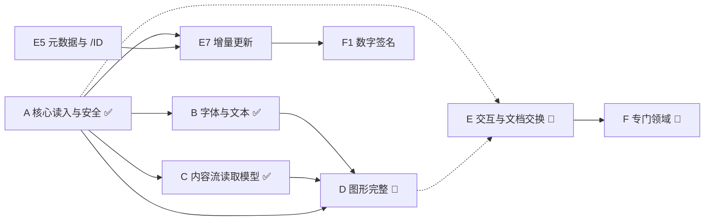

# 阶段依赖与映射
> 规划层｜职责：阶段先后依赖与历史阶段编号映射。｜禁止：测试名、统计数字、历史叙述。

## 阶段依赖图

实线表示阶段完成顺序，虚线表示 E 阶段的 E1/E3/E5 等增量只依赖 A、可在 D 完成前启动（逐增量依赖以各阶段正文为准）。依赖构成无环 DAG：A → B/C → D → E → F；B 与 C 可并行；E7 是 F1 的额外前置。

## 阶段映射（旧 → 新）

| 旧规划 | 新规划 | 说明 |
|---|---|---|
| 阶段 A 读得全 ✅ | 阶段 A 核心读入与安全 🚧 | 收窄完成口径；JBIG2/JPX/图像字典/内容流读端移出；评审后回退为 🚧 并补 A6 fixture 回归 |
| 阶段 B 文本可用 🚧 | 阶段 B 字体与文本 ✅ | 条目合并为 7 个增量；B1–B7 已全部完成；B6 经 B6.1–B6.5 收口（编码类 CMap 160 个文件全量 vendored、ToUnicode 基座名册 47 个），裸 ordering 仍为紧凑近似（矩阵 9.7.5 已登记边界） |
| 阶段 C 图形完整 🚧 | 阶段 C 内容流读取模型 ⬜ + 阶段 D 图形完整 🚧 | 拆出跨章节前置的读端内容流模型 |
| 阶段 D 交互与交换 ⬜ | 阶段 E 交互与文档交换 ⬜ | 顺延；新增 E7 增量更新 |
| 阶段 E 专门领域 ⬜ | 阶段 F 专门领域 ⬜ | 顺延；签名/线性化等重新分组 |
